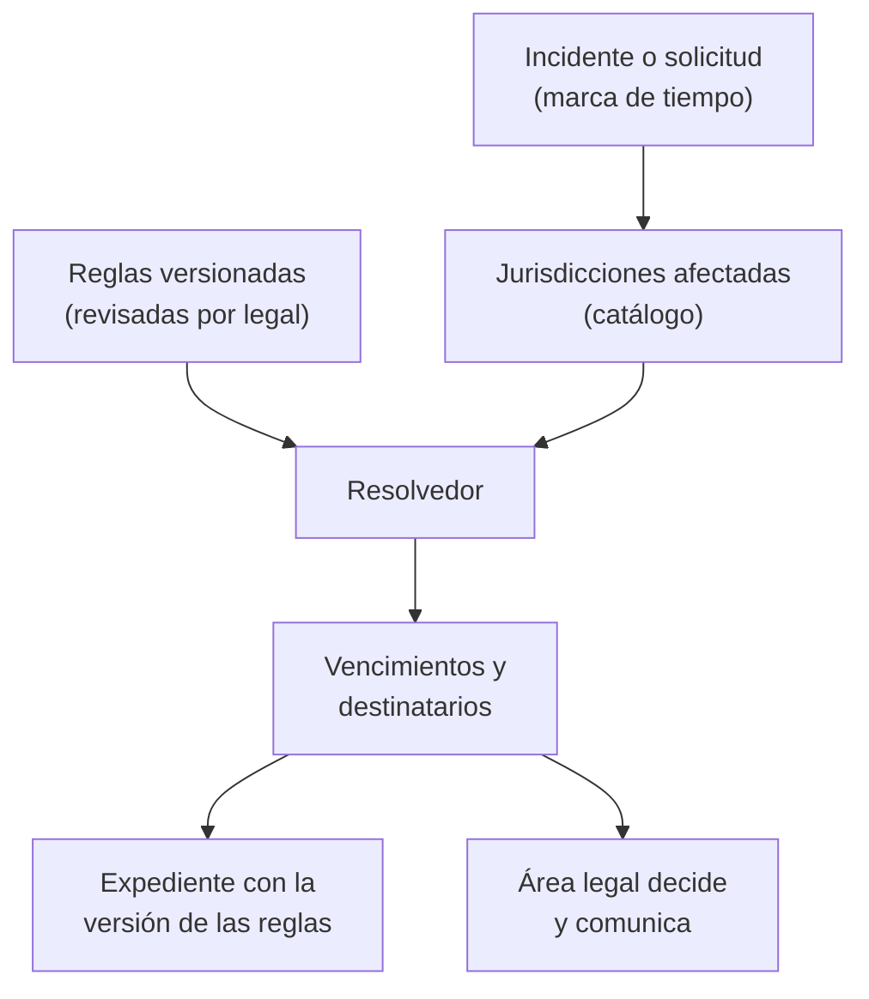

## 1. Resumen

Esta ficha no es asesoría legal: explica qué cambia en una plataforma de datos cuando también trata datos de personas en la Unión Europea. Si el RGPD aplica, qué base corresponde o qué mecanismo usar lo decide el área legal.

**Pregunta guía:** una plataforma chilena que trata datos de residentes de la UE, ¿qué tiene que hacer distinto? Ingeniería no necesita otra plataforma: necesita saber qué datos, productos y flujos quedan bajo el RGPD, tener sus plazos y destinatarios como **configuración versionada por jurisdicción** y producir evidencia que sirva a las dos normas.

**Cómo leerla.** *Comprender* (§1–6): cuándo alcanza el RGPD a una empresa chilena y en qué difiere de la Ley 21.719. *Aplicar* (§7–13): reglas por jurisdicción y residencia en las tres nubes. *Demostrar*: la evidencia del §8, el resolvedor del §10 y los criterios del §18.

Las citas del RGPD vienen de su versión oficial en español (BOE, reproducción del DOUE); no necesitan traducción.

## 2. Qué es

- **[Obligación legal · GDPR art. 3]** El Reglamento (UE) 2016/679 «se aplica al tratamiento de datos personales de interesados que residan en la Unión por parte de un responsable o encargado no establecido en la Unión», cuando el tratamiento se relaciona con «la oferta de bienes o servicios a dichos interesados en la Unión, independientemente de si a estos se les requiere su pago», o con «el control de su comportamiento, en la medida en que este tenga lugar en la Unión».
- **[Obligación legal · GDPR art. 27]** En ese caso, el responsable o encargado designa por escrito un representante en la Unión, con las excepciones del propio artículo.
- **[Obligación legal · Ley 19.628, art. 1 bis]** La ley chilena alcanza a quien, desde fuera de Chile, ofrece bienes o servicios a titulares «que se encuentren en Chile» o monitorea su comportamiento. **[Buena práctica]** Es otro criterio: Chile mira dónde se encuentra el titular; el art. 3.2 del RGPD, a los interesados que residan en la Unión.
- **[Buena práctica]** Que un dato esté guardado en Chile no saca el tratamiento del RGPD, y que esté en una región europea no lo pone bajo él: decide la relación con las personas (oferta o seguimiento), no la ubicación del servidor.
- **[Buena práctica]** Comparación en lo que impacta a ingeniería. Cada fila lleva la etiqueta del RGPD; la columna chilena se etiqueta en el §4 y la brasileña en la ficha `lgpd`.

| Tema | Ley 21.719 (Chile) | RGPD (UE) | LGPD (Brasil) |
|---|---|---|---|
| **[Obligación legal · GDPR art. 6]** Bases de licitud | Consentimiento (art. 12) y casos sin consentimiento (art. 13) | «al menos una de las siguientes condiciones» del art. 6.1 | Hipótesis del art. 7 |
| **[Obligación legal · GDPR art. 12]** Plazo de respuesta a una solicitud | 30 días corridos, prorrogable una vez por igual período (art. 11) | Un mes, prorrogable otros dos meses (art. 12.3) | 15 días para la declaración completa (art. 19, II) |
| **[Obligación legal · GDPR art. 30]** Registro de actividades | Política de tratamiento disponible (art. 14 ter) | Registro de actividades, con excepción para menos de 250 personas y salvedades (art. 30) | Registro de las operaciones (art. 37) |
| **[Obligación legal · GDPR art. 35]** Evaluación de impacto | Si puede producir un alto riesgo (art. 15 ter) | Si es probable un alto riesgo (art. 35) | Relatório de impacto, si lo determina la ANPD (art. 38) |
| **[Obligación legal · GDPR art. 33]** Brecha: autoridad | Agencia, «sin dilaciones indebidas», sin plazo en horas, «cuando exista un riesgo razonable para los derechos y libertades de los titulares» (art. 14 sexies) | Autoridad de control, «sin dilación indebida y, de ser posible, a más tardar 72 horas» desde la constancia, salvo que el riesgo sea improbable (art. 33.1) | ANPD, plazo que define la autoridad (art. 48): 3 días hábiles desde que el controlador sabe que el incidente afectó datos personales, el doble para agentes de pequeño porte (Res. CD/ANPD 15/2024) |
| **[Obligación legal · GDPR art. 34]** Brecha: personas | Titulares, en los casos que indica (art. 14 sexies) | Interesados, con probable alto riesgo, sin dilación indebida (art. 34.1) | Titulares, con risco ou dano relevante (art. 48) |
| **[Obligación legal · GDPR art. 45]** Transferencias | País adecuado según la Agencia, cláusulas u otros instrumentos (arts. 27 y 28) | Decisión de adecuación (art. 45) o cláusulas tipo de la Comisión (art. 46.2 c)) | País adecuado o cláusulas-padrão (art. 33) |
| **[Obligación legal · GDPR art. 37]** Delegado | En el modelo de prevención voluntario (art. 49) | Obligatorio en los casos del art. 37.1 | Encarregado (art. 41) |
| **[Obligación legal · GDPR art. 22]** Decisiones automatizadas | Oponerse y no ser objeto de ellas (art. 8 bis) | No ser objeto de una decisión basada únicamente en el tratamiento automatizado (art. 22.1) | Pedir su revisión (art. 20) |

- **[Obligación legal · GDPR art. 46]** Sin decisión de adecuación, una vía son las «cláusulas tipo de protección de datos adoptadas por la Comisión».
- **[Buena práctica]** Las filas no son equivalencias: el mismo tema tiene otra unidad (horas, meses, días corridos o hábiles), otro destinatario u otra condición. Por eso cada regla va con su jurisdicción, su base y su fecha de revisión.

## 3. Problema que resuelve

**[Buena práctica]** Una agencia de viajes chilena vende paquetes en euros a clientes en España y Alemania y les envía ofertas según su historial. Un incidente expone reservas de clientes de los dos lados: el equipo de datos tiene que decir, en horas, cuántos titulares hay por jurisdicción, a quién se avisa y hasta cuándo. Si los plazos están escritos como `if pais == ...` en cinco servicios, cada cambio de norma obliga a buscarlos, y nadie puede mostrar qué regla se aplicó en cada fecha.

**[Obligación legal · GDPR art. 33]** El reloj europeo pide notificar sin dilación indebida y, de ser posible, en 72 horas desde la constancia, salvo que sea improbable que la violación constituya un riesgo. **[Obligación legal · Ley 19.628, art. 14 sexies]** El chileno no fija horas: pide reportar sin dilaciones indebidas cuando exista un riesgo razonable para los titulares. **[Decisión de arquitectura]** Las dos reglas viven en la misma configuración y el mismo incidente las resuelve a la vez.

## 4. Cómo funciona

1. **[Obligación legal · GDPR art. 3]** Determinar el alcance: qué productos ofrecen bienes o servicios a personas en la UE o siguen su comportamiento. **[Decisión de arquitectura]** Marcar esos productos y datasets con la jurisdicción en el catálogo.
2. **[Obligación legal · GDPR art. 30]** Llevar el registro de actividades. **[Obligación legal · Ley 19.628, art. 14 ter]** Del mismo inventario sale la política chilena. **[Decisión de arquitectura]** Un inventario con columnas por jurisdicción, no dos.
3. **[Obligación legal · GDPR art. 6]** Registrar la base de cada actividad bajo el RGPD. **[Obligación legal · Ley 19.628, art. 12]** Y bajo la ley chilena, con consentimiento o **[Obligación legal · Ley 19.628, art. 13]** en los casos sin consentimiento: las bases no coinciden una a una.
4. **[Obligación legal · GDPR art. 12]** Calcular el plazo de respuesta a cada solicitud según la jurisdicción del titular: un mes en la UE; **[Obligación legal · Ley 19.628, art. 11]** treinta días corridos en Chile.
5. **[Obligación legal · GDPR art. 35]** Evaluación de impacto antes de un tratamiento probablemente de alto riesgo. **[Obligación legal · Ley 19.628, art. 15 ter]** La ley chilena la pide en un supuesto parecido. **[Decisión de arquitectura]** Una sola evaluación con secciones por jurisdicción.
6. **[Obligación legal · GDPR art. 34]** Ante una brecha, calcular el alcance por jurisdicción y por titular para decidir las comunicaciones.
7. **[Obligación legal · GDPR art. 45]** Cada flujo que sale de la UE necesita adecuación o una garantía. **[Obligación legal · Ley 19.628, art. 27]** Cada flujo que sale de Chile, uno de los casos de la ley chilena, **[Obligación legal · Ley 19.628, art. 28]** con la adecuación que determine la Agencia.
8. **[Obligación legal · GDPR art. 22]** Los modelos que deciden sobre personas en la UE tienen una ruta de intervención humana. **[Obligación legal · Ley 19.628, art. 8 bis]** La misma ruta sirve a la ley chilena.
9. **[Obligación legal · GDPR art. 37]** Si el caso lo exige, el delegado de protección de datos recibe las alertas. **[Obligación legal · Ley 19.628, art. 49]** En Chile, el delegado forma parte del modelo de prevención de infracciones, que es voluntario.
10. **[Decisión de arquitectura]** Las reglas (plazo, unidad, prórroga, destinatario, condición, base) son un archivo versionado que revisa el área legal; el código solo lo interpreta.

## 5. Cuándo utilizarlo

- Al vender, ofrecer o enviar comunicaciones a personas en la UE, o al analizar su comportamiento en la Unión.
- Al recibir datos de una filial, un socio o un proveedor europeo.
- Al diseñar el runbook de incidentes, el pipeline de derechos o el inventario de una plataforma con clientes en varias jurisdicciones.

## 6. Cuándo no utilizarlo

- Para decidir si el RGPD aplica a un producto, qué base corresponde o si hay que designar representante o delegado: el área legal.
- Para resumir el RGPD completo: esta ficha cubre lo que impacta a ingeniería; sus capítulos sobre autoridades, sanciones y cooperación quedan fuera.
- Para tratar como iguales la Ley 21.719 y el RGPD: tienen plazos, unidades y destinatarios distintos.

## 7. Ejemplo sencillo

Una solicitud de acceso que llega el viernes 4 de diciembre de 2026, con fechas calculadas por el §10:

| Titular | Regla | Vence | Prórroga máxima |
|---|---|---|---|
| Cliente en Chile | 30 días corridos (art. 11) | 2027-01-03 | 2027-02-02 |
| Cliente en España | Un mes (art. 12.3) | 2027-01-04 | 2027-03-04 |
| Cliente en Brasil | 15 días (art. 19, II), días corridos como interpretación ilustrativa | 2026-12-19 | — |

## 8. Ejemplo de producción

Escenario genérico: la plataforma de datos de una agencia de viajes con clientes en Chile, la UE y Brasil.

| Control | Implementación posible | Qué demuestra y qué no |
|---|---|---|
| Jurisdicción en el catálogo | Etiqueta `jurisdiction` en productos y datasets, derivada del país de oferta o seguimiento | Qué datos se declararon bajo cada norma; no que la etiqueta sea correcta |
| Reglas versionadas | `rules/privacy-deadlines.yaml` revisado por el área legal, con versión y fecha | Qué regla estaba vigente en cada fecha; no que la interpretación sea la correcta |
| Reloj de incidentes | El runbook guarda la marca de tiempo de la constancia y llama al resolvedor | Qué vencimientos se calcularon; no que se haya notificado a tiempo |
| Residencia | Políticas de ubicación por proyecto o cuenta para los datos de la UE | Dónde se crean los recursos; no desde dónde accede el soporte |
| Flujos al exterior | Inventario de flujos con el mecanismo de cada origen | Qué mecanismo se declaró; no que el contrato esté firmado |

### Evidencia de cumplimiento

| Evidencia | Dónde queda | Quién la produce | Qué demuestra | Qué no demuestra |
|---|---|---|---|---|
| Archivo de reglas con historial | Repositorio | Área legal e ingeniería | Plazo, unidad y destinatario de cada jurisdicción en cada versión | Que la norma no haya cambiado después |
| Salida del resolvedor por incidente | Expediente del incidente | Runbook | Los vencimientos y destinatarios calculados con la versión usada | Que se haya notificado ni que el análisis de riesgo sea correcto |
| Inventario con jurisdicción y base | Catálogo | Ingeniería y área legal | Qué actividades están bajo cada norma y con qué base | Tratamientos no declarados |
| Políticas de ubicación | Configuración como código | Plataforma | Dónde se permiten recursos nuevos | Recursos anteriores, metadatos ni accesos remotos |

## 9. Arquitectura



El resolvedor calcula fechas; no decide si hay riesgo ni si la comunicación procede.

## 10. Código

```python
# Python 3.12+, biblioteca estándar. Resolvedor de plazos y destinatarios por jurisdicción (CL, UE, BR) para un
# incidente o una solicitud de acceso. Las reglas son configuración versionada: un cambio de norma o de reglamento es
# un cambio de datos revisado por el área legal, no un `if` nuevo en el código. Ilustrativo: no es asesoría legal.
from __future__ import annotations

import calendar
import datetime as dt
from dataclasses import dataclass
from typing import Literal

Event = Literal["breach", "access_request"]
Unit = Literal["hours", "days", "business_days", "months", "undue_delay"]


@dataclass(frozen=True)
class Rule:
    jurisdiction: str
    event: Event
    recipient: str
    amount: int
    unit: Unit
    basis: str
    literal: bool                # True: el plazo es literal de la norma; False: interpretación ilustrativa
    extension: int = 0           # prórroga máxima, en la misma unidad
    condition: str = ""          # cuándo aplica (lo decide el área legal, no el código)


RULES_VERSION = "2026-10-30"     # revisada contra BCN, BOE (DOUE), Câmara y ANPD ese día
RULES: tuple[Rule, ...] = (
    Rule("CL", "breach", "Agencia de Protección de Datos Personales", 0, "undue_delay", "Ley 19.628, art. 14 sexies", True,
         condition="hay riesgo razonable para los titulares"),
    Rule("CL", "breach", "titulares", 0, "undue_delay", "Ley 19.628, art. 14 sexies", True,
         condition="hay datos sensibles, de menores de 14 o de obligaciones económicas"),
    Rule("EU", "breach", "autoridad de control", 72, "hours", "GDPR art. 33.1", True,
         condition="hay riesgo para los derechos (salvo que sea improbable)"),
    Rule("EU", "breach", "interesados", 0, "undue_delay", "GDPR art. 34.1", True, condition="hay alto riesgo"),
    Rule("BR", "breach", "ANPD", 3, "business_days", "LGPD art. 48; Res. CD/ANPD 15/2024, arts. 6 y 9", False,
         condition="hay risco ou dano relevante (días hábiles sin feriados)"),
    Rule("BR", "breach", "titulares", 3, "business_days", "LGPD art. 48; Res. CD/ANPD 15/2024, arts. 6 y 9", False,
         condition="hay risco ou dano relevante (días hábiles sin feriados)"),
    Rule("CL", "access_request", "titular", 30, "days", "Ley 19.628, art. 11", True, extension=30),
    Rule("EU", "access_request", "interesado", 1, "months", "GDPR art. 12.3", True, extension=2),
    Rule("BR", "access_request", "titular", 15, "days", "LGPD art. 19, II", False,
         condition="se pide la declaración completa (días corridos)"),
)


def add_months(start: dt.datetime, months: int) -> dt.datetime:
    month = start.month - 1 + months
    year, month = start.year + month // 12, month % 12 + 1
    return start.replace(year=year, month=month, day=min(start.day, calendar.monthrange(year, month)[1]))


def add_business_days(start: dt.datetime, days: int) -> dt.datetime:
    current = start
    while days:
        current += dt.timedelta(days=1)
        if current.weekday() < 5:   # sin feriados: un calendario real es otra configuración por jurisdicción
            days -= 1
    return current


def due(start: dt.datetime, amount: int, unit: Unit) -> dt.datetime | None:
    match unit:
        case "hours":
            return start + dt.timedelta(hours=amount)
        case "days":
            return start + dt.timedelta(days=amount)
        case "business_days":
            return add_business_days(start, amount)
        case "months":
            return add_months(start, amount)
        case "undue_delay":
            return None   # sin plazo fijo: «sin dilación indebida»; se fija un objetivo interno aparte


def resolve(event: Event, jurisdictions: set[str], start: dt.datetime) -> list[str]:
    lines = []
    for code in sorted(jurisdictions):
        rules = [r for r in RULES if r.jurisdiction == code and r.event == event]
        if not rules:
            lines.append(f"{code}: sin regla configurada → revisar con el área legal antes de operar")
        for r in rules:
            when = due(start, r.amount, r.unit)
            text = when.isoformat(timespec="minutes") if when else "sin dilación indebida (sin plazo fijo)"
            if r.extension and when:
                extended = due(when, r.extension, r.unit)
                assert extended is not None
                text += f" (prórroga hasta {extended.date().isoformat()})"
            mark = "" if r.literal else " [ilustrativo]"
            cond = f" si {r.condition}" if r.condition else ""
            lines.append(f"{code} → {r.recipient}: {text}{cond} · {r.basis}{mark}")
    return lines


known = dt.datetime(2026, 12, 4, 10, 0, tzinfo=dt.UTC)   # viernes: constancia del incidente
print(f"reglas versión {RULES_VERSION}")
for line in resolve("breach", {"CL", "EU", "BR"}, known):
    print(line)
received = dt.datetime(2026, 12, 4, 10, 0, tzinfo=dt.UTC)
for line in resolve("access_request", {"CL", "EU", "BR", "AR"}, received):
    print(line)
```

Salida:

```text
reglas versión 2026-10-30
BR → ANPD: 2026-12-09T10:00+00:00 si hay risco ou dano relevante (días hábiles sin feriados) · LGPD art. 48; Res. CD/ANPD 15/2024, arts. 6 y 9 [ilustrativo]
BR → titulares: 2026-12-09T10:00+00:00 si hay risco ou dano relevante (días hábiles sin feriados) · LGPD art. 48; Res. CD/ANPD 15/2024, arts. 6 y 9 [ilustrativo]
CL → Agencia de Protección de Datos Personales: sin dilación indebida (sin plazo fijo) si hay riesgo razonable para los titulares · Ley 19.628, art. 14 sexies
CL → titulares: sin dilación indebida (sin plazo fijo) si hay datos sensibles, de menores de 14 o de obligaciones económicas · Ley 19.628, art. 14 sexies
EU → autoridad de control: 2026-12-07T10:00+00:00 si hay riesgo para los derechos (salvo que sea improbable) · GDPR art. 33.1
EU → interesados: sin dilación indebida (sin plazo fijo) si hay alto riesgo · GDPR art. 34.1
AR: sin regla configurada → revisar con el área legal antes de operar
BR → titular: 2026-12-19T10:00+00:00 si se pide la declaración completa (días corridos) · LGPD art. 19, II [ilustrativo]
CL → titular: 2027-01-03T10:00+00:00 (prórroga hasta 2027-02-02) · Ley 19.628, art. 11
EU → interesado: 2027-01-04T10:00+00:00 (prórroga hasta 2027-03-04) · GDPR art. 12.3
```

Limitaciones: los días hábiles no descuentan feriados; los 3 días hábiles brasileños corren desde que el controlador sabe que el incidente afectó datos personales (Res. CD/ANPD 15/2024, art. 6 § 1º y art. 9), y el ejemplo usa esa misma marca de tiempo; «un mes» se suma como mes calendario; el plazo brasileño de solicitudes se toma en días corridos y su inicio, como la fecha del requerimiento. Las reglas marcadas `[ilustrativo]` no son literales de la norma en su unidad o su conteo. Una jurisdicción sin regla no se resuelve por defecto: se informa.

## 11. GCP

| Necesidad | Servicio y alcance | Lo que no cubre |
|---|---|---|
| Recursos de datos de la UE solo en la UE | Organization Policy con el grupo `in:eu-locations` («All locations within European Union») | Recursos creados antes de la política |
| Compromiso de residencia | Assured Workloads, *Data residency*: si la región es de la UE, el Customer Data en uso se procesa dentro de la UE | «Customer Data does not include resource identifiers, attributes, or other data labels»: nombres de recursos y etiquetas no van con datos personales |

## 12. AWS

| Necesidad | Servicio y alcance | Lo que no cubre |
|---|---|---|
| Regiones con geografía en la UE | eu-central-1 (Germany), eu-west-1 (Ireland), eu-west-3 (France), eu-north-1 (Sweden); eu-south-1 (Italy) y eu-south-2 (Spain) requieren habilitarse | `eu-west-2` es United Kingdom y `eu-central-2` es Switzerland: el prefijo `eu-` no equivale a la UE |
| Limitar regiones | Condición `aws:RequestedRegion` en políticas | Controla el endpoint invocado, no los efectos entre regiones, como la replicación de S3; las llamadas a IAM van siempre a `us-east-1`, así que negar toda región fuera de la UE bloquea IAM |

## 13. Azure

| Necesidad | Servicio y alcance | Lo que no cubre |
|---|---|---|
| Compromiso de almacenar y procesar en la UE y la EFTA | EU Data Boundary: los servicios regionales de Azure en una región de la frontera quedan dentro | «subject to limited circumstances» en que siguen transfiriéndose datos fuera; los servicios no regionales requieren su configuración |
| Limitar ubicaciones | Azure Policy «Allowed locations» | Resource groups, `Microsoft.AzureActiveDirectory/b2cDirectories` y recursos de la región «global» |

## 14. Buenas prácticas

- **[Decisión de arquitectura]** Una regla por jurisdicción y evento, en datos versionados; nunca un `if` con el país en el código de los servicios.
- **[Buena práctica]** Guardar con cada cálculo la versión de las reglas usada, para reconstruir después qué se sabía.
- **[Buena práctica]** Separar la marca de tiempo de la constancia de la del incidente: el RGPD cuenta desde la constancia.
- **[Buena práctica]** Una jurisdicción sin regla bloquea y avisa; no hereda la regla de otra.
- **[Obligación legal · GDPR art. 37]** Si hay delegado, recibe las alertas del resolvedor. **[Buena práctica]** Registrar a quién se envió cada alerta.
- **[Buena práctica]** **Seguridad:** solo el área legal y los dueños de la plataforma aprueban cambios en el archivo de reglas, con revisión obligatoria en el repositorio.
- **[Buena práctica]** **Observabilidad:** alertar cuando un dataset con jurisdicción `EU` aparece en una región fuera de la política o cuando un incidente supera la mitad de su plazo sin cierre.
- **[Buena práctica]** **Costo:** residir en la UE solo los datos que lo necesitan; duplicar toda la plataforma por jurisdicción multiplica la infraestructura.

## 15. Errores frecuentes

| Error | Consecuencia |
|---|---|
| Suponer que una región europea pone el tratamiento bajo el RGPD, o que una región chilena lo saca | Alcance mal calculado en el inventario y en los incidentes |
| Usar `eu-` como sinónimo de UE en AWS | Datos en Reino Unido o Suiza tratados como si estuvieran en la UE |
| Copiar el plazo de una norma a otra | Vencimientos en otra unidad (horas, meses, días corridos o hábiles) |
| Contar las 72 horas desde el incidente y no desde la constancia, o al revés sin registrar ambas | No se puede mostrar cuándo empezó el reloj |
| Plazos escritos en el código de cada servicio | Un cambio de norma exige buscar y desplegar en todos |

## 16. Trade-offs

| Opción | Gana | Cuesta |
|---|---|---|
| Reglas como configuración versionada | Cambios auditables y sin despliegue de código | Un proceso de revisión del archivo con el área legal |
| Residencia en la UE para todo dato europeo | Menos flujos que justificar | Duplicar infraestructura y latencia para el resto |
| Un inventario con columnas por jurisdicción | Una sola fuente para registro y política | Más campos obligatorios por actividad |

## 17. Conceptos relacionados

- `chile-data-protection`: ficha padre.
- `lgpd`: el otro marco comparado del tramo.
- `processors-and-international-transfers`: mecanismo por flujo y políticas de región.
- `data-breach-response`: el reporte chileno junto al reloj europeo.
- `data-subject-rights-pipeline`: plazos de respuesta por jurisdicción.
- `processing-activities-inventory`: base del registro de actividades.
- `dpia-and-automated-decisions`: evaluación de impacto y decisiones automatizadas.

## 18. Preguntas técnicas abiertas

1. ¿Qué productos de tu plataforma ofrecen bienes o servicios a personas en la UE o siguen su comportamiento?
2. ¿Dónde están hoy los plazos de respuesta y de incidentes: en datos o en código?
3. ¿Qué regiones de tu nube tienen datos de la UE, y cuáles tienen prefijo europeo sin estar en la UE?
4. ¿Qué flujos salen de la UE, y con qué mecanismo?

**Criterio de dominio:** dominas esta ficha si, ante un incidente o una solicitud, puedes decir qué jurisdicciones aplican y por qué, qué regla de qué versión se usó, cuándo vence cada plazo y quién es el destinatario, y qué parte de esa respuesta es cálculo y qué parte es decisión del área legal.

## 19. Laboratorio relacionado

Propuesta para F4: el archivo de reglas del §10 como YAML, cargado por el resolvedor; simular un incidente con titulares de Chile, la UE y Brasil, cambiar una regla en una rama y comprobar que la CI muestra la diferencia de vencimientos. Sin datos personales reales.

## 20. Fuentes

- BOE: *Documento DOUE-L-2016-80807* (Reglamento (UE) 2016/679, texto original en español).
- BCN Ley Chile: *Ley 19628 SOBRE PROTECCION DE LOS DATOS PERSONALES* (versión con vigencia diferida desde 2026-12-01).
- Câmara dos Deputados: *LEI Nº 13.709, DE 14 DE AGOSTO DE 2018* (texto actualizado).
- Comisión Europea: *Adequacy decisions*.
- Google Cloud: *Restrict resource locations*; *Data residency*.
- AWS: *AWS Regions*; *AWS global condition context keys*.
- Microsoft Learn: *What is the EU Data Boundary?*; *List of built-in policy definitions*.

El detalle de cada fuente está en `sources` del frontmatter.

## 21. Fecha de última verificación

2026-10-30: RGPD (BOE, reproducción del DOUE; EUR-Lex no respondió a la lectura automática), Ley 19.628 en BCN, LGPD en la Câmara, lista de adecuación de la Comisión y páginas de GCP, AWS y Microsoft consultadas ese día. `review_required`: pasa a `verified` solo con la aprobación explícita de Felipe (`owner_approved_at`). Revisión mensual.

## 22. Historial de cambios importantes

- 2026-10-30: creación (lote P4), en el tramo 6 «Marcos regulatorios comparados», después de la Enmienda 5 de ADR-023 (jurisdicción EU y etiquetas «GDPR art. N»).
- 2026-10-30: la Enmienda de jurisdicciones pasa a ser la Enmienda 5 de ADR-023; cita de la Res. CD/ANPD 15/2024 (art. 6 § 1º y art. 9) sobre el inicio del plazo brasileño.
- 2026-10-30: Enmienda 4 de ADR-023: 4 tabla(s) sin columna ni línea «Etiqueta»; la fila con origen legal lleva «Obligación legal» al inicio de su primera celda. Sin cambios de contenido.
- 2026-10-30: revisión `docs/reviews/p4.md` aplicada (hallazgos legales tratados como altos): art. 3.2 con «interesados que residan en la Unión» y la frase del pago; art. 1 bis como presencia en Chile, en frase aparte; art. 33.1 con «sin dilación indebida», «de ser posible» y la salvedad del riesgo improbable; art. 14 sexies con el riesgo razonable; inicio y doble plazo de la ANPD; Comisión con Noruega, Liechtenstein e Islandia; IAM siempre en us-east-1; `page_title` de Azure Policy con su H1 y exclusión de b2cDirectories.
