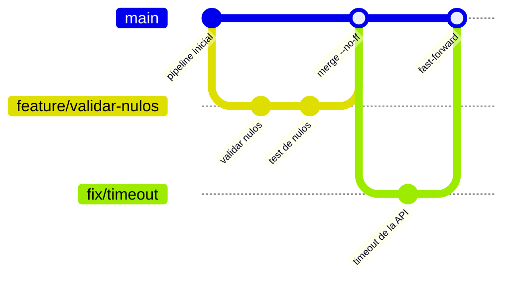

## 1. Resumen

Una estrategia de branching decide qué ramas viven mucho, cuáles son cortas y cómo se integran. Las fuentes describen tres familias:

- **Ramas de tema cortas sobre una rama principal.** Pro Git las define como «a short-lived branch that you create and use for a single particular feature or related work». GitHub flow es esta idea con pull requests: rama, cambios, pull request, revisión, merge y borrar la rama.
- **Ramas de larga vida por etapa o por versión.** Pro Git muestra una rama estable y otra de desarrollo; la guía de GitLab, ramas de release de larga vida cuando hay varias versiones en producción.
- **Una rama por entorno.** Según GitLab, común con varios servicios interdependientes de distintos equipos.

La guía de GitLab lo dice directo: ninguna estrategia cubre todos los casos.

## 2. Qué es

- **Rama de tema (topic branch):** corta, para un cambio; se fusiona y se borra.
- **Rama de larga vida:** abierta siempre, para una etapa (estable, desarrollo) o una versión.
- **Merge con fast-forward:** solo mueve el puntero de la rama; no crea merge commit (`--ff`, el comportamiento por defecto cuando se puede).
- **Merge commit:** `--no-ff` lo crea siempre, aunque se pudiera hacer fast-forward.
- **`--ff-only`:** integra solo si es fast-forward; si no, rechaza el merge.
- **Rebase:** reescribe los commits de una rama sobre otra; crea commits nuevos.

## 3. Problema que resuelve

En un repositorio de datos conviven DAGs, modelos SQL, jobs y Terraform. Sin una convención:

- se trabaja directo sobre la rama de producción;
- las ramas viven semanas y el merge final es un conflicto grande;
- nadie sabe qué versión corre en cada entorno.

## 4. Cómo funciona

GitHub flow, paso a paso:

1. Se crea una rama con nombre corto y descriptivo (`feature/validar-nulos`) desde la rama por defecto.
2. Se hacen commits en la rama, sin afectar la rama por defecto.
3. Se abre un pull request y se revisa.
4. Se integra (merge, squash o rebase, según el repositorio).
5. Se borra la rama: según la página, indica que el trabajo terminó y evita usar ramas viejas por error.

Con ramas de release de larga vida (GitLab), las versiones anteriores reciben solo hotfixes y releases de seguridad, mientras main recibe las funcionalidades.

## 5. Cuándo utilizarlo

- **Ramas de tema sobre main:** un servicio o una plataforma con una sola versión en producción. Es el caso de «web services» de la guía de GitLab.
- **Ramas de release de larga vida:** cuando hay que mantener varias versiones a la vez, como una librería de ingesta que usan equipos con versiones distintas.
- **Rama por entorno:** cuando un release candidate pasa por entornos de test y UAT antes de producción, con equipos que dependen unos de otros.

## 6. Cuándo no utilizarlo

- Ramas de larga vida si hay una sola versión en producción: agregan merges sin aportar.
- Rama por entorno para un equipo chico con un solo servicio: la guía de GitLab la ubica en organizaciones con varios servicios interdependientes de distintos equipos.
- Rebase sobre commits ya publicados: Pro Git dice «Do not rebase commits that exist outside your repository and that people may have based work on».

## 7. Ejemplo sencillo

Un analista agrega validación de nulos a un pipeline. Crea `feature/validar-nulos` desde main, hace dos commits, abre un pull request y, tras la revisión, la rama se integra y se borra. main nunca tuvo código a medio hacer.

## 8. Ejemplo de producción

Una plataforma de datos con:

- main como única rama de larga vida, protegida: solo se integra por pull request con revisión y checks verdes;
- ramas de tema cortas, de un cambio cada una;
- merge commit (`--no-ff`) para cambios con varios commits que conviene ver juntos, y fast-forward para correcciones de un commit;
- tags de versión sobre main para lo que se despliega.

Si además publica una librería con dos versiones mayores en uso, mantiene una rama `release/1.x` que solo recibe correcciones.

## 9. Arquitectura



## 10. Código

```bash
# Bash y Git (ejecutado en la CI sobre un repositorio temporal, sin remoto): una rama de tema corta que sale de
# main, se integra con un merge commit (--no-ff) y se borra; y una integración que exige fast-forward (--ff-only).
set -euo pipefail
git init -q -b main repo && cd repo
echo "v1" > pipeline.py && git add pipeline.py && git commit -q -m "pipeline inicial"

# Rama de tema: un cambio acotado, integrado con merge commit para que la historia muestre la rama.
git switch -q -c feature/validar-nulos
echo "valida nulos" >> pipeline.py && git commit -q -am "validar nulos en la carga"
echo "test de nulos" > test_pipeline.py && git add test_pipeline.py && git commit -q -m "test de nulos"
git switch -q main
git merge -q --no-ff feature/validar-nulos -m "merge feature/validar-nulos"
git branch -d feature/validar-nulos

# Otra rama que se integra solo si main no avanzó: --ff-only rechaza el merge si no es fast-forward.
git switch -q -c fix/timeout
echo "timeout=30" >> pipeline.py && git commit -q -am "timeout de la API"
git switch -q main
git merge -q --ff-only fix/timeout
git branch -d fix/timeout

git log --oneline --graph --format="%s"
```

El script se **ejecuta en la CI** (pytest, sobre un repositorio temporal, sin remoto) y el test comprueba la historia: el merge de la rama de tema tiene dos padres y las ramas quedan borradas. Muestra `--no-ff` y `--ff-only` como los describe la página de `git-merge`.

## 11. GCP

No aplica de forma específica: las estrategias de branching son de Git. En GCP, el repositorio administrado es Secure Source Manager. Las diferencias, según sus páginas:

| | Git (Pro Git, GitHub, GitLab) | Secure Source Manager |
|---|---|---|
| Ramas e integración | Ramas de tema, de larga vida o por entorno; merge con o sin fast-forward | Repositorios con los comandos del cliente Git y pull requests integrados |
| Proteger una rama | GitHub y GitLab: ramas protegidas | Reglas de protección: exigir pull request antes del merge y número de revisores y aprobadores |

## 12. AWS

No aplica de forma específica. En AWS, el repositorio administrado es CodeCommit. Las diferencias, según sus páginas:

| | Git (Pro Git, GitHub, GitLab) | AWS CodeCommit |
|---|---|---|
| Ramas e integración | Las mismas estrategias | Repositorios Git privados; comandos de Git y de AWS CLI |
| Revisión antes del merge | Pull request (GitHub) o merge request (GitLab) | Pull requests para revisar y comentar antes del merge a una rama |

## 13. Azure

**Azure Repos** (Azure DevOps) aloja repositorios Git. Sus políticas de rama protegen ramas importantes exigiendo pull requests, revisores, builds y otros checks antes del merge; con políticas requeridas, todo cambio pasa por pull request (*Set and manage branch policies*).

## 14. Buenas prácticas

- Ramas de tema cortas y de un cambio; borrarlas después del merge.
- Una sola rama de larga vida salvo que haya varias versiones que mantener.
- Proteger la rama principal: integrar solo por pull request.
- No reescribir con rebase commits ya publicados.
- **Seguridad:** la rama principal protegida evita que un push directo llegue a producción sin revisión.
- **Observabilidad:** la historia con merge commits deja ver qué rama trajo cada cambio; con fast-forward, la historia queda lineal.
- **Costo:** cada rama de larga vida suma merges y conflictos que alguien resuelve a mano.

## 15. Errores frecuentes

- Ramas de tema que viven semanas y terminan en un merge enorme.
- Trabajar directo sobre main.
- Hacer rebase de una rama que otros ya bajaron.
- Copiar git-flow con ramas de larga vida para un equipo con un solo servicio.

## 16. Trade-offs

Las ramas de larga vida dan aislamiento por versión o por entorno a cambio de merges frecuentes y de saber qué cambio está en cada rama. Las ramas de tema cortas simplifican la integración, pero exigen que main esté siempre en un estado que se pueda desplegar. El merge commit conserva la forma de la historia; el fast-forward y el rebase la dejan lineal, y el rebase reescribe commits.

## 17. Conceptos relacionados

- `pull-requests`: cómo se integra cada rama.
- `git-tags-and-releases`: las versiones sobre main o sobre una rama de release.
- `ci-cd-pipelines`: el pipeline que corre en cada push y pull request.

## 18. Preguntas técnicas abiertas

1. ¿Cuántas versiones de tu código tienen que estar vivas a la vez?
2. ¿Cuánto vive en promedio una rama de tema en tu equipo?
3. ¿Qué perderías si integraras todo con fast-forward?

## 19. Laboratorio relacionado

Pendiente (F4).

## 20. Fuentes

- Git: *Pro Git* (*Branching Workflows* y *Rebasing*) y la referencia de `git-merge`.
- GitHub Docs: *GitHub flow*. GitLab Docs: *Branching strategies*.
- Google Cloud: *Secure Source Manager overview*. AWS: *What is AWS CodeCommit?*. Microsoft Learn: *Set and manage branch policies*.

El detalle de cada fuente está en `sources` del frontmatter.

## 21. Fecha de última verificación

2026-10-14. `review_required`: pendiente de revisión B-F3.1 del lote F3b-11a.

## 22. Historial de cambios importantes

- 2026-10-14: creación (lote F3b-11a).
