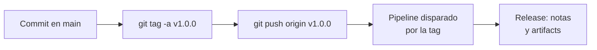

## 1. Resumen

Una **tag** de Git le pone nombre a un commit. Hay dos tipos:

- **anotada:** un objeto con autor, fecha y mensaje. La referencia de `git-tag` dice que son «meant for release»;
- **ligera:** solo un nombre para el commit, para marcas privadas o temporales.

Un **release** se construye sobre una tag. En GitHub es una iteración desplegable con notas y binarios; en GitLab, un snapshot del proyecto con evidencia para auditoría.

Tres detalles que conviene saber:

- `git push` no transfiere tags si no se pide;
- `git describe` usa solo las anotadas por defecto;
- una tag publicada no se mueve: según `git-tag`, lo sensato es usar otro nombre.

## 2. Qué es

- **Tag anotada:** `git tag -a v1.0.0 -m "…"`; objeto propio, con firma opcional.
- **Tag ligera:** `git tag nombre`; apunta directo al commit.
- **`git describe`:** nombra un commit por la tag más reciente alcanzable, más los commits encima y el hash abreviado (`v1.0.0-2-g<hash>`).
- **Release:** versión publicada sobre una tag, con notas y archivos.

## 3. Problema que resuelve

Sin tags, «la versión que corre en producción» es un hash que nadie recuerda. Con una tag anotada por versión, se puede saber qué commit se desplegó, comparar versiones y volver a construir exactamente esa versión.

## 4. Cómo funciona

1. Al cerrar una versión, se crea una tag anotada sobre el commit de main.
2. Se empuja explícitamente: `git push origin v1.0.0`.
3. El push de la tag dispara un pipeline (GitHub Actions con `on: push: tags`, un trigger «Push new tag» de Cloud Build, un filtro de tags en CodePipeline o Azure Pipelines).
4. El pipeline construye, prueba y crea el release con sus notas y artifacts.

## 5. Cuándo utilizarlo

- Tags anotadas para toda versión que se despliega o se publica.
- Tags ligeras para marcas locales («probado en mi máquina»).
- Releases cuando otros consumen la versión: una librería de ingesta, un paquete de DAGs.

## 6. Cuándo no utilizarlo

- Re-taggear una versión ya publicada: crear `v1.0.1`.
- Tags ligeras para versiones: `git describe` no las ve por defecto.
- Un release como única copia del binario: el pipeline debería poder reconstruirlo desde la tag.

## 7. Ejemplo sencillo

El job de ventas se publica como `v1.0.0` (tag anotada). Dos commits después, `git describe` devuelve `v1.0.0-2-g<hash>`: dos commits encima de la versión 1.0.0.

## 8. Ejemplo de producción

Una plataforma publica su librería de conectores:

- cada versión es una tag anotada `vX.Y.Z` sobre main;
- el push de la tag dispara un workflow que crea el release con notas generadas;
- el artifact del release se construye en el pipeline, no en la máquina de alguien;
- si una tag salió mal, se publica la siguiente versión en lugar de moverla.

## 9. Arquitectura



## 10. Código

```bash
# Bash y Git (ejecutado en la CI sobre un repositorio temporal, sin remoto): una tag anotada para la versión publicada
# y una ligera para una marca privada; git describe solo usa las anotadas, salvo con --tags.
set -euo pipefail
git init -q -b main repo && cd repo
echo "v1" > job.py && git add job.py && git commit -q -m "job v1"
git tag -a v1.0.0 -m "Versión 1.0.0 del job de ventas"   # anotada: autor, fecha y mensaje

echo "fix" >> job.py && git commit -q -am "corrige zona horaria"
git tag probado-local                                     # ligera: solo un nombre para el commit
echo "log" >> job.py && git commit -q -am "agrega logs"

git cat-file -t v1.0.0        # tag: un objeto propio
git cat-file -t probado-local # commit: apunta directo al commit
git describe                  # v1.0.0-2-g<hash>: la anotada más reciente y los commits encima
git describe --tags           # probado-local-1-g<hash>: también considera las ligeras
```

```yaml
# GitHub Actions (.github/workflows/release.yml; validado con actionlint en la CI, no ejecutado): al empujar una tag
# v*, crea el release de GitHub con notas generadas. Solo ese job tiene permiso de escritura sobre el contenido.
name: release

on:
  push:
    tags: ["v*"]

jobs:
  release:
    runs-on: ubuntu-24.04
    permissions:
      contents: write
    steps:
      - uses: actions/checkout@v7
      - name: Crear el release de la tag
        env:
          GH_TOKEN: ${{ github.token }}
          TAG: ${{ github.ref_name }}
        run: gh release create "$TAG" --title "$TAG" --generate-notes --verify-tag
```

El script de Bash se **ejecuta en la CI** (pytest, sobre un repositorio temporal, sin remoto) y el test comprueba lo que dicen las páginas de `git-tag` y `git-describe`: la tag anotada es un objeto `tag`, la ligera apunta a un `commit`, y `git describe` ignora la ligera salvo con `--tags`. El workflow se **valida con actionlint en la CI y no se ejecutó**: crea el release con `gh release create` al empujar una tag `v*`.

## 11. GCP

No aplica de forma específica: las tags son de Git. En GCP, Cloud Build puede reaccionar a ellas. Las diferencias, según sus páginas:

| | GitHub y GitLab | Cloud Build |
|---|---|---|
| Release | Sobre una tag, con notas y archivos (GitLab agrega snapshot y evidencia) | No tiene releases; construye y guarda artifacts |
| Disparo por tag | Workflow con `on: push: tags` | Trigger «Push new tag» |

## 12. AWS

No aplica de forma específica. En AWS, CodePipeline puede reaccionar a tags. Las diferencias, según sus páginas:

| | GitHub y GitLab | AWS CodePipeline |
|---|---|---|
| Release | Sobre una tag, con notas y archivos | No tiene releases; modela las etapas de la entrega |
| Disparo por tag | Workflow con `on: push: tags` | Trigger de push filtrado por tags de Git |

## 13. Azure

En **Azure Pipelines**, los triggers de CI incluyen o excluyen tags (`tags: include` / `exclude`). Si no se especifican, por defecto las tags no disparan pipelines (*Build Azure Repos Git or TFS Git repositories*).

## 14. Buenas prácticas

- Tags anotadas para versiones; empujarlas explícitamente.
- No mover una tag publicada.
- Construir el release en el pipeline, desde la tag.
- **Seguridad:** el job que crea releases es el único con permiso de escritura (`permissions: contents: write`); tags firmadas (`-s`) cuando hay que probar quién las creó.
- **Observabilidad:** `git describe` en los logs y metadatos del job dice exactamente qué versión corre.
- **Costo:** reconstruir una versión desde su tag evita guardar copias manuales de cada binario.

## 15. Errores frecuentes

- Crear la tag y olvidar empujarla.
- Mover una tag con `-f` después de publicarla.
- Usar tags ligeras para versiones y ver que `git describe` no las encuentra.
- Pipelines de Azure que esperan una tag y no la ven por no declarar el trigger.

## 16. Trade-offs

Las tags anotadas cuestan un mensaje más y dan autor, fecha y firma. Un release por versión facilita a otros el consumo, a cambio de mantener notas. Disparar el pipeline por tag separa «integrar» de «publicar», pero agrega un paso manual o automatizado para crear la tag.

## 17. Conceptos relacionados

- `git-branching-strategies`: dónde se crean las tags.
- `ci-cd-pipelines`: el pipeline que dispara la tag.
- `build-artifacts`: lo que publica el release.

## 18. Preguntas técnicas abiertas

1. ¿Cómo sabes hoy qué commit corre en producción?
2. ¿Quién debería poder crear una tag de versión?
3. ¿Qué harías si un release salió con un artifact equivocado?

## 19. Laboratorio relacionado

Pendiente (F4).

## 20. Fuentes

- Git: *Pro Git* (*Tagging*) y las referencias de `git-tag` y `git-describe`.
- GitHub Docs: *About releases* y *Workflow syntax for GitHub Actions*. GitLab Docs: *Releases*.
- Google Cloud: *Create and manage build triggers*. AWS: *Add trigger with code push or pull request event types*. Microsoft Learn: *Build Azure Repos Git or TFS Git repositories*.

El detalle de cada fuente está en `sources` del frontmatter.

## 21. Fecha de última verificación

2026-10-14. Pasa a `verified`: revisión B-F3.1 del lote F3b-11a aplicada, sin VERIFY pendientes.

## 22. Historial de cambios importantes

- 2026-10-14: creación (lote F3b-11a).
- 2026-10-14: revisión B-F3.1 del lote F3b-11a aplicada (docs/reviews/cards-f3b-11a.md): filas aprobadas sin cambios en esta ficha.
- 2026-10-14: `verification_status: verified` (sin VERIFY pendientes).
