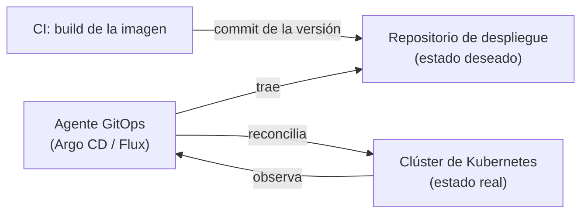

## 1. Resumen

GitOps es una forma de desplegar: lo que debe correr está **declarado en un repositorio**, y un **agente** lo aplica y lo mantiene. OpenGitOps (Nivel 4) lo resume en cuatro principios: declarativo, versionado e inmutable, traído automáticamente y reconciliado sin parar.

La diferencia con un pipeline que despliega (`kubectl apply` desde la CI) está en quién empuja. En GitOps el pipeline solo hace commit del estado deseado; el agente (Argo CD, Flux, Config Sync) lo **trae** y lo **reconcilia**. Argo CD lo dice así: los pipelines no necesitan acceso directo a su servidor, solo hacer commit y push.

En el blueprint es `modern` y de importancia baja: aplica a cargas en **Kubernetes**, como servicios de ingesta y consumidores de eventos.

## 2. Qué es

- **Estado deseado:** manifests (YAML, Helm, kustomize) en Git o, en Flux, también en artifacts OCI.
- **Agente:** controlador que trae el estado y lo aplica (Argo CD, Flux, Config Sync).
- **Reconciliación:** según Flux, asegurar que un estado coincide con el deseado declarado.
- **Prune:** borrar lo que ya no está declarado. En Argo CD está apagado por defecto, como medida de seguridad.
- **Self-heal:** corregir cambios hechos a mano en el clúster. En Argo CD también está apagado por defecto.

## 3. Problema que resuelve

Con despliegues imperativos, el clúster termina con cambios que nadie registró: un `kubectl edit` de urgencia, un recurso viejo que nadie borró. No se sabe qué debería estar corriendo. Con GitOps, el repositorio es la respuesta, y el agente acerca el clúster a ese estado una y otra vez.

## 4. Cómo funciona

1. La CI construye la imagen y hace commit de su nueva versión en el repositorio de despliegue.
2. Argo CD detecta la diferencia entre Git y el clúster.
3. Con sincronización automática, aplica los cambios.
4. Con `prune: true`, borra lo que se quitó de Git; con `selfHeal: true`, revierte cambios hechos a mano en el clúster.
5. Volver atrás es revertir el commit: el agente reconcilia hacia el estado anterior.

## 5. Cuándo utilizarlo

- Cargas de datos que corren en Kubernetes (GKE, EKS, AKS).
- Varios clústeres o entornos que deben tener la misma configuración.
- Equipos que quieren que todo cambio en producción pase por un commit revisado.

## 6. Cuándo no utilizarlo

- Servicios administrados sin Kubernetes (BigQuery, Cloud Run jobs, Glue): sin un agente que reconcilie, se usa IaC con un pipeline (ver `infrastructure-as-code`).
- Equipos chicos con un solo servicio: un pipeline que despliega es más simple.
- Activar `prune` sin entender qué borra.

## 7. Ejemplo sencillo

El estado deseado declara dos recursos: el job con la imagen `v2` y un cron. En el clúster corre el job con `v1` y un recurso viejo. La reconciliación crea el cron y actualiza el job. Con `prune`, también borra el recurso viejo. Reconciliar de nuevo no hace nada.

## 8. Ejemplo de producción

Una plataforma con consumidores de eventos en GKE:

- un repositorio de despliegue con una carpeta por servicio y entorno;
- la CI solo actualiza la versión de la imagen por pull request;
- Argo CD (o Config Sync) sincroniza automáticamente, con `selfHeal` en producción;
- promover a producción es un pull request que copia la versión de staging a la carpeta de prod.

## 9. Arquitectura



## 10. Código

```yaml
# Argo CD (application.yaml; no ejecutado): el estado deseado de un servicio de datos en Kubernetes vive en Git, en
# una carpeta del repositorio de despliegue. Con la sincronización automática, Argo CD aplica lo que cambia en Git;
# prune borra lo que ya no está y selfHeal corrige los cambios hechos a mano en el clúster.
apiVersion: argoproj.io/v1alpha1
kind: Application
metadata:
  name: ingesta-eventos
  namespace: argocd
spec:
  project: default
  source:
    repoURL: https://github.com/org/plataforma-deploy.git
    targetRevision: main
    path: apps/ingesta-eventos/prod
  destination:
    server: https://kubernetes.default.svc
    namespace: datos
  syncPolicy:
    automated:
      prune: true
      selfHeal: true
```

```python
# Python 3.12, solo biblioteca estándar (ejecutado en la CI; mypy --strict sin errores): el ciclo de reconciliación
# de GitOps reducido a funciones puras. Compara el estado deseado (lo declarado en Git) con el observado y devuelve las
# acciones para converger. Sin prune no se borra lo que sobra; aplicar el plan y volver a planificar no deja acciones.
from __future__ import annotations

from typing import Any

State = dict[str, dict[str, Any]]  # nombre del recurso -> su especificación


def plan(desired: State, actual: State, prune: bool = False) -> list[tuple[str, str]]:
    actions = [("create", name) for name in sorted(desired.keys() - actual.keys())]
    actions += [("update", name) for name in sorted(desired.keys() & actual.keys()) if desired[name] != actual[name]]
    if prune:
        actions += [("delete", name) for name in sorted(actual.keys() - desired.keys())]
    return actions


def apply(desired: State, actual: State, actions: list[tuple[str, str]]) -> State:
    result = dict(actual)
    for verb, name in actions:
        if verb == "delete":
            del result[name]
        else:
            result[name] = desired[name]
    return result
```

El `Application` de Argo CD **no se ejecutó**: no hay clúster en la CI. Sigue los campos de *Declarative Setup* y la política automática de *Automated Sync Policy*. El script de Python se **ejecuta en la CI** y pasa `mypy --strict`. El test comprueba que sin `prune` no se borra lo que sobra, que con `prune` el estado converge al deseado y que volver a planificar no deja acciones. Es la idea de la reconciliación, no el algoritmo de Argo CD ni de Flux.

## 11. GCP

En GCP, **Config Sync**, el servicio de GitOps incluido en GKE. Las diferencias con Argo CD, según sus páginas:

| | Argo CD | Config Sync |
|---|---|---|
| Qué es | Herramienta de CD declarativa para Kubernetes, que se instala y opera | Servicio de GitOps incluido en GKE |
| Alcance | Aplicaciones en los entornos destino | Configuración y políticas en cualquier cantidad de clústeres |
| Fuente | Git (kustomize, Helm, jsonnet, YAML) | Git como única fuente de verdad |

## 12. AWS

En AWS, **Argo CD administrado** con EKS Capabilities. Las diferencias con Argo CD instalado, según sus páginas:

| | Argo CD instalado | Argo CD en EKS Capabilities |
|---|---|---|
| Operación | Se instalan y mantienen sus controladores | Totalmente administrado por AWS |
| Fuentes | Repositorios Git | Git, registros Helm (HTTP y OCI) e imágenes OCI |

## 13. Azure

En Azure, **GitOps con Flux v2** para AKS y clústeres con Azure Arc, mediante la extensión `microsoft.flux`. Se soportan la versión más reciente y las dos anteriores, y se puede desplegar a escala con Azure Policy (*Application deployments with GitOps (Flux v2) for AKS and Azure Arc-enabled Kubernetes*).

## 14. Buenas prácticas

- El estado deseado en un repositorio de despliegue, separado del código.
- Cambios por pull request, revisados como el código.
- `prune` y `selfHeal` activados a propósito, empezando por entornos no productivos.
- Versiones de imagen fijas en los manifests, no `latest`.
- **Seguridad:** la CI no necesita credenciales del clúster, solo permiso de commit en el repositorio de despliegue.
- **Observabilidad:** el agente muestra si cada aplicación está sincronizada o no con Git.
- **Costo:** el agente es una pieza más que correr; los servicios administrados (Config Sync, EKS Capabilities, Flux en AKS) lo absorben.

## 15. Errores frecuentes

- Cambiar el clúster a mano y ver que `selfHeal` lo revierte.
- Activar `prune` y borrar recursos que nadie había declarado.
- Usar GitOps para servicios sin Kubernetes.
- Un solo repositorio de despliegue sin carpetas por entorno.

## 16. Trade-offs

GitOps da un registro completo de lo desplegado y una vuelta atrás con un revert, a cambio de un agente más y de que todo cambio pase por un commit. La reconciliación continua corrige desvíos, pero un error en Git llega solo y rápido a todos los clústeres. Un agente administrado ahorra operación, a cambio de las versiones y opciones que ofrezca la nube.

## 17. Conceptos relacionados

- `ci-cd-pipelines`: el pipeline que hace commit.
- `infrastructure-as-code`: el estado deseado declarativo para lo que no es Kubernetes.
- `environment-promotion`: promover cambiando el estado del entorno siguiente.
- `rollback`: volver atrás con un revert.
- `idempotency`: reconciliar dos veces no cambia nada.

## 18. Preguntas técnicas abiertas

1. ¿Qué cargas de tu plataforma corren en Kubernetes?
2. ¿Qué cambios a mano tiene hoy tu clúster que no están en ningún repositorio?
3. ¿Activarías `prune` en producción desde el primer día?

## 19. Laboratorio relacionado

Pendiente (F4).

## 20. Fuentes

- OpenGitOps (Nivel 4, conceptual): *GitOps Principles v1.0.0*.
- Argo CD 3.5: *Overview*, *Automated Sync Policy* y *Declarative Setup*. Flux 2.9: *Core Concepts*.
- Google Cloud: *Config Sync overview*. AWS: *Continuous Deployment with Argo CD*. Microsoft Learn: *Application deployments with GitOps (Flux v2) for AKS and Azure Arc-enabled Kubernetes*.

El detalle de cada fuente está en `sources` del frontmatter.

## 21. Fecha de última verificación

2026-10-14. Pasa a `verified`: revisión B-F3.1 del lote F3b-11b aplicada, sin VERIFY pendientes.

## 22. Historial de cambios importantes

- 2026-10-14: creación (lote F3b-11b).
- 2026-10-14: revisión B-F3.1 del lote F3b-11b aplicada (docs/reviews/cards-f3b-11b.md): filas aprobadas sin cambios en esta ficha.
- 2026-10-14: `verification_status: verified` (sin VERIFY pendientes).
