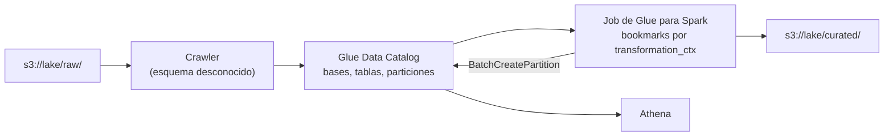

## 1. Resumen

**AWS Glue** tiene dos piezas que en un lake se usan juntas:

- **Data Catalog:** guarda los metadatos de tablas y particiones (columnas, formato, ubicación en S3). Según su documentación, reemplaza directamente al Apache Hive Metastore. Lo usan, entre otros, Athena (ver `athena-serverless-queries`) y los propios jobs de Glue.
- **Jobs de Glue para Spark:** ETL serverless en PySpark o Scala con extensiones de Glue. La capacidad se mide en **DPU** (4 vCPU y 16 GB) y la **versión de Glue** fija Spark y Python: Glue 5.1, la versión por defecto, trae Spark 3.5.6; Glue 6.0 trae Spark 4.1.1.

El catálogo se llena con **crawlers**, que infieren formato y esquema, o con la API. Los **job bookmarks** guardan el estado entre corridas para procesar solo lo nuevo.

## 2. Qué es

- **Base y tabla del catálogo:** metadatos; los datos siguen en S3. Una tabla tiene columnas, formato (input/output format y SerDe), ubicación y claves de partición.
- **Partición:** valores de las claves y la ubicación de ese subconjunto (`.../dt=2026-10-01/`).
- **Crawler:** recorre almacenes de datos, usa clasificadores para inferir formato y esquema, y crea o actualiza tablas.
- **Job de Glue para Spark:** script con `GlueContext`, `DynamicFrame` y transformaciones de Glue, más Spark.
- **Worker:** se mide en DPU; por ejemplo, G.1X es 1 DPU y G.025X es 0,25 DPU (solo jobs de streaming).
- **Job bookmark:** estado por `transformation_ctx`, que se guarda al llamar a `job.commit`. Se controla con `--job-bookmark-option` (`job-bookmark-enable`, `-disable`, `-pause`).

## 3. Problema que resuelve

Sin catálogo, cada motor tendría que saber dónde están los archivos y qué esquema tienen. El Data Catalog lo centraliza: una tabla se define una vez y la consultan varios motores. Los jobs de Glue resuelven el ETL sin administrar un clúster, y los bookmarks evitan reprocesar todo en cada corrida.

## 4. Cómo funciona

1. Una tabla se registra en el catálogo, con un crawler o con la API (`CreateTable`, `BatchCreatePartition`).
2. Un job de Glue arranca: `job.init` recupera el bookmark.
3. Lee la tabla del catálogo con un `transformation_ctx`, transforma y escribe en S3.
4. `job.commit` guarda el nuevo estado del bookmark de forma atómica.
5. La siguiente corrida, con el bookmark activado, procesa solo los archivos nuevos.

## 5. Cuándo utilizarlo

- **Catálogo:** siempre que el lake se consulte con Athena o con jobs de Glue.
- **Crawler:** datos nuevos con esquema desconocido o cambiante.
- **API:** tablas con esquema conocido, registradas por el propio pipeline (más predecible que un crawler).
- **Jobs de Glue:** ETL en Spark sin administrar clústeres, con cargas incrementales sobre S3.

## 6. Cuándo no utilizarlo

- Transformaciones SQL sobre datos que ya están en un warehouse: se hacen ahí.
- Jobs de Spark que necesitan control fino del clúster, versiones o librerías especiales: EMR (ver `emr-spark-clusters`).
- Crawlers programados sobre datos de esquema fijo que el pipeline ya conoce: agregan costo y pueden cambiar el esquema sin aviso.

## 7. Ejemplo sencillo

Un pipeline escribe Parquet en `curated/ventas_diarias/dt=2026-10-01/` y registra la partición `2026-10-01` en la tabla `ventas.ventas_diarias`. Athena ya puede consultar ese día. Si el pipeline se re-ejecuta, la partición existe y no se duplica.

## 8. Ejemplo de producción

Un job de Glue 5.1 con 10 workers G.1X corre cada hora:

1. lee la tabla `ventas_raw` del catálogo con bookmarks activados;
2. mapea columnas con `ApplyMapping` y escribe Parquet en `curated/`;
3. `job.commit` guarda el estado: la corrida siguiente lee solo los archivos nuevos.

Las tablas de `curated/` se registran por API desde el pipeline, no con un crawler, para que el esquema cambie solo cuando cambia el código.

## 9. Arquitectura



## 10. Código

```python
# Python 3.12 y boto3 (ejecutado en la CI contra moto, que simula el Glue Data Catalog; no se corrió contra AWS).
# Registra en el catálogo una tabla Parquet particionada por dt y agrega particiones sin duplicarlas:
# es lo que haría un crawler, pero explícito y repetible.
from __future__ import annotations

from typing import TYPE_CHECKING

import boto3

if TYPE_CHECKING:
    from mypy_boto3_glue import GlueClient
    from mypy_boto3_glue.type_defs import ColumnTypeDef, StorageDescriptorTypeDef

PARQUET_IN = "org.apache.hadoop.hive.ql.io.parquet.MapredParquetInputFormat"
PARQUET_OUT = "org.apache.hadoop.hive.ql.io.parquet.MapredParquetOutputFormat"
PARQUET_SERDE = "org.apache.hadoop.hive.ql.io.parquet.serde.ParquetHiveSerDe"
COLUMNS: list[ColumnTypeDef] = [{"Name": "id_venta", "Type": "bigint"}, {"Name": "id_tienda", "Type": "int"}, {"Name": "monto", "Type": "decimal(12,2)"}]


def storage(location: str) -> StorageDescriptorTypeDef:
    return {
        "Columns": COLUMNS,
        "Location": location,
        "InputFormat": PARQUET_IN,
        "OutputFormat": PARQUET_OUT,
        "SerdeInfo": {"SerializationLibrary": PARQUET_SERDE},
    }


def ensure_table(glue: GlueClient, database: str, table: str, location: str) -> None:
    """Crea la base y la tabla si no existen (re-ejecutar no falla ni duplica)."""
    try:
        glue.create_database(DatabaseInput={"Name": database})
    except glue.exceptions.AlreadyExistsException:
        pass
    try:
        glue.create_table(
            DatabaseName=database,
            TableInput={
                "Name": table,
                "TableType": "EXTERNAL_TABLE",
                "Parameters": {"classification": "parquet"},
                "PartitionKeys": [{"Name": "dt", "Type": "string"}],
                "StorageDescriptor": storage(location),
            },
        )
    except glue.exceptions.AlreadyExistsException:
        pass


def add_partitions(glue: GlueClient, database: str, table: str, location: str, days: list[str]) -> int:
    """Agrega las particiones dt=<día>; las que ya existen se ignoran. Devuelve cuántas se crearon."""
    result = glue.batch_create_partition(
        DatabaseName=database,
        TableName=table,
        PartitionInputList=[{"Values": [d], "StorageDescriptor": storage(f"{location}dt={d}/")} for d in days],
    )
    errors = result.get("Errors", [])
    unexpected = [e for e in errors if e.get("ErrorDetail", {}).get("ErrorCode") != "AlreadyExistsException"]
    if unexpected:
        raise RuntimeError(f"particiones con error: {unexpected}")
    return len(days) - len(errors)


def partition_values(glue: GlueClient, database: str, table: str) -> list[str]:
    paginator = glue.get_paginator("get_partitions")
    pages = paginator.paginate(DatabaseName=database, TableName=table)
    return sorted(p["Values"][0] for page in pages for p in page["Partitions"])


if __name__ == "__main__":
    # Contra AWS (no ejecutado): credenciales del entorno.
    client = boto3.client("glue")
    ensure_table(client, "ventas", "ventas_diarias", "s3://mi-data-lake/curated/ventas_diarias/")
    add_partitions(client, "ventas", "ventas_diarias", "s3://mi-data-lake/curated/ventas_diarias/", ["2026-10-01"])
```

```python
# Script de AWS Glue para Spark (no ejecutado: awsglue solo existe en el entorno de Glue). Sigue la estructura del
# ejemplo de *Using job bookmarks*: job.init al inicio, transformation_ctx en cada operador y job.commit al final.
# Con --job-bookmark-option job-bookmark-enable, cada corrida procesa solo los archivos nuevos de la tabla.
import sys

from awsglue.context import GlueContext
from awsglue.job import Job
from awsglue.transforms import ApplyMapping
from awsglue.utils import getResolvedOptions
from pyspark.context import SparkContext

args = getResolvedOptions(sys.argv, ["JOB_NAME", "TARGET_PATH"])
sc = SparkContext()
glueContext = GlueContext(sc)
job = Job(glueContext)
job.init(args["JOB_NAME"], args)

source = glueContext.create_dynamic_frame.from_catalog(
    database="ventas", table_name="ventas_raw", transformation_ctx="source"
)
mapped = ApplyMapping.apply(
    frame=source,
    mappings=[("id", "long", "id_venta", "long"), ("tienda", "int", "id_tienda", "int"), ("monto", "double", "monto", "double")],
    transformation_ctx="mapped",
)
glueContext.write_dynamic_frame.from_options(
    frame=mapped,
    connection_type="s3",
    connection_options={"path": args["TARGET_PATH"]},
    format="parquet",
    transformation_ctx="sink",
)
job.commit()
```

El primer script, en Python 3.12 con boto3, se **ejecuta en la CI contra moto**, que simula el Glue Data Catalog en memoria (ADR-011), y pasa `mypy --strict` con `boto3-stubs`. **No se corrió contra AWS.** El test crea la tabla dos veces y agrega particiones con un día repetido: quedan tres particiones, sin errores ni duplicados.

El segundo, el script del job de Glue, **no se ejecutó**: `awsglue` solo existe en el entorno de Glue, y moto no ejecuta jobs (ADR-011). Sigue la estructura del ejemplo de *Using job bookmarks*.

## 11. GCP

No aplica de forma específica: esta ficha describe AWS Glue. En GCP, el catálogo y el gobierno se tratan en `dataplex-governance`, con otro modelo; no hay una pieza única equivalente a Glue.

## 12. AWS

**AWS Glue.** El Data Catalog, los crawlers, los jobs de Spark, las versiones de Glue con su Spark y Python, las DPU, los bookmarks y `--job-bookmark-option` son los de sus páginas. Los precios por DPU-hora, del catálogo y de los crawlers se consultan en la página de precios.

## 13. Azure

No aplica de forma específica.

## 14. Buenas prácticas

- Registrar por API las tablas de esquema conocido; crawlers solo para descubrir.
- Fijar la versión de Glue en cada job.
- Un `transformation_ctx` estable por operador cuando se usan bookmarks; no cambiar la fuente con el bookmark activado.
- Escribir de forma idempotente: los bookmarks evitan releer, no reescribir.
- **Seguridad:** el job corre con un rol de IAM con acceso solo a sus prefijos; el acceso a las tablas del catálogo se gobierna con IAM o con Lake Formation (ver `lake-formation-permissions`).
- **Observabilidad:** seguir la duración de cada corrida, las DPU usadas y el número de archivos procesados; un bookmark que no avanza deja de procesar datos nuevos.
- **Costo:** se paga por DPU-hora en incrementos de 1 segundo, con un mínimo de 2 DPU en jobs de Spark; también se cobran el catálogo y los crawlers. Los montos se consultan en la página de precios.

## 15. Errores frecuentes

- Un crawler que cambia el esquema de una tabla de producción.
- Olvidar `job.commit` y reprocesar todo en cada corrida.
- Cambiar el `transformation_ctx` y perder el estado del bookmark.
- Registrar particiones con `CreatePartition` uno por uno y fallar en la segunda corrida porque ya existen.
- Dejar los 10 DPU por defecto en un job chico.

## 16. Trade-offs

El catálogo es compartido por todos los motores, a cambio de ser un punto que hay que gobernar. Los crawlers ahorran trabajo con esquemas desconocidos y cuestan predictibilidad. Los jobs de Glue quitan la administración del clúster, con menos control que EMR sobre versiones, tipos de instancia y configuración de Spark.

## 17. Conceptos relacionados

- `data-transformation` y `pyspark-dataframes`: lo que hace un job.
- `incremental-load` y `checkpoints`: los bookmarks.
- `idempotency`: registrar sin duplicar.
- `s3-data-lake`, `athena-serverless-queries` y `lake-formation-permissions`: datos, consulta y gobierno.
- `emr-spark-clusters`: Spark con más control.
- `dataplex-governance`: el catálogo de GCP, con otro modelo.

## 18. Preguntas técnicas abiertas

1. ¿Qué tablas de tu lake registrarías por API y cuáles dejarías a un crawler?
2. ¿Qué pasa con tu job si el bookmark se reinicia?
3. ¿Cuándo pasarías un job de Glue a EMR?

## 19. Laboratorio relacionado

Pendiente (F4).

## 20. Fuentes

- AWS, AWS Glue User Guide: *What is AWS Glue?*, *AWS Glue components*, *Using crawlers to populate the Data Catalog*, *Tracking processed data using job bookmarks*, *Using job bookmarks*, *Using job parameters in AWS Glue jobs*, *Configuring job properties for Spark jobs* y *AWS Glue versions*; *AWS Glue pricing*.

El detalle de cada fuente está en `sources` del frontmatter.

## 21. Fecha de última verificación

2026-10-12. `review_required`: pendiente de revisión B-F3.1 del lote F3b-09a.

## 22. Historial de cambios importantes

- 2026-10-12: creación (lote F3b-09a).
