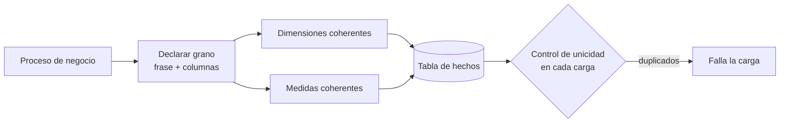

## 1. Resumen

El grano es la respuesta, en una frase, a "¿qué es una fila de esta tabla de hechos?": por ejemplo, "una línea de ticket" o "el saldo de una cuenta al cierre de un día". Se declara **antes** de elegir dimensiones y medidas, y todo lo que entra a la tabla debe ser coherente con él. Conviene el grano **atómico**, el más bajo que captura el proceso. Como BigQuery, Redshift y Fabric no hacen cumplir las claves, el grano declarado hay que comprobarlo en cada carga.

## 2. Qué es

Es un concepto del modelado dimensional de Kimball, la segunda de sus cuatro decisiones de diseño (proceso de negocio, **grano**, dimensiones, hechos). Kimball lo describe como un contrato vinculante del diseño: cada dimensión y cada medida candidata debe ser coherente con el grano, o no entra en esa tabla. En la práctica se expresa con las columnas que, juntas, identifican una fila: `(ticket_id, linea)` en una línea de venta, o `(cuenta_id, fecha)` en un snapshot diario.

## 3. Problema que resuelve

Sin un grano explícito aparecen las tablas "mezcladas": filas de línea y de total de pedido juntas, o una medida a nivel de día en una tabla a nivel de transacción. El resultado son sumas duplicadas y reportes que no cuadran, y nadie sabe qué significa una fila. Declarar el grano fija qué se puede sumar, qué dimensiones aplican y qué es un duplicado.

## 4. Cómo funciona

1. **Partir del proceso**, no del reporte: ¿qué evento o medición produce el dato?
2. **Declarar el grano en lenguaje de negocio** ("una fila por línea de ticket") y traducirlo a columnas: las claves que lo identifican.
3. **Preferir el grano atómico:** permite responder preguntas imprevistas. Los granos resumidos (por día y tienda) son tablas adicionales para rendimiento, no reemplazos.
4. **Filtrar dimensiones y medidas por coherencia:** una dimensión que tiene varios valores por fila del grano (varios diagnósticos por visita) no entra directa; necesita otro tratamiento (*bridge*). Una medida de otro grano va a otra tabla.
5. **Comprobar el grano en cada carga:** BigQuery no aplica las claves primarias (`NOT ENFORCED`), Redshift las trata como informativas y Fabric Warehouse solo las admite como `NONCLUSTERED` y `NOT ENFORCED`, así que en los tres una carga puede insertar filas duplicadas sin error. El control lo hace el pipeline: una consulta de duplicados, aserciones de Dataform o tests de dbt.

## 5. Cuándo utilizarlo

- En cada tabla de hechos, sin excepción, antes de escribir el DDL.
- Al revisar un modelo existente que da sumas inconsistentes.
- Al decidir si una medida nueva entra en una tabla o necesita otra.

## 6. Cuándo no utilizarlo

El grano aplica a toda tabla de hechos; lo que puede no convenir es el grano **atómico**:

- cuando el volumen atómico no aporta valor y el proceso solo se analiza por período (se modela un snapshot periódico, cuyo grano es el período);
- cuando el dato atómico no se puede conservar (retención o privacidad): se declara un grano resumido y se documenta lo que se pierde.

## 7. Ejemplo sencillo

| Tabla | Grano | Columnas del grano |
|---|---|---|
| `fact_venta_linea` | una línea de ticket | `ticket_id`, `linea` |
| `fact_inventario_diario` | un producto en una tienda al cierre de un día | `producto_sk`, `tienda_sk`, `fecha` |
| `fact_pedido_online` | una línea de pedido de su creación a su entrega | `pedido_id`, `linea` |

## 8. Ejemplo de producción

Un equipo agrega a `fact_venta_linea` el "descuento por ticket" que entrega el sistema de cajas. Es una medida a nivel de ticket, no de línea: repetida en cada línea, se suma tantas veces como líneas tenga el ticket. La revisión del modelo la rechaza por violar el grano. El descuento se prorratea por línea con una regla acordada, o se lleva a una tabla de grano ticket. Además, el pipeline tiene una aserción de unicidad sobre `(ticket_id, linea)`: un reproceso que duplicó un día falló la aserción antes de que llegara al tablero.

## 9. Arquitectura



## 10. Código

```sql
-- BigQuery: control de grano tras cada carga. La clave primaria declarada es NOT ENFORCED,
-- así que BigQuery no impide los duplicados: esta consulta debe devolver cero filas.
SELECT ticket_id, linea, COUNT(*) AS filas
FROM `proyecto.dwh.fact_venta_linea`
WHERE fecha >= DATE_SUB(CURRENT_DATE(), INTERVAL 7 DAY)   -- solo las particiones recién cargadas
GROUP BY ticket_id, linea
HAVING COUNT(*) > 1;
```

```sql
-- Dataform (SQLX): el mismo control como aserción; si falla, la ejecución lo reporta.
config {
  type: "table",
  assertions: {
    uniqueKeys: [["ticket_id", "linea"]],
    nonNull: ["ticket_id", "linea", "fecha"]
  }
}

SELECT ticket_id, linea, fecha, producto_sk, tienda_sk, cantidad, monto
FROM ${ref("stg_venta_linea")}
```

## 11. GCP

En **BigQuery**, las claves primarias se declaran `NOT ENFORCED`: sirven para optimizar, pero no impiden duplicados. El grano se protege con controles en el pipeline. En **Dataform**, la aserción `uniqueKeys` falla si hay más de una fila con los mismos valores en todas las columnas indicadas, y `nonNull` exige que las columnas del grano no sean nulas.

## 12. AWS

En **Redshift**, unicidad, clave primaria y clave foránea son informativas: un insert que las viola tiene éxito. Hay un riesgo adicional frente a BigQuery: el planificador usa esas claves como pistas. Si se declaran y los datos no las cumplen, las consultas pueden dar resultados incorrectos. Por eso la documentación pide declararlas solo si el ETL garantiza su integridad.

## 13. Azure

En **Fabric Warehouse**, `PRIMARY KEY` y `UNIQUE` solo se admiten como `NONCLUSTERED` y `NOT ENFORCED`, y se agregan con `ALTER TABLE` después de crear la tabla. Como en las otras nubes, el grano se comprueba en el pipeline; con dbt, por ejemplo, con los tests genéricos de unicidad y no nulos.

## 14. Buenas prácticas

- Escribir el grano como una frase de negocio en la documentación de cada tabla de hechos.
- Empezar por el grano atómico; crear agregados aparte.
- Rechazar en la revisión cualquier medida o dimensión que no sea coherente con el grano.
- Controlar unicidad y no nulos de las columnas del grano en cada carga, limitando el control a las particiones cargadas.
- **Seguridad:** el grano atómico suele ser el más sensible (transacciones individuales); restringirlo más que los agregados y publicar los agregados para el consumo amplio.
- **Observabilidad:** registrar en cada carga el resultado del control de grano (filas duplicadas encontradas) y alertar si es distinto de cero.
- **Costo:** el grano atómico ocupa más; particionar por fecha y crear agregados para las consultas frecuentes evita releer el detalle.

## 15. Errores frecuentes

- No declarar el grano y descubrirlo a partir de los datos.
- Mezclar granos en una misma tabla (líneas y totales).
- Repetir una medida de un grano superior en cada fila del grano inferior.
- Confiar en una clave primaria declarada en BigQuery, Redshift o Fabric como si impidiera duplicados.
- Elegir un grano resumido "porque el reporte de hoy lo pide" y perder preguntas futuras.

## 16. Trade-offs

El grano atómico da flexibilidad máxima a cambio de volumen y de consultas más pesadas; un grano resumido es más liviano pero cierra preguntas. Controlar el grano en cada carga cuesta una consulta adicional, mucho menos que publicar sumas duplicadas.

## 17. Conceptos relacionados

- `fact-tables`: la tabla cuyo grano se declara.
- `star-schema`: el diseño en el que el grano es el paso 2.
- `dimension-tables`: las dimensiones coherentes con el grano.
- `deduplication`: cómo eliminar filas duplicadas en el grano.

## 18. Preguntas técnicas abiertas

1. ¿Cuál es el grano de una tabla de visitas a una web si una visita puede tener varias páginas y varias compras?
2. El negocio pide un "costo de envío por pedido" en una tabla de líneas. ¿Qué opciones tienes y qué pierde cada una?
3. ¿Cómo detectarías, sin claves aplicadas por el motor, que un reproceso duplicó un día?

## 19. Laboratorio relacionado

Pendiente (F4).

## 20. Fuentes

- Kimball Group: *Grain*, *Four-Step Dimensional Design Process* y *Periodic Snapshot Fact Tables* (referencia conceptual, Nivel 4).
- Microsoft Learn: *Dimensional modeling in Fabric Warehouse: Fact tables* y *Primary, Foreign, and Unique Keys*.
- Google Cloud: *Use primary and foreign keys* (BigQuery) y *Test data quality* (Dataform).
- AWS: *Table constraints* (Amazon Redshift).
- dbt: *Add data tests to your DAG*.

El detalle de cada fuente está en `sources` del frontmatter.

## 21. Fecha de última verificación

2026-10-05. Pasa a `verified`: revisión B-F3.1 del lote 6 aplicada, sin VERIFY pendientes.

## 22. Historial de cambios importantes

- 2026-10-05: creación (lote 6 de F3).
- 2026-10-05: revisión B-F3.1 del lote 6 aplicada (docs/reviews/cards-lote6.md), sin cambios pedidos. `verification_status: verified` (sin VERIFY pendientes).
- 2026-10-07: §4: las claves primarias no exigidas se atribuyen por motor con el término de cada página (BigQuery `NOT ENFORCED`, Redshift informativas, Fabric solo `NOT ENFORCED`), en lugar de una afirmación conjunta (criterio de la revisión de F3b-02c). Cambio mínimo en ficha `verified`, pendiente de revisión de Cursor.
- 2026-10-07: revisión de los cambios mínimos aplicada (docs/reviews/fixes-null-concat.md, aprobada por Felipe): §4 dice «`NONCLUSTERED` y `NOT ENFORCED`» para Fabric, como la §13. Sigue `verified`.
