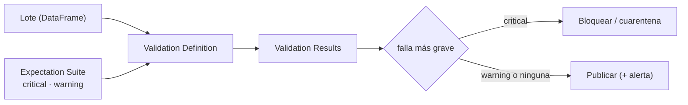

## 1. Resumen

**Great Expectations (GX Core)** es una biblioteca de Python para describir cómo deberían ser los datos y validar un lote contra esa descripción. Una regla es una **Expectation** («`id` no es nulo», «`monto` entre 0 y algo»); varias forman una **Expectation Suite**; una **Validation Definition** une la suite con los datos, y un **Checkpoint** corre validaciones y dispara **Actions** con el resultado (*GX Core overview*).

Dos parámetros acercan GX a un quality gate:

- **`mostly`**: la Expectation pasa si cumple al menos ese porcentaje de filas;
- **`severity`**: `critical`, `warning` o `info`, para decidir con la falla más grave (*Create an Expectation*).

Esta ficha usa GX Core 1.24.0 (ADR-019). Hay equivalentes en otras herramientas (`dbt-tests`, `custom-data-validators`) y en los catálogos de nube, con diferencias.

## 2. Qué es

Según *GX Core overview*:

| Componente | Qué es |
|---|---|
| Data Context | El objeto que da acceso a la configuración y a los resultados; efímero (en memoria) o en archivos |
| Data Source y Data Asset | De dónde vienen los datos (aquí, un DataFrame de pandas) |
| Batch Definition | Qué parte de los datos se valida (aquí, el DataFrame completo) |
| Expectation | Una regla verificable |
| Expectation Suite | Una colección de Expectations |
| Validation Definition | Una suite aplicada a una Batch Definition |
| Checkpoint y Actions | Correr validaciones en producción y reaccionar al resultado |

## 3. Problema que resuelve

Un pipeline en Python carga lotes de pedidos en pandas antes de escribirlos. Las reglas están repartidas en `if` por el código, sin severidad ni reporte. Con GX, las reglas quedan en una suite, cada lote produce un resultado por regla (con el número de filas inesperadas) y el pipeline decide: publicar con avisos o bloquear.

## 4. Cómo funciona

1. `gx.get_context(mode="ephemeral")` crea un Data Context en memoria, adecuado para la CI (*Create a Data Context*).
2. Se agrega un Data Source de pandas, un asset de DataFrame y una Batch Definition del DataFrame completo.
3. Se crea la suite y se le agregan Expectations, con `mostly` y `severity` donde corresponda.
4. Una Validation Definition une la suite y la Batch Definition; `run(batch_parameters={"dataframe": df})` valida un lote (*Run a Validation Definition*).
5. El resultado trae `success` global y, por Expectation, `success` y `unexpected_count`.
6. El pipeline consulta la falla más grave. *Create an Expectation* nombra el método `get_maximum_severity_failure`; en GX Core 1.24.0 se llama **`get_max_severity_failure`** (ADR-019).

## 5. Cuándo utilizarlo

- Pipelines en Python que procesan lotes en DataFrames antes de escribirlos.
- Cuando se quiere un catálogo de reglas con resultados estructurados y severidad.
- Equipos que validan datos fuera del warehouse (archivos, APIs) con las mismas reglas.

## 6. Cuándo no utilizarlo

- Si los datos ya están en el warehouse y el proyecto usa dbt o Dataform: sus tests corren donde están los datos.
- Para validar registro por registro en una API: Pydantic es más directo.
- Para dos o tres reglas: un validador propio cuesta menos que una dependencia.

## 7. Ejemplo sencillo

Una suite de cuatro Expectations y dos lotes:

| Expectation | Severidad | `lote-1` | `lote-2` |
|---|---|---|---|
| `id` no nulo | critical | pasa | falla (1 nulo) |
| `id` único | critical | pasa | falla (2 inesperados) |
| `monto` entre 0 y ∞, `mostly=0.75` | warning | pasa (1 de 4 fuera: 75 % cumple) | pasa |
| `moneda` en `CLP`, `USD` | warning | falla (`EUR`) | pasa |
| Falla más grave → decisión | | `warning` → publicar | `critical` → bloquear |

En los dos lotes `success` es `False`: `success` no distingue severidades; la decisión sale de la falla más grave.

## 8. Ejemplo de producción

Un pipeline de pedidos en Python:

- una suite versionada en el repositorio, construida en código;
- un Checkpoint que corre la Validation Definition de cada lote y dispara una Action de alerta para fallas `warning`;
- el pipeline bloquea la publicación si la falla más grave es `critical`, y manda el lote a cuarentena;
- un File Data Context en producción para conservar resultados; uno efímero en la CI.

## 9. Arquitectura



## 10. Código

```python
# Python 3.12 y GX Core 1.24.0 (ejecutado en la CI; ADR-019): un Data Context efímero, un DataFrame de pandas,
# una Expectation Suite con severidades y un Validation Definition; el pipeline decide con la falla más grave.
import great_expectations as gx
import pandas as pd

context = gx.get_context(mode="ephemeral")   # configuración en memoria: nada que persistir entre corridas
batch_definition = (context.data_sources.add_pandas("pedidos")
                    .add_dataframe_asset("lote_diario")
                    .add_batch_definition_whole_dataframe("lote_completo"))

suite = context.suites.add(gx.ExpectationSuite(name="pedidos"))
suite.add_expectation(gx.expectations.ExpectColumnValuesToNotBeNull(column="id"))
suite.add_expectation(gx.expectations.ExpectColumnValuesToBeUnique(column="id"))
suite.add_expectation(gx.expectations.ExpectColumnValuesToBeBetween(
    column="monto", min_value=0, mostly=0.75, severity="warning"))   # tolera hasta un 25 % fuera de rango
suite.add_expectation(gx.expectations.ExpectColumnValuesToBeInSet(
    column="moneda", value_set=["CLP", "USD"], severity="warning"))

validation = context.validation_definitions.add(
    gx.ValidationDefinition(name="pedidos_diarios", data=batch_definition, suite=suite))

lotes = {
    "lote-1": pd.DataFrame({"id": ["P1", "P2", "P3", "P4"], "monto": [10, 20, -5, 30],
                            "moneda": ["CLP", "CLP", "USD", "EUR"]}),
    "lote-2": pd.DataFrame({"id": ["P5", "P5", "P6", None], "monto": [10, 20, 30, 40],
                            "moneda": ["CLP", "CLP", "CLP", "CLP"]}),
}
for nombre, df in lotes.items():
    result = validation.run(batch_parameters={"dataframe": df})
    print(f"{nombre}: success={result.success}")
    for r in result.results:
        cfg = r.expectation_config
        assert cfg is not None
        print(f"  {cfg.type} [{cfg.severity.value}]: {r.success} (inesperados: {r.result.get('unexpected_count')})")
    peor = result.get_max_severity_failure()   # así se llama en 1.24.0 (la guía dice get_maximum_severity_failure)
    print(f"  falla más grave: {peor.value if peor else 'ninguna'} -> {'bloquear' if peor and peor.value == 'critical' else 'publicar'}")
```

El script se **ejecuta en la CI con GX Core 1.24.0** (ADR-019) y un Data Context efímero. Imprime, por lote, `success=False` y cada Expectation con su severidad y sus filas inesperadas; para `lote-1`, `falla más grave: warning -> publicar`, y para `lote-2`, `falla más grave: critical -> bloquear`. No pasa por `mypy --strict`: GX no declara explícitamente sus exportaciones de `great_expectations.expectations` (ADR-019).

## 11. GCP

En GCP, **Knowledge Catalog** corre reglas de calidad sobre tablas. Según *Create an Expectation* y *Auto data quality overview* (no ejecutado):

| | Great Expectations | Knowledge Catalog |
|---|---|---|
| Dónde corre | En el proceso de Python, sobre un DataFrame u otra fuente | En un escaneo sobre la tabla |
| Tolerancia | `mostly`: porcentaje mínimo de filas que cumplen | Umbral de porcentaje de filas que pasan, en reglas por fila |
| Clasificación | `severity`: critical, warning, info | Cada regla se asocia a una dimensión |

## 12. AWS

En AWS, **AWS Glue Data Quality** en ETL jobs. Según *Run a Validation Definition* y *Data Quality for ETL jobs in AWS Glue Studio notebooks* (no ejecutado):

| | Great Expectations | AWS Glue Data Quality |
|---|---|---|
| Resultado | Por Expectation, con `unexpected_count` | Por regla y por fila (`rowLevelOutcomes`, con `DataQualityEvaluationResult`) |
| Uso típico | Decidir si se publica el lote | El ejemplo escribe solo las filas `Passed` |

## 13. Azure

En Azure, **Microsoft Purview** sobre datos de **Fabric**. Según *GX Core overview* y *Set up data quality for Fabric Lakehouse data* (no ejecutado):

| | Great Expectations | Purview sobre Fabric Lakehouse |
|---|---|---|
| Datos | DataFrames y otras fuentes conectadas desde Python | Tablas del Lakehouse en formato Delta o Iceberg, registradas y escaneadas con el Data Map |
| Definición | Suites en código | Reglas creadas en el catálogo y escaneos de calidad |

## 14. Buenas prácticas

- Severidad explícita en cada Expectation; decidir con la falla más grave, no con `success`.
- `mostly` solo donde se acepta una tolerancia, con el número justificado.
- Data Context efímero en la CI; persistente donde haga falta conservar resultados.
- Fijar la versión de GX y comprobar los nombres de métodos contra la versión instalada.
- **Seguridad:** los resultados pueden incluir valores inesperados de los datos; guardarlos con los permisos de los datos.
- **Observabilidad:** guardar los Validation Results de cada lote y alertar con Actions.
- **Costo:** GX trae pandas, numpy y scipy, entre otras dependencias (ADR-019); validar en Python lee el lote en memoria.

## 15. Errores frecuentes

- Usar `success` del resultado para bloquear: es `False` también con solo avisos.
- Copiar nombres de métodos de la guía sin probarlos en la versión instalada.
- Una suite enorme de Expectations sin severidad: todo pesa igual.
- `mostly` bajo para que «pase»: oculta el problema.

## 16. Trade-offs

GX da un vocabulario de reglas y resultados estructurados, a cambio de una dependencia grande y de un modelo de componentes que aprender. Validar en Python protege antes de escribir; validar en el warehouse (dbt, Dataform) evita mover los datos. Un catálogo de nube centraliza la vista de calidad y queda fuera del código del pipeline.

## 17. Conceptos relacionados

- `custom-data-validators`: las mismas reglas a mano.
- `quality-gate`: decidir con el resultado.
- `data-validation-with-pydantic`: validar registros.
- `python-dataframes`: pandas.
- `data-quality-dimensions`: qué mide cada Expectation.
- `dbt-tests`: reglas en el warehouse.

## 18. Preguntas técnicas abiertas

1. ¿Qué reglas de tu pipeline en Python serían `critical` y cuáles `warning`?
2. ¿Tus validaciones distinguen avisos de bloqueos?
3. ¿Dónde guardarías los resultados de cada lote?

## 19. Laboratorio relacionado

Pendiente (F4).

## 20. Fuentes

- Great Expectations (GX Core 1.24.0): *GX Core overview*, *Create a Data Context*, *Create an Expectation*, *Run a Validation Definition* y *Create a Checkpoint with Actions*.
- Google Cloud: *Auto data quality overview*.
- AWS: *Data Quality for ETL jobs in AWS Glue Studio notebooks*.
- Microsoft Learn: *Set up data quality for Fabric Lakehouse data*.

El detalle de cada fuente está en `sources` del frontmatter.

## 21. Fecha de última verificación

2026-10-20. `review_required`: pendiente de revisión B-F3.1 del lote F3b-15b.

## 22. Historial de cambios importantes

- 2026-10-20: creación (lote F3b-15b).
