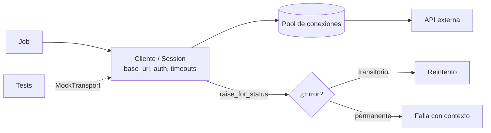

## 1. Resumen

**Requests** y **HTTPX** son los clientes HTTP más usados en Python. Para un pipeline, tres cosas importan más que elegir entre ellos:

- reutilizar una sesión o cliente, por el pool de conexiones;
- poner timeouts explícitos. Requests **no** tiene timeout por defecto y puede quedar colgado indefinidamente; HTTPX usa 5 segundos;
- convertir los códigos de error en excepciones con `raise_for_status()`.

HTTPX agrega un cliente asíncrono y un transporte de prueba sin red.

## 2. Qué es

- **Requests:**
  - API síncrona (`requests.get`, `Session`);
  - `Session` mantiene cabeceras, cookies y el pool de conexiones de urllib3;
  - `timeout` acepta un número o una tupla `(conexión, lectura)`.
- **HTTPX:**
  - API parecida, con `Client` (síncrono) y `AsyncClient`;
  - `Timeout` separa connect, read, write y pool;
  - transportes intercambiables, entre ellos `MockTransport` para pruebas.
- **Respuesta:** código de estado, cabeceras y cuerpo (`.json()`, `.text`). `raise_for_status()` lanza una excepción en 4xx y 5xx.

## 3. Problema que resuelve

Una ingesta desde APIs falla de formas muy concretas:

- una petición que nunca termina y deja el job colgado;
- una conexión nueva por petición, que agota puertos o tarda de más;
- un 500 tratado como si fuera un cuerpo válido;
- tests que dependen de la red.

Un cliente bien configurado resuelve las cuatro.

## 4. Cómo funciona

1. Se crea **una** sesión o cliente por ejecución, o por destino, con `base_url`, cabeceras de autenticación y timeouts.
2. Cada petición reutiliza conexiones del pool hacia el mismo host.
3. **Timeout de conexión:** cuánto esperar para establecer la conexión. **Timeout de lectura:** cuánto esperar entre bytes de la respuesta, que en la práctica suele ser el tiempo hasta el primer byte. Si se excede, se lanza una excepción de timeout.
4. `raise_for_status()` convierte 4xx y 5xx en `HTTPError` (Requests) o `HTTPStatusError` (HTTPX). La capa de reintentos decide qué hacer con cada una.
5. En pruebas, HTTPX acepta `transport=httpx.MockTransport(handler)`: el handler recibe la petición y devuelve una respuesta construida, sin red.

## 5. Cuándo utilizarlo

- Consumir APIs REST de proveedores o internas desde jobs de Python.
- Requests cuando el código es síncrono y ya está en el proyecto.
- HTTPX cuando se necesita un cliente asíncrono, el control fino de timeouts o el transporte de prueba.

## 6. Cuándo no utilizarlo

- Para servicios de la propia nube que tienen SDK oficial (BigQuery, S3, Blob Storage): el SDK maneja autenticación, paginación y reintentos propios del servicio.
- Para descargas masivas de object storage: los SDK y herramientas de transferencia paralelizan y reanudan.
- Para APIs con cliente generado oficial (gRPC, OpenAPI): suele traer tipos y manejo de errores.

## 7. Ejemplo sencillo

```python
import httpx


def manejador(request: httpx.Request) -> httpx.Response:
    return httpx.Response(200, json={"ok": True})


with httpx.Client(transport=httpx.MockTransport(manejador), timeout=5.0) as cliente:
    respuesta = cliente.get("https://api.ejemplo.test/estado")
    respuesta.raise_for_status()
    print(respuesta.json())   # {'ok': True}
```

## 8. Ejemplo de producción

La ingesta diaria de un proveedor de pagos crea un `httpx.Client` con:

- `base_url` y el token, leído al inicio desde el gestor de secretos;
- `Timeout(10, connect=3)`.

Cada página se pide con el mismo cliente, y `raise_for_status()` convierte los errores en excepciones. La capa de reintentos solo repite timeouts, 429 y 5xx. En la CI, los tests usan `MockTransport` con respuestas grabadas para páginas normales, la última página vacía, un 503 y un JSON mal formado, sin tocar la red.

## 9. Arquitectura



## 10. Código

```python
# Python 3.12, HTTPX 0.28.1 y Requests 2.34.2 (ejecutado; mypy --strict sin errores): sesión reutilizable,
# timeouts explícitos, errores HTTP como excepciones y pruebas sin red.
import threading
from http.server import BaseHTTPRequestHandler, HTTPServer

import httpx
import requests


def nuevo_cliente(base_url: str, token: str, transport: httpx.BaseTransport | None = None) -> httpx.Client:
    return httpx.Client(
        base_url=base_url,
        headers={"Authorization": f"Bearer {token}"},
        timeout=httpx.Timeout(10.0, connect=3.0),    # 3 s para conectar; 10 s para leer, escribir y el pool
        transport=transport,
    )


def pagina(cliente: httpx.Client, numero: int) -> list[dict[str, object]]:
    respuesta = cliente.get("/ventas", params={"page": numero})
    respuesta.raise_for_status()                     # 4xx/5xx → httpx.HTTPStatusError
    datos: list[dict[str, object]] = respuesta.json()["items"]
    return datos


def falsa_api(request: httpx.Request) -> httpx.Response:
    """Transporte de prueba: responde sin red según la URL y verifica la cabecera."""
    assert request.headers["Authorization"] == "Bearer t0k3n"
    if request.url.params["page"] == "1":
        return httpx.Response(200, json={"items": [{"id": "v1"}, {"id": "v2"}]})
    return httpx.Response(503, json={"error": "mantenimiento"})


with nuevo_cliente("https://api.ejemplo.test", "t0k3n", httpx.MockTransport(falsa_api)) as cliente:
    print(pagina(cliente, 1))                        # [{'id': 'v1'}, {'id': 'v2'}]
    try:
        pagina(cliente, 2)
    except httpx.HTTPStatusError as error:
        print(error.response.status_code)            # 503


class Lenta(BaseHTTPRequestHandler):
    def do_GET(self) -> None:
        threading.Event().wait(2)                    # el servidor tarda 2 s en responder
        self.send_response(200)
        self.end_headers()

    def log_message(self, format: str, *args: object) -> None:
        pass


servidor = HTTPServer(("127.0.0.1", 0), Lenta)
threading.Thread(target=servidor.serve_forever, daemon=True).start()
url = f"http://127.0.0.1:{servidor.server_port}/"
with requests.Session() as sesion:                   # Session reutiliza conexiones (pool de urllib3)
    try:
        sesion.get(url, timeout=(3.05, 0.5))         # (connect, read): sin timeout, requests espera sin límite
    except requests.exceptions.ReadTimeout:
        print("ReadTimeout")                         # ReadTimeout
servidor.shutdown()
```

En el entorno de pruebas se ejecutó con HTTPX 0.28.1 y Requests 2.34.2, y `mypy --strict` pasó con `types-requests`. El servidor local tarda 2 segundos en responder, y el timeout de lectura de 0.5 segundos corta la espera con `ReadTimeout`.

## 11. GCP

No aplica de forma específica: los clientes HTTP se comportan igual en cualquier runtime. Para los servicios de Google Cloud se usan sus bibliotecas cliente (ver `python-api-consumption`).

## 12. AWS

No aplica de forma específica (ver §11). Para los servicios de AWS se usa Boto3 (ver `python-api-consumption`).

## 13. Azure

No aplica de forma específica (ver §11). Para los servicios de Azure se usa el Azure SDK para Python (ver `python-api-consumption`).

## 14. Buenas prácticas

- Un cliente o sesión por destino y por ejecución, cerrado con `with`.
- Timeout explícito en toda petición, con conexión y lectura separadas.
- `raise_for_status()` antes de leer el cuerpo.
- Pruebas con `MockTransport` (HTTPX) o un servidor local, nunca contra la API real en la CI.
- **Seguridad:** tokens en cabeceras desde un gestor de secretos, nunca en la URL (queda en logs de proxies y servidores); no registrar cabeceras `Authorization` ni cuerpos con datos personales; dejar la verificación TLS activada.
- **Observabilidad:** registrar método, ruta sin parámetros sensibles, código de estado, latencia e intento; contar timeouts y 429 por separado de los 5xx.
- **Costo:** reutilizar conexiones reduce latencia y uso de CPU en TLS; un timeout bien puesto evita pagar tiempo de cómputo esperando a un servidor que no va a responder.

## 15. Errores frecuentes

- `requests.get(url)` sin `timeout`: el job puede quedar colgado.
- Crear un cliente nuevo por petición en un bucle.
- Leer `.json()` de una respuesta 500 y cargar el cuerpo de error como datos.
- Desactivar la verificación de certificados "para probar" y olvidarlo.
- Tests que llaman a la API real y fallan por la red o el rate limit.

## 16. Trade-offs

Requests es el más difundido y simple, pero solo síncrono y sin timeout por defecto. HTTPX tiene una API similar, con cliente asíncrono, timeouts por defecto y transportes de prueba, a cambio de ser otra dependencia y una API levemente distinta en detalles. Los SDK oficiales de cada nube resuelven más cosas, pero solo para sus propios servicios.

## 17. Conceptos relacionados

- `python-api-consumption`: paginación, autenticación y rate limits.
- `python-error-handling-and-retries`: qué reintentar.
- `api-ingestion`: el patrón de ingesta completo.
- `python-concurrency`: muchas peticiones a la vez.
- `testing-with-pytest`: pruebas sin red.

## 18. Preguntas técnicas abiertas

1. ¿Qué timeouts de conexión y de lectura pondrías para una API cuya respuesta más lenta tarda 8 segundos?
2. ¿Cómo probarías que tu código distingue un 429 de un 500 sin llamar a la API real?
3. ¿Cuándo vale la pena migrar de Requests a HTTPX en un proyecto existente?

## 19. Laboratorio relacionado

Pendiente (F4).

## 20. Fuentes

- Requests: *Quickstart* y *Advanced Usage*.
- HTTPX: *Timeouts*, *Clients*, *Transports* y *Async Support*.

El detalle de cada fuente está en `sources` del frontmatter.

## 21. Fecha de última verificación

2026-10-09. Pasa a `verified`: revisión B-F3.1 del lote F3b-03b aplicada, sin VERIFY pendientes.

## 22. Historial de cambios importantes

- 2026-10-08: creación (lote F3b-03b).
- 2026-10-09: revisión B-F3.1 del lote F3b-03b aplicada (docs/reviews/cards-f3b-03b.md): filas aprobadas sin cambios en esta ficha.
- 2026-10-09: `verification_status: verified` (sin VERIFY pendientes).
