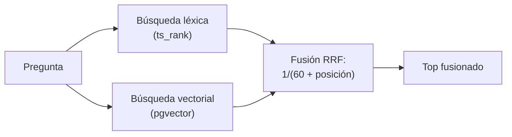

## 1. Resumen

La búsqueda vectorial encuentra significado y se equivoca con lo exacto: un código de error, un nombre de tabla, un ID. La búsqueda léxica acierta lo exacto y no entiende sinónimos. **Hybrid RAG** corre las dos y **fusiona** las listas. La forma común es **Reciprocal Rank Fusion** (RRF): cada documento suma 1/(k + posición) por cada lista en que aparece, con k cerca de 60 (*Relevance scoring in hybrid search using Reciprocal Rank Fusion (RRF)*).

Las nubes lo ofrecen: Vector Search fusiona con RRF (*About hybrid search*), Azure AI Search corre ambas en paralelo en una sola solicitud (*Hybrid search…*), Bedrock Knowledge Bases tiene un tipo de búsqueda Hybrid en ciertos vector stores. En PostgreSQL se arma con `ts_rank` y pgvector en la misma consulta.

## 2. Qué es

- **Lado léxico:** búsqueda de texto completo o embeddings dispersos (TF-IDF, BM25, SPLADE); no considera la semántica (*About hybrid search*).
- **Lado vectorial:** distancia entre embeddings (`vector-databases`).
- **RRF:** suma de 1/(k + posición) entre listas; usa posiciones, no puntajes, así que no hay que normalizar escalas distintas.
- **k de RRF:** una constante (60 según Azure), distinta del k de vecinos más cercanos.

## 3. Problema que resuelve

Un ingeniero de guardia busca «ERR-4012». La búsqueda vectorial devuelve también «ERR-4013», que se parece; la léxica devuelve solo el exacto, pero no encuentra «cargas fallidas» si la pregunta dice «carga fallida». La fusión pone primero lo que aparece en ambas.

## 4. Cómo funciona

1. Se indexa cada fragmento dos veces: texto (`tsvector`, índice invertido) y vector.
2. Se corre la búsqueda léxica y se numeran sus resultados por posición.
3. Se corre la vectorial y se numeran por distancia.
4. Para cada documento, RRF = suma de 1/(60 + posición) en las listas donde aparece.
5. Se ordena por RRF y se pasa el top al reranking (`reranking`) o al prompt.

## 5. Cuándo utilizarlo

- Documentación técnica con códigos de error, nombres de tablas, comandos.
- Catálogos con nombres propios y sinónimos a la vez.
- Cuando la búsqueda vectorial sola devuelve «casi» lo pedido.

## 6. Cuándo no utilizarlo

- Corpus sin términos exactos importantes: la vectorial puede bastar.
- Si una de las dos búsquedas no tiene índice y el volumen es grande: la latencia se suma.
- En Bedrock, con un vector store que no soporta la híbrida: la consulta usa la semántica (*Configure and customize queries…*).

## 7. Ejemplo sencillo

| Pregunta | Primero | Por qué |
|---|---|---|
| «ERR-4012 carga fallida» | doc 1 (ERR-4012) | Primero en las dos listas |
| | doc 2 (Cargas fallidas) | Solo en la vectorial: la léxica exige todos los términos |
| «ERR-4013» | doc 3 (ERR-4013) | Primero en las dos |
| | doc 1 (ERR-4012) | Solo en la vectorial: se parece, no es el pedido |

## 8. Ejemplo de producción

Búsqueda sobre runbooks y tickets en PostgreSQL:

- columna `tsv` generada con `to_tsvector('spanish', texto)` e índice GIN; columna `embedding` con índice HNSW;
- una consulta con dos CTE (léxica y vectorial) y la fusión RRF;
- top 20 de cada lado, top 5 fusionado al reranking;
- en la nube (no ejecutado): hybrid search de Vector Search, `VECTOR_SEARCH` híbrido de BigQuery, tipo Hybrid de Knowledge Bases o Azure AI Search.

## 9. Arquitectura



## 10. Código

```python
# Python 3.12, psycopg 3 y numpy contra pgvector 0.8.7 (ejecutado en la CI; ADR-025): búsqueda híbrida en una sola
# base. Una lista sale de la búsqueda de texto de PostgreSQL (ts_rank) y otra de la distancia coseno de pgvector; se
# fusionan con Reciprocal Rank Fusion: 1/(60 + posición), sumado entre listas. Aquí el lado vectorial usa la opción A
# (n-gramas de caracteres: tolera variantes de una palabra); en producción es un modelo de embeddings.
import os
import zlib

import numpy as np
import psycopg

DIM = 64
DOCUMENTOS = [
    "ERR-4012: la carga de ventas falla por timeout del warehouse",
    "Cargas fallidas de ventas: revisar el warehouse y reintentar",
    "ERR-4013: duplicados en pedidos por reproceso manual",
    "Guía de particionado de la tabla de ventas",
    "Cómo pedir acceso a la tabla gold.ventas",
]


def vector(texto: str) -> str:
    limpio = f" {texto.lower()} "
    v = np.zeros(DIM)
    for i in range(len(limpio) - 2):
        v[zlib.crc32(limpio[i:i + 3].encode()) % DIM] += 1.0
    v = v / np.linalg.norm(v)
    return "[" + ",".join(f"{x:.6f}" for x in v) + "]"


HIBRIDA = """
WITH lexica AS (
  SELECT id, row_number() OVER (ORDER BY ts_rank(tsv, q) DESC, id) AS pos
  FROM documentos, plainto_tsquery('spanish', %(texto)s) AS q WHERE tsv @@ q
), semantica AS (
  SELECT id, row_number() OVER (ORDER BY embedding <=> %(vec)s::vector, id) AS pos FROM documentos
)
SELECT d.id, l.pos AS pos_lexica, s.pos AS pos_vector,
       round((coalesce(1.0 / (60 + l.pos), 0) + coalesce(1.0 / (60 + s.pos), 0))::numeric, 4)::float8 AS rrf
FROM documentos d LEFT JOIN lexica l USING (id) LEFT JOIN semantica s USING (id)
ORDER BY rrf DESC, d.id LIMIT 3
"""

with psycopg.connect(os.environ["PGVECTOR_DSN"], autocommit=True) as conn:
    conn.execute("CREATE EXTENSION IF NOT EXISTS vector")
    conn.execute("DROP TABLE IF EXISTS documentos")
    conn.execute(f"""CREATE TABLE documentos (id int PRIMARY KEY, texto text, embedding vector({DIM}),
                     tsv tsvector GENERATED ALWAYS AS (to_tsvector('spanish', texto)) STORED)""")
    with conn.cursor() as cur:
        cur.executemany("INSERT INTO documentos (id, texto, embedding) VALUES (%s, %s, %s::vector)",
                        [(i, t, vector(t)) for i, t in enumerate(DOCUMENTOS, start=1)])
    for pregunta in ("ERR-4012 carga fallida", "ERR-4013"):
        print(f"pregunta: {pregunta}")
        for doc_id, pos_lexica, pos_vector, rrf in conn.execute(HIBRIDA, {"texto": pregunta, "vec": vector(pregunta)}):
            print(f"  doc {doc_id}: léxica {pos_lexica}, vectorial {pos_vector}, RRF {rrf} — {DOCUMENTOS[doc_id - 1][:38]}")
```

El script se **ejecuta en la CI** contra `pgvector/pgvector:0.8.7-pg17` en Docker (ADR-025) y pasa `mypy --strict`. Para «ERR-4012 carga fallida» imprime el doc 1 con `léxica 1, vectorial 1, RRF 0.0328` y el doc 2 solo por la vectorial; para «ERR-4013», el doc 3 primero y el doc 1 segundo, solo por la vectorial. El lado vectorial usa vectores léxicos por n-gramas (opción A): toleran variantes de una palabra, no entienden sinónimos.

## 11. GCP

En GCP, **Vector Search** de Gemini Enterprise Agent Platform y **VECTOR_SEARCH** de BigQuery. Según *About hybrid search* y *Search functions* (no ejecutado):

| | PostgreSQL + pgvector (este concepto) | Google Cloud |
|---|---|---|
| Lado léxico | `ts_rank` sobre `tsvector` | Embeddings dispersos (TF-IDF, BM25 o SPLADE) en Vector Search |
| Fusión | RRF en SQL | RRF, con `rrf_ranking_alpha` |
| En SQL | La consulta del §10 | `VECTOR_SEARCH`, semántica o híbrida |

## 12. AWS

En AWS, **Amazon Bedrock Knowledge Bases**. Según *Configure and customize queries and response generation* (no ejecutado):

| | PostgreSQL + pgvector (este concepto) | Bedrock Knowledge Bases |
|---|---|---|
| Tipo de búsqueda | Siempre híbrida | Default, Hybrid o Semantic |
| Requisito | — | Hybrid solo en RDS, OpenSearch Serverless y MongoDB con un campo de texto filtrable |

## 13. Azure

En Azure, **Azure AI Search**. Según *Hybrid search using vectors and full-text search in Azure AI Search* y *Relevance scoring in hybrid search using Reciprocal Rank Fusion (RRF)* (no ejecutado):

| | PostgreSQL + pgvector (este concepto) | Azure AI Search |
|---|---|---|
| Solicitud | Una consulta SQL con dos CTE | Una solicitud con consulta de texto y consultas vectoriales, en paralelo |
| Fusión | 1/(60 + posición) | 1/(rank + k), con k chico como 60 |

## 14. Buenas prácticas

- Fusionar por posición (RRF), no sumando puntajes de escalas distintas.
- Limitar cada lado (por ejemplo, top 20) antes de fusionar.
- Usar el diccionario de idioma correcto en el lado léxico (`'spanish'`).
- Aplicar los mismos filtros a ambos lados (`metadata-filtering`).
- **Seguridad:** los dos índices guardan el texto; mismos permisos que la fuente.
- **Observabilidad:** cuántos resultados aportó cada lado al top final.
- **Costo:** dos índices y dos búsquedas por pregunta.

## 15. Errores frecuentes

- Sumar `ts_rank` y distancia coseno directamente.
- Lado léxico con el diccionario de otro idioma.
- Aplicar el filtro solo a un lado.
- Confundir el k de RRF con el k de vecinos.

## 16. Trade-offs

La híbrida recupera lo exacto y lo parecido, a cambio de dos índices y más latencia. RRF es simple y robusto y no aprovecha la magnitud de los puntajes. Hacerlo en la base que ya se opera evita otra pieza; un servicio administrado lo trae resuelto con sus restricciones.

## 17. Conceptos relacionados

- `rag`: donde se usa.
- `metadata-filtering`: los filtros.
- `vector-databases`: el lado vectorial.
- `reranking`: lo que viene después.

## 18. Preguntas técnicas abiertas

1. ¿Qué términos exactos de tu documentación falla en encontrar la búsqueda vectorial?
2. ¿Cuántos resultados de cada lado pasarías a la fusión?
3. ¿Medirías el aporte de cada lado al resultado final?

## 19. Laboratorio relacionado

Pendiente (F4).

## 20. Fuentes

- Google Cloud: *About hybrid search* y *Search functions* (BigQuery).
- AWS: *Configure and customize queries and response generation*.
- Microsoft Learn: *Hybrid search using vectors and full-text search in Azure AI Search* y *Relevance scoring in hybrid search using Reciprocal Rank Fusion (RRF)*.
- PostgreSQL 17: *12.3. Controlling Text Search*; pgvector: *pgvector* (README, v0.8.7).

El detalle de cada fuente está en `sources` del frontmatter.

## 21. Fecha de última verificación

2026-10-25. `review_required`: pendiente de revisión B-F3.1 del lote F3b-21b.

## 22. Historial de cambios importantes

- 2026-10-25: creación (lote F3b-21b).
