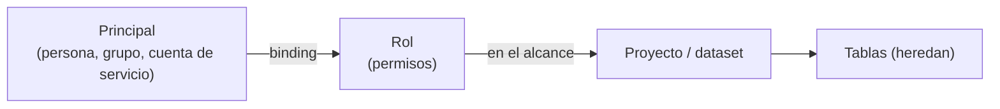

## 1. Resumen

Toda nube y casi toda base de datos responden la misma pregunta: **quién puede hacer qué sobre qué**. El modelo tiene cuatro piezas:

- **principal:** quién (una persona, un grupo, una cuenta de servicio);
- **permiso:** una acción concreta (leer tablas, escribir tablas, conceder acceso);
- **rol:** un conjunto de permisos; se conceden roles, no permisos sueltos (*IAM overview*);
- **binding en un alcance:** el principal recibe el rol sobre un recurso (organización, proyecto, dataset, tabla), y vale también para lo que cuelga de ese recurso.

Las fichas `gcp-iam-for-data`, `aws-iam-for-data` y `entra-id-for-data` tratan cada nube; esta, el modelo común.

## 2. Qué es

| Pieza | Google Cloud | AWS | Azure |
|---|---|---|---|
| Principal | Usuario, grupo, cuenta de servicio | Usuario, grupo, rol | Usuario, grupo, service principal, managed identity |
| Unidad que se concede | Rol | Política (JSON) adjunta a una identidad o a un recurso | Definición de rol |
| Dónde | Allow policy sobre un recurso | Política de identidad o de recurso | Asignación de rol con un ámbito |

## 3. Problema que resuelve

Un equipo da acceso tabla por tabla y persona por persona. Al año hay cientos de permisos sueltos, nadie sabe por qué existe cada uno y una baja de personal deja accesos vivos. Con grupos, roles y bindings en el alcance correcto (el dataset, no cada tabla), los accesos se leen y se revisan.

## 4. Cómo funciona

1. Se definen roles por función (lector, editor, administrador).
2. Las personas entran a grupos; los grupos reciben roles en un alcance.
3. Para decidir, se recorre el recurso y sus ancestros buscando un binding que dé el permiso.
4. Si ninguno lo da, se deniega: el acceso no se supone.
5. Los cambios se hacen sobre bindings, no sobre permisos individuales.

## 5. Cuándo utilizarlo

- Siempre: es el modelo sobre el que se construyen RBAC, ABAC y mínimo privilegio.
- Para revisar accesos: principal, rol, alcance.

## 6. Cuándo no utilizarlo

- Como reemplazo de controles finos dentro de los datos (filas, columnas, máscaras): esos van en la base o el warehouse.

## 7. Ejemplo sencillo

| Pregunta | Resultado | Por qué |
|---|---|---|
| ¿Ana lee `ventas.consumo.pedidos`? | permitido | lector en `dataset/ventas.consumo`, vía `grupo:analistas` |
| ¿Ana escribe esa tabla? | denegado | ningún binding da escritura |
| ¿La cuenta del pipeline escribe esa tabla? | denegado | su rol editor está en `ventas.crudo`, no en `consumo` |
| ¿Plataforma concede accesos sobre esa tabla? | permitido | admin en `proyecto/ventas`, heredado |

## 8. Ejemplo de producción

- Grupos por función y por dominio, administrados en el proveedor de identidad.
- Bindings en el alcance del dataset o el proyecto, declarados en Terraform.
- Cuentas de servicio por pipeline, con roles en su alcance.
- Una revisión trimestral de bindings con los dueños de los datos.

## 9. Arquitectura



## 10. Código

```python
"""El modelo común de IAM: principal, rol (conjunto de permisos), binding en un alcance y herencia hacia abajo.

Se evalúa si un principal puede hacer una acción sobre un recurso, recorriendo el recurso y sus ancestros.
"""
ROLES = {
    "lector": {"tables.read"},
    "editor": {"tables.read", "tables.write"},
    "admin": {"tables.read", "tables.write", "iam.grant"},
}
PADRE = {   # jerarquía de recursos: organización > proyecto > dataset > tabla
    "proyecto/ventas": "org",
    "dataset/ventas.crudo": "proyecto/ventas",
    "dataset/ventas.consumo": "proyecto/ventas",
    "tabla/ventas.consumo.pedidos": "dataset/ventas.consumo",
}
BINDINGS = [  # (principal, rol, alcance)
    ("grupo:analistas", "lector", "dataset/ventas.consumo"),
    ("sa:pipeline-ventas", "editor", "dataset/ventas.crudo"),
    ("usuario:plataforma", "admin", "proyecto/ventas"),
]
MIEMBROS = {"usuario:ana": {"grupo:analistas"}}


def ancestros(recurso: str) -> list[str]:
    cadena = [recurso]
    while cadena[-1] in PADRE:
        cadena.append(PADRE[cadena[-1]])
    return cadena


def puede(principal: str, permiso: str, recurso: str) -> tuple[bool, str]:
    identidades = {principal} | MIEMBROS.get(principal, set())
    for alcance in ancestros(recurso):
        for quien, rol, donde in BINDINGS:
            if quien in identidades and donde == alcance and permiso in ROLES[rol]:
                return True, f"{rol} en {donde} (vía {quien})"
    return False, "sin binding que lo dé"


for principal, permiso, recurso in [
    ("usuario:ana", "tables.read", "tabla/ventas.consumo.pedidos"),
    ("usuario:ana", "tables.write", "tabla/ventas.consumo.pedidos"),
    ("sa:pipeline-ventas", "tables.write", "tabla/ventas.consumo.pedidos"),
    ("usuario:plataforma", "iam.grant", "tabla/ventas.consumo.pedidos"),
]:
    ok, porque = puede(principal, permiso, recurso)
    print(f"{principal} {permiso} {recurso}: {'permitido' if ok else 'denegado'} ({porque})")
```

El script se **ejecuta en la CI** y pasa `mypy --strict`. Imprime las cuatro decisiones con su motivo; Ana lee por el grupo de analistas y la cuenta del pipeline no escribe en `consumo`.

## 11. GCP

En GCP, **IAM**. Según *IAM overview* y *Roles overview* (no ejecutado):

| | Modelo común | IAM de Google Cloud |
|---|---|---|
| Qué se concede | Un rol | Un rol (colección de permisos `servicio.recurso.verbo`), mediante una allow policy; no permisos sueltos |
| Tipos de rol | Por función | Básicos (muy amplios), predefinidos (por servicio, gestionados por Google) y personalizados |

## 12. AWS

En AWS, **IAM**. Según *Policies and permissions in AWS Identity and Access Management* e *IAM roles* (no ejecutado):

| | Modelo común | IAM de AWS |
|---|---|---|
| Qué se concede | Un rol | Políticas en JSON, de identidad (a usuarios, grupos o roles) o de recurso (por ejemplo, a un bucket) |
| Rol | Conjunto de permisos | Una identidad que se asume, sin credenciales de largo plazo; da credenciales temporales |

## 13. Azure

En Azure, **Azure RBAC**. Según *What is Azure role-based access control (Azure RBAC)?* (no ejecutado):

| | Modelo común | Azure RBAC |
|---|---|---|
| Binding | Principal, rol, alcance | Asignación de rol: principal de seguridad, definición de rol y ámbito |
| Denegar | Sin binding, no hay acceso | Además, deny assignments que bloquean aunque haya una asignación |

## 14. Buenas prácticas

- Conceder a grupos, no a personas.
- Bindings en el alcance más alto que sigue siendo correcto, no tabla por tabla.
- Declarar los bindings como código.
- **Seguridad:** sin binding, denegado; revisar bindings heredados.
- **Observabilidad:** auditar quién concedió qué y cuándo.
- **Costo:** permisos sueltos cuestan horas de revisión; grupos y roles las reducen.

## 15. Errores frecuentes

- Permisos a personas en lugar de grupos.
- Olvidar la herencia: un rol en el proyecto vale en todas sus tablas.
- Roles básicos o de administrador «para que funcione».

## 16. Trade-offs

Alcances altos simplifican y amplían el acceso; alcances bajos son precisos y multiplican los bindings. Roles predefinidos son mantenidos por el proveedor y a veces dan de más; roles propios ajustan y hay que mantenerlos.

## 17. Conceptos relacionados

- `rbac`: roles por función.
- `abac`: condiciones por atributos.
- `least-privilege`: cuánto conceder.
- `service-accounts`: principales que no son personas.
- `gcp-iam-for-data`, `aws-iam-for-data`, `entra-id-for-data`: cada nube.

## 18. Preguntas técnicas abiertas

1. ¿Cuántos de tus accesos están dados a personas en lugar de grupos?
2. ¿En qué alcance das acceso a tus datasets?
3. ¿Quién revisa los bindings y cada cuánto?

## 19. Laboratorio relacionado

Pendiente (F4).

## 20. Fuentes

- Google Cloud: *IAM overview* y *Roles overview*.
- AWS: *Policies and permissions in AWS Identity and Access Management* e *IAM roles*.
- Microsoft Learn: *What is Azure role-based access control (Azure RBAC)?*.

El detalle de cada fuente está en `sources` del frontmatter.

## 21. Fecha de última verificación

2026-10-21. Pasa a `verified`: revisión B-F3.1 del lote F3b-18a aplicada y CI en verde (run 39677322697).

## 22. Historial de cambios importantes

- 2026-10-21: creación (lote F3b-18a).
- 2026-10-21: `verification_status: verified` (revisión aplicada; CI en verde, run 39677322697).
