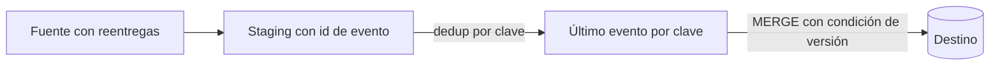

## 1. Resumen

Un proceso es idempotente si ejecutarlo una o varias veces con la misma entrada deja el sistema en el mismo estado. En datos es la condición que hace seguros los reintentos, los reprocesos y los backfills: sin ella, cada reintento puede duplicar o corromper datos.

## 2. Qué es

Es una propiedad del **efecto** de una operación, no de su código. `SET estado = 'pagado'` es idempotente; `saldo = saldo + 10` no lo es. En un pipeline, la unidad idempotente suele ser una tarea (cargar un día, procesar un lote) identificada por una clave estable.

## 3. Problema que resuelve

Los sistemas distribuidos reintentan: un broker reentrega un mensaje, un orquestador relanza una tarea fallida, un operador vuelve a ejecutar un día. Si la escritura no es idempotente, cada reintento produce duplicados o totales inflados, y el error aparece semanas después en un informe.

## 4. Cómo funciona

Las técnicas habituales son:

- **Clave natural o de negocio + upsert** (`MERGE`): repetir la carga actualiza la misma fila en vez de insertar otra.
- **Sobrescritura por partición**: cada ejecución reemplaza por completo la partición que le corresponde (por ejemplo, un día).
- **Deduplicación por identificador de evento**: el consumidor descarta los eventos ya aplicados.
- **Condición de versión**: aplicar un cambio solo si su versión (timestamp, LSN, número de secuencia) es mayor que la ya guardada.

## 5. Cuándo utilizarlo

Siempre que una operación pueda repetirse: consumo de colas o streams con entrega at-least-once, tareas orquestadas con reintentos, backfills y reprocesos, y cargas incrementales.

## 6. Cuándo no utilizarlo

Hay efectos que no deben repetirse y que no se pueden volver idempotentes solo con la escritura. En esos casos se necesita coordinación explícita (registro de ejecuciones, bloqueo o confirmación de dos fases). Ejemplos: enviar un correo o cobrar un pago. Forzar la idempotencia en una tabla de auditoría que debe registrar cada intento también es un error: allí cada intento sí debe contar.

## 7. Ejemplo sencillo

Cargar las ventas del 2026-09-30 reemplazando el día completo **dentro de una transacción**: `DELETE` del día seguido de `INSERT` del día, confirmados juntos. Ejecutarlo dos veces deja el mismo resultado. Sin transacción, un fallo entre ambas sentencias dejaría el día vacío; solo con `INSERT`, la segunda ejecución lo duplicaría.

```sql
-- BigQuery: reemplazo atómico de un día (transacción de varias sentencias).
BEGIN TRANSACTION;
DELETE FROM `proyecto.dataset.ventas` WHERE fecha = '2026-09-30';
INSERT INTO `proyecto.dataset.ventas`
SELECT * FROM `proyecto.dataset.ventas_stg` WHERE fecha = '2026-09-30';
COMMIT TRANSACTION;
```

## 8. Ejemplo de producción

Un consumidor lee eventos de pedidos de Pub/Sub, cuya entrega por defecto es at-least-once. Escribe en staging con el `message_id` y aplica cada 5 minutos un `MERGE` al destino, con clave `order_id` y condición `s.updated_at > t.updated_at`. Un reinicio del consumidor reentrega mensajes, pero el destino no cambia.

## 9. Arquitectura



## 10. Código

```sql
-- BigQuery: carga idempotente de un lote (ejecutable adaptando nombres).
-- Requiere: destino orders(order_id, status, updated_at) y staging orders_stg con las mismas columnas.
MERGE `proyecto.dataset.orders` AS t
USING (
  SELECT * FROM `proyecto.dataset.orders_stg`
  WHERE TRUE
  QUALIFY ROW_NUMBER() OVER (PARTITION BY order_id ORDER BY updated_at DESC) = 1
) AS s
ON t.order_id = s.order_id
WHEN MATCHED AND s.updated_at > t.updated_at THEN
  UPDATE SET status = s.status, updated_at = s.updated_at
WHEN NOT MATCHED THEN
  INSERT (order_id, status, updated_at) VALUES (s.order_id, s.status, s.updated_at);
```

## 11. GCP

- **Pub/Sub** entrega at-least-once por defecto: el consumidor debe ser idempotente. Las suscripciones pull pueden activar exactly-once delivery, pero solo aplica a suscripciones pull (no push ni export) y dentro de una misma región.
- En **BigQuery**, el `MERGE` falla si una fila del destino coincide con más de una fila de origen: hay que deduplicar el lote antes de aplicarlo.

## 12. AWS

En **SQS**, un mensaje que no se procesa bien vuelve a recibirse hasta `maxReceiveCount` veces antes de pasar a la dead-letter queue: el consumidor debe tolerar la repetición. En **Redshift**, `MERGE` cumple el mismo papel que en BigQuery y también falla si varias filas de origen coinciden con una fila del destino; su modo simplificado `REMOVE DUPLICATES` además elimina en silencio los duplicados del destino que coinciden con una fila de origen, y deja los que no coinciden.

## 13. Azure

En **Service Bus**, un mensaje se reentrega hasta su *max delivery count* antes de pasar a la dead-letter queue. En Azure SQL, Synapse y Fabric Warehouse, el `MERGE` de T-SQL da error si una fila del destino coincide con varias filas de origen, igual que en BigQuery. Son mecanismos distintos con el mismo requisito: consumidores y escrituras idempotentes.

## 14. Buenas prácticas

- Diseñar cada tarea con una clave de ejecución estable (fecha lógica, lote o partición), no con "ahora".
- Preferir sobrescribir particiones o usar `MERGE` antes que `INSERT` ciego.
- Guardar un identificador de evento o una versión para poder descartar lo ya aplicado.
- Probar explícitamente la reejecución: correr dos veces y comparar el resultado.
- **Efectos externos** (correo, cobro, llamada a otra API): registrar una clave de idempotencia (id de evento o de operación) antes de producir el efecto y consultarla antes de repetirlo; si el destino externo acepta una clave de idempotencia, enviarla.
- **Observabilidad:** controlar duplicados comparando `COUNT(*)` con `COUNT(DISTINCT clave)` por partición o lote, y alertar si difieren.
- **Seguridad:** el identificador de evento no debe contener datos personales; las tablas de staging y de claves heredan la misma clasificación que el dato.
- **Costo:** un `MERGE` con `UPDATE` o `DELETE` factura origen más destino en BigQuery; filtrar el destino a la ventana afectada lo reduce.

## 15. Errores frecuentes

- Usar la hora de ejecución (`CURRENT_TIMESTAMP`) como clave o filtro: cada reintento procesa otra ventana.
- `INSERT` sin deduplicar tras un reintento del orquestador.
- Asumir exactly-once de extremo a extremo porque un componente lo ofrece.
- Totales acumulativos (`x = x + delta`) sin control de versión.

## 16. Trade-offs

La idempotencia cuesta: más almacenamiento (staging, identificadores), `MERGE` más caros que `INSERT` y diseño adicional. A cambio, los reintentos y backfills se vuelven operaciones rutinarias. Sobrescribir particiones es simple y barato si el grano es la partición; el `MERGE` es más flexible pero lee más datos.

## 17. Conceptos relacionados

- `sql-merge`: la herramienta habitual para escribir idempotentemente.
- `change-data-capture`: el CDC reenvía cambios; el destino debe tolerarlo.
- `dead-letter-queue`: complemento de los reintentos para mensajes que nunca se procesan.
- Con ficha: `retries`, `backfill`, `replay`.
- Del blueprint, pendiente de ficha: `delivery-semantics`.

## 18. Preguntas técnicas abiertas

1. ¿Cómo harías idempotente un pipeline que agrega totales diarios si los eventos pueden llegar duplicados y tarde?
2. ¿Qué diferencia hay entre deduplicar en el consumidor y hacer idempotente la escritura en el destino, y cuándo elegirías cada una?
3. ¿Cómo probarías en CI que una tarea de carga es idempotente?

## 19. Laboratorio relacionado

Pendiente (F4): lab de tipo B "Un pipeline comenzó a insertar duplicados después de un retry" (§25).

## 20. Fuentes

- Google Cloud: *Subscription overview* y *Exactly-once delivery* de Pub/Sub; *DML statements* de BigQuery.
- AWS: *Using dead-letter queues in Amazon SQS*.
- Microsoft Learn: *Service Bus dead-letter queues*; *MERGE (Transact-SQL)*.

El detalle de cada fuente está en `sources` del frontmatter.

## 21. Fecha de última verificación

2026-09-30. Pasa a `verified`: revisión de cb77a2f (B-F3.1 del lote 2) aplicada, sin VERIFY pendientes.

## 22. Historial de cambios importantes

- 2026-09-28: creada como stub en F0.
- 2026-09-30: ficha completa (lote 1 de F3).
- 2026-09-30: revisión B-F3.1 aplicada (docs/reviews/cards-lote1.md): relaciones completas, seguridad, observabilidad y costo, notas de fuentes y ejemplos corregidos.
- 2026-09-30: corregido el comportamiento de `MERGE` en Redshift ante duplicados (detectado al preparar el lote 2): falla con varias filas de origen por fila destino; la eliminación de duplicados del destino es solo del modo `REMOVE DUPLICATES`.
- 2026-09-30: revisión B-F3.1 del lote 2 aplicada: en `REMOVE DUPLICATES`, los duplicados del destino sin coincidencia con el origen no se tocan.
- 2026-09-30: `verification_status: verified` (revisión de cb77a2f (B-F3.1 del lote 2) aplicada; sin VERIFY pendientes).
- 2026-10-06: la sección de conceptos relacionados ya no lista como pendientes de ficha a `retries`, `backfill`, `replay`, que ya tienen ficha.
- 2026-10-13: `page_title` en cada cita, con el título de la página citada (ADR-012); sin cambios de contenido.
