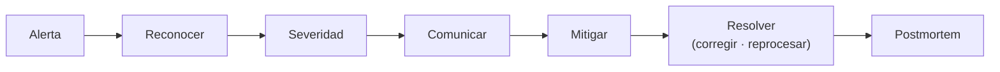

## 1. Resumen

Un **incidente de datos** es una interrupción o degradación que afecta a los consumidores: un tablero incompleto, una tabla atrasada, un modelo entrenado con datos malos. Responder bien es seguir un orden:

1. **detectar** (una alerta);
2. **reconocer** (alguien se hace cargo);
3. **clasificar la severidad** por impacto en los consumidores;
4. **comunicar** a los afectados;
5. **mitigar**: devolver algo usable rápido (la versión de ayer con un aviso, por ejemplo);
6. **resolver**: arreglar la causa y reprocesar;
7. **postmortem**: un registro escrito, sin culpas, con causas y acciones (*Postmortem Culture: Learning from Failure*, libro de SRE de Google).

Mitigar no es resolver: primero se reduce el impacto, después se arregla.

## 2. Qué es

| Paso | Pregunta | Medida |
|---|---|---|
| Detectar | ¿Cuándo nos enteramos? | Tiempo desde el inicio |
| Reconocer | ¿Quién se hizo cargo? | Tiempo desde la detección |
| Severidad | ¿A quién afecta y cuánto? | SEV1, SEV2, SEV3 |
| Comunicar | ¿Lo saben los afectados? | Antes de mitigar |
| Mitigar | ¿Tienen algo usable? | Tiempo desde la detección |
| Resolver | ¿Está arreglado y reprocesado? | Tiempo desde la detección |

## 3. Problema que resuelve

Sin un orden, el incidente lo atiende quien lo ve primero, todos investigan la causa a la vez, nadie avisa a finanzas, y el tablero queda incompleto toda la mañana. Con roles y pasos, uno reconoce, otro comunica, y la mitigación llega antes que la causa.

## 4. Cómo funciona

1. La alerta abre el incidente; la guardia lo reconoce.
2. Se clasifica por impacto: qué tablas, qué consumidores, si hay alguno crítico.
3. Se avisa a los consumidores afectados con qué está mal y cuándo habrá novedades.
4. Se mitiga: publicar la última versión buena con aviso, detener la publicación o marcar los datos como incompletos.
5. Se resuelve: corregir la causa, reprocesar (`backfill`) y reconciliar.
6. Se escribe el postmortem con la línea de tiempo y las acciones.

## 5. Cuándo utilizarlo

- Ante toda alerta que afecta a consumidores.
- Con severidad definida antes del incidente, no durante.
- Siempre con una línea de tiempo.

## 6. Cuándo no utilizarlo

- Para problemas sin impacto en consumidores: van a la cola de trabajo normal.
- Saltando la mitigación para buscar la causa primero.

## 7. Ejemplo sencillo

| Hora | Evento |
|---|---|
| 06:10 | Empieza: el origen deja de enviar la región sur |
| 06:45 | Detectado: alerta de volumen |
| 06:52 | Reconocido por la guardia |
| 07:05 | Comunicado a finanzas |
| 07:40 | Mitigado: versión de ayer con aviso |
| 10:15 | Resuelto: carga completa y reconciliada |

Severidad SEV2 (un consumidor crítico, dos tablas). Detección en 35 min, reconocimiento en 7, mitigación a los 55 y resolución a los 210 desde la detección.

## 8. Ejemplo de producción

- Severidades escritas: SEV1 (varios consumidores críticos o datos regulatorios), SEV2 (un consumidor crítico), SEV3 (sin consumidores críticos).
- Roles: quien coordina, quien investiga, quien comunica.
- Plantillas de aviso para consumidores.
- Una línea de tiempo en el canal del incidente, que alimenta el postmortem.
- Postmortem obligatorio para SEV1 y SEV2.

## 9. Arquitectura



## 10. Código

```python
"""La línea de tiempo de un incidente de datos: severidad por impacto y tiempos de detección, respuesta y mitigación."""
from datetime import datetime

LINEA = [  # (hora, evento)
    ("2026-10-20 06:10", "empieza: el origen deja de enviar la región sur"),
    ("2026-10-20 06:45", "detectado: alerta de volumen en ventas_diarias"),
    ("2026-10-20 06:52", "reconocido: guardia de datos"),
    ("2026-10-20 07:05", "comunicado: aviso a finanzas, el tablero de hoy está incompleto"),
    ("2026-10-20 07:40", "mitigado: se vuelve a publicar la versión de ayer con aviso en el tablero"),
    ("2026-10-20 10:15", "resuelto: el origen reenvía; carga completa y reconciliada"),
]
IMPACTO = {"tablas": ["ventas_diarias", "margen_diario"], "consumidores_criticos": ["finanzas"]}


def severidad(impacto: dict[str, list[str]]) -> str:
    if impacto["consumidores_criticos"]:
        return "SEV1" if len(impacto["tablas"]) > 3 else "SEV2"
    return "SEV3"


t = {evento.split(":")[0]: datetime.fromisoformat(hora) for hora, evento in LINEA}


def minutos(desde: str, hasta: str) -> int:
    return int((t[hasta] - t[desde]).total_seconds() // 60)


print(f"severidad: {severidad(IMPACTO)}")
print(f"tiempo hasta detectar: {minutos('empieza', 'detectado')} min")
print(f"tiempo hasta reconocer: {minutos('detectado', 'reconocido')} min")
print(f"tiempo hasta mitigar: {minutos('detectado', 'mitigado')} min")
print(f"tiempo hasta resolver: {minutos('detectado', 'resuelto')} min")
print(f"consumidores avisados antes de mitigar: {t['comunicado'] < t['mitigado']}")
```

El script se **ejecuta en la CI** y pasa `mypy --strict`. Imprime `severidad: SEV2`, `tiempo hasta detectar: 35 min`, `tiempo hasta reconocer: 7 min`, `tiempo hasta mitigar: 55 min`, `tiempo hasta resolver: 210 min` y `consumidores avisados antes de mitigar: True`.

## 11. GCP

En GCP, **Cloud Monitoring** lleva el estado de las alertas. Según *Postmortem Culture: Learning from Failure* y *Alerts for metric-based alerting policies* (no ejecutado):

| | Respuesta a incidentes (este concepto) | Cloud Monitoring |
|---|---|---|
| Reconocer | Paso explícito, con responsable | Estado Acknowledged, marcado a mano, normalmente porque se investiga |
| Cerrar | Al resolver y reprocesar | Closed cuando la condición deja de cumplirse, alguien la cierra o pasan 7 días |
| Severidad, comunicación, postmortem | Parte del proceso | Las páginas citadas no los tratan: son del proceso del equipo |

## 12. AWS

En AWS, **AWS Systems Manager Incident Manager**. Según *What Is AWS Systems Manager Incident Manager?* (no ejecutado):

| | Respuesta a incidentes (este concepto) | Incident Manager |
|---|---|---|
| Disponibilidad | — | Ya no está abierto a clientes nuevos; los existentes pueden seguir usándolo |
| Definición de incidente | Impacto en los consumidores de datos | Interrupción no planificada o reducción de la calidad del servicio con impacto significativo en el negocio |

Para equipos nuevos en AWS, la respuesta se organiza con las alarmas de CloudWatch (`alerting`) y el proceso propio.

## 13. Azure

En Azure, **Azure Monitor** con action groups. Según *Postmortem Culture: Learning from Failure* y *Action groups* (no ejecutado):

| | Respuesta a incidentes (este concepto) | Action groups |
|---|---|---|
| Avisar | A la guardia y a los consumidores | Voz, SMS, push y correo |
| Automatizar | Mitigaciones conocidas | Webhook, Azure Function o Logic Apps |
| Postmortem | Parte del proceso | La página citada no lo trata |

## 14. Buenas prácticas

- Severidades y roles escritos antes del primer incidente.
- Mitigar antes de buscar la causa.
- Avisar a los consumidores pronto, aunque no se sepa la causa.
- Línea de tiempo en vivo.
- **Seguridad:** el canal del incidente no es lugar para credenciales ni datos personales.
- **Observabilidad:** medir tiempos de detección, reconocimiento y mitigación de cada incidente.
- **Costo:** cada hora de incidente cuesta tiempo de varias personas; la mitigación rápida lo reduce.

## 15. Errores frecuentes

- Todos investigando, nadie comunicando.
- Confundir mitigar con resolver.
- Cerrar el incidente sin reprocesar el período afectado.
- Postmortems que buscan culpables.

## 16. Trade-offs

Un proceso con roles ordena la respuesta y agrega pasos; para incidentes chicos puede ser demasiado, por eso las severidades. Mitigar con la versión de ayer da algo usable y obliga a avisar que está desactualizado.

## 17. Conceptos relacionados

- `alerting`: cómo empieza.
- `root-cause-analysis`: buscar la causa.
- `data-sla`: el impacto contra lo acordado.
- `backfill`: reprocesar el período afectado.

## 18. Preguntas técnicas abiertas

1. ¿Tu equipo tiene severidades escritas?
2. ¿Quién avisa a los consumidores cuando una tabla falla?
3. ¿Cuánto tardaron en mitigar tu último incidente?

## 19. Laboratorio relacionado

Pendiente (F4).

## 20. Fuentes

- Google, *Site Reliability Engineering*: *Postmortem Culture: Learning from Failure*.
- Google Cloud: *Alerts for metric-based alerting policies*.
- AWS: *What Is AWS Systems Manager Incident Manager?*.
- Microsoft Learn: *Action groups*.

El detalle de cada fuente está en `sources` del frontmatter.

## 21. Fecha de última verificación

2026-10-20. Pasa a `verified`: revisión B-F3.1 del lote F3b-16b sin hallazgos en esta ficha, sin VERIFY pendientes.

## 22. Historial de cambios importantes

- 2026-10-20: creación (lote F3b-16b).
- 2026-10-20: revisión B-F3.1 del lote F3b-16b (docs/reviews/cards-f3b-16b.md), sin hallazgos que corregir.
- 2026-10-20: `verification_status: verified` (sin VERIFY pendientes).
