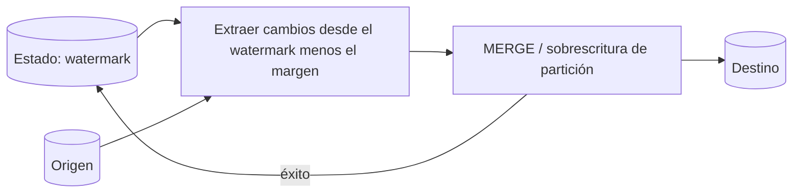

## 1. Resumen

Una carga incremental procesa en cada ejecución solo lo que cambió desde la última vez, en vez de recargar todo. Para eso necesita un criterio fiable para saber qué es "nuevo" (un watermark, un CDC o una partición) y una escritura idempotente en el destino.

## 2. Qué es

Es un patrón de carga con tres piezas:

1. **Detección de lo nuevo**: por marca de agua (`updated_at > último valor`), por partición (el día D) o por CDC.
2. **Aplicación en el destino**: append, sobrescritura de partición o upsert (`MERGE`).
3. **Estado**: dónde se guarda "hasta dónde se cargó".

## 3. Problema que resuelve

Las cargas completas crecen con la tabla: más costo, más tiempo y más carga sobre el origen en cada ejecución. La carga incremental mantiene el trabajo proporcional al cambio, no al tamaño total.

## 4. Cómo funciona

Hay tres variantes de escritura:

- **Append**: para datos inmutables (eventos, logs). Solo se agregan filas nuevas.
- **Sobrescritura por partición**: se reemplaza por completo el período afectado. Es simple e idempotente.
- **Upsert** (`MERGE` por clave): para entidades que cambian (clientes, pedidos).

El watermark debe guardarse **después** de una escritura exitosa y con un margen de solapamiento para cubrir los datos que llegan tarde.

## 5. Cuándo utilizarlo

- Tablas grandes que cambian poco en relación con su tamaño.
- Orígenes con una columna fiable de modificación, particiones temporales o CDC.
- Cargas frecuentes (horarias, cada 15 minutos) donde la carga completa no cabe en la ventana.

## 6. Cuándo no utilizarlo

- Tablas pequeñas: una carga completa es más simple y sin estado.
- Orígenes sin forma fiable de detectar cambios (sin `updated_at`, con borrados físicos invisibles). Allí conviene CDC o una carga completa periódica.
- Cuando la lógica de negocio recalcula toda la historia en cada ejecución.

## 7. Ejemplo sencillo

Cada hora: leer del origen las filas con `updated_at > '2026-09-30 10:00'` (el último watermark), aplicarlas con `MERGE` por `id` y guardar como nuevo watermark el máximo `updated_at` cargado.

## 8. Ejemplo de producción

La tabla de pedidos se carga cada 15 minutos con un watermark que se solapa 30 minutos, para cubrir las transacciones que se confirman tarde en el origen. El `MERGE` con condición de versión absorbe el solapamiento sin duplicar. Una vez por semana, una reconciliación compara conteos y sumas con el origen y, si difieren, dispara un backfill de las particiones afectadas.

## 9. Arquitectura



## 10. Código

```sql
-- Dataform (SQLX), tabla incremental con uniqueKey: la primera vez se construye completa;
-- después solo procesa lo nuevo y fusiona por order_id en lugar de agregar duplicados.
config {
  type: "incremental",
  uniqueKey: ["order_id"]
}

SELECT order_id, status, updated_at
FROM ${ref("raw_orders")}
${when(incremental(),
  `WHERE updated_at > (SELECT MAX(updated_at) FROM ${self()}) - INTERVAL 30 MINUTE`)}
```

## 11. GCP

- **Dataform** tiene tablas `incremental`: la primera ejecución construye la tabla desde cero y las siguientes solo insertan o fusionan filas nuevas según la condición configurada con `when(incremental(), ...)`. Con `uniqueKey`, fusiona las filas de la misma clave en lugar de agregarlas.
- En **BigQuery**, las tablas particionadas permiten escribir una partición concreta sin afectar a las demás, lo que hace idempotente la sobrescritura por período.

## 12. AWS

En un lake consultado con **Athena**, lo incremental suele ser escribir la partición nueva en S3 (y registrarla en el catálogo). En **Redshift**, el modo upsert se implementa con `MERGE` desde una tabla de staging.

## 13. Azure

En el dedicated SQL pool de **Synapse**, el *partition switching* permite cargar un período en una tabla de staging y conmutarlo con la partición del destino, un reemplazo rápido de una sección de la tabla. El upsert se hace con `MERGE` de T-SQL.

## 14. Buenas prácticas

- Guardar el watermark solo tras escribir con éxito, y solapar la ventana.
- Hacer la escritura idempotente (sobrescritura de partición o `MERGE` con versión).
- Tener un modo de carga completa o backfill por rango para recuperarse.
- **Observabilidad:** registrar en cada ejecución el watermark anterior, el nuevo y las filas leídas; alertar si el watermark deja de avanzar y reconciliar periódicamente contra el origen (conteos, sumas, rangos).
- **Costo:** leer solo la ventana nueva (más el solape) es lo que abarata la carga; un solape excesivo, o un origen sin índice ni partición en la columna del watermark, pierde esa ventaja.
- **Seguridad:** leer del origen con un usuario de solo lectura y, si la carga es pesada, desde una réplica; el watermark no debe exponer datos del origen.

## 15. Errores frecuentes

- Watermark basado en la hora de ejecución en lugar de la de los datos.
- Guardar el watermark antes de confirmar la escritura: si esta falla, se pierden datos.
- No detectar borrados en el origen.
- Watermark sin solapamiento: se pierden las filas que se confirman tarde.

## 16. Trade-offs

Menos costo y latencia por ejecución, a cambio de estado que mantener, casos borde (datos tardíos, borrados, reprocesos) y la necesidad de reconciliar. La carga completa es cara pero sin estado y siempre correcta.

## 17. Conceptos relacionados

- `sql-merge`: modo upsert.
- `idempotency`: requisito para reintentos seguros.
- `partitioning`, `bigquery-partitioning`: sobrescritura por período.
- Con ficha: `incremental-pipelines`, `data-reconciliation`, `dataform-incremental-tables`, `change-detection`.

## 18. Preguntas técnicas abiertas

1. ¿Cómo diseñarías el watermark de una carga incremental si el origen confirma transacciones con varios minutos de retraso?
2. ¿Cómo detectarías y propagarías los borrados físicos del origen en una carga incremental por `updated_at`?
3. ¿Qué señales te harían volver de incremental a carga completa?

## 19. Laboratorio relacionado

Pendiente (F4): lab de tipo A "Implementar una carga incremental desde una tabla staging hacia una tabla final" (§25).

## 20. Fuentes

- Google Cloud: *Create tables* (Dataform, tablas incrementales y `uniqueKey`); *Introduction to partitioned tables* (BigQuery).
- AWS: *Partition your data* (Amazon Athena).
- Microsoft Learn: *Partitioning tables in dedicated SQL pool* (Azure Synapse).

El detalle de cada fuente está en `sources` del frontmatter.

## 21. Fecha de última verificación

2026-09-30. Pasa a `verified`: revisión B-F3.1 aprobada y aplicada, sin VERIFY pendientes.

## 22. Historial de cambios importantes

- 2026-09-30: creación (lote 1 de F3).
- 2026-09-30: revisión B-F3.1 aplicada (docs/reviews/cards-lote1.md): relaciones completas, seguridad, observabilidad y costo, notas de fuentes y ejemplos corregidos.
- 2026-09-30: `verification_status: verified` (revisión B-F3.1 aprobada y aplicada; VERIFY resueltos).
- 2026-10-04: §14 con las viñetas Seguridad, Observabilidad y Costo (regla nueva de `validate`).
- 2026-10-06: la sección de conceptos relacionados ya no lista como pendientes de ficha a `incremental-pipelines`, `data-reconciliation`, `dataform-incremental-tables`, que ya tienen ficha.
- 2026-10-07: la sección de conceptos relacionados ya no lista como pendiente de ficha a `change-detection`, que ya tiene ficha.
- 2026-10-13: `page_title` en cada cita, con el título de la página citada (ADR-012); sin cambios de contenido.
- 2026-10-14: lote F3b-rel (regla del §17): relations incluye `change-detection`, `data-reconciliation`, `dataform-incremental-tables`, `incremental-pipelines`.
