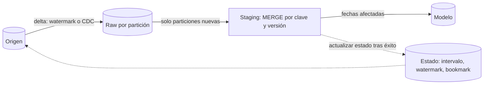

## 1. Resumen

Un pipeline incremental procesa en cada ejecución solo lo nuevo desde la vez anterior, en todas sus etapas y no solo en la carga final. Para eso cada etapa necesita un **estado** que diga dónde retomar (un watermark, un bookmark o el intervalo de la ejecución) y una escritura idempotente, de modo que reejecutar un intervalo no duplique nada.

## 2. Qué es

Es un patrón de diseño de pipeline completo. `incremental-load` resuelve cómo escribir un delta en una tabla. Este patrón resuelve algo más amplio:

- cómo se **detecta** el delta en el origen (watermark, CDC, archivos nuevos);
- dónde se **guarda** el estado (en el orquestador, en el job, en una tabla de control);
- cómo se **propaga** el delta entre etapas (raw → staging → modelo);
- cómo se **repite** un intervalo (reintento, backfill) sin romper nada.

## 3. Problema que resuelve

Reprocesar todo en cada ejecución se vuelve lento y caro a medida que crecen los datos. Pero hacer incremental solo la extracción no basta: si una etapa intermedia recalcula todo, el costo vuelve. Y si el estado vive en un lugar frágil (un archivo local, una variable), un fallo deja al pipeline sin saber desde dónde seguir.

## 4. Cómo funciona

Hay dos formas principales de definir el delta.

- **Por intervalo:** cada ejecución procesa un período fijo (por ejemplo, el día D), que le da el orquestador. En **Airflow**, cada ejecución tiene un *data interval*. El estado es implícito: el intervalo *es* el estado. Reejecutar el día D es repetir exactamente el mismo trabajo.
- **Por marca de progreso:** el pipeline guarda hasta dónde llegó, como un watermark (último `updated_at` o id procesado) o un bookmark. Esa marca solo se actualiza **después** de escribir con éxito.

Después, cada etapa lee solo el delta de la anterior (la partición del período o las filas con marca posterior) y escribe de forma idempotente (reemplazo de partición o `MERGE` por clave).

## 5. Cuándo utilizarlo

- Volúmenes que hacen caro o lento el reproceso completo.
- Orígenes que exponen una marca fiable de cambio (timestamp, id creciente, CDC, archivos por fecha).
- Pipelines de varias etapas en los que cada una puede trabajar por período.

## 6. Cuándo no utilizarlo

- Tablas pequeñas: una recarga completa es más simple y evita errores de estado.
- Orígenes sin una marca fiable de cambio y sin CDC: el delta será incompleto (por ejemplo, borrados invisibles).
- Transformaciones que dependen de toda la historia en cada ejecución (algunas métricas acumuladas): hay que rediseñarlas o aceptar el recálculo completo.

## 7. Ejemplo sencillo

Un pipeline diario procesa solo el día anterior: extrae los pedidos de ese día, los deja en la partición de ese día de la capa raw, y la transformación reemplaza solo esa partición en el modelo. Reejecutar el día repite el mismo trabajo y deja el mismo resultado.

## 8. Ejemplo de producción

La primera etapa lee cambios con CDC y los escribe en raw particionada por fecha de llegada. Una tabla de control guarda, por fuente, el último offset confirmado; se actualiza en la misma transacción que la escritura. La etapa de staging procesa las particiones nuevas y aplica `MERGE` por clave primaria y versión. El modelo final se recalcula solo para las fechas de negocio afectadas. Un backfill no requiere código especial: es reejecutar intervalos.

## 9. Arquitectura



## 10. Código

```sql
-- Etapa incremental por watermark, idempotente y atómica (script de BigQuery).
-- Requiere: etl_control(fuente, watermark) con una fila por fuente y destino con clave pedido_id.
DECLARE wm_anterior TIMESTAMP DEFAULT (
  SELECT watermark FROM `proyecto.dwh.etl_control` WHERE fuente = 'pedidos');
DECLARE corte TIMESTAMP DEFAULT CURRENT_TIMESTAMP();  -- lo posterior a "ahora" espera a otra ejecución
DECLARE wm_nuevo TIMESTAMP;

IF wm_anterior IS NULL THEN
  RAISE USING MESSAGE = 'Falta la fila de etl_control para pedidos: no se procesa nada';
END IF;

-- Lote: una fila por clave, solo entre la marca anterior y el corte (sin timestamps futuros).
CREATE OR REPLACE TEMP TABLE lote AS  -- OR REPLACE: repetir el script en la misma sesión no falla
SELECT * FROM `proyecto.staging.pedidos`
WHERE updated_at > wm_anterior AND updated_at <= corte
QUALIFY ROW_NUMBER() OVER (PARTITION BY pedido_id ORDER BY updated_at DESC) = 1;

-- La marca nueva sale del lote leído, no del destino; con lote vacío no se mueve.
SET wm_nuevo = COALESCE((SELECT MAX(updated_at) FROM lote), wm_anterior);

BEGIN TRANSACTION;

-- Si otra ejecución movió la marca, el error revierte la transacción.
IF (SELECT watermark FROM `proyecto.dwh.etl_control` WHERE fuente = 'pedidos') IS DISTINCT FROM wm_anterior THEN
  RAISE USING MESSAGE = 'etl_control cambió durante la ejecución: se revierte';
END IF;

MERGE `proyecto.dwh.pedidos` AS t
USING lote AS s
ON t.pedido_id = s.pedido_id
WHEN MATCHED AND s.updated_at > t.updated_at THEN
  UPDATE SET estado = s.estado, monto = s.monto, updated_at = s.updated_at
WHEN NOT MATCHED THEN
  INSERT (pedido_id, estado, monto, updated_at) VALUES (s.pedido_id, s.estado, s.monto, s.updated_at);

UPDATE `proyecto.dwh.etl_control`
SET watermark = wm_nuevo
WHERE fuente = 'pedidos' AND watermark = wm_anterior;

COMMIT TRANSACTION;
```

Tres decisiones hacen seguro el avance de la marca:

- **La marca sale del lote leído**, no de `MAX(updated_at)` del destino. Una fila del destino con un timestamp futuro no puede adelantarla y hacer que se salten filas de staging.
- **Timestamps futuros:** solo entra lo que tiene `updated_at <= corte`. Una fila con reloj adelantado espera a una ejecución posterior en lugar de mover la marca hacia el futuro. Conviene contar esas filas y alertar si aparecen.
- **Estado de control ausente o cambiado:** si no existe la fila de `etl_control`, el script se detiene antes de escribir. Si otra ejecución la cambió, el `RAISE` dentro de la transacción la revierte: un error sin manejador hace fallar la consulta y BigQuery revierte la transacción.

El `MERGE` y el avance de la marca van en la misma transacción: si algo falla, la marca no avanza y la siguiente ejecución repite el mismo lote sin duplicar.

## 11. GCP

En **Dataform**, una tabla `incremental` se construye desde cero la primera vez y luego inserta o fusiona solo las filas nuevas; con `uniqueKey` fusiona las filas que tienen la misma clave. La orquestación por intervalos se hace con **Managed Service for Apache Airflow** (según el anuncio del 15 de abril de 2026 en *Managed Service for Apache Airflow release notes*, Cloud Composer «is evolving to become» Managed Service for Apache Airflow): un servicio administrado construido sobre Apache Airflow, así que sus Dags tienen el mismo *data interval*.

## 12. AWS

En **AWS Glue**, los *job bookmarks* guardan qué datos ya procesó un job para no reprocesarlos (en S3, según la fecha de modificación de los objetos). El estado vive en el servicio y no en el intervalo de la ejecución: es cómodo, pero un reproceso obliga a decidir explícitamente qué hacer con el bookmark.

## 13. Azure

**Data Factory** documenta varios enfoques de carga incremental:

- **watermark** en la base de origen: se carga lo cambiado entre el watermark anterior y el nuevo;
- **Change Tracking** de SQL;
- **LastModifiedDate** de archivos: ADF escanea todos los archivos y filtra;
- **carpetas o nombres particionados por tiempo**: el enfoque más eficiente para archivos nuevos.

El estado del watermark lo guarda el propio pipeline (por ejemplo, en una tabla), no el servicio.

## 14. Buenas prácticas

- Preferir el intervalo de la ejecución como estado cuando el origen lo permite: hace triviales los reintentos y los backfills.
- Si se usa watermark, tomarlo del lote procesado (no del destino) y avanzarlo solo después de escribir, en la misma transacción cuando sea posible.
- Acotar cada lote con un corte (`updated_at <= corte`) para que los timestamps futuros no adelanten la marca.
- Hacer incrementales todas las etapas costosas, no solo la extracción.
- Mantener una forma documentada de hacer una recarga completa.
- **Seguridad:** proteger la tabla de control del estado: quien la modifica puede saltarse o repetir datos.
- **Observabilidad:** registrar por ejecución el intervalo o el rango de watermark procesado y las filas leídas y escritas; alertar si el watermark deja de avanzar.
- **Costo:** medir los bytes procesados por etapa; una etapa que recalcula todo anula el ahorro del resto.

## 15. Errores frecuentes

- Avanzar el watermark antes de escribir y perder datos si la escritura falla.
- Calcular la marca nueva como `MAX(updated_at)` de la tabla destino: una fila con timestamp futuro la adelanta y se saltan filas.
- Suponer que la fila de control existe: un `UPDATE` que no afecta filas no da error.
- Usar `>=` o `>` sin pensar en empates de timestamp y perder o duplicar filas.
- Suponer que un watermark por `updated_at` captura los borrados.
- Hacer incremental solo la extracción y recalcular completo en las etapas siguientes.

## 16. Trade-offs

El estado por intervalo es simple y repetible, pero requiere que el origen se pueda consultar por período. El estado por watermark o bookmark se adapta a orígenes sin períodos claros, a cambio de más cuidado al avanzarlo y más complejidad al reprocesar.

## 17. Conceptos relacionados

- `incremental-load`: la escritura del delta en una tabla.
- `idempotency`: requisito para repetir intervalos.
- `change-data-capture`: fuente de deltas completos, incluidos borrados.
- `backfill`: reejecutar intervalos históricos.
- `checkpoints`: guardar hasta dónde se procesó para reanudar sin repetir.
- `watermarks`: la watermark de streaming, distinta de la marca de progreso de una carga incremental.
- Del blueprint, pendiente de ficha: `full-refresh`.

## 18. Preguntas técnicas abiertas

1. ¿Qué estado usarías para un origen que no tiene `updated_at` pero sí un id autoincremental?
2. ¿Cómo detectarías que un pipeline incremental está perdiendo filas silenciosamente?
3. ¿Cómo harías una recarga completa de un pipeline incremental sin detener las ejecuciones diarias?

## 19. Laboratorio relacionado

Pendiente (F4): pipeline incremental con watermark y backfill (lab de tipo A).

## 20. Fuentes

- Apache Airflow: *Dag Runs*.
- Google Cloud: *Create tables* (Dataform); *Multi-statement transactions*, *Procedural language* y *DML syntax* (BigQuery); *Managed Airflow overview* (Managed Service for Apache Airflow).
- AWS: *Tracking processed data using job bookmarks* (Glue).
- Microsoft Learn: *Incrementally copy data from a source data store to a destination data store* (Data Factory).

El detalle de cada fuente está en `sources` del frontmatter.

## 21. Fecha de última verificación

2026-09-30. Pasa a `verified`: revisión B-F3.1 del lote 2 aplicada, sin VERIFY pendientes.

## 22. Historial de cambios importantes

- 2026-09-30: creación (lote 2 de F3).
- 2026-09-30: revisión B-F3.1 aplicada: el watermark sale del lote leído, con corte para timestamps futuros y rollback si falta o cambia la fila de control; nombre y fuente de Managed Service for Apache Airflow.
- 2026-09-30: `verification_status: verified` (revisión B-F3.1 del lote 2 aplicada; sin VERIFY pendientes).
- 2026-10-01: §10 alineada con el snippet `bigquery-incremental-merge-watermark`: `CREATE OR REPLACE TEMP TABLE` (revisión B-F3.2 de snippets).
- 2026-10-13: `page_title` en cada cita, con el título de la página citada (ADR-012); sin cambios de contenido.
- 2026-10-14: lote F3b-rel (regla del §17): relations incluye `checkpoints`; el §17 enlaza `checkpoints`, que ya tienen ficha.
- 2026-10-19: lote F3b-14b (regla del §17): relations y el §17 enlazan `watermarks`, que ya tiene ficha; antes figuraba como pendiente de ficha.
- 2026-10-20: revisión B-F3.1 del lote F3b-16a (docs/reviews/cards-f3b-16a.md): el renombre de Cloud Composer usa la formulación de la página, «is evolving to become» (anuncio del 15 de abril de 2026 en las release notes), en lugar de darlo por terminado.
