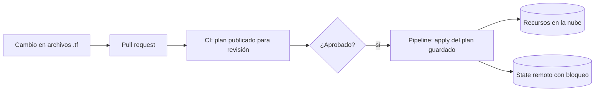

## 1. Resumen

Infraestructura como código (IaC) es definir datasets, buckets, permisos y redes en archivos de texto declarativos, versionados en Git y revisados como cualquier código, que una herramienta aplica de forma repetible. Reemplaza los clics en una consola: el mismo archivo crea el mismo entorno en desarrollo y en producción, y cada cambio queda revisado y registrado.

## 2. Qué es

Es una práctica con tres rasgos:

- **declarativa:** el archivo describe el estado final deseado, no los pasos para llegar a él;
- **versionada:** los archivos viven en un repositorio y cada cambio pasa por revisión;
- **reproducible:** aplicar el mismo archivo da el mismo resultado; volver a aplicarlo sin cambios no modifica nada.

Las herramientas difieren en cómo saben qué existe: Terraform guarda un archivo de **state**; CloudFormation agrupa los recursos en **stacks** que gestiona el servicio; con Bicep, Azure guarda el estado y no hay archivo de state que gestionar.

## 3. Problema que resuelve

La infraestructura creada a mano no se puede reproducir con exactitud, no tiene historial de quién cambió qué y diverge entre entornos. En datos, eso se traduce en un dataset de producción con una partición o un permiso distinto al de pruebas, que nadie recuerda haber configurado.

## 4. Cómo funciona

1. Se escribe la configuración: recursos y sus propiedades (por ejemplo, una tabla de BigQuery particionada).
2. La herramienta compara la configuración con lo que existe y **propone los cambios** (plan, change set o what-if).
3. Una persona o un pipeline revisa la propuesta y la **aplica**.
4. La herramienta registra lo que gestiona (state en Terraform; el servicio en CloudFormation y Bicep) para el próximo cambio.

## 5. Cuándo utilizarlo

- Recursos de datos que deben existir igual en varios entornos (datasets, buckets, tópicos, permisos).
- Equipos que necesitan revisar y auditar cambios de infraestructura.
- Recursos que se recrean (entornos efímeros, recuperación ante desastres).

## 6. Cuándo no utilizarlo

- Recursos que el propio pipeline crea y reemplaza en cada ejecución (por ejemplo, tablas que genera Dataform): gestionarlos también con IaC produce conflictos de propiedad.
- Pruebas exploratorias de una sola vez, que se borran en minutos.
- Datos: IaC define contenedores y permisos, no el contenido de las tablas.

## 7. Ejemplo sencillo

Un archivo define un dataset `dwh` y una tabla `eventos` particionada por día. Aplicarlo en el proyecto de pruebas y en el de producción crea lo mismo en ambos. Cambiar la partición es un cambio en el archivo, revisado en un pull request.

## 8. Ejemplo de producción

El repositorio de la plataforma de datos tiene un directorio por entorno con la misma configuración y variables distintas (proyecto, ubicación). Cada pull request ejecuta `terraform plan` en la CI y publica el resultado para revisión; al aprobar y mergear, un pipeline con una cuenta de servicio dedicada ejecuta `apply` del plan guardado. El state vive en un bucket remoto con versionado y bloqueo. Nadie tiene permisos para crear datasets a mano en producción.

## 9. Arquitectura



## 10. Código

```hcl
# Terraform: la misma configuración para todos los entornos; solo cambian las variables.
# Requiere: Terraform 1.x y el provider hashicorp/google 8.x. Validar sin credenciales:
# terraform init -backend=false && terraform validate
terraform {
  required_providers {
    google = {
      source  = "hashicorp/google"
      version = "~> 8.0"
    }
  }
}

variable "project_id" {
  type = string
}

variable "location" {
  type    = string
  default = "US"
}

provider "google" {
  project = var.project_id
}

resource "google_bigquery_dataset" "dwh" {
  dataset_id = "dwh"
  location   = var.location
}
```

Aplicar este archivo dos veces seguidas no cambia nada la segunda vez: la herramienta compara la configuración con lo que existe y solo propone diferencias. El snippet `terraform-bigquery-partitioned-table` muestra una tabla completa.

## 11. GCP

En Google Cloud, Terraform es la herramienta habitual: su provider de Google Cloud aprovisiona y gestiona los recursos. **Infrastructure Manager** es un servicio administrado que despliega esas mismas configuraciones de Terraform desde Cloud Storage, Git o un directorio local, con previews antes de aplicar, deployments y revisiones. No es otra sintaxis: usa Terraform; cambia quién lo ejecuta y dónde se guarda el estado del despliegue.

## 12. AWS

**CloudFormation** usa templates que describen los recursos de AWS; el servicio los aprovisiona y los agrupa en stacks. Los **change sets** muestran, antes de aplicar, qué recursos se agregarán, modificarán o borrarán. A diferencia de Terraform, no hay un archivo de state que guardar: el estado del stack lo mantiene el servicio. Es solo para AWS.

## 13. Azure

**Bicep** es un lenguaje declarativo para recursos de Azure. Sus archivos son idempotentes y no hay archivos de state que gestionar: Azure guarda el estado. La operación **what-if** muestra los cambios antes de desplegar. Como CloudFormation, es específico de su nube; Terraform, en cambio, usa providers para varias nubes con la misma herramienta.

## 14. Buenas prácticas

- Un repositorio con revisión obligatoria para todo cambio de infraestructura.
- Revisar siempre el plan (o change set, o what-if) antes de aplicar.
- Separar entornos por variables o directorios, con la misma configuración base.
- Fijar la versión de la herramienta y de los providers.
- **Seguridad:** aplicar con una cuenta de servicio dedicada al despliegue, con permisos mínimos; ningún secreto en los archivos (Terraform guarda en el state y en el plan los valores secretos que reciba).
- **Observabilidad:** publicar el plan en cada pull request y registrar cada apply (quién, cuándo, qué cambió).
- **Costo:** revisar en el plan los recursos nuevos o reemplazados antes de aplicar; un cambio que recrea un recurso grande puede costar tiempo y dinero.

## 15. Errores frecuentes

- Mezclar cambios manuales en la consola con IaC: la configuración deja de describir la realidad.
- Aplicar sin leer el plan.
- Guardar el state de Terraform en un lugar sin bloqueo ni control de acceso.
- Gestionar con IaC recursos que otro proceso también crea o borra.

## 16. Trade-offs

IaC da reproducibilidad, revisión y auditoría, a cambio de una curva de aprendizaje y de disciplina: todo cambio pasa por el repositorio. Las herramientas nativas (CloudFormation, Bicep) no requieren gestionar estado, pero sirven para una sola nube; Terraform cubre varias, a cambio de gestionar su state.

## 17. Conceptos relacionados

- `terraform-state`: cómo Terraform sabe qué gestiona.
- `terraform-plan-apply`: el flujo de revisar y aplicar.
- `terraform-providers`: la conexión con cada nube.
- Del blueprint, pendientes de ficha: `ci-cd-pipelines`, `terraform-drift`, `terraform-security`.

## 18. Preguntas técnicas abiertas

1. ¿Qué recursos de tu plataforma de datos dejarías fuera de IaC y por qué?
2. ¿Cómo evitarías que alguien cree un dataset a mano en producción?
3. ¿Qué harías si descubres que un recurso gestionado por Terraform fue cambiado en la consola?

## 19. Laboratorio relacionado

Pendiente (F4): snippets de Terraform para Cloud Storage e IAM (lote 4) y lab de tipo A.

## 20. Fuentes

- HashiCorp: *What is Terraform* y *Manage sensitive data in your configuration*.
- Google Cloud: *Overview of Terraform on Google Cloud* e *Infrastructure Manager overview*.
- AWS: *What is CloudFormation?* y *Update CloudFormation stacks using change sets*.
- Microsoft Learn: *What is Bicep?*.

El detalle de cada fuente está en `sources` del frontmatter.

## 21. Fecha de última verificación

2026-10-01. La ficha queda en `review_required` hasta la revisión humana (B-F3.1).

## 22. Historial de cambios importantes

- 2026-10-01: creación (lote 4 de F3).
