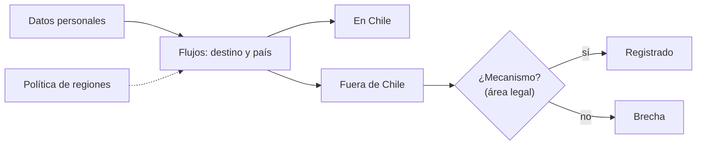

## 1. Resumen

Esta ficha no es asesoría legal: cubre cómo controla ingeniería de datos los flujos de datos personales hacia fuera de Chile.

Para una plataforma en la nube, una **transferencia internacional** ocurre con cosas cotidianas: un warehouse en una región de otro país, la API de un proveedor extranjero, un LLM externo al que se le manda texto con datos personales. La ley la permite con **adecuación** del país (que determina la Agencia), con **instrumentos con garantías** (como cláusulas contractuales) o con un **modelo de cumplimiento**, y solo en casos específicos sin ellos. El área legal decide el mecanismo; ingeniería de datos:

- mantiene el **inventario de flujos** con su destino y su país;
- marca los flujos **sin mecanismo documentado**;
- **restringe regiones** por política para que un flujo nuevo no salga sin revisión.

## 2. Qué es

- **[Obligación legal · art. 27]** La transferencia es lícita con adecuación, con instrumentos con garantías adecuadas o con un modelo de cumplimiento; sin ellos, solo transferencias específicas y no habituales en los supuestos de la ley.
- **[Obligación legal · art. 28]** La Agencia determina los países adecuados y publicará su listado y modelos de cláusulas.
- **[Obligación legal · art. 14 ter]** El responsable informa las transferencias a terceros países y si ofrecen un nivel adecuado de protección.
- **[Decisión de arquitectura]** Cada flujo de datos personales hacia fuera tiene un destino, un país y un mecanismo registrado.

## 3. Problema que resuelve

**[Buena práctica]** Un equipo conecta los tickets de soporte a la API de un LLM externo para resumirlos. Los tickets tienen nombres, correos y RUT. Nadie lo registró como transferencia, nadie revisó el mecanismo, y el dato salió del país en el primer día.

## 4. Cómo funciona

1. **[Decisión de arquitectura]** Inventariar los flujos con datos personales: origen, destino, país.
2. **[Obligación legal · art. 27]** Por cada flujo hacia fuera, registrar el mecanismo que indica el área legal.
3. **[Obligación legal · art. 28]** Usar la lista de países adecuados que publique la Agencia como parámetro, no como suposición.
4. **[Buena práctica]** Marcar como brecha todo flujo sin mecanismo.
5. **[Decisión de arquitectura]** Restringir por política las regiones donde se pueden crear recursos con datos personales.

## 5. Cuándo utilizarlo

- Al elegir regiones de la nube para datos personales.
- Antes de integrar una API externa o un LLM con datos personales.

## 6. Cuándo no utilizarlo

- Para decidir el mecanismo: lo decide el área legal.
- Para flujos sin datos personales (agregados sin personas).

## 7. Ejemplo sencillo

| Flujo | País | Mecanismo |
|---|---|---|
| Warehouse en otra región | US | Cláusulas contractuales |
| API de despacho de un tercero | AR | Cláusulas contractuales |
| API de un LLM externo | US | **Sin mecanismo: brecha** |
| Dashboard SaaS con agregados | US | No aplica: sin datos personales |

## 8. Ejemplo de producción

- El inventario de flujos vive junto al registro de tratamientos.
- Una política de la organización limita las regiones de los recursos con datos personales.
- Integrar una API externa con datos personales pasa por la revisión de privacidad y por el área legal.
- Antes de mandar texto a un LLM externo, se quitan o seudonimizan los datos personales.

### Evidencia de cumplimiento

| Evidencia | Dónde queda | Quién la produce |
|---|---|---|
| Inventario de flujos con país y mecanismo | Registro de tratamientos | Ingeniería de datos y área legal |
| Política de regiones permitidas | Código de infraestructura | Plataforma |
| Brechas detectadas y su cierre | Log del job de inventario | Ingeniería de datos |

## 9. Arquitectura



## 10. Código

```python
# Python 3.12, biblioteca estándar (ejecutado en la CI): inventario de flujos de datos personales hacia fuera de
# Chile. Cada destino (región de la nube, API de un tercero, LLM externo) se cruza con el mecanismo que lo ampara,
# que documenta el área legal; un flujo sin mecanismo es una brecha. La lista de países adecuados la determina la
# Agencia: aquí es un parámetro, no un dato.
from dataclasses import dataclass


@dataclass(frozen=True)
class Flujo:
    origen: str
    destino: str
    pais: str
    personal: bool
    mecanismo: str | None  # adecuación, cláusulas contractuales, modelo de cumplimiento, consentimiento específico


PAISES_ADECUADOS: set[str] = set()  # la publica la Agencia; vacía mientras no exista
FLUJOS = [
    Flujo("silver.clientes", "bucket de respaldo", "CL", True, None),
    Flujo("silver.clientes", "warehouse en otra región de la nube", "US", True, "cláusulas contractuales"),
    Flujo("gold.ventas_por_comuna", "dashboard SaaS", "US", False, None),
    Flujo("tickets_soporte", "API de un LLM externo", "US", True, None),
    Flujo("silver.clientes", "API de despacho de un tercero", "AR", True, "cláusulas contractuales"),
]

internacionales = [f for f in FLUJOS if f.personal and f.pais != "CL"]
print("flujos con datos personales fuera de Chile:", [(f.destino, f.pais) for f in internacionales])
print("amparados por adecuación:", [f.destino for f in internacionales if f.pais in PAISES_ADECUADOS])
print("sin mecanismo documentado:", [f.destino for f in internacionales if f.pais not in PAISES_ADECUADOS and not f.mecanismo])
print("regiones permitidas por política para datos personales:", sorted({"CL"} | {f.pais for f in internacionales if f.mecanismo}))
```

El script se **ejecuta en la CI** con la biblioteca estándar y pasa `mypy --strict`. Imprime los tres flujos con datos personales fuera de Chile, ninguno amparado por adecuación (la lista de la Agencia es un parámetro vacío), el flujo al LLM externo como brecha y las regiones que quedarían permitidas.

## 11. GCP

En GCP, **Organization Policy**. Según *Ley 19628 SOBRE PROTECCION DE LOS DATOS PERSONALES* y *Restrict resource locations* (no ejecutado):

| | Inventario (este ejemplo) | Restricción de ubicaciones | Etiqueta |
|---|---|---|---|
| Qué controla | Flujos y mecanismos | Dónde se crean los recursos nuevos | **[Decisión de arquitectura]** |
| Límite | — | No afecta recursos existentes ni, en algunos servicios, subrecursos | **[Buena práctica]** |

## 12. AWS

En AWS, **IAM** con `aws:RequestedRegion`. Según *Ley 19628 SOBRE PROTECCION DE LOS DATOS PERSONALES* y *AWS global condition context keys* (no ejecutado):

| | Inventario (este ejemplo) | `aws:RequestedRegion` | Etiqueta |
|---|---|---|---|
| Qué controla | Flujos y mecanismos | Qué regiones se pueden llamar | **[Decisión de arquitectura]** |
| Límite | — | No controla el impacto: S3 puede replicar a otras regiones | **[Buena práctica]** |

## 13. Azure

En Azure, **Azure Policy**. Según *Ley 19628 SOBRE PROTECCION DE LOS DATOS PERSONALES* y *Azure Policy built-in policy definitions* (no ejecutado):

| | Inventario (este ejemplo) | «Allowed locations» | Etiqueta |
|---|---|---|---|
| Qué controla | Flujos y mecanismos | Ubicaciones permitidas al desplegar recursos (Audit, Deny o Disabled) | **[Decisión de arquitectura]** |
| Límite | — | Excluye resource groups y recursos de la región «global» | **[Buena práctica]** |

## 14. Buenas prácticas

- **[Obligación legal · art. 14 ter]** Mantener el inventario de transferencias listo para informarlo.
- **[Decisión de arquitectura]** Restringir regiones por política y revisar las excepciones.
- **[Buena práctica]** **Seguridad:** antes de mandar texto a un LLM externo, quitar o seudonimizar los datos personales.
- **[Buena práctica]** **Observabilidad:** alertar cuando un recurso con datos personales aparece en una región no permitida.
- **[Buena práctica]** **Costo:** elegir regiones en Chile o con mecanismo desde el inicio; mover datos después cuesta más.

## 15. Errores frecuentes

- No contar como transferencia la llamada a una API o a un LLM.
- Suponer que un país es adecuado antes de que la Agencia lo publique.
- Restringir regiones solo para recursos nuevos y olvidar los existentes.

## 16. Trade-offs

Regiones solo en Chile simplifican el cumplimiento y pueden limitar servicios o precios; regiones en otros países abren servicios y exigen un mecanismo por flujo.

## 17. Conceptos relacionados

- `chile-data-protection`: el panorama.
- `processing-activities-inventory`: el registro.
- `data-lineage`: qué datos salen.

## 18. Preguntas técnicas abiertas

1. ¿En qué regiones están hoy tus datos personales?
2. ¿Qué APIs externas reciben datos personales?
3. ¿Tus equipos mandan texto con datos personales a LLM externos?

## 19. Laboratorio relacionado

Pendiente (F4).

## 20. Fuentes

- BCN Ley Chile: *Ley 19628 SOBRE PROTECCION DE LOS DATOS PERSONALES* (versión con vigencia diferida desde 2026-12-01).
- Google Cloud: *Restrict resource locations*.
- AWS: *AWS global condition context keys*.
- Microsoft Learn: *Azure Policy built-in policy definitions*.

El detalle de cada fuente está en `sources` del frontmatter.

## 21. Fecha de última verificación

2026-10-21: texto legal consultado ese día en BCN. `review_required`: pendiente de revisión B-F3.1 del lote F3b-19d; pasa a `verified` solo con la aprobación explícita de Felipe (`owner_approved_at`). Revisión mensual.

## 22. Historial de cambios importantes

- 2026-10-21: creación (lote F3b-19d).
