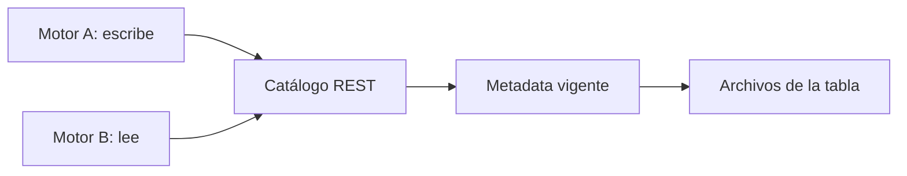

## 1. Resumen

Un formato abierto de tabla (`open-table-formats`) resuelve cómo se guardan los datos. Falta saber **dónde** está cada tabla y quién confirma sus cambios: el catálogo. La **Iceberg REST Catalog API** estandariza esa pieza: cualquier motor que hable REST descubre, lee y escribe la misma tabla, sin un conector por motor (*REST Catalog Spec*). Apache Polaris la implementa y se graduó como Top Level Project de la ASF en 2026; Google Cloud, AWS y OneLake exponen endpoints REST compatibles.

Es emergente: los estándares de catálogo, los formatos de intercambio y su soporte en cada motor cambian rápido. **No reemplaza** el catálogo de gobierno (`data-catalog`): permisos, linaje y calidad siguen en sus herramientas.

## 2. Qué es

- **Catálogo REST:** servicio con una API estándar para namespaces, tablas y commits.
- **Motor:** Spark, Trino, PyIceberg u otro cliente que habla esa API.
- **Commit atómico:** el catálogo decide qué versión de la metadata es la vigente.
- **Credential vending:** el catálogo entrega credenciales temporales para leer los archivos.
- **Implementaciones:** abiertas (Polaris) y administradas (Lakehouse runtime catalog, Glue, OneLake).

## 3. Problema que resuelve

El equipo de datos escribe con Spark, analítica consulta con Trino y ML lee con Python. Con catálogos propietarios, cada motor necesita su conector y las tablas se copian. Con un catálogo REST común, los tres ven la misma tabla, el mismo esquema y la misma última versión.

## 4. Cómo funciona

1. Cada motor se configura con la URI del catálogo REST.
2. Un motor crea la tabla y escribe; el catálogo registra el commit.
3. Otro motor lista las tablas y carga la metadata vigente.
4. Un cambio de esquema en un motor es visible para los demás.
5. El acceso a los archivos se controla con las credenciales del catálogo.

## 5. Cuándo utilizarlo

- Varias herramientas sobre las mismas tablas Iceberg.
- Evitar depender del conector propietario de un motor.
- Arquitecturas lakehouse con motores mezclados.

## 6. Cuándo no utilizarlo

- Con un solo motor y su catálogo nativo: un estándar más no agrega nada.
- Como reemplazo del gobierno: el catálogo REST no define políticas de negocio.
- Sin revisar qué operaciones soporta cada endpoint administrado.

## 7. Ejemplo sencillo

| Paso | Resultado |
|---|---|
| El motor A crea y escribe `ventas.pedidos` | 2 filas |
| El motor B lista las tablas | `[('ventas', 'pedidos')]` |
| El motor B lee | 2 filas |
| El motor A agrega `canal` | El motor B ve `['id', 'monto', 'canal']` |

## 8. Ejemplo de producción

Lakehouse con varios motores:

- un catálogo REST para todas las tablas Iceberg;
- Spark escribe, Trino y Python leen;
- permisos por namespace en el catálogo y gobierno en el catálogo de datos (`data-catalog`);
- en la nube (no ejecutado): Lakehouse runtime catalog de Google Cloud, endpoint REST de Glue o la Iceberg metadata API de OneLake.

## 9. Arquitectura



## 10. Código

```python
# Python 3.12, PyIceberg 0.12 y PyArrow (ejecutado en la CI en Linux; ADR-018 y ADR-026): interoperabilidad por el
# catálogo REST de Iceberg. Dos clientes independientes («motores») hablan con el mismo catálogo REST en un
# contenedor: uno crea y escribe la tabla, el otro la descubre, la lee y ve la evolución del esquema. Ninguno conoce
# al otro: solo comparten la API REST y los archivos. Uso: rest_interop.py <uri del catálogo REST>
import sys

import pyarrow as pa  # type: ignore[import-untyped]  # pyarrow no publica stubs de tipos
from pyiceberg.catalog.rest import RestCatalog
from pyiceberg.types import StringType

URI = sys.argv[1]
escritor = RestCatalog("motor_a", uri=URI)
lector = RestCatalog("motor_b", uri=URI)

escritor.create_namespace("ventas")
tabla = escritor.create_table("ventas.pedidos", schema=pa.schema([("id", pa.int64()), ("monto", pa.float64())]))
tabla.append(pa.table({"id": pa.array([1, 2], pa.int64()), "monto": pa.array([10.0, 20.0], pa.float64())}))

print("el lector descubre:", lector.list_tables("ventas"))
print("filas que lee el lector:", lector.load_table("ventas.pedidos").scan().to_arrow().num_rows)

with escritor.load_table("ventas.pedidos").update_schema() as cambio:     # evolución en el motor A
    cambio.add_column("canal", StringType())
print("columnas que ve el lector:", [f.name for f in lector.load_table("ventas.pedidos").schema().fields])
print("snapshots:", len(lector.load_table("ventas.pedidos").metadata.snapshots))
```

El script se **ejecuta en la CI** con PyIceberg 0.12 contra `apache/iceberg-rest-fixture:1.10.1`, fijada por digest y levantada con `docker run` (ADR-026), en Linux; pasa `mypy --strict`. Imprime lo que descubre y lee el segundo cliente, la columna nueva y los snapshots. La imagen es el fixture de pruebas del proyecto Iceberg, no un catálogo para producción.

## 11. GCP

En GCP, el **Lakehouse runtime catalog**. Según *Set up the Apache Iceberg REST catalog endpoint* (no ejecutado):

| | Este concepto | Google Cloud |
|---|---|---|
| Nombre | — | «BigLake is now called Lakehouse. BigLake metastore is now called the Lakehouse runtime catalog» (desde el 2026-04-20) |
| APIs | Iceberg REST | Las APIs, bibliotecas, CLI e IAM siguen con el nombre BigLake |

## 12. AWS

En AWS, el **endpoint REST de Iceberg de AWS Glue**. Según *Connecting to the Data Catalog using AWS Glue Iceberg REST endpoint* (no ejecutado):

| | Este concepto | AWS Glue |
|---|---|---|
| API | Iceberg REST | Operaciones de la especificación REST de Apache Iceberg |
| Autenticación | Sin autenticación (fixture) | Autenticación de AWS |

## 13. Azure

En Azure, la **OneLake Iceberg metadata API**. Según *OneLake Iceberg metadata API* (no ejecutado):

| | Este concepto | OneLake |
|---|---|---|
| API | Iceberg REST | Iceberg REST Catalog (IRC) para lecturas, escrituras y credential vending |
| Endpoint | Contenedor local | `https://onelake.table.fabric.microsoft.com/iceberg` |

## 14. Buenas prácticas

- Un catálogo por dominio de tablas, no uno por motor.
- Verificar qué operaciones soporta cada endpoint antes de depender de ellas.
- Versionar la configuración de cada motor.
- **Seguridad:** credenciales temporales del catálogo, no llaves de almacenamiento en cada motor.
- **Observabilidad:** commits por tabla y conflictos de concurrencia.
- **Costo:** cada motor paga su cómputo; los archivos se guardan una vez.

## 15. Errores frecuentes

- Copiar tablas entre motores teniendo un catálogo común.
- Asumir que todos los endpoints soportan todas las operaciones.
- Mezclar catálogos para la misma tabla.
- Confundir el catálogo técnico con el de gobierno.

## 16. Trade-offs

Un catálogo común da una sola versión de la verdad a cambio de una pieza central que operar. Un catálogo administrado ahorra operación y fija su propio alcance de la API. Es emergente: la especificación REST y sus implementaciones evolucionan.

## 17. Conceptos relacionados

- `open-table-formats` y `table-format-comparison`: el formato.
- `data-catalog`: el gobierno.
- `open-table-format-evolution`: la evolución del formato.

## 18. Preguntas técnicas abiertas

1. ¿Qué motores leen hoy tus tablas y con qué conectores?
2. ¿Qué tabla se copia entre herramientas?
3. ¿Qué operaciones necesitarías de un catálogo REST administrado?

## 19. Laboratorio relacionado

Pendiente (F4).

## 20. Fuentes

- Apache Iceberg: *REST Catalog Spec*.
- Apache Polaris: *Apache Polaris™* y *Apache Polaris Graduates to Top Level Project!*.
- Google Cloud: *Set up the Apache Iceberg REST catalog endpoint*.
- AWS: *Connecting to the Data Catalog using AWS Glue Iceberg REST endpoint*.
- Microsoft Learn: *OneLake Iceberg metadata API*.

El detalle de cada fuente está en `sources` del frontmatter.

## 21. Fecha de última verificación

2026-10-27. `review_required`: pendiente de revisión B-F3.1 del lote F3b-23b.

## 22. Historial de cambios importantes

- 2026-10-27: creación (lote F3b-23b).
