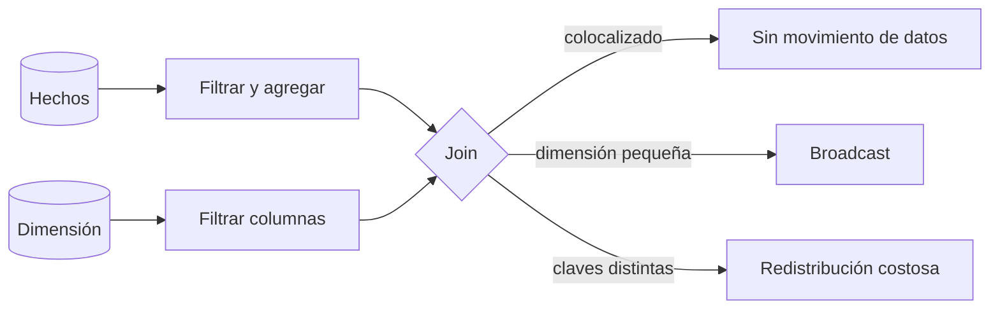

## 1. Resumen

En un warehouse distribuido, un join grande es caro sobre todo por **mover datos** entre nodos o slots para juntar las filas que coinciden. Optimizarlo es, en orden:

1. **Unir menos:** filtrar, seleccionar solo las columnas necesarias y agregar antes del join.
2. **Unir bien:** claves del mismo tipo, preferentemente enteras, sin funciones sobre ellas.
3. **Colocar los datos:** distribuir las tablas por la clave del join (Redshift, Synapse) o dejar que el motor elija broadcast cuando una tabla es pequeña.

El plan de ejecución (ver `query-plans`) es la forma de saber cuál de esas cosas falla.

## 2. Qué es

| Estrategia física | Cuándo conviene | Dónde aparece |
|---|---|---|
| Hash join | Tablas grandes, igualdad | PostgreSQL; Redshift lo nombra al recomendar el sort merge join |
| Merge join | Ambas entradas ordenadas por la clave | PostgreSQL; Redshift (sort merge join) con sort key = dist key |
| Nested loop | Pocas filas a la izquierda e índice a la derecha | PostgreSQL |
| Broadcast | Una tabla pequeña: se copia a todos los nodos o slots | BigQuery; `DS_BCAST_INNER` en Redshift |
| Colocalizado | Ambas tablas distribuidas por la clave del join | `DS_DIST_NONE` en Redshift; tablas hash en Synapse |

## 3. Problema que resuelve

Los modelos analíticos unen tablas de hechos de millones o miles de millones de filas con dimensiones. Un join mal planteado puede redistribuir terabytes, multiplicar filas o desbordar la memoria. Un buen diseño lo resuelve en una fracción del tiempo y del costo.

## 4. Cómo funciona

1. **Reducir antes de unir:**
   - BigQuery recomienda agregar antes del join en consultas con `GROUP BY` y `JOIN`;
   - Fabric recomienda filtrar antes de unir.
2. **Tipos de clave:**
   - BigQuery recomienda `INT64` en lugar de `STRING`, porque no indexa claves y comparar claves anchas es más lento;
   - Synapse exige el mismo tipo en ambas columnas para evitar movimiento de datos;
   - Fabric pide tipos iguales o compatibles y evitar conversiones explícitas.
3. **Distribución:**
   - en Redshift, distribuir hechos y la dimensión más grande por la clave del join colocaliza el join; las dimensiones pequeñas pueden ir con distribución `ALL`;
   - en Synapse, las condiciones son tablas distribuidas por hash por una columna del join, mismo tipo, igualdad y nada de `CROSS JOIN`.
4. **Orden y broadcast en BigQuery:** el optimizador decide los lados, pero la documentación recomienda poner primero la tabla más grande. Con una tabla grande a la izquierda y una pequeña a la derecha se crea un broadcast join.
5. **Restricciones de clave:** BigQuery puede usar claves primarias y foráneas declaradas para optimizar, pero no las verifica. Si los datos no las cumplen, los resultados pueden ser incorrectos.

## 5. Cuándo utilizarlo

- En los joins de los modelos que más tiempo o costo consumen, según el historial de consultas.
- Al diseñar tablas de hechos y dimensiones en motores con distribución explícita (Redshift, Synapse dedicado).
- Cuando el plan muestra redistribución (`DS_DIST_BOTH`, `DS_BCAST_INNER` sobre tablas grandes) o mucho shuffle.

## 6. Cuándo no utilizarlo

- Joins entre tablas pequeñas: el motor los resuelve bien sin ayuda.
- Cambiar la distribución de una tabla por una sola consulta: afecta a todas las demás.
- Declarar claves primarias o foráneas en BigQuery sobre datos que no se garantiza que las cumplan.

## 7. Ejemplo sencillo

```sql
-- Agregar antes de unir: el join recibe una fila por cliente, no una por evento.
WITH por_cliente AS (
  SELECT cliente_id, COUNT(*) AS eventos
  FROM eventos
  WHERE fecha = '2026-10-07'
  GROUP BY cliente_id
)
SELECT c.segmento, SUM(p.eventos) AS eventos
FROM por_cliente AS p
JOIN clientes AS c USING (cliente_id)
GROUP BY c.segmento;
```

## 8. Ejemplo de producción

En Redshift, la tabla de ventas (2 000 millones de filas) estaba distribuida `EVEN` y la dimensión de productos (5 millones) también. El join principal mostraba `DS_DIST_BOTH`. Se distribuyeron ambas por `producto_id`, la clave del join y de alta cardinalidad, y el plan pasó a `DS_DIST_NONE`.

La dimensión de tiendas (300 filas), que no podía colocalizarse con la misma clave, quedó con distribución `ALL`. La documentación advierte el costo: más almacenamiento y cargas más lentas.

## 9. Arquitectura



## 10. Código

```sql
-- PostgreSQL (ejecutado): estrategia elegida para unir eventos (≈1 400 filas) con usuarios (101).
EXPLAIN (COSTS OFF)
SELECT u.nombre, COUNT(*)
FROM eventos AS e
JOIN usuarios AS u ON u.usuario = e.usuario
GROUP BY u.nombre;
--  HashAggregate
--    ->  Hash Join
--          Hash Cond: (e.usuario = u.usuario)
--          ->  Append (particiones de eventos)
--          ->  Hash
--                ->  Seq Scan on usuarios u

-- Redshift (sintaxis documentada; no ejecutado aquí): colocalizar hechos y dimensión por la clave del join.
-- CREATE TABLE ventas (..., producto_id BIGINT, ...) DISTKEY (producto_id) SORTKEY (producto_id);
-- CREATE TABLE productos (producto_id BIGINT, ...) DISTKEY (producto_id) SORTKEY (producto_id);
```

PostgreSQL eligió un hash join con la tabla pequeña (`usuarios`) en la tabla hash, la estrategia que su documentación describe. El ejemplo de Redshift aplica la recomendación de usar la columna del join como distribution key y sort key, que permite un sort merge join. No se ejecutó: requiere AWS.

## 11. GCP

**BigQuery** no tiene claves de distribución. Su guía de rendimiento recomienda:

- poner primero la tabla más grande;
- aprovechar el broadcast join con tablas pequeñas a la derecha;
- claves `INT64` en lugar de `STRING`;
- agregar antes de unir;
- evitar self-joins (usar ventanas o `PIVOT`) y joins que generan más filas que las de entrada.

Las claves primarias y foráneas declaradas ayudan al optimizador, pero no se verifican. El detalle de optimización de BigQuery corresponde a `bigquery-query-optimization` del dominio 08.

## 12. AWS

**Redshift** colocaliza joins distribuyendo hechos y la dimensión más grande por la clave del join (`DISTKEY`). Usa `ALL` para dimensiones que no se pueden colocalizar, y `AUTO` deja la elección al motor. Si la columna del join es además la sort key, el optimizador puede usar un sort merge join. Las etiquetas `DS_*` del plan muestran el movimiento de datos.

## 13. Azure

En el **pool SQL dedicado de Synapse**, las tablas grandes se distribuyen por hash y las pequeñas se replican. Un join no requiere movimiento de datos si ambas tablas están distribuidas por hash por una columna del join, del mismo tipo y con igualdad.

En **Fabric Warehouse**, la guía de rendimiento pide filtrar antes de unir y mantener tipos iguales en las columnas del join. Las estadísticas se crean automáticamente. Esa guía no expone claves de distribución como Synapse dedicado: son modelos distintos aunque ambos sean de Azure.

## 14. Buenas prácticas

- Filtrar y agregar antes del join; seleccionar solo las columnas necesarias.
- Claves de join del mismo tipo, preferentemente enteras.
- En motores con distribución explícita, distribuir hechos y la dimensión principal por la clave del join.
- Verificar la estrategia en el plan después de cada cambio.
- **Seguridad:** replicar o difundir una dimensión copia sus datos en todos los nodos; los permisos no cambian, pero el volumen de datos sensibles en memoria sí.
- **Observabilidad:** registrar el tiempo y los bytes de los joins de los modelos críticos, y alertar cuando aparecen redistribuciones nuevas en el plan.
- **Costo:** el movimiento de datos (shuffle, redistribución, broadcast de tablas que crecieron) es el costo dominante de los joins grandes.

## 15. Errores frecuentes

- Unir primero y filtrar o agregar después.
- Claves de join `STRING` contra `INT64`, con conversión implícita en cada fila.
- Distribuir por una columna de baja cardinalidad, que deja unos pocos nodos con casi todo.
- Una dimensión con `ALL` que creció hasta ser grande.
- Declarar claves no verificadas en BigQuery sobre datos que no las cumplen.

## 16. Trade-offs

Distribuir por la clave de un join acelera ese join y puede empeorar otros que usan otra clave. `ALL` evita movimiento a cambio de almacenamiento y cargas más lentas. Desnormalizar (por ejemplo, con columnas anidadas en BigQuery) evita el join, a cambio de redundancia y de cargas más complejas.

## 17. Conceptos relacionados

- `sql-joins`: la semántica de los joins.
- `query-plans`: cómo leer estrategia y movimiento.
- `star-schema`: hechos y dimensiones.
- `scan-reduction`: leer menos antes de unir.
- Del blueprint, pendiente de ficha: `bigquery-query-optimization`.

## 18. Preguntas técnicas abiertas

1. ¿Cuál es el join más caro de tu warehouse y qué muestra su plan?
2. ¿Qué tabla distribuirías por qué clave si tus consultas usan dos claves de join distintas?
3. ¿Cuándo preferirías desnormalizar en vez de optimizar un join?

## 19. Laboratorio relacionado

Pendiente (F4).

## 20. Fuentes

- Google Cloud: *Optimize query computation* (BigQuery).
- AWS: *Choose the best distribution style*, *Evaluating the query plan* y *Choose the best sort key* (Amazon Redshift).
- Microsoft Learn: *Guidance for designing distributed tables* (Synapse) y *Performance guidelines in Fabric Data Warehouse*.
- PostgreSQL: *Planner/Optimizer*.

El detalle de cada fuente está en `sources` del frontmatter.

## 21. Fecha de última verificación

2026-10-07. En `review_required` hasta la revisión B-F3.1 del lote F3b-02b.

## 22. Historial de cambios importantes

- 2026-10-05: esqueleto creado desde el blueprint (rama `f/sql`).
- 2026-10-07: ficha completa (lote F3b-02b, dominio 02-sql).
- 2026-10-07: revisión B-F3.1 del lote F3b-02b aplicada (docs/reviews/cards-f3b-02b.md): §2 deja hash, merge y nested loop solo en los motores cuyas páginas los nombran; el broadcast, en BigQuery y en `DS_BCAST_INNER` de Redshift.
