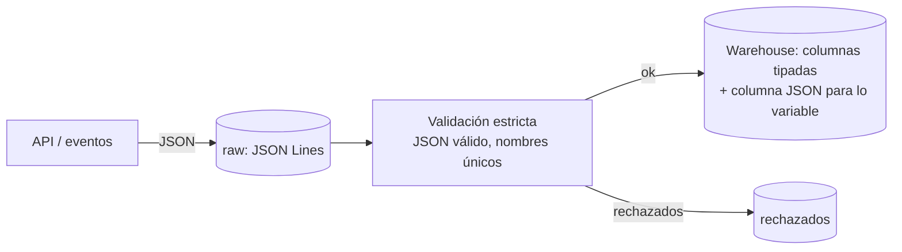

## 1. Resumen

JSON es el formato de texto con que hablan las APIs y muchos sistemas de eventos: objetos con pares nombre-valor, arrays, números, strings, booleanos y null, con anidamiento y sin esquema obligatorio. Para archivos de datos, la variante útil es **JSON delimitado por líneas** (JSON Lines o ndJSON): un objeto por línea, que se procesa registro a registro. Sus trampas son reales: nombres repetidos, números con precisión limitada y esquemas implícitos que cambian sin aviso.

## 2. Qué es

Es un formato estándar, definido en la **RFC 8259**: texto liviano e independiente del lenguaje, derivado de JavaScript. En datos se usa en dos formas:

| Forma | Estructura | Uso |
|---|---|---|
| Documento JSON | Un valor (a menudo un array con todos los registros) | Respuestas de APIs, configuración |
| JSON Lines (ndJSON) | Un objeto JSON por línea | Archivos de datos, logs, cargas a warehouses |

BigQuery carga JSON Lines y lo llama *newline-delimited JSON*. Data Factory reconoce ambos patrones (`setOfObjects` y `arrayOfObjects`).

## 3. Problema que resuelve

Representa datos estructurados y semiestructurados (anidados, con campos opcionales) en un formato legible por personas y soportado por casi cualquier lenguaje. Es el formato natural para intercambiar con APIs y para eventos cuyo esquema varía.

## 4. Cómo funciona

1. **Objetos y arrays:** `{"nombre": valor}` y `[valor, ...]`, anidables.
2. **Nombres únicos:** la RFC dice que los nombres dentro de un objeto *deberían* ser únicos y que, si no lo son, el comportamiento de quien lo recibe es impredecible. El módulo `json` de Python, por ejemplo, conserva el último sin avisar.
3. **Números:** la RFC permite que cada implementación limite el rango y la precisión. Montos o identificadores largos pueden perder exactitud según el lector; por eso a menudo se envían como strings.
4. **Codificación:** UTF-8 cuando se intercambia por red.
5. **Esquema:** no es obligatorio. El lector lo infiere (autodetección) o lo impone al cargar. BigQuery también tiene un tipo `JSON` para guardar el documento sin esquema fijo.

## 5. Cuándo utilizarlo

- Respuestas de APIs y eventos con estructura anidada o variable.
- Zona raw de lo que llega de APIs, guardado tal cual en JSON Lines.
- Logs estructurados (ver `python-logging`).
- Datos semiestructurados que se exploran antes de definir un esquema.

## 6. Cuándo no utilizarlo

- Para la capa analítica que se consulta todos los días: Parquet (columnar) o tablas del warehouse leen mucho menos.
- Para grandes volúmenes de intercambio con esquema estable: Avro es más compacto y tipado.
- Para montos con precisión exacta como números JSON, sin acordar cómo se leen: mejor strings con formato acordado o tipos decimales en el destino.

## 7. Ejemplo sencillo

```text
{"pedido_id": "A1", "monto": 1250, "items": [{"sku": "P1", "cantidad": 2}]}
{"pedido_id": "A2", "monto": 90, "items": []}
```

Dos registros en JSON Lines, cada uno con un array anidado.

## 8. Ejemplo de producción

Una ingesta por API guarda cada página de respuesta en la zona raw como JSON Lines comprimido con gzip. Un paso de validación lee cada línea, rechaza las inválidas y las que tienen nombres repetidos, y aparta lo que no cumple el modelo esperado. Lo válido se carga a BigQuery en columnas tipadas; un atributo de estructura variable (`metadata`) se guarda en una columna `JSON`.

## 9. Arquitectura



## 10. Código

```python
# Python 3.12, solo biblioteca estándar: leer JSON Lines (un objeto por línea) en forma estricta.
# Rechaza líneas inválidas y objetos con nombres repetidos, que el estándar desaconseja porque
# cada implementación los resuelve distinto.
import json
from collections.abc import Iterator
from typing import Any


def unique_keys(pairs: list[tuple[str, Any]]) -> dict[str, Any]:
    keys = [k for k, _ in pairs]
    duplicated = {k for k in keys if keys.count(k) > 1}
    if duplicated:
        raise ValueError(f"nombres repetidos: {sorted(duplicated)}")
    return dict(pairs)


def read_json_lines(lines: Iterator[str]) -> tuple[list[dict[str, Any]], list[tuple[int, str]]]:
    ok: list[dict[str, Any]] = []
    rejected: list[tuple[int, str]] = []
    for number, line in enumerate(lines, start=1):
        if not line.strip():
            continue
        try:
            value = json.loads(line, object_pairs_hook=unique_keys)
            if not isinstance(value, dict):
                raise ValueError("cada línea debe ser un objeto")
            ok.append(value)
        except ValueError as exc:          # json.JSONDecodeError es subclase de ValueError
            rejected.append((number, str(exc)))
    return ok, rejected


if __name__ == "__main__":
    sample = [
        '{"pedido_id": "A1", "monto": 1250}',
        '{"pedido_id": "A2", "monto": 90, "monto": 900}',   # nombre repetido
        '{"pedido_id": "A3", "monto": }',                   # JSON inválido
        '["no", "es", "objeto"]',
    ]
    ok, rejected = read_json_lines(iter(sample))
    print(ok)            # [{'pedido_id': 'A1', 'monto': 1250}]
    for r in rejected:
        print(r)         # líneas 2, 3 y 4, cada una con su motivo
```

Sin `object_pairs_hook`, `json.loads` aceptaría la línea 2 y se quedaría con `monto: 900` sin avisar.

## 11. GCP

**BigQuery** carga JSON delimitado por líneas (un objeto por línea), con autodetección de esquema opcional. Con gzip, la carga no se lee en paralelo y es más lenta, no se mezclan archivos comprimidos y sin comprimir en un job, y cada archivo gzip llega hasta 4 GB. El tipo **`JSON`** guarda documentos sin esquema fijo para consultarlos con schema-on-read, a diferencia de `STRUCT`, que exige esquema. Las políticas de acceso por fila no se aplican a columnas `JSON`.

## 12. AWS

**Redshift** carga JSON con `COPY ... FORMAT AS JSON` desde S3, EMR o SSH (no desde DynamoDB). Con la opción por defecto, `'auto'`, empareja las columnas de la tabla destino con las claves del JSON; también acepta un archivo *jsonpaths* para mapear a mano. No divide las estructuras anidadas en varias columnas. A diferencia del tipo `JSON` de BigQuery, que guarda el documento entero, aquí el JSON se lleva a columnas de una tabla que ya existe.

## 13. Azure

**Data Factory** reconoce dos patrones de archivo: `setOfObjects` (JSON Lines, el valor por defecto al escribir) y `arrayOfObjects` (un array con todos los registros). Admite varios codecs de compresión, aunque la Copy activity no admite `snappy` ni `lz4`. Elegir el patrón al escribir importa: JSON Lines se puede procesar línea a línea; un array único hay que leerlo completo.

## 14. Buenas prácticas

- JSON Lines para archivos de datos; un documento por línea.
- Validar en forma estricta: JSON válido, objetos, nombres únicos.
- Montos e identificadores largos como strings con formato acordado, o tipos decimales al cargar.
- Guardar en la zona raw tal cual llega y tipar al pasar a curated.
- **Seguridad:** las respuestas JSON de APIs suelen traer más campos de los necesarios, incluidos datos personales; seleccionar explícitamente lo que se guarda en capas compartidas.
- **Observabilidad:** contar líneas rechazadas y campos nuevos o faltantes por carga, para detectar cambios de esquema de la fuente.
- **Costo:** JSON ocupa más que formatos binarios o columnares; comprimir en raw y convertir a columnar lo que se consulta seguido.

## 15. Errores frecuentes

- Guardar un array gigante en un solo documento y no poder procesarlo por partes.
- Confiar en que los nombres repetidos "no pasan".
- Perder precisión en montos o identificadores largos al leerlos como números.
- Consultar la zona raw en JSON en lugar de una capa tipada.
- Esperar que la autodetección de esquema adivine bien tipos ambiguos.

## 16. Trade-offs

Legible, flexible y universal, a cambio de tamaño, falta de esquema obligatorio y lecturas más caras. Frente a CSV: admite anidamiento y campos opcionales, pero ocupa más. Frente a Avro: más fácil de inspeccionar y producir, menos compacto y sin resolución de esquemas.

## 17. Conceptos relacionados

- `csv-format` y `avro-format`: alternativas según estructura y esquema.
- `schema-on-read-vs-schema-on-write`: cómo se trata un formato sin esquema.
- `api-ingestion`: la fuente más común de JSON.
- `compression`: comprimir JSON y sus efectos en la carga.
- `python-logging`: logs estructurados en JSON (§5).

## 18. Preguntas técnicas abiertas

1. ¿Cómo guardarías un campo cuyo contenido cambia de estructura entre registros?
2. ¿Qué harías con montos que llegan como números JSON con muchos decimales?
3. ¿Cuándo convertirías la zona raw de JSON a Parquet?

## 19. Laboratorio relacionado

Pendiente (F4).

## 20. Fuentes

- IETF: *RFC 8259, The JavaScript Object Notation (JSON) Data Interchange Format* (referencia canónica).
- Google Cloud: *Load JSON data from Cloud Storage* y *Work with JSON data in GoogleSQL* (BigQuery).
- AWS: *Data format parameters* (Amazon Redshift).
- Microsoft Learn: *JSON format* (Azure Data Factory).
- Python: *json — JSON encoder and decoder*.

El detalle de cada fuente está en `sources` del frontmatter.

## 21. Fecha de última verificación

2026-10-06. Pasa a `verified`: revisión B-F3.1 del lote F3b-01b aplicada, sin VERIFY pendientes.

## 22. Historial de cambios importantes

- 2026-10-06: creación (lote F3b-01b, dominio 01-fundamentals).
- 2026-10-06: revisión B-F3.1 del lote F3b-01b aplicada (docs/reviews/cards-f3b-01b.md), sin cambios pedidos.
- 2026-10-06: `verification_status: verified` (sin VERIFY pendientes).
- 2026-10-13: `page_title` en cada cita, con el título de la página citada (ADR-012); sin cambios de contenido.
- 2026-10-14: lote F3b-rel (regla del §17): relations incluye `python-logging`; el §17 nombra `python-logging`, que el cuerpo ya citaba.
