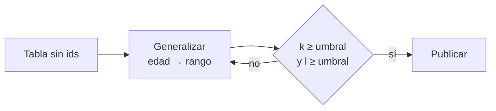

## 1. Resumen

Un conjunto de datos es **k-anónimo** si cada fila comparte sus **cuasi-identificadores** (columnas que solas no identifican, pero combinadas sí: región, edad, sexo) con al menos **k-1 filas más** (*Re-identification risk analysis*). Si k = 1, alguien queda solo en su grupo y se puede encontrar cruzando con otros datos.

- **Medir:** agrupar por los cuasi-identificadores; k es el tamaño del grupo más chico.
- **Subir k:** generalizar (edad exacta → rango) o suprimir columnas.
- **No basta:** si todo un grupo tiene el mismo valor sensible, ese valor se revela igual. Para eso está la **l-diversidad**: cada grupo con al menos l valores sensibles distintos.

k-anonimato es una medida del riesgo, no una garantía: los datos desidentificados a veces se reidentifican (*NIST IR 8053*).

## 2. Qué es

- **Cuasi-identificador:** columna que combinada con otras puede identificar.
- **Clase de equivalencia:** filas con los mismos cuasi-identificadores.
- **k:** el tamaño de la clase más chica.
- **l-diversidad:** cuántos valores sensibles distintos hay, como mínimo, en cada clase.
- **Generalizar:** reemplazar un valor por un rango o una categoría.

## 3. Problema que resuelve

Un equipo publica un extracto sin nombres ni ids, con región, edad, sexo y plan contratado. Una persona de 57 años de la región norte es la única con esa combinación: quien sepa su edad y región conoce su plan. Medir k antes de publicar muestra el problema; generalizar la edad lo reduce.

## 4. Cómo funciona

1. Elegir los cuasi-identificadores (con la clasificación de datos: `data-classification`).
2. Agrupar por ellos y contar: k es el mínimo.
3. Si k es menor que el umbral acordado, generalizar o suprimir y volver a medir.
4. Revisar la l-diversidad: clases donde todos tienen el mismo valor sensible.
5. Registrar k y l con el extracto publicado.

## 5. Cuándo utilizarlo

- Antes de publicar o compartir un extracto a nivel de fila sin identificadores directos.
- Para comparar el riesgo de dos versiones de un mismo extracto.

## 6. Cuándo no utilizarlo

- Como prueba de anonimización: no protege contra todo cruce posible ni contra la homogeneidad de una clase.
- Si se pueden publicar solo agregados: es más simple exigir un mínimo por fila del resultado (como en Clean Rooms).

## 7. Ejemplo sencillo

Ocho filas con región, edad, sexo y plan:

| Paso | Resultado |
|---|---|
| k con la edad exacta | 1 |
| k con la edad en rangos de 10 años | 2 |
| Clases con un solo plan (l = 1) | `norte, 50-59, M` y `sur, 20-29, M` |

Con k = 2, en esas dos clases todos tienen el mismo plan: saber que alguien está en la clase revela su plan.

## 8. Ejemplo de producción

- Lista de cuasi-identificadores por dataset, tomada de la clasificación.
- Antes de cada extracto, un job mide k y l y falla si están por debajo del umbral.
- Generalizaciones definidas (rangos de edad, región en lugar de comuna) y versionadas.
- El resultado (k, l, columnas) queda junto al extracto.

## 9. Arquitectura



## 10. Código

```python
"""k-anonimato y l-diversidad sobre cuasi-identificadores, antes y después de generalizar."""

from collections import defaultdict

Fila = tuple[str, int, str, str]   # (región, edad, sexo, plan), sin identificador directo

DATOS: list[Fila] = [
    ("norte", 34, "F", "premium"), ("norte", 36, "F", "básico"), ("norte", 52, "M", "premium"),
    ("norte", 57, "M", "premium"), ("sur", 41, "F", "básico"), ("sur", 44, "F", "premium"),
    ("sur", 23, "M", "básico"), ("sur", 28, "M", "básico"),
]


def clases(filas: list[tuple[str, str, str, str]]) -> dict[tuple[str, str, str], list[str]]:
    """Clases de equivalencia: filas con los mismos cuasi-identificadores; guarda el valor sensible."""
    grupos: dict[tuple[str, str, str], list[str]] = defaultdict(list)
    for region, edad, sexo, plan in filas:
        grupos[(region, edad, sexo)].append(plan)
    return grupos


def k_de(filas: list[tuple[str, str, str, str]]) -> int:
    return min(len(v) for v in clases(filas).values())


def rango(edad: int) -> str:
    base = edad // 10 * 10
    return f"{base}-{base + 9}"


originales = [(r, str(e), s, p) for r, e, s, p in DATOS]
generalizados = [(r, rango(e), s, p) for r, e, s, p in DATOS]

print(f"k con la edad exacta: {k_de(originales)}")
print(f"k con la edad en rangos de 10 años: {k_de(generalizados)}")
homogeneas = [c for c, planes in clases(generalizados).items() if len(set(planes)) == 1]
print(f"clases con un solo valor de plan (l=1): {homogeneas}")
# La misma cuenta en SQL: SELECT region, edad, sexo, COUNT(*) FROM t GROUP BY region, edad, sexo HAVING COUNT(*) < k
```

El script se **ejecuta en la CI** con la biblioteca estándar y pasa `mypy --strict`. Imprime k = 1 con la edad exacta, k = 2 con rangos de 10 años y las dos clases donde todos tienen el mismo plan. El comentario final muestra la misma cuenta en SQL.

## 11. GCP

En GCP, **Sensitive Data Protection**. Según *Re-identification risk analysis*, *Computing k-anonymity for a dataset* y *Transformation reference* (no ejecutado):

| | Este ejemplo | Sensitive Data Protection |
|---|---|---|
| Medir | Agrupar en Python | Job de análisis de riesgo sobre una tabla de BigQuery; también l-diversidad, k-map y δ-presence |
| Generalizar | Rangos de 10 años | Bucketing de tamaño fijo o con rangos propios |
| Cuidado | — | El job puede guardar valores de los cuasi-identificadores en sus resultados |

## 12. AWS

En AWS, **AWS Clean Rooms**. Según *Re-identification risk analysis* y *Aggregation analysis rule* (no ejecutado):

| | k-anonimato (este ejemplo) | Aggregation constraints de Clean Rooms |
|---|---|---|
| Sobre qué | Un conjunto de filas que se publica | Las filas del resultado de cada consulta agregada |
| Regla | Cada clase con al menos k filas | Cada fila del resultado con `COUNT(DISTINCT columna) >= X`, con X de al menos 2 |

No es lo mismo: Clean Rooms no publica filas individuales; filtra resultados agregados con pocos valores distintos.

## 13. Azure

En Azure, la misma medida con **GROUP BY y HAVING** en Azure SQL. Según *Re-identification risk analysis* y *SELECT - HAVING clause (Transact-SQL)* (no ejecutado):

| | Este ejemplo | Azure SQL |
|---|---|---|
| Medir | Agrupar en Python | `GROUP BY` por los cuasi-identificadores y `HAVING COUNT(*) < k` para listar las clases chicas |
| Generalizar | En el script | En la consulta o en una vista |

Es una consulta, no un servicio: la elección de cuasi-identificadores y la l-diversidad quedan a cargo del equipo.

## 14. Buenas prácticas

- Elegir los cuasi-identificadores con quien conoce los datos y qué otros datos hay afuera.
- Medir también la l-diversidad.
- Generalizar antes que suprimir filas, y registrar cuánto se perdió.
- **Seguridad:** k-anonimato no reemplaza el control de acceso; un extracto con k alto sigue siendo información interna.
- **Observabilidad:** guardar k y l de cada extracto publicado.
- **Costo:** medir sobre tablas grandes es un escaneo completo; correrlo al publicar, no en cada carga.

## 15. Errores frecuentes

- Olvidar un cuasi-identificador (la fecha exacta, el código postal).
- Mirar solo k e ignorar la homogeneidad de las clases.
- Publicar dos extractos distintos del mismo dataset que, cruzados, bajan k.

## 16. Trade-offs

Más generalización da más k y menos utilidad: un rango de 10 años sirve para un informe y no para un estudio por edad. Suprimir columnas protege más que generalizar y puede dejar el extracto sin uso.

## 17. Conceptos relacionados

- `pseudonymization-vs-anonymization`: dónde encaja esta medida.
- `data-classification`: qué columnas son cuasi-identificadores.

## 18. Preguntas técnicas abiertas

1. ¿Qué columnas de tus extractos son cuasi-identificadores?
2. ¿Cuál es el k de tu último extracto compartido?
3. ¿Qué otros datos públicos podría cruzar quien lo recibe?

## 19. Laboratorio relacionado

Pendiente (F4).

## 20. Fuentes

- Google Cloud: *Re-identification risk analysis*, *Computing k-anonymity for a dataset* y *Transformation reference* (Sensitive Data Protection).
- AWS: *Aggregation analysis rule* (Clean Rooms).
- Microsoft Learn: *SELECT - HAVING clause (Transact-SQL)*.
- NIST: *IR 8053, De-Identification of Personal Information*.

El detalle de cada fuente está en `sources` del frontmatter.

## 21. Fecha de última verificación

2026-10-21. `review_required`: pendiente de revisión B-F3.1 del lote F3b-18c.

## 22. Historial de cambios importantes

- 2026-10-21: creación (lote F3b-18c).
