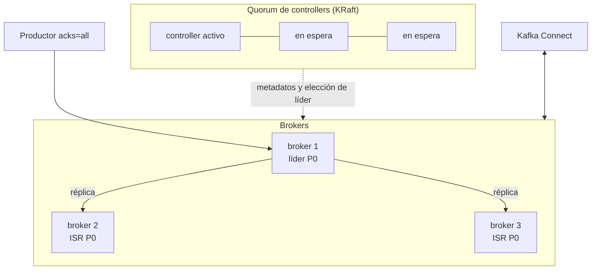

## 1. Resumen

Un clúster de Kafka tiene dos roles. Los **brokers** guardan las particiones de los topics y atienden a productores y consumidores. Los **controllers**, en modo KRaft, forman un quorum que guarda los metadatos del clúster: qué topics hay, qué broker lidera cada partición, qué réplicas están sincronizadas.

La durabilidad sale de tres piezas:

- **replicación por partición**, con factor 3 como configuración habitual de producción;
- **ISR** (in-sync replicas): un mensaje está confirmado cuando lo aplicaron todas las réplicas del ISR;
- **`min.insync.replicas` con `acks=all`**: el mínimo de réplicas sincronizadas para aceptar una escritura; el escenario típico es factor 3, mínimo 2 y `acks=all`. Desde Kafka 4.0, Eligible Leader Replicas (activado por defecto en clústeres nuevos desde 4.1) cambia esa semántica.

Además, la **compactación** conserva el último valor de cada clave, y Kafka trae APIs para procesar (Streams) e integrar sistemas (Connect).

## 2. Qué es

- **Broker:** guarda particiones y sus réplicas.
- **Controller:** miembro del quorum de metadatos de KRaft; uno activo y los demás en espera; se suelen usar 3 o 5.
- **Servidor combinado:** broker y controller a la vez (`process.roles=broker,controller`); más simple para entornos chicos.
- **Líder, réplicas e ISR:** cada partición tiene un líder; el ISR es el conjunto de réplicas al día.
- **ELR:** réplicas fuera del ISR que el controller considera seguras para ser líderes.
- **Compactación:** `cleanup.policy=compact` retiene al menos el último valor por clave en cada partición.
- **Connect y Streams:** conectores con otros sistemas y procesamiento de topics a topics.

## 3. Problema que resuelve

Un equipo usa Kafka como si fuera una cola y pierde mensajes cuando cae un broker. Mirando la arquitectura descubre que los topics tienen factor 1 y que el productor usa `acks=1`. Con factor 3, `min.insync.replicas=2` y `acks=all`, una escritura aceptada está en al menos dos réplicas. Para una tabla de saldos, un topic compactado guarda el último saldo de cada cuenta sin crecer sin límite.

## 4. Cómo funciona

1. Los controllers eligen un líder del quorum y mantienen los metadatos.
2. Cada partición tiene un broker líder; los demás brokers con réplicas la copian.
3. El productor escribe en el líder; con `acks=all`, espera a que la escritura llegue a todo el ISR.
4. Si el ISR queda por debajo de `min.insync.replicas`, la escritura se rechaza (o, con ELR, el high watermark no avanza).
5. Si cae el líder, el controller elige otro: primero del ISR, después del ELR.
6. En un topic compactado, el log cleaner reescribe los segmentos cerrados y deja el último valor de cada clave.

## 5. Cuándo utilizarlo

- Kafka propio cuando hace falta control total de versión, configuración y red.
- Factor 3 y `min.insync.replicas=2` para datos que no se pueden perder.
- Topics compactados para estado por clave (saldos, configuraciones, el último estado de una entidad).

## 6. Cuándo no utilizarlo

- Factor 1 en producción.
- Topics compactados como reemplazo de una base de datos con consultas.
- Operar un clúster propio cuando un servicio administrado cubre el caso (ver §11 a §13).

## 7. Ejemplo sencillo

Un broker de un nodo en KRaft es su propio controller: el quorum tiene un solo votante. Un topic `saldos` compactado, con una partición, recibe cinco eventos de dos cuentas. Después de compactar, quedan `cuenta-1=75` y `cuenta-2=60`: el último saldo de cada una.

## 8. Ejemplo de producción

Un clúster de Kafka para los eventos de la empresa:

- tres controllers dedicados y seis brokers, en tres zonas;
- factor 3, `min.insync.replicas=2` y productores con `acks=all`;
- topics de eventos con `delete` y retención por tiempo; topics de estado con `compact`;
- Kafka Connect para traer cambios de las bases y llevar eventos al lake;
- alertas por particiones con el ISR por debajo del mínimo.

## 9. Arquitectura



## 10. Código

```bash
# Bash y Kafka (ejecutado en la CI con un broker Kafka 4.3.1 en KRaft, en Docker; ADR-017): el quorum de controllers que
# guarda los metadatos, el estado de una partición (líder, réplicas, ISR, ELR) y la compactación del log, que conserva
# el último valor de cada clave. Segmentos chicos y una proporción baja de log sucio hacen que el cleaner compacte pronto.
set -euo pipefail
K="${KAFKA_CONTAINER:-dekh-kafka}"
kafka() { docker exec -i "$K" /opt/kafka/bin/"$1" --bootstrap-server localhost:9092 "${@:2}"; }
trap 'kafka kafka-topics.sh --delete --topic saldos > /dev/null 2>&1 || true' EXIT

kafka kafka-metadata-quorum.sh describe --status | grep -E '^(LeaderId|CurrentVoters):' | tr -s ' '

kafka kafka-topics.sh --create --topic saldos --partitions 1 --replication-factor 1 \
  --config cleanup.policy=compact --config segment.ms=100 --config min.cleanable.dirty.ratio=0.01 > /dev/null
kafka kafka-topics.sh --describe --topic saldos | awk -F'\t' '/^\tTopic/ {print $3 ", " $4 ", " $5 ", " $6}'

send() { printf '%s\n' "$@" | kafka kafka-console-producer.sh --topic saldos --reader-property parse.key=true \
           --reader-property key.separator='|'; }
send 'cuenta-1|100' 'cuenta-2|50' 'cuenta-1|90' 'cuenta-1|75' 'cuenta-2|60'
read_all() { kafka kafka-console-consumer.sh --topic saldos --from-beginning --timeout-ms 5000 \
               --formatter-property print.key=true 2> /dev/null; }
echo "antes de compactar: $(read_all | wc -l) eventos"

for _ in $(seq 1 30); do   # el segmento activo no se compacta: un evento nuevo cierra el anterior
  sleep 2
  send 'cierre|0'
  remaining=$(read_all | grep -c '^cuenta-' || true)
  [ "$remaining" -le 2 ] && break
done
echo "después de compactar: $(read_all | grep '^cuenta-' | sort | tr '\t\n' '= ')"
```

El script se **ejecuta en la CI contra un broker Kafka 4.3.1 en KRaft, en Docker** (ADR-017). Imprime el líder del quorum y sus votantes, el estado de la partición (`Leader: 1, Replicas: 1, Isr: 1`), `antes de compactar: 5 eventos` y `después de compactar: cuenta-1=75 cuenta-2=60`. La compactación la hace el log cleaner en segundo plano, por eso el script espera hasta verla. La regla de `min.insync.replicas` necesita varios brokers y se cita de *Topic Configs* y *Eligible Leader Replicas*; con un solo broker no se reproduce.

## 11. GCP

En GCP, el broker administrado que citan las fichas es **Pub/Sub**, que no es Kafka. Según *Subscription overview* (no ejecutado):

| | Kafka | Pub/Sub |
|---|---|---|
| Modelo | Topics particionados, grupos de consumidores con offsets | Topics y suscripciones; cada suscripción recibe los mensajes publicados después de crearla |
| Qué opera el equipo | Brokers, controllers y réplicas | Nada de infraestructura |

## 12. AWS

En AWS, **Amazon MSK** es Kafka administrado. Según *Welcome to the Amazon MSK Developer Guide* y *Supported Apache Kafka versions* (no ejecutado):

| | Kafka propio | Amazon MSK |
|---|---|---|
| Qué opera el equipo | Todo el clúster | MSK opera el plano de control (crear, actualizar y borrar clústeres); se usa el plano de datos de Kafka |
| Versiones | Las que elija el equipo, como 4.3 en esta ficha | Las que lista MSK: 4.2.x, 4.1.x, 4.0.x, 3.9.x y anteriores (consultado el 2026-10-12) |

## 13. Azure

En Azure, **Event Hubs** expone un endpoint de Kafka. Según *What is Azure Event Hubs for Apache Kafka?* (no ejecutado):

| | Kafka | Event Hubs |
|---|---|---|
| Qué es | El clúster de Kafka | Un servicio propio con un endpoint compatible con Kafka |
| Clientes | Clientes de Kafka | Muchas aplicaciones de Kafka se conectan cambiando solo la configuración |

## 14. Buenas prácticas

- Factor 3, `min.insync.replicas=2` y `acks=all` para datos importantes.
- 3 o 5 controllers en producción, separados de los brokers cuando el clúster crece.
- `compact` para estado por clave; `delete` para eventos.
- **Seguridad:** autenticación de clientes y autorización por topic; cifrado entre brokers y clientes.
- **Observabilidad:** particiones con el ISR por debajo del mínimo, líder del quorum, lag de los consumidores.
- **Costo:** el factor de replicación multiplica el almacenamiento y el tráfico entre zonas.

## 15. Errores frecuentes

- Factor 1 o `acks=1` en datos que no se pueden perder.
- Un número par de controllers.
- Esperar que un topic compactado quede con un solo evento por clave al instante: el segmento activo no se compacta.
- Copiar un manual de Kafka 3.x sobre ZooKeeper a un clúster 4.x en KRaft.

## 16. Trade-offs

Más réplicas y un `min.insync.replicas` alto dan durabilidad, a cambio de latencia y de rechazar escrituras cuando faltan réplicas. KRaft elimina un sistema aparte para los metadatos, a cambio de operar el quorum. La compactación mantiene el estado por clave con almacenamiento acotado, con un proceso en segundo plano que hay que vigilar.

## 17. Conceptos relacionados

- `topics-and-partitions`: la unidad de replicación.
- `message-brokers`: el rol de broker.
- `offsets`: la posición de los consumidores.
- `delivery-semantics`: acks y durabilidad.
- `exactly-once-semantics`: transacciones entre topics.
- `msk-managed-kafka`: Kafka en AWS.
- `event-hubs-streaming`: el endpoint de Kafka en Azure.

## 18. Preguntas técnicas abiertas

1. ¿Con qué factor de replicación y `min.insync.replicas` corren tus topics críticos?
2. ¿Qué datos de tu plataforma serían un buen topic compactado?
3. ¿Qué te da operar Kafka que no te da MSK o Event Hubs?

## 19. Laboratorio relacionado

Pendiente (F4).

## 20. Fuentes

- Apache Kafka 4.3: *Introduction*, *KRaft*, *Design*, *Topic Configs*, *Eligible Leader Replicas* y *API*.
- Google Cloud: *Subscription overview*.
- AWS: *Welcome to the Amazon MSK Developer Guide* y *Supported Apache Kafka versions*.
- Microsoft Learn: *What is Azure Event Hubs for Apache Kafka?*.

El detalle de cada fuente está en `sources` del frontmatter.

## 21. Fecha de última verificación

2026-10-20. `review_required`: pendiente de revisión B-F3.1 del lote F3b-20a.

## 22. Historial de cambios importantes

- 2026-10-20: creación (lote F3b-20a).
