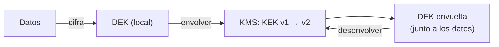

## 1. Resumen

Gestionar claves es decidir **dónde viven**, **quién las usa**, **cómo se rotan** y **cómo se destruyen**. El patrón base en las tres nubes es **envelope encryption**:

- una **DEK** (data encryption key) cifra los datos; se genera localmente y se guarda **envuelta**, cerca de los datos (*Envelope encryption*, Cloud KMS);
- una **KEK** (key encryption key) envuelve la DEK; vive en el KMS y no sale de él;
- **rotar la KEK** es re-envolver las DEK, sin volver a cifrar los datos.

Un detalle que suele sorprender: en Cloud KMS, rotar crea una versión nueva pero **no** vuelve a cifrar los datos ni deshabilita las versiones anteriores (*Key rotation*).

## 2. Qué es

- **DEK:** cifra los datos; muchas, chicas, cerca de los datos, siempre envueltas.
- **KEK:** envuelve DEK; pocas, en el KMS, con acceso controlado y auditado.
- **Versión de clave:** cada rotación crea una; las anteriores siguen sirviendo para descifrar mientras existan.
- **Destrucción:** borrar una versión deja ilegible lo que solo ella puede descifrar.

## 3. Problema que resuelve

Una aplicación cifra todo con una clave guardada en un archivo de configuración. Rotarla obligaría a descifrar y volver a cifrar terabytes, así que nunca se rota; y quien lee la configuración lee todos los datos. Con envelope encryption, la KEK está en el KMS, la aplicación solo pide envolver o desenvolver, y rotar es re-envolver unas pocas DEK.

## 4. Cómo funciona

1. Se genera una DEK localmente y se cifran los datos con ella.
2. Se pide al KMS que la envuelva con la KEK; se guarda la DEK envuelta junto a los datos y se descarta la DEK en claro.
3. Para leer, se pide al KMS que desenvuelva la DEK y se descifran los datos.
4. Para rotar la KEK: se desenvuelve cada DEK con la versión vieja y se envuelve con la nueva; los datos no se tocan.
5. Cuando ninguna DEK depende de la versión vieja, se puede destruir.

## 5. Cuándo utilizarlo

- Siempre que la aplicación cifre datos propios.
- Con claves propias en la nube (CMEK) para controlar rotación y destrucción.

## 6. Cuándo no utilizarlo

- Inventando un algoritmo o un formato propio: se usan las primitivas de una biblioteca y el KMS del proveedor.
- Con una sola DEK para todo: la guía de Cloud KMS recomienda no compartir una DEK entre datos de distintos usuarios.

## 7. Ejemplo sencillo

| Paso | Resultado |
|---|---|
| Cifrar «ventas de octubre» con una DEK y envolverla con la KEK v1 | DEK envuelta con la KEK v1 |
| Rotar la KEK y re-envolver la DEK | DEK envuelta con la KEK v2; la v1 se destruye; los datos no se vuelven a cifrar |
| Descifrar | «ventas de octubre» |

## 8. Ejemplo de producción

- Una KEK por dominio de datos en el KMS, con rotación automática.
- Una DEK por archivo o por lote, generada al escribir y guardada envuelta en los metadatos del archivo.
- Acceso a «envolver/desenvolver» solo para las cuentas de servicio de los pipelines de ese dominio, con auditoría.
- Un job re-envuelve las DEK después de cada rotación; las versiones viejas se destruyen cuando nada depende de ellas.

## 9. Arquitectura



## 10. Código

```python
# Python 3.12 y cryptography (ejecutado en la CI; ADR-022): envelope encryption. Una clave de datos (DEK) por dataset
# cifra los datos; una clave de cifrado de claves (KEK), que en producción vive en un KMS y no sale de él, envuelve la
# DEK. Rotar la KEK es re-envolver las DEK, sin volver a cifrar los datos.
import os

from cryptography.hazmat.primitives.ciphers.aead import AESGCM
from cryptography.hazmat.primitives.keywrap import aes_key_unwrap, aes_key_wrap


class KmsSimulado:
    """Lo que hace un KMS: guarda las KEK por versión y solo envuelve o desenvuelve; la KEK no sale."""

    def __init__(self) -> None:
        self._versiones: dict[int, bytes] = {1: AESGCM.generate_key(bit_length=256)}

    @property
    def primaria(self) -> int:
        return max(self._versiones)

    def envolver(self, dek: bytes) -> tuple[int, bytes]:
        return self.primaria, aes_key_wrap(self._versiones[self.primaria], dek)

    def desenvolver(self, version: int, envuelta: bytes) -> bytes:
        return aes_key_unwrap(self._versiones[version], envuelta)

    def rotar(self) -> None:
        self._versiones[self.primaria + 1] = AESGCM.generate_key(bit_length=256)

    def destruir(self, version: int) -> None:
        del self._versiones[version]


kms = KmsSimulado()
dek = AESGCM.generate_key(bit_length=256)
nonce = os.urandom(12)
datos = AESGCM(dek).encrypt(nonce, b"ventas de octubre", None)
version, dek_envuelta = kms.envolver(dek)                # se guarda junto a los datos; la DEK en claro se descarta
del dek
print(f"DEK envuelta con la KEK v{version}; datos cifrados: {len(datos)} bytes")

kms.rotar()
version, dek_envuelta = kms.envolver(kms.desenvolver(version, dek_envuelta))   # re-envolver, sin tocar los datos
kms.destruir(1)
print(f"tras rotar: DEK envuelta con la KEK v{version}; la v1 se destruyó; datos sin volver a cifrar")
print("descifrar:", AESGCM(kms.desenvolver(version, dek_envuelta)).decrypt(nonce, datos, None).decode())
```

El script se **ejecuta en la CI con cryptography** (ADR-022) y pasa `mypy --strict`. La clase `KmsSimulado` hace de KMS: guarda las KEK por versión, envuelve y desenvuelve con `aes_key_wrap`, rota y destruye. Imprime la DEK envuelta con la v1, la rotación a la v2 con la v1 destruida, y el descifrado correcto.

## 11. GCP

En GCP, **Cloud KMS**. Según *Key wrapping*, *Envelope encryption* y *Key rotation* (no ejecutado):

| | KMS simulado (este ejemplo) | Cloud KMS |
|---|---|---|
| DEK | Una por dataset | La guía: generarla localmente, una nueva en cada escritura, no compartirla entre usuarios |
| Rotar | Crear versión y re-envolver | Crea versiones nuevas; no re-cifra los datos ni deshabilita las anteriores, que siguen activas y con costo |

## 12. AWS

En AWS, **AWS KMS**. Según *Key wrapping*, *AWS KMS cryptography essentials* y *Rotate AWS KMS keys* (no ejecutado):

| | KMS simulado (este ejemplo) | AWS KMS |
|---|---|---|
| Envelope | DEK envuelta por la KEK | Clave por mensaje cifrada con una clave estática de más largo plazo, empaquetadas juntas |
| Rotación | Manual en el ejemplo | Automática cada año por defecto, con período propio o a pedido |

## 13. Azure

En Azure, **Azure Key Vault**. Según *Key wrapping* y *Configure cryptographic key auto-rotation in Azure Key Vault* (no ejecutado):

| | KMS simulado (este ejemplo) | Azure Key Vault |
|---|---|---|
| Rotación | Manual | Política de rotación por clave, con la frecuencia elegida |
| Recomendación | — | Rotar las claves de cifrado al menos cada dos años |

## 14. Buenas prácticas

- Envelope encryption; la KEK no sale del KMS.
- DEK nuevas al escribir; nunca una DEK para todo.
- Rotación automática de la KEK y re-envoltura de las DEK.
- **Seguridad:** acceso a envolver y desenvolver solo para quien lo necesita, con auditoría.
- **Observabilidad:** registrar cada uso de la KEK y alertar por usos inesperados.
- **Costo:** en Cloud KMS, las versiones anteriores siguen activas y con costo hasta deshabilitarlas o destruirlas (*Key rotation*).

## 15. Errores frecuentes

- Guardar la DEK en claro junto a los datos.
- Creer que rotar la clave vuelve a cifrar los datos.
- Destruir una versión de la que todavía dependen DEK.

## 16. Trade-offs

Más claves (una por dataset o por usuario) dan más aislamiento y permiten borrar por partes, a cambio de más operaciones de envolver y desenvolver. Rotar seguido limita la exposición y agrega trabajo de re-envoltura.

## 17. Conceptos relacionados

- `encryption-at-rest`: cifrar los datos.
- `crypto-shredding`: destruir para borrar.
- `gcp-cmek-with-kms`: CMEK en Google Cloud.
- `secrets-management`: secretos.

## 18. Preguntas técnicas abiertas

1. ¿Dónde viven hoy las claves de lo que cifras?
2. ¿Qué pasa con tus datos cuando rotas una clave?
3. ¿Quién puede usar tus KEK?

## 19. Laboratorio relacionado

Pendiente (F4).

## 20. Fuentes

- cryptography: *Key wrapping* y *Authenticated encryption*.
- Google Cloud: *Envelope encryption* y *Key rotation* (Cloud KMS).
- AWS: *AWS KMS cryptography essentials* y *Rotate AWS KMS keys*.
- Microsoft Learn: *Configure cryptographic key auto-rotation in Azure Key Vault*.

El detalle de cada fuente está en `sources` del frontmatter.

## 21. Fecha de última verificación

2026-10-21. `review_required`: pendiente de revisión B-F3.1 del lote F3b-18b.

## 22. Historial de cambios importantes

- 2026-10-21: creación (lote F3b-18b).
