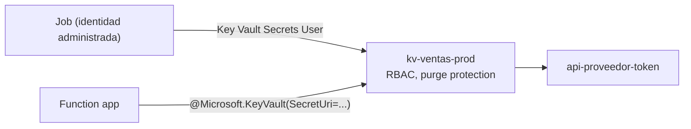

## 1. Resumen

**Azure Key Vault** guarda secretos (tokens, contraseñas, API keys), claves y certificados, y controla quién los lee. Para una plataforma de datos, según su documentación:

- el modelo de permisos recomendado es **Azure RBAC**: **un vault por aplicación y entorno**, con roles en el alcance del vault, no secreto por secreto;
- el rol **Key Vault Secrets User** lee el contenido de los secretos;
- el **borrado temporal (soft-delete)** permite recuperar lo borrado; la **protección de purga** es **opcional y no viene activada**;
- las apps de App Service y Functions leen secretos desde su configuración con referencias **`@Microsoft.KeyVault(...)`**.

## 2. Qué es

- **Vault:** contenedor de secretos, claves y certificados.
- **Secreto:** un valor sensible con versiones; se lee por su URI.
- **Modelo de permisos Azure RBAC:** roles como Key Vault Secrets User asignados a identidades (ver `entra-id-for-data`).
- **Soft-delete y purge protection:**
  - con soft-delete, lo borrado se puede recuperar durante el período de retención, y el nombre del vault no se reutiliza hasta que vence;
  - purge protection impide purgar antes de tiempo; es opcional y se activa solo con soft-delete activado.
- **Referencias de Key Vault:** `@Microsoft.KeyVault(SecretUri=https://<vault>.vault.azure.net/secrets/<nombre>)` en la configuración de la app.

## 3. Problema que resuelve

Las cargas de datos necesitan credenciales de APIs, bases y servicios externos. En el código o en la configuración en claro, se filtran; Key Vault las guarda aparte y solo las entrega a las identidades autorizadas.

## 4. Cómo funciona

1. Se crea un vault para la aplicación y el entorno, con el modelo de permisos de Azure RBAC y protección de purga.
2. Se asigna Key Vault Secrets User a la identidad del job en el alcance del vault.
3. El job lee el secreto con su identidad administrada, sin ninguna clave en el código.
4. Una function app usa una referencia `@Microsoft.KeyVault(...)` en su configuración y lee el valor al arrancar.

## 5. Cuándo utilizarlo

- Toda credencial de un pipeline: APIs, bases, servicios externos.
- Apps de Functions o App Service que necesitan secretos en su configuración.
- Separar los secretos de producción de los de desarrollo.

## 6. Cuándo no utilizarlo

- Para datos de negocio: es para secretos, claves y certificados.
- Un vault compartido por todas las aplicaciones y entornos: su página recomienda uno por aplicación y entorno.
- Permisos sobre secretos individuales como regla general: no se recomienda.

## 7. Ejemplo sencillo

El job de ventas lee `api-proveedor-token` de `kv-ventas-prod` con su identidad administrada. El token no está en el código, en el repositorio ni en la configuración en claro.

## 8. Ejemplo de producción

Una plataforma tiene `kv-ventas-dev`, `kv-ventas-pre` y `kv-ventas-prod`:

- modelo de permisos Azure RBAC, con Key Vault Secrets User para la identidad del job de cada entorno;
- protección de purga activada en producción;
- la function app de ventas lee el token con una referencia de Key Vault;
- el vault y sus asignaciones se definen en Terraform; los valores de los secretos se cargan aparte.

## 9. Arquitectura



## 10. Código

```hcl
# Terraform (validado en la CI con terraform validate, sin credenciales; no se aplicó): un vault por aplicación y
# entorno, con el modelo de permisos de Azure RBAC y protección de purga, y el rol «Key Vault Secrets User» para la
# identidad del job en el alcance del vault.
# Requiere: provider hashicorp/azurerm ~> 5.0; grupo de recursos e identidad existentes.
terraform {
  required_providers {
    azurerm = {
      source  = "hashicorp/azurerm"
      version = "~> 5.0"
    }
  }
}

provider "azurerm" {
  features {}
}

variable "resource_group_name" {
  type = string
}

variable "location" {
  type    = string
  default = "eastus2"
}

variable "job_principal_id" {
  type = string
}

data "azurerm_client_config" "current" {}

resource "azurerm_key_vault" "ventas_prod" {
  name                       = "kv-ventas-prod"
  location                   = var.location
  resource_group_name        = var.resource_group_name
  tenant_id                  = data.azurerm_client_config.current.tenant_id
  sku_name                   = "standard"
  rbac_authorization_enabled = true
  purge_protection_enabled   = true
  soft_delete_retention_days = 90
}

resource "azurerm_role_assignment" "job_lee_secretos" {
  scope                = azurerm_key_vault.ventas_prod.id
  role_definition_name = "Key Vault Secrets User"
  principal_id         = var.job_principal_id
}
```

```python
# Python 3.12 con azure-identity y azure-keyvault-secrets (no ejecutado: no hay emulador de Key Vault en la CI y no se
# corrió contra Azure). El job lee el secreto con su identidad administrada; nunca hay una clave en el código.
from azure.identity import DefaultAzureCredential
from azure.keyvault.secrets import SecretClient

cliente = SecretClient(vault_url="https://kv-ventas-prod.vault.azure.net", credential=DefaultAzureCredential())
token_api = cliente.get_secret("api-proveedor-token").value
```

El bloque de Terraform se valida en la CI con `terraform validate`, sin credenciales (`make validate-terraform`), y **no se aplicó**. Usa el modelo de permisos de Azure RBAC y asigna el rol en el alcance del vault, como recomienda la guía de RBAC; en `azurerm` 5.x el atributo es `rbac_authorization_enabled`.

El script en Python 3.12 con `azure-keyvault-secrets` **no se ejecutó**: no hay emulador de Key Vault en la CI y no se corrió contra Azure (ADR-013).

## 11. GCP

No aplica de forma específica: esta ficha describe Key Vault. En GCP es Secret Manager (ver `gcp-secret-manager-usage`). Las diferencias, según sus páginas:

| | Key Vault | Secret Manager |
|---|---|---|
| Separar aplicaciones y entornos | Un vault por aplicación y entorno, con roles en el alcance del vault | Proyectos distintos por aplicación y entorno |
| Permisos | Azure RBAC (por ejemplo, Key Vault Secrets User) | IAM sobre la API, con mínimo privilegio |
| Qué guarda | Secretos, claves y certificados | Datos sensibles como API keys, usuarios, contraseñas y certificados |

## 12. AWS

No aplica de forma específica. En AWS es Secrets Manager. Las diferencias, según sus páginas:

| | Key Vault | Secrets Manager |
|---|---|---|
| Recuperar lo borrado | Soft-delete durante el período de retención; purge protection opcional, no activada por defecto | Ventana de recuperación de al menos siete días |
| Rotación | Con una referencia sin versión, la app toma la última versión del secreto y, tras una rotación, la usa dentro de 24 horas (*Use Key Vault references…*); la rotación automática del secreto no está en las páginas citadas | Rotación automática |
| Leer desde la configuración de una app | Referencias `@Microsoft.KeyVault(...)` en App Service y Functions | Las páginas citadas no lo tratan |

## 13. Azure

**Azure Key Vault.** El modelo de permisos con Azure RBAC, la recomendación de un vault por aplicación y entorno, soft-delete, purge protection y las referencias de Key Vault son los de sus páginas.

## 14. Buenas prácticas

- Un vault por aplicación y entorno, con roles en el alcance del vault.
- Modelo de permisos Azure RBAC e identidades administradas.
- Soft-delete forzado (su página recomienda hacerlo con Azure Policy) y purge protection en producción.
- Los valores de los secretos fuera del código y del estado de Terraform.
- **Seguridad:** solo la identidad del job lee sus secretos; nadie los copia a la configuración en claro.
- **Observabilidad:** seguir los accesos al vault y los intentos denegados.
- **Costo:** los precios se consultan en la página de precios de Key Vault; esta ficha no cita su modelo de cobro.

## 15. Errores frecuentes

- Un vault compartido para todo y todos.
- Secretos en variables de entorno en claro.
- Borrar un vault y no poder reutilizar su nombre durante la retención.
- Creer que la protección de purga viene activada.

## 16. Trade-offs

Key Vault separa las credenciales del código y las entrega solo a identidades autorizadas, a cambio de un vault por aplicación y entorno que administrar. Las referencias de Key Vault simplifican Functions y App Service; el SDK da control desde cualquier código.

## 17. Conceptos relacionados

- `gcp-secret-manager-usage`: secretos en GCP.
- `entra-id-for-data`: las identidades que leen los secretos.
- `azure-functions-for-data`: las referencias de Key Vault.
- `infrastructure-as-code`: el vault como código.

## 18. Preguntas técnicas abiertas

1. ¿Dónde están hoy las credenciales de tus pipelines?
2. ¿Cuántos vaults necesitas por aplicación y entorno?
3. ¿Qué pasaría si alguien borra el vault de producción?

## 19. Laboratorio relacionado

Pendiente (F4).

## 20. Fuentes

- Microsoft Learn: *About Azure Key Vault*, *Provide access to Key Vault keys, certificates, and secrets with Azure role-based access control*, *Azure Key Vault: soft-delete overview* y *Use Key Vault references as app settings in Azure App Service, Azure Functions, and Azure Logic Apps (Standard)*.
- Google Cloud: *Secret Manager overview* y *Secret Manager best practices*. AWS: *What is AWS Secrets Manager?*, *Rotate AWS Secrets Manager secrets* y *Delete an AWS Secrets Manager secret*.

El detalle de cada fuente está en `sources` del frontmatter.

## 21. Fecha de última verificación

2026-10-14. Pasa a `verified`: revisión B-F3.1 del lote F3b-10b aplicada, sin VERIFY pendientes.

## 22. Historial de cambios importantes

- 2026-10-13: creación (lote F3b-10b).
- 2026-10-14: revisión B-F3.1 del lote F3b-10b aplicada (docs/reviews/cards-f3b-10b.md): la celda de rotación del §12 dice lo que dice «Understand rotation» de *Use Key Vault references…*; la rotación automática del secreto sigue sin página citada.
- 2026-10-14: `verification_status: verified` (sin VERIFY pendientes).
