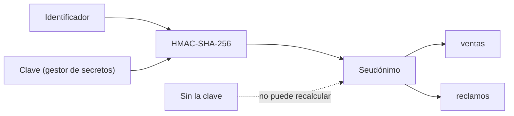

## 1. Resumen

Un **hash simple** de un identificador **no lo protege**: si los valores posibles son pocos, quien tiene el hash los prueba todos y encuentra el original. Un número de cliente de 6 dígitos tiene un millón de valores posibles, y un millón de SHA-256 se calcula en segundos.

Un **hash con clave (HMAC)** cambia eso:

- **mismo valor, mismo seudónimo**: se pueden unir tablas y contar por cliente;
- **sin la clave no se recalcula**: probar todos los valores no sirve;
- **cambiar la clave cambia todos los seudónimos**.

HMAC usa una función de hash y además una clave secreta (*RFC 2104*). Sensitive Data Protection lo ofrece como su seudonimización no reversible (HMAC-SHA-256) (*Pseudonymization*).

## 2. Qué es

- **Hash criptográfico:** una función de un solo sentido; sin clave, cualquiera la calcula.
- **HMAC:** un hash calculado con una clave secreta; sin la clave, nadie más lo calcula.
- **Seudónimo:** el valor que reemplaza al identificador.
- **Ataque de diccionario:** calcular el hash de todos los valores posibles y comparar.

## 3. Problema que resuelve

Un equipo comparte un extracto de ventas con el número de cliente reemplazado por su SHA-256, «para que no se vea». Quien recibe el archivo calcula el SHA-256 de los números 000000 a 999999 y recupera cada número en segundos. Con HMAC y la clave en un gestor de secretos, ese ataque no funciona, y el equipo de análisis igual puede unir ventas y reclamos por cliente.

## 4. Cómo funciona

1. Se genera una clave aleatoria y se guarda en un KMS o un gestor de secretos.
2. El pipeline calcula `HMAC-SHA-256(clave, identificador)` y guarda el resultado en lugar del identificador.
3. Las otras tablas usan la misma clave: el mismo cliente da el mismo seudónimo y las uniones funcionan.
4. Quien no tiene la clave no puede calcular el seudónimo de un valor que conoce.
5. Rotar la clave rompe la continuidad: los seudónimos nuevos no coinciden con los viejos.

## 5. Cuándo utilizarlo

- Para reemplazar identificadores que se usan para unir o contar, sin necesidad de recuperar el valor.
- Cuando el espacio de valores es chico (números de cliente, documentos, teléfonos): ahí un hash simple se invierte fácil.

## 6. Cuándo no utilizarlo

- Cuando hay que recuperar el valor original: hace falta cifrado reversible o tokenización con bóveda (`tokenization`).
- Como anonimización: el resto de las columnas puede reidentificar igual (`pseudonymization-vs-anonymization`).
- Para guardar contraseñas: eso pide una función lenta y con sal (*hashlib*).

## 7. Ejemplo sencillo

Tres números de cliente de 6 dígitos:

| Prueba | Resultado |
|---|---|
| SHA-256 simple, probando 1 000 000 valores | 3 de 3 reidentificados |
| HMAC, sin la clave | 0 de 3 |
| El mismo cliente en dos tablas | mismo seudónimo |
| Otra clave | otro seudónimo |

## 8. Ejemplo de producción

- Clave de seudonimización por dominio de datos, en el gestor de secretos o el KMS; solo el pipeline la lee.
- Todas las tablas del dominio usan la misma clave, así los seudónimos se unen.
- La clave no se comparte con quien recibe los datos.
- Si la clave se filtra, se rota y se vuelven a calcular los seudónimos.

## 9. Arquitectura



## 10. Código

```python
"""Hash simple frente a HMAC para seudonimizar un número de cliente de 6 dígitos."""

import hashlib
import hmac
import secrets

CLIENTES = ["004217", "731908", "250066"]   # el espacio posible: 000000 a 999999


def hash_simple(valor: str) -> str:
    return hashlib.sha256(valor.encode()).hexdigest()


def seudonimo(clave: bytes, valor: str) -> str:
    return hmac.new(clave, valor.encode(), hashlib.sha256).hexdigest()


def ataque_diccionario(publicados: set[str], funcion: "Funcion") -> dict[str, str]:
    """Quien no tiene la clave prueba todos los valores posibles y compara."""
    encontrados: dict[str, str] = {}
    for n in range(1_000_000):
        candidato = f"{n:06d}"
        h = funcion(candidato)
        if h in publicados:
            encontrados[h] = candidato
    return encontrados


class Funcion:
    def __init__(self, clave: bytes | None) -> None:
        self.clave = clave

    def __call__(self, valor: str) -> str:
        return hash_simple(valor) if self.clave is None else seudonimo(self.clave, valor)


clave = secrets.token_bytes(32)        # en producción, en un KMS o gestor de secretos
sin_clave = {hash_simple(c) for c in CLIENTES}
con_clave = {seudonimo(clave, c) for c in CLIENTES}

r1 = ataque_diccionario(sin_clave, Funcion(None))
print(f"hash simple: {len(r1)} de {len(CLIENTES)} reidentificados probando 1000000 valores")
r2 = ataque_diccionario(con_clave, Funcion(secrets.token_bytes(32)))   # el atacante no tiene la clave
print(f"HMAC sin la clave: {len(r2)} de {len(CLIENTES)} reidentificados")

ventas = seudonimo(clave, "731908")
reclamos = seudonimo(clave, "731908")
print(f"mismo cliente, mismo seudónimo en dos tablas: {hmac.compare_digest(ventas, reclamos)}")
otra = seudonimo(secrets.token_bytes(32), "731908")
print(f"con otra clave el seudónimo cambia: {not hmac.compare_digest(ventas, otra)}")
```

El script se **ejecuta en la CI** con la biblioteca estándar y pasa `mypy --strict`. Imprime los 3 números reidentificados con el hash simple, 0 con HMAC sin la clave, el mismo seudónimo en dos tablas y otro seudónimo con otra clave. Las comparaciones usan `hmac.compare_digest` (*hmac*).

## 11. GCP

En GCP, **Sensitive Data Protection**. Según *hmac* y *Pseudonymization* (no ejecutado):

| | HMAC (este ejemplo) | Sensitive Data Protection |
|---|---|---|
| Algoritmo | HMAC-SHA-256 | Hash criptográfico con HMAC-SHA-256 |
| Reversible | No | No; para revertir están AES-SIV y FPE |
| Integridad referencial | Misma clave, mismo seudónimo | Misma clave y mismo context tweak, mismo token; una clave transitoria solo la mantiene dentro de una solicitud |

## 12. AWS

En AWS, **AWS Glue** y **AWS Glue DataBrew**. Según *hmac*, *Detect and process sensitive data* y *CRYPTOGRAPHIC_HASH* (no ejecutado):

| | HMAC (este ejemplo) | AWS Glue | AWS Glue DataBrew |
|---|---|---|---|
| Hash | Con clave | `SHA256_HASH`: la página describe un SHA-256 y no menciona una clave | `HMAC_SHA256` por defecto, con un secreto de Secrets Manager; también hash sin clave (`SHA256` y otros) |

Antes de usar el hash de Glue para seudonimizar valores con pocas posibilidades, comprobar si lleva clave: sin clave, vale el ataque de la sección 7.

## 13. Azure

En Azure, **Always Encrypted** en Azure SQL. Según *hmac* y *Always Encrypted* (no ejecutado):

| | HMAC (este ejemplo) | Cifrado determinista de Always Encrypted |
|---|---|---|
| Qué es | Hash con clave, no reversible | Cifrado, reversible con la clave |
| Operaciones | Igualdad y joins sobre el seudónimo | Búsqueda puntual, joins por igualdad, agrupar e indexar |
| Riesgo | Sin la clave, no se recalcula | La página advierte que se pueden adivinar valores mirando patrones, sobre todo con pocos valores posibles |

No es lo mismo: el determinista de Always Encrypted protege la columna dentro de la base; el HMAC produce un seudónimo para llevar los datos a otro lado.

## 14. Buenas prácticas

- HMAC, nunca un hash simple, para identificadores con pocos valores posibles.
- Clave larga y aleatoria, generada con `secrets`, en un KMS o gestor de secretos.
- `compare_digest` para comparar valores calculados con valores recibidos.
- **Seguridad:** quien tiene la clave puede recalcular el seudónimo de cualquier valor; limitar el acceso a la clave como a los datos originales.
- **Observabilidad:** registrar qué clave (versión) generó cada tabla, para saber qué se puede unir.
- **Costo:** rotar la clave obliga a recalcular los seudónimos de todas las tablas que se unen.

## 15. Errores frecuentes

- `sha256(numero_cliente)` como «anonimización».
- La clave escrita en el código del pipeline.
- Claves distintas por tabla cuando se necesita unirlas.

## 16. Trade-offs

Una sola clave por dominio permite unir todo y concentra el riesgo en esa clave. Claves por destino (una por socio) impiden que dos socios crucen sus datos entre sí, a cambio de perder la unión entre ellos.

## 17. Conceptos relacionados

- `pseudonymization-vs-anonymization`: seudonimizar no es anonimizar.
- `tokenization`: seudónimos reversibles con bóveda.
- `key-management`: dónde vive la clave.
- `secrets-management`: la clave es un secreto.

## 18. Preguntas técnicas abiertas

1. ¿Tienes identificadores reemplazados por un hash simple?
2. ¿Cuántos valores posibles tiene ese identificador?
3. ¿Quién tiene la clave con que se calculan tus seudónimos?

## 19. Laboratorio relacionado

Pendiente (F4).

## 20. Fuentes

- Python 3.12: *hmac* y *hashlib*.
- IETF: *RFC 2104, HMAC: Keyed-Hashing for Message Authentication*.
- Google Cloud: *Pseudonymization* (Sensitive Data Protection).
- AWS: *Detect and process sensitive data* (Glue) y *CRYPTOGRAPHIC_HASH* (Glue DataBrew).
- Microsoft Learn: *Always Encrypted*.

El detalle de cada fuente está en `sources` del frontmatter.

## 21. Fecha de última verificación

2026-10-21. Pasa a `verified`: revisión B-F3.1 del lote F3b-18c sin hallazgos y CI en verde (run 39662678196).

## 22. Historial de cambios importantes

- 2026-10-21: creación (lote F3b-18c).
- 2026-10-21: `verification_status: verified` (revisión sin hallazgos; CI en verde, run 39662678196).
