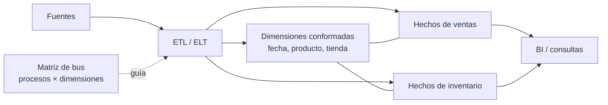

## 1. Resumen

La metodología de Kimball construye el data warehouse como un conjunto de **modelos dimensionales**, uno por proceso de negocio (ventas, inventario, devoluciones), integrados por **dimensiones conformadas** compartidas. Cada modelo se diseña en **cuatro pasos**:

1. proceso de negocio;
2. grano;
3. dimensiones;
4. hechos.

Se entrega de forma incremental: un proceso por vez, guiado por una **matriz de bus** que da la visión de conjunto. En bases relacionales, el resultado se publica como esquemas estrella, que es el enfoque que hoy recomiendan Fabric Warehouse y Power BI.

## 2. Qué es

Es un enfoque de diseño y de arquitectura del data warehouse descrito por Ralph Kimball y el Kimball Group:

- **Diseño en cuatro pasos:**
  1. elegir el proceso de negocio;
  2. declarar el grano;
  3. identificar las dimensiones;
  4. identificar los hechos.

  Después se definen nombres, valores de ejemplo y reglas de negocio.
- **Arquitectura de bus:** los procesos de negocio comparten dimensiones conformadas, administradas una vez y reutilizadas por varias tablas de hechos.
- **Matriz de bus:** filas = procesos de negocio; columnas = dimensiones. Guía qué se construye y en qué orden (ver `conformed-dimensions`).
- **Publicación:** esquemas estrella en bases relacionales (ver `star-schema`).

## 3. Problema que resuelve

Un warehouse que se diseña como copia de las bases operacionales es difícil de consultar, y uno que se diseña reporte por reporte produce silos con definiciones distintas. Kimball propone modelos pensados para la consulta (simples y rápidos) e integrados por dimensiones compartidas. Así, dos áreas que miran ventas e inventario usan el mismo producto, la misma fecha y las mismas definiciones.

## 4. Cómo funciona

1. Se levanta la **matriz de bus** con el negocio: qué procesos existen y qué dimensiones usa cada uno.
2. Se elige **un** proceso para empezar, por ejemplo ventas en tienda.
3. **Paso 2, grano:** se declara qué es una fila del hecho, como «una línea de ticket». Es la decisión que más condiciona el resto (ver `grain`).
4. **Paso 3, dimensiones:** fecha, producto, tienda y cliente, con atributos descriptivos y aplanados.
5. **Paso 4, hechos:** cantidad y monto, numéricos y, en lo posible, aditivos al nivel del grano.
6. Se construye y publica el modelo estrella del proceso. Las dimensiones que otros procesos usarán se diseñan **conformadas** desde el inicio.
7. Se pasa al siguiente proceso de la matriz, reutilizando las dimensiones existentes.

## 5. Cuándo utilizarlo

- Para la capa de consumo de un warehouse o lakehouse: tableros, BI, análisis ad hoc.
- Cuando varias áreas necesitan cruzar procesos con definiciones comunes.
- Cuando la herramienta de BI espera un modelo estrella; la guía de Power BI lo explica en esos términos.

## 6. Cuándo no utilizarlo

- Como modelo del sistema transaccional: ahí corresponde un modelo normalizado (ver `normalization`).
- Como única capa de integración cuando muchas fuentes cambian a menudo y hace falta conservar todo el historial crudo: algunos equipos integran antes con otro enfoque (ver `data-vault`) y publican estrellas después.
- Para un análisis puntual de una sola tabla, donde un modelo completo no paga su costo.

## 7. Ejemplo sencillo

Los cuatro pasos para ventas en tienda:

1. **Proceso:** ventas en el punto de venta.
2. **Grano:** una línea de ticket.
3. **Dimensiones:** fecha, producto y tienda (el ticket queda como dimensión degenerada).
4. **Hechos:** cantidad y monto.

## 8. Ejemplo de producción

Un retailer arma la matriz de bus con cinco procesos: ventas, inventario, compras, devoluciones y promociones. Las dimensiones fecha, producto y tienda son comunes a casi todos.

- **Primer trimestre:** solo ventas, con las tres dimensiones diseñadas como conformadas.
- **Segundo trimestre:** inventario, reutilizando fecha y producto sin cambios. El primer reporte que cruza ventas con stock sale sin reconciliar definiciones (ver `conformed-dimensions`).

Cada estrella se publica en el warehouse y se consume desde la herramienta de BI.

## 9. Arquitectura



## 10. Código

```sql
-- PostgreSQL 17 (ejecutado): los cuatro pasos de Kimball aplicados a ventas en tienda.
-- 1. Proceso de negocio: ventas en el punto de venta.
-- 2. Grano: una fila por línea de ticket (producto vendido en un ticket).
-- 3. Dimensiones: fecha, producto, tienda (y el ticket como dimensión degenerada).
-- 4. Hechos: cantidad y monto, aditivos al nivel del grano.
CREATE TABLE dim_fecha    (fecha_key integer PRIMARY KEY, fecha date NOT NULL UNIQUE, mes text NOT NULL);
CREATE TABLE dim_producto (producto_key integer PRIMARY KEY, sku text NOT NULL, nombre text NOT NULL, categoria text NOT NULL);
CREATE TABLE dim_tienda   (tienda_key integer PRIMARY KEY, codigo text NOT NULL, region text NOT NULL);
CREATE TABLE fact_ventas (
  fecha_key    integer NOT NULL REFERENCES dim_fecha,
  producto_key integer NOT NULL REFERENCES dim_producto,
  tienda_key   integer NOT NULL REFERENCES dim_tienda,
  ticket       text    NOT NULL,                          -- dimensión degenerada
  cantidad     integer NOT NULL,
  monto        numeric(12,2) NOT NULL,
  UNIQUE (ticket, producto_key)                           -- el grano declarado, como restricción
);

INSERT INTO dim_fecha VALUES (20261007, '2026-10-07', '2026-10'), (20261008, '2026-10-08', '2026-10');
INSERT INTO dim_producto VALUES (1, 'SKU-1', 'Café', 'Bebidas'), (2, 'SKU-2', 'Pan', 'Panadería');
INSERT INTO dim_tienda VALUES (1, 'T1', 'Norte'), (2, 'T2', 'Sur');
INSERT INTO fact_ventas VALUES
  (20261007, 1, 1, 'A-001', 2, 3000), (20261007, 2, 1, 'A-001', 1, 1500),
  (20261007, 1, 2, 'B-001', 1, 1500), (20261008, 2, 2, 'B-002', 3, 4500);

SELECT f.mes, t.region, p.categoria, sum(v.cantidad) AS unidades, sum(v.monto) AS monto
FROM fact_ventas v
JOIN dim_fecha f USING (fecha_key) JOIN dim_tienda t USING (tienda_key) JOIN dim_producto p USING (producto_key)
GROUP BY 1, 2, 3 ORDER BY 2, 3;
-- 2026-10 | Norte | Bebidas   | 2 | 3000.00
-- 2026-10 | Norte | Panadería | 1 | 1500.00
-- 2026-10 | Sur   | Bebidas   | 1 | 1500.00
-- 2026-10 | Sur   | Panadería | 3 | 4500.00

-- Comprobación del grano: ninguna combinación (ticket, producto) repetida.
SELECT ticket, producto_key, count(*) FROM fact_ventas GROUP BY 1, 2 HAVING count(*) > 1;   -- 0 filas
```

Ejecutado en PostgreSQL 17.11 local, en un esquema desechable. El grano declarado en el paso 2 queda como restricción única `(ticket, producto_key)`, y la última consulta comprueba que no hay filas repetidas. En warehouses que no aplican restricciones únicas, esa consulta es la prueba que se corre en cada carga (ver `physical-data-model`).

## 11. GCP

No aplica de forma específica: la metodología es independiente de la tecnología. Las decisiones de implementación en BigQuery están en `physical-data-model` y `denormalization`.

## 12. AWS

No aplica de forma específica (ver §11).

## 13. Azure

La guía de **Fabric Data Warehouse** sobre modelado dimensional recomienda el esquema estrella al crear un Warehouse y toma como referencia el libro de Kimball. La guía de **Power BI** explica el esquema estrella, sus medidas y sus tipos de dimensión, y por qué importa para los modelos semánticos de Power BI (ver `semantic-models`).

## 14. Buenas prácticas

- Grano declarado por escrito antes de elegir dimensiones y hechos.
- Matriz de bus mantenida con el negocio; un proceso por entrega.
- Dimensiones conformadas diseñadas desde el primer proceso que las usa.
- Hechos al grano más fino disponible; los agregados se derivan después.
- **Seguridad:** las dimensiones de cliente y empleado concentran datos personales; aplicar permisos por tabla o columna y publicar versiones reducidas cuando el consumo no necesita el detalle.
- **Observabilidad:** pruebas por modelo (grano único, claves de dimensión existentes, totales que cuadran con la fuente) ejecutadas en cada carga.
- **Costo:** reutilizar dimensiones conformadas evita construir y mantener varias versiones del mismo producto o cliente, uno de los beneficios que Kimball atribuye a la arquitectura de bus.

## 15. Errores frecuentes

- Empezar por las tablas de la fuente en lugar de por el proceso de negocio.
- Mezclar granos en una misma tabla de hechos.
- Crear una dimensión de producto distinta por cada proceso: los reportes cruzados no cuadran.
- Querer modelar toda la empresa antes de entregar el primer proceso.

## 16. Trade-offs

El modelo dimensional es simple de consultar y entender, a cambio de trabajo de diseño con el negocio y de transformaciones en el ETL. Las dimensiones conformadas exigen gobierno y acuerdos entre áreas. Entregar un proceso a la vez da valor pronto, pero requiere la matriz de bus para no terminar con estrellas aisladas.

## 17. Conceptos relacionados

- `star-schema`, `fact-tables`, `dimension-tables` y `grain`: las piezas del modelo.
- `conformed-dimensions`: la integración entre procesos y la matriz de bus.
- `slowly-changing-dimensions` y `surrogate-keys`: historia y claves de las dimensiones.
- `data-vault` y `one-big-table`: otros enfoques, que no reemplazan al dimensional.
- Del blueprint (dominio 07), pendiente de ficha: `medallion-architecture` y `data-mesh`.

## 18. Preguntas técnicas abiertas

1. ¿Cómo sería la matriz de bus de tu organización y qué proceso entregarías primero?
2. ¿Qué dimensión es hoy distinta en dos áreas y cuánto costaría conformarla?
3. ¿Cuándo integrarías primero con otro enfoque y publicarías estrellas después?

## 19. Laboratorio relacionado

Pendiente (F4).

## 20. Fuentes

- Kimball Group: *Four-Step Dimensional Design Process*, *Enterprise Data Warehouse Bus Architecture* y *Star Schemas and OLAP Cubes* (Nivel 4, conceptual).
- Microsoft Learn: *Dimensional modeling in Fabric Data Warehouse* y *Understand star schema and the importance for Power BI*.

El detalle de cada fuente está en `sources` del frontmatter.

## 21. Fecha de última verificación

2026-10-10. `review_required`: pendiente de revisión B-F3.1 del lote F3b-04a.

## 22. Historial de cambios importantes

- 2026-10-10: creación (lote F3b-04a).
