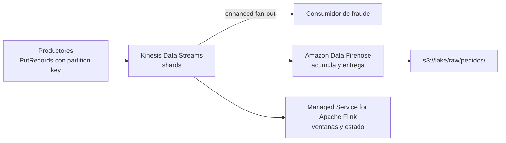

## 1. Resumen

**Amazon Kinesis Data Streams** es el servicio de streams de AWS. Un stream se compone de **shards** y cada shard tiene capacidad fija: hasta 1 MB/s o 1.000 registros por segundo de escritura y 2 MB/s de lectura.

- El productor envía cada registro con una **partition key**; un hash MD5 de la clave decide el shard, así los registros de una misma clave quedan en el mismo shard. `PutRecords` no garantiza el orden; para leer en el orden de escritura, la API indica usar `PutRecord` y escribir al mismo shard.
- Hay tres **modos de capacidad**: On-demand Standard, On-demand Advantage y Provisioned (shards explícitos).
- La **retención** va de 24 horas (por defecto) a 365 días.

Para entregar el stream a S3, Redshift u otros destinos sin escribir un consumidor está **Amazon Data Firehose**. Su historial de documentación dice que antes se llamaba Amazon Kinesis Data Firehose: el 9 de febrero de 2024 registra «Amazon Kinesis Data Firehose is now known as Amazon Data Firehose».

## 2. Qué es

- **Registro:** número de secuencia, partition key y un blob de hasta 1 MB que Kinesis no interpreta.
- **Shard:** secuencia ordenada de registros. Por shard: escritura de hasta 1.000 registros y 1 MB por segundo; lectura de hasta 5 transacciones y 2 MB por segundo.
- **Partition key:** hasta 256 caracteres; su MD5 elige el shard. Una clave con mucho tráfico concentra la carga en un shard.
- **Orden:** un registro escrito no cambia de orden en su shard. `PutRecords` procesa todos los registros aunque alguno falle, así que no garantiza el orden de escritura; `PutRecord` al mismo shard sí.
- **Modos de capacidad:**
  - *On-demand Standard:* escala solo, sin planificar shards;
  - *On-demand Advantage:* configuración de cuenta por región; permite calentar la capacidad de escritura y cambia la estructura de precios;
  - *Provisioned:* se indica la cantidad de shards y se ajusta con `UpdateShardCount`.
- **Consumidores:**
  - compartidos: se reparten 2 MB/s por shard con `GetRecords`;
  - con *enhanced fan-out*: 2 MB/s por shard dedicados a cada uno, por push; hasta 20 por stream (50 en On-demand Advantage).
- **Kinesis Client Library (KCL):** asigna un procesador por shard y guarda el avance en tablas de DynamoDB.
- **Amazon Data Firehose:** entrega administrada del stream a destinos (S3, Redshift, OpenSearch, tablas Iceberg, HTTP). Acumula por tamaño o por tiempo antes de entregar y puede transformar. Hacia Redshift, entrega a S3 y luego hace `COPY`.
- **Amazon Managed Service for Apache Flink:** para procesar el stream con Flink (ventanas, estado), sin administrar la infraestructura.

## 3. Problema que resuelve

Recibir eventos continuos de muchos productores, guardarlos ordenados por clave durante un tiempo y dejar que varios consumidores los lean a su ritmo, cada uno desde donde quedó. El stream desacopla a quien produce de quien consume.

## 4. Cómo funciona

1. El productor llama a `PutRecords` con varios registros, cada uno con su partition key.
2. Kinesis calcula el MD5 de cada clave y escribe el registro en el shard que corresponde, con un número de secuencia.
3. La respuesta de `PutRecords` trae `FailedRecordCount` y, por registro, `ShardId` y `SequenceNumber` o `ErrorCode`. Un fallo no detiene a los demás registros: el productor reintenta solo los fallidos, que quedan detrás de los que ya entraron.
4. Cada consumidor lee cada shard desde un iterador (desde el inicio, desde una secuencia o desde lo último) y avanza.
5. Firehose, si está configurado, lee el stream y entrega lotes al destino.

## 5. Cuándo utilizarlo

- Ingesta de eventos en AWS con orden por clave y varios consumidores.
- Entrega simple de un stream a S3 o Redshift: Firehose.
- Procesamiento con estado y ventanas: Managed Service for Apache Flink leyendo el stream.

## 6. Cuándo no utilizarlo

- Equipos con herramientas y clientes de Kafka: MSK (ver `msk-managed-kafka`).
- Colas de tareas con un solo consumidor por mensaje y sin orden: otro servicio de colas.
- Registros de más de 1 MB.

## 7. Ejemplo sencillo

Cada evento de un pedido (`creado`, `pagado`, `enviado`) lleva como partition key el id del pedido, así los tres caen en el mismo shard. Si se envían con `PutRecords` y uno se reintenta, puede quedar detrás de otro: el consumidor ordena por un campo del evento (versión o fecha) o el productor usa `PutRecord` cuando el orden de escritura importa. Pedidos distintos pueden caer en shards distintos y leerse en paralelo.

## 8. Ejemplo de producción

Una tienda en línea publica los eventos de pedidos en un stream en On-demand Standard:

- un servicio de fraude lee con enhanced fan-out, con 2 MB/s por shard propios;
- Firehose entrega el stream a `s3://lake/raw/pedidos/`, acumulando por tamaño o cada pocos minutos;
- la retención se amplía a 7 días para poder reprocesar un incidente.

El consumidor de fraude descarta duplicados por id de evento: según *Handle duplicate records*, un registro puede llegar más de una vez por reintentos del productor o del consumidor.

## 9. Arquitectura



## 10. Código

```python
# Python 3.12 y boto3 (ejecutado en la CI contra moto, que simula Kinesis Data Streams; no se corrió contra AWS).
# Productor: PutRecords con partition key por pedido (sus eventos caen siempre en el mismo shard) y reintento solo de
# los registros que fallaron. PutRecords no garantiza el orden: un registro reintentado queda detrás de los que entraron.
# Consumidor simple: lee cada shard desde el inicio con GetShardIterator y GetRecords (sin KCL ni checkpoints).
from __future__ import annotations

import json
import time
from typing import TYPE_CHECKING

import boto3

if TYPE_CHECKING:
    from mypy_boto3_kinesis import KinesisClient
    from mypy_boto3_kinesis.type_defs import PutRecordsRequestEntryTypeDef


def put_events(kinesis: KinesisClient, stream: str, events: list[dict[str, object]], attempts: int = 3) -> None:
    """Envía los eventos; la partition key es el pedido, así todos sus eventos caen en el mismo shard."""
    pending: list[PutRecordsRequestEntryTypeDef] = [
        {"Data": json.dumps(e).encode("utf-8"), "PartitionKey": str(e["id_pedido"])} for e in events
    ]
    for attempt in range(attempts):
        result = kinesis.put_records(StreamName=stream, Records=pending)
        if result.get("FailedRecordCount", 0) == 0:
            return
        # Un registro fallido no detiene a los demás: se reintentan solo los que traen ErrorCode.
        pending = [rec for rec, out in zip(pending, result["Records"]) if "ErrorCode" in out]
        time.sleep(0.2 * 2**attempt)
    raise RuntimeError(f"{len(pending)} registros sin enviar después de {attempts} intentos")


def read_all(kinesis: KinesisClient, stream: str) -> dict[str, list[dict[str, object]]]:
    """Lee todos los registros disponibles de cada shard, en el orden del shard."""
    by_shard: dict[str, list[dict[str, object]]] = {}
    for shard in kinesis.list_shards(StreamName=stream)["Shards"]:
        sid = shard["ShardId"]
        it = kinesis.get_shard_iterator(StreamName=stream, ShardId=sid, ShardIteratorType="TRIM_HORIZON")["ShardIterator"]
        records: list[dict[str, object]] = []
        while it:
            out = kinesis.get_records(ShardIterator=it, Limit=100)
            records += [json.loads(r["Data"]) for r in out["Records"]]
            if not out["Records"] and out.get("MillisBehindLatest", 0) == 0:
                break
            it = out.get("NextShardIterator", "")
        by_shard[sid] = records
    return by_shard


if __name__ == "__main__":
    # Contra AWS (no ejecutado): credenciales del entorno y un stream existente.
    client = boto3.client("kinesis")
    put_events(client, "pedidos", [{"id_pedido": 7, "estado": "creado"}, {"id_pedido": 7, "estado": "pagado"}])
    print(read_all(client, "pedidos"))
```

El script en Python 3.12 con boto3 se **ejecuta en la CI contra moto**, que simula Kinesis Data Streams en memoria (ADR-011), y pasa `mypy --strict` con `boto3-stubs`. **No se corrió contra AWS:** moto no reproduce los límites por shard, el throttling ni la latencia. El test crea un stream de 2 shards, envía 15 eventos de 5 pedidos y comprueba que llegan los 15 y que los eventos de cada pedido están en un solo shard. No prueba el orden: `PutRecords` no lo garantiza.

## 11. GCP

No aplica de forma específica: esta ficha describe Kinesis. En GCP, el servicio de mensajería es Pub/Sub (ver `pubsub-topics-and-subscriptions`), con otro modelo de capacidad y de orden; no son equivalentes.

## 12. AWS

**Amazon Kinesis Data Streams**, **Amazon Data Firehose** y **Amazon Managed Service for Apache Flink.** Los límites por shard, la partition key, los modos de capacidad, la retención, enhanced fan-out y Firehose son los de sus páginas. El cambio de nombre de Firehose es el de su historial de documentación. Los precios se consultan en la página de precios de Kinesis Data Streams.

## 13. Azure

No aplica de forma específica.

## 14. Buenas prácticas

- Partition key con muchos valores y tráfico parejo.
- Reintentar solo los registros fallidos de `PutRecords`, con espera creciente; si el orden de escritura importa, `PutRecord` al mismo shard.
- Consumidores idempotentes: un reintento del productor puede repetir registros.
- Enhanced fan-out para consumidores que no deben competir por la lectura.
- **Seguridad:** productores y consumidores con roles de IAM que solo permiten sus operaciones sobre su stream.
- **Observabilidad:** seguir el retraso de los consumidores, los registros rechazados por throttling y la distribución por shard.
- **Costo:** depende del modo de capacidad, de los datos escritos y leídos, de la retención extendida y de enhanced fan-out. Los montos se consultan en la página de precios.

## 15. Errores frecuentes

- Una partition key constante que manda todo a un shard.
- Ignorar `FailedRecordCount` y perder los registros fallidos de `PutRecords`.
- Suponer que `PutRecords` conserva el orden de escritura.
- Asumir que cada registro llega una sola vez.
- Retención de 24 horas cuando un consumidor puede estar caído un fin de semana.

## 16. Trade-offs

Kinesis está integrado con el resto de AWS y no exige operar brokers, a cambio de un modelo propio (shards, límites por shard) y de clientes de AWS. MSK da el protocolo y el ecosistema de Kafka con más que configurar. Firehose simplifica la entrega a destinos y agrega latencia por el buffer.

## 17. Conceptos relacionados

- `streaming-ingestion`: el patrón que implementa.
- `pubsub-topics-and-subscriptions`: el servicio de GCP, con otro modelo.
- `msk-managed-kafka`: la alternativa con Kafka.
- `idempotency`, `deduplication` y `retries`: productores y consumidores tolerantes a repeticiones.
- `s3-data-lake`: el destino de Firehose.

## 18. Preguntas técnicas abiertas

1. ¿Qué partition key usarías para tus eventos, y qué pasa si un cliente genera la mitad del tráfico?
2. ¿Qué consumidores necesitan enhanced fan-out?
3. ¿Cuándo entregarías con Firehose y cuándo con un consumidor propio?

## 19. Laboratorio relacionado

Pendiente (F4).

## 20. Fuentes

- AWS, Amazon Kinesis Data Streams Developer Guide: *Terminology and concepts*, *Choose the right mode to stream in*, *Develop enhanced fan-out consumers* y *Handle duplicate records*; API Reference: *PutRecords* y *GetShardIterator*; *Amazon Kinesis Data Streams pricing*.
- AWS, Amazon Data Firehose Developer Guide: *What is Amazon Data Firehose?* y *Document history*.
- AWS, *What is Amazon Managed Service for Apache Flink?*

El detalle de cada fuente está en `sources` del frontmatter.

## 21. Fecha de última verificación

2026-10-13. Pasa a `verified`: revisión B-F3.1 del lote F3b-09a aplicada, sin VERIFY pendientes.

## 22. Historial de cambios importantes

- 2026-10-12: creación (lote F3b-09a), con Amazon Data Firehose en §2 y su nombre anterior, Amazon Kinesis Data Firehose, como alias de búsqueda (historial de documentación de Firehose).
- 2026-10-13: revisión B-F3.1 del lote F3b-09a aplicada (docs/reviews/cards-f3b-09a.md): filas aprobadas sin cambios en esta ficha.
- 2026-10-13: `verification_status: verified` (sin VERIFY pendientes).
