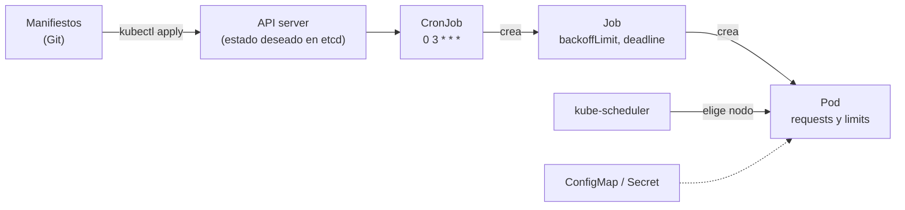

## 1. Resumen

«Kubernetes is a portable, extensible, open source platform for managing containerized workloads and services». Se le describe un **estado deseado** en manifiestos (YAML) y sus controladores llevan el clúster hacia ese estado.

Para un equipo de datos, seis objetos cubren la mayor parte:

- **Job** y **CronJob**, para cargas que corren hasta terminar, a demanda o en un horario;
- **Deployment** y **Service**, para servicios que siguen corriendo, como una API de datos;
- **ConfigMap** y **Secret**, para la configuración; los Secrets están sin cifrar por defecto en etcd.

Y dos campos que conviene poner siempre: **requests** y **limits** de CPU y memoria.

## 2. Qué es

- **Clúster:** un control plane (API server, etcd, scheduler, controladores) y nodos que corren los Pods.
- **Pod:** la unidad mínima: uno o más contenedores con red y almacenamiento compartidos.
- **Job:** crea Pods y reintenta hasta que terminan bien, con un límite de reintentos (`backoffLimit`) y de tiempo (`activeDeadlineSeconds`).
- **CronJob:** crea un Job en cada horario, con una política para corridas que se superponen (`concurrencyPolicy`).
- **Deployment:** mantiene un número de réplicas de un Pod y las actualiza en forma controlada.
- **Service:** un punto de acceso estable a un conjunto de Pods.
- **ConfigMap y Secret:** configuración no confidencial y confidencial.
- **Namespace:** un ámbito para los nombres de los recursos.

## 3. Problema que resuelve

Un equipo corre decenas de jobs de ingesta y algunas APIs en contenedores. Necesita reintentar los jobs que fallan, cortar los que se cuelgan, no correr dos veces el mismo job a la vez, dar recursos a cada uno y reemplazar una réplica de la API que muere. Kubernetes hace eso a partir de manifiestos, con una sola API para todas las cargas.

## 4. Cómo funciona

1. Los manifiestos se aplican con `kubectl apply -f`, que crea lo que no existe y actualiza lo que sí.
2. El API server guarda el estado deseado en etcd.
3. Los controladores comparan el estado deseado con el real: el de CronJob crea un Job en cada horario y el de Job crea Pods.
4. kube-scheduler pone cada Pod en un nodo con espacio para sus requests.
5. En el nodo, el kubelet corre los contenedores y no los deja pasar sus limits.
6. Si un Pod del Job falla, se reintenta hasta `backoffLimit`; si se cumple `activeDeadlineSeconds`, el Job falla.

## 5. Cuándo utilizarlo

- Muchas cargas en contenedores (jobs, APIs, workers) que conviene operar con una sola plataforma.
- Cuando hace falta controlar la red, el hardware o el escalado más de lo que permite una plataforma serverless.
- Equipos que ya tienen un clúster administrado y alguien que lo opere.

## 6. Cuándo no utilizarlo

- Un par de jobs diarios: Cloud Run jobs, ECS con Fargate o Container Apps jobs los corren sin un clúster que administrar.
- Para guardar secretos sin cifrado en reposo ni control de acceso al namespace.
- Sin requests ni limits: el scheduler no sabe cuánto ocupa cada Pod.

## 7. Ejemplo sencillo

Un CronJob `ingesta-ventas` en el namespace `datos` corre todos los días a las 3:00, no arranca si la corrida anterior sigue, reintenta dos veces y corta a la hora. Lee su configuración de un ConfigMap y la contraseña de la base de un Secret.

## 8. Ejemplo de producción

Una plataforma de datos sobre un clúster administrado:

- un namespace por equipo;
- un CronJob por carga, con `concurrencyPolicy: Forbid`, requests y limits y la imagen fijada por digest;
- una API de datos como Deployment con dos réplicas y un Service;
- manifiestos en Git, validados en la CI y aplicados por un agente de GitOps;
- credenciales que vienen del gestor de secretos de la nube, no escritas en los manifiestos.

## 9. Arquitectura



## 10. Código

```yaml
# Kubernetes (validado con kubeconform contra los esquemas de Kubernetes 1.37.1; no aplicado a un clúster; ADR-016):
# un job diario de ingesta con su configuración, y una API de datos con un Service delante.
apiVersion: v1
kind: ConfigMap
metadata:
  name: ingesta-config
  namespace: datos
data:
  SOURCE_URL: "https://example.org/ventas.csv"
  TARGET_TABLE: "raw.ventas"
---
apiVersion: batch/v1
kind: CronJob
metadata:
  name: ingesta-ventas
  namespace: datos
spec:
  schedule: "0 3 * * *"
  concurrencyPolicy: Forbid          # no arranca una corrida si la anterior sigue
  jobTemplate:
    spec:
      backoffLimit: 2                # reintentos de pods fallidos
      activeDeadlineSeconds: 3600    # tiempo máximo del job, con o sin reintentos
      template:
        spec:
          restartPolicy: Never
          containers:
            - name: ingesta
              image: registry.example.org/dekh/ingesta@sha256:5291449c3df73caf6ed85e649dec1b9e818b39a5d8c871e97afc13e9cd5e8fa8
              envFrom:
                - configMapRef:
                    name: ingesta-config
              env:
                - name: DB_PASSWORD
                  valueFrom:
                    secretKeyRef:
                      name: ingesta-db
                      key: password
              resources:
                requests: {cpu: "500m", memory: "512Mi"}   # para elegir el nodo
                limits: {memory: "1Gi"}                     # lo que el kubelet no deja superar
---
apiVersion: apps/v1
kind: Deployment
metadata:
  name: datos-api
  namespace: datos
spec:
  replicas: 2
  selector:
    matchLabels: {app: datos-api}
  template:
    metadata:
      labels: {app: datos-api}
    spec:
      containers:
        - name: api
          image: registry.example.org/dekh/datos-api@sha256:a6e34c598f2467ed0e9a8d349809fcd8b5c603269512df273a0bb1784edc11b1
          ports:
            - containerPort: 8000
          resources:
            requests: {cpu: "250m", memory: "256Mi"}
            limits: {memory: "512Mi"}
---
apiVersion: v1
kind: Service
metadata:
  name: datos-api
  namespace: datos
spec:
  selector: {app: datos-api}
  ports:
    - port: 80
      targetPort: 8000
```

Los manifiestos se **validan en la CI con kubeconform 0.8.0 contra los esquemas de Kubernetes 1.37.1** (`make validate-k8s`, ADR-016), el parche vigente según *Releases*, y **no se aplicaron a un clúster**: no hay clúster en la CI. El registry `registry.example.org` y el Secret `ingesta-db` son ilustrativos.

## 11. GCP

En GCP, **GKE** es Kubernetes administrado. Las diferencias con un clúster propio, según *GKE overview* y *GKE Autopilot overview*:

| | Kubernetes propio | GKE |
|---|---|---|
| Control plane | Lo opera el equipo | Lo administra Google |
| Nodos | Los opera el equipo | Autopilot: Google administra nodos, escalado y seguridad; Standard: el equipo configura los nodos |
| Qué se paga | La infraestructura | Autopilot: los recursos que piden los Pods; Standard: todos los recursos de los nodos |

## 12. AWS

En AWS, **Amazon EKS** es Kubernetes administrado. Las diferencias, según *What is Amazon EKS?* y *Simplify compute management with AWS Fargate*:

| | Kubernetes propio | Amazon EKS |
|---|---|---|
| Control plane | Lo opera el equipo | Lo administra AWS |
| Nodos | Los opera el equipo | EKS standard: el equipo; EKS Auto Mode: EKS aprovisiona y escala; o Pods en Fargate, sin máquinas virtuales que administrar |

## 13. Azure

En Azure, **AKS** es Kubernetes administrado. Las diferencias, según *What is Azure Kubernetes Service (AKS)?*:

| | Kubernetes propio | AKS |
|---|---|---|
| Control plane | Lo opera el equipo | Azure lo crea y lo administra, sin costo; se pagan los nodos |
| Nodos | Los opera el equipo | AKS Automatic: Azure administra nodos, escalado y actualizaciones; AKS Standard: control total de los node pools |

## 14. Buenas prácticas

- Requests y limits en cada contenedor.
- Jobs con `backoffLimit` y `activeDeadlineSeconds`; CronJobs con `concurrencyPolicy: Forbid` si dos corridas a la vez dañan los datos.
- Imágenes por digest y configuración en ConfigMaps, no en la imagen.
- Manifiestos validados en la CI (kubeconform) antes de aplicarlos.
- **Seguridad:** los Secrets están sin cifrar en etcd por defecto y quien crea Pods en un namespace puede leerlos: cifrado en reposo, permisos por namespace y, mejor, un gestor de secretos externo.
- **Observabilidad:** el estado del Job (completado, fallido, `DeadlineExceeded`) dice cómo terminó la corrida; alertar sobre Jobs fallidos.
- **Costo:** en GKE Autopilot se paga lo que piden los Pods; requests altos sin necesidad se pagan.

## 15. Errores frecuentes

- CronJob con `concurrencyPolicy: Allow` (el valor por defecto) y dos corridas escribiendo la misma partición.
- Un Job sin `activeDeadlineSeconds` que queda colgado.
- Contraseñas en un ConfigMap: no da secreto ni cifrado.
- Suponer que el CronJob corre exactamente una vez por horario: la documentación dice que puede haber dos o ninguno, así que el job debe ser idempotente.

## 16. Trade-offs

Kubernetes da una sola API para todo tipo de carga, con control fino de recursos, red y reintentos, a cambio de un clúster que alguien opera, aun administrado. GKE Autopilot, EKS Auto Mode y AKS Automatic quitan buena parte de ese trabajo y dejan menos control sobre los nodos. Para pocos jobs, una plataforma serverless de contenedores suele bastar.

## 17. Conceptos relacionados

- `containers`: lo que corre en los Pods.
- `container-images`: imágenes por digest en los manifiestos.
- `container-registries`: de dónde bajan los nodos las imágenes.
- `gitops`: manifiestos en Git, aplicados por un agente.
- `retries`: reintentos acotados del Job.
- `ci-cd-secrets`: secretos fuera de los manifiestos.

## 18. Preguntas técnicas abiertas

1. ¿Qué pasa hoy si tu job diario corre dos veces a la vez?
2. ¿Cuánta memoria pide tu job y cuánta usa?
3. ¿Quién puede leer los Secrets de tu namespace?

## 19. Laboratorio relacionado

Pendiente (F4).

## 20. Fuentes

- Kubernetes (documentación 1.37): *Overview*, *Kubernetes Components*, *Pods*, *Deployments*, *Jobs*, *CronJob*, *Service*, *ConfigMaps*, *Secrets*, *Resource Management for Pods and Containers*, *Namespaces*, *Declarative Management of Kubernetes Objects Using Configuration Files* y *Releases*.
- Google Cloud: *GKE overview* y *GKE Autopilot overview*.
- AWS: *What is Amazon EKS?* y *Simplify compute management with AWS Fargate*.
- Microsoft Learn: *What is Azure Kubernetes Service (AKS)?*.

El detalle de cada fuente está en `sources` del frontmatter.

## 21. Fecha de última verificación

2026-10-19. Pasa a `verified`: revisión B-F3.1 del lote F3b-13b aplicada, sin VERIFY pendientes.

## 22. Historial de cambios importantes

- 2026-10-19: creación (lote F3b-13b).
- 2026-10-19: revisión B-F3.1 del lote F3b-13b aplicada (docs/reviews/cards-f3b-13b.md): los manifiestos se validan contra los esquemas de Kubernetes 1.37.1, el parche vigente según *Releases* (fuente agregada).
- 2026-10-19: `verification_status: verified` (sin VERIFY pendientes).
