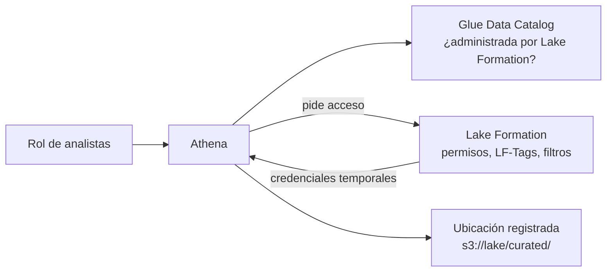

## 1. Resumen

**AWS Lake Formation** gobierna el acceso al lake con un modelo de permisos propio que, según su documentación, **complementa a IAM**: se dan permisos sobre bases, tablas y vistas del Glue Data Catalog y sobre los datos de las ubicaciones de S3 registradas.

- Los motores integrados, como Athena, piden acceso y reciben **credenciales temporales** si el usuario está autorizado.
- Los **filtros de datos** restringen columnas, filas o celdas.
- Las **LF-Tags** dan permisos por atributos (`dominio=ventas`, `sensibilidad=publica`) en lugar de tabla por tabla.

**Atención:** por compatibilidad con Glue, el punto de partida deja el control solo en IAM (`IAMAllowedPrincipals`). Hasta que no se cambia, los permisos de Lake Formation no tienen efecto.

## 2. Qué es

- **Ubicación registrada:** un prefijo de S3 que pasa a estar gobernado por Lake Formation.
- **Permisos de Lake Formation:** `SELECT`, `DESCRIBE` y otros, sobre recursos del catálogo, por recurso nombrado o por LF-Tags.
- **Filtros de datos:** se incluyen al dar permisos sobre una tabla:
  - columna: solo algunas columnas;
  - fila: solo las filas que cumplen una expresión;
  - celda: la combinación de ambas.
- **LF-Tags (LF-TBAC):** pares clave-valor asignados a recursos del Data Catalog. Un principal con acceso a `sensibilidad=publica` puede operar sobre todo recurso con ese valor, también sobre los que se etiqueten después. Es el método recomendado cuando hay muchos recursos.
- **Punto de partida compatible con Glue:**
  - permiso Super a `IAMAllowedPrincipals` sobre los recursos existentes;
  - «Use only IAM access control» activado para los nuevos.
- **Modo de acceso híbrido:** los principales elegidos usan Lake Formation y el resto sigue con IAM, sobre los mismos objetos.

## 3. Problema que resuelve

Con solo IAM, el acceso al lake se da por bucket y prefijo: no hay forma simple de dar acceso a algunas columnas o filas de una tabla. Lake Formation da permisos al nivel de la tabla, la columna y la fila, y los aplica igual en los motores integrados. Con LF-Tags, el número de permisos no crece con el número de tablas.

## 4. Cómo funciona

1. Se registra la ubicación de S3 en Lake Formation.
2. Se cambia el punto de partida (o se usa el modo híbrido) para que los permisos de Lake Formation tengan efecto.
3. Se crean LF-Tags y se asignan a bases y tablas.
4. Se dan permisos a roles por expresión de tags, o por recurso, con filtros si hace falta.
5. Un motor integrado consulta el catálogo, ve que la tabla está administrada por Lake Formation, pide acceso y recibe credenciales temporales si el principal está autorizado.

## 5. Cuándo utilizarlo

- Lakes con varios equipos y datos de distinta sensibilidad.
- Acceso por columna o fila sin copiar tablas.
- Muchas tablas que se gobiernan mejor por atributos que una por una.
- Compartir datos entre cuentas con el mismo modelo de permisos.

## 6. Cuándo no utilizarlo

- Un lake chico con un solo equipo y sin datos sensibles: IAM por prefijo puede alcanzar.
- Accesos de herramientas que no están integradas con Lake Formation: siguen el camino de IAM.
- Como sustituto de IAM: lo complementa, no lo reemplaza.

## 7. Ejemplo sencillo

La base `ventas` tiene `dominio=ventas` y `sensibilidad=publica`. El rol de analistas recibe `SELECT` sobre tablas con esas dos etiquetas. Una tabla nueva de la base, con las mismas etiquetas, queda visible para los analistas sin dar ningún permiso más.

## 8. Ejemplo de producción

Una empresa migra de IAM a Lake Formation en modo híbrido:

1. registra el bucket del lake en modo de acceso híbrido;
2. define `dominio` y `sensibilidad` como LF-Tags y etiqueta las bases;
3. pasa primero al equipo de analítica: sus permisos salen de LF-Tags y la tabla de clientes tiene un filtro de fila por país;
4. los demás equipos siguen por IAM hasta migrarlos.

Todo se define en Terraform y se revisa como código.

## 9. Arquitectura



## 10. Código

```hcl
# Terraform (validado en la CI con terraform validate, sin credenciales; no se aplicó): registra la ubicación de S3 en
# Lake Formation, define LF-Tags, etiqueta una base del Data Catalog y da SELECT por expresión de tags (LF-TBAC).
# Requiere: provider hashicorp/aws ~> 6.0; la base "ventas" ya existe en el Data Catalog.
terraform {
  required_providers {
    aws = {
      source  = "hashicorp/aws"
      version = "~> 6.0"
    }
  }
}

provider "aws" {
  region = "us-east-1"
}

variable "lake_bucket_arn" {
  type = string
}

variable "analysts_role_arn" {
  type = string
}

# La ubicación registrada pasa a estar gobernada por Lake Formation.
resource "aws_lakeformation_resource" "lake" {
  arn = var.lake_bucket_arn
}

resource "aws_lakeformation_lf_tag" "dominio" {
  key    = "dominio"
  values = ["ventas", "finanzas"]
}

resource "aws_lakeformation_lf_tag" "sensibilidad" {
  key    = "sensibilidad"
  values = ["publica", "confidencial"]
}

resource "aws_lakeformation_resource_lf_tags" "ventas_db" {
  database {
    name = "ventas"
  }
  lf_tag {
    key   = aws_lakeformation_lf_tag.dominio.key
    value = "ventas"
  }
  lf_tag {
    key   = aws_lakeformation_lf_tag.sensibilidad.key
    value = "publica"
  }
}

# Los analistas leen toda tabla de ventas con sensibilidad pública, incluidas las que se creen después.
resource "aws_lakeformation_permissions" "analysts_select" {
  principal   = var.analysts_role_arn
  permissions = ["SELECT", "DESCRIBE"]

  lf_tag_policy {
    resource_type = "TABLE"
    expression {
      key    = aws_lakeformation_lf_tag.dominio.key
      values = ["ventas"]
    }
    expression {
      key    = aws_lakeformation_lf_tag.sensibilidad.key
      values = ["publica"]
    }
  }
}
```

El bloque de Terraform se valida en la CI con `terraform validate`, sin credenciales (`make validate-terraform`), y **no se aplicó**. Supone que la base `ventas` existe en el catálogo y que la configuración por defecto ya se cambió o se usa el modo híbrido: sin eso, los permisos no tendrían efecto.

## 11. GCP

No aplica de forma específica: esta ficha describe Lake Formation. En GCP, el gobierno del catálogo es Knowledge Catalog (ver `dataplex-governance`) y la seguridad fina de las tablas está en BigQuery (ver `bigquery-policy-tags` y `bigquery-security`). Las diferencias, según sus páginas:

| | Lake Formation | Knowledge Catalog | BigQuery (policy tags y filas) |
|---|---|---|---|
| Modelo de permisos | Permisos propios que complementan a IAM; LF-Tags | IAM: roles a principales sobre recursos de Google Cloud | IAM más el rol Fine-Grained Reader por policy tag y políticas de acceso por fila |
| Granularidad | Base, tabla, columna, fila y celda (filtros de datos) | Recursos del catálogo, como grupos de entradas y entradas | Proyecto, dataset y tabla; columna con policy tags; fila con políticas de acceso por fila |
| Dónde se aplica | En los motores integrados (Athena, Glue, EMR, Redshift Spectrum), que reciben credenciales temporales para leer las ubicaciones de S3 registradas | Sobre los recursos del propio catálogo | En BigQuery, al consultar |

No son equivalentes: Lake Formation gobierna el acceso a los datos de S3 para varios motores; en GCP, el control fino de los datos lo aplica BigQuery al consultar, y Knowledge Catalog gobierna sus recursos con IAM.

## 12. AWS

**AWS Lake Formation.** El modelo de permisos, las ubicaciones registradas, las credenciales temporales, los filtros de datos, LF-TBAC, el punto de partida con `IAMAllowedPrincipals` y el modo híbrido son los de sus páginas.

## 13. Azure

No aplica de forma específica.

## 14. Buenas prácticas

- Decidir el modelo (Lake Formation completo o híbrido) antes de dar permisos.
- LF-Tags con pocas claves y valores cerrados (`dominio`, `sensibilidad`).
- Filtros de fila y columna en lugar de copias de tablas.
- Permisos como código, revisados en cada cambio.
- **Seguridad:** quitar `IAMAllowedPrincipals` de los recursos gobernados, o el control seguirá en IAM; dar permisos a roles, no a usuarios.
- **Observabilidad:** auditar quién accede a qué tabla y revisar periódicamente los permisos por tag.
- **Costo:** el costo de consultar es el de cada motor (ver `athena-serverless-queries`); los permisos y los filtros no lo reducen por sí solos.

## 15. Errores frecuentes

- Dar permisos en Lake Formation sin cambiar el punto de partida y creer que ya rigen.
- Gobernar tabla por tabla cuando hay cientos de tablas.
- Etiquetas libres que nadie mantiene.
- Asumir que toda herramienta respeta los permisos de Lake Formation.

## 16. Trade-offs

Lake Formation da control fino y uniforme sobre el lake, a cambio de un modelo más que convive con IAM y de una migración que hay que planificar. LF-TBAC escala con el número de tablas, pero exige disciplina en las etiquetas. El modo híbrido permite migrar por partes, con dos caminos de acceso que hay que entender durante la transición.

## 17. Conceptos relacionados

- `glue-catalog-and-etl`: los recursos que se gobiernan.
- `s3-data-lake`: las ubicaciones registradas.
- `athena-serverless-queries`: un motor que recibe credenciales temporales.
- `dataplex-governance` y `bigquery-policy-tags`: gobierno y seguridad por columna en GCP.
- `aws-iam-for-data`: el modelo de IAM que Lake Formation complementa.

## 18. Preguntas técnicas abiertas

1. ¿Qué tablas de tu lake necesitan filtros de fila o de columna?
2. ¿Qué claves de LF-Tags definirías y quién las mantiene?
3. ¿Cómo migrarías de IAM a Lake Formation sin cortar el acceso de nadie?

## 19. Laboratorio relacionado

Pendiente (F4).

## 20. Fuentes

- AWS, AWS Lake Formation Developer Guide: *What is AWS Lake Formation?*, *How it works*, *Adding an Amazon S3 location to your data lake*, *Changing the default settings for your data lake*, *Hybrid access mode*, *Data filtering and cell-level security in Lake Formation*, *Lake Formation tag-based access control* y *Granting permissions on Data Catalog resources*.

El detalle de cada fuente está en `sources` del frontmatter.

## 21. Fecha de última verificación

2026-10-13. Pasa a `verified`: revisión B-F3.1 del lote F3b-09a aplicada, sin VERIFY pendientes.

## 22. Historial de cambios importantes

- 2026-10-12: creación (lote F3b-09a).
- 2026-10-13: revisión B-F3.1 del lote F3b-09a aplicada (docs/reviews/cards-f3b-09a.md): el §11 dice en qué difiere de Knowledge Catalog y de los policy tags y la seguridad por fila de BigQuery (modelo de permisos, granularidad y dónde se aplica), con fuente de cada lado; el §17 enlaza `aws-iam-for-data`, que ya tiene ficha, y relations la incluye.
- 2026-10-13: `verification_status: verified` (sin VERIFY pendientes).
