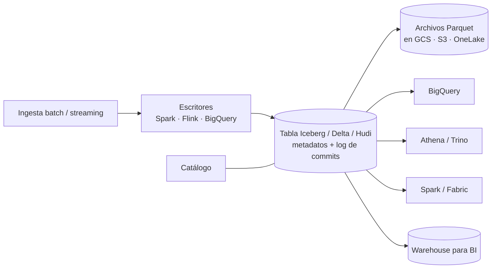

## 1. Resumen

Un lakehouse guarda los datos como un data lake, en archivos abiertos (normalmente Parquet) sobre almacenamiento de objetos, pero agrega una **capa de tabla** con metadatos y log de transacciones: Apache Iceberg, Delta Lake o Apache Hudi. Esa capa aporta:

- transacciones;
- inserts, updates y deletes por registro;
- evolución de esquema y de particiones;
- *time travel* sobre versiones anteriores.

Varios motores (Spark, Trino, BigQuery, Athena, Fabric) pueden leer y escribir las mismas tablas. Es una evolución del lake, **no un reemplazo del warehouse**: muchas organizaciones usan los dos.

## 2. Qué es

Es una arquitectura *modern* que nace de una limitación del data lake: los archivos sueltos no tienen transacciones, no se actualizan por registro y cambiar su esquema o partición es delicado. Los **formatos de tabla abiertos** resuelven eso con metadatos que describen qué archivos forman cada versión de la tabla:

| Formato | Énfasis según su documentación |
|---|---|
| Apache Iceberg | Tablas enormes multimotor, evolución de esquema y particiones sin efectos secundarios, particionado oculto, time travel |
| Delta Lake | Transacciones ACID serializables sobre el lake, batch y streaming en la misma tabla, aplicación de esquema |
| Apache Hudi | Escrituras incrementales de alto rendimiento, upserts y deletes eficientes, índices y servicios de compactación |

## 3. Problema que resuelve

Con un lake de archivos simples:

- corregir un registro obliga a reescribir archivos;
- dos escritores concurrentes pueden corromper una tabla;
- un lector puede ver una carga a medias;
- cambiar una columna rompe consumidores.

La alternativa clásica es copiar todo a un warehouse, que duplica datos y deja fuera a los motores que no son el del warehouse. El lakehouse da semántica de tabla sobre los archivos que ya están en el lake.

## 4. Cómo funciona

1. **Archivos de datos:** Parquet (u otros formatos abiertos) en Cloud Storage, S3 o ADLS/OneLake.
2. **Metadatos de tabla:** el formato registra qué archivos componen cada snapshot o versión, el esquema y el particionado.
3. **Commits atómicos:** cada escritura crea una nueva versión; los lectores ven la versión anterior completa o la nueva completa, nunca un estado intermedio.
4. **Catálogo:** un catálogo (Glue Data Catalog, el de BigQuery, el metastore de Fabric) indica a los motores dónde está la versión actual de cada tabla.
5. **Lectura eficiente:** los metadatos guardan estadísticas por archivo, que permiten saltar archivos al planear la consulta.
6. **Mantenimiento:** compactar archivos pequeños y expirar snapshots viejos, a mano o con servicios administrados (BigQuery, por ejemplo, ofrece optimización automática en sus tablas Iceberg).

## 5. Cuándo utilizarlo

- Varios motores (Spark para ingeniería, SQL para análisis, ML) sobre las mismas tablas, sin copias.
- Tablas grandes en el lake que necesitan updates, deletes o upserts (CDC, correcciones, bajas por privacidad).
- Ingesta streaming y batch sobre la misma tabla.
- Cuando se quiere evitar el encierro en el formato propietario de un único motor.

## 6. Cuándo no utilizarlo

- Si todo el consumo es SQL en un solo warehouse y no hay otros motores: las tablas nativas del warehouse son más simples de operar.
- Para equipos sin capacidad de operar catálogo, compactación y expiración de snapshots (salvo que el servicio lo administre).
- Como reemplazo automático del warehouse: la capa gobernada de BI, con sus permisos, modelos y rendimiento, sigue teniendo sentido. El lakehouse amplía las opciones, no las anula.

## 7. Ejemplo sencillo

La tabla `pedidos` está en Iceberg sobre Cloud Storage. Spark agrega los pedidos de hoy; un minuto después, BigQuery y Athena ven la nueva versión completa. Si una carga falla, la tabla queda en la versión anterior. Si hay que borrar a un cliente, se hace un `DELETE` por registro sin reescribir la tabla a mano.

## 8. Ejemplo de producción

Una empresa guarda en S3 su capa curada en Iceberg:

- jobs de Spark aplican CDC con `MERGE`;
- Athena atiende las consultas ad hoc;
- los modelos de ML leen la misma tabla, con *time travel* para reproducir el entrenamiento sobre el snapshot de una fecha;
- un job semanal compacta archivos y expira snapshots de más de 30 días.

La capa de BI sigue en un warehouse, alimentado desde estas tablas.

## 9. Arquitectura



## 10. Código

```sql
-- BigQuery: tabla Iceberg administrada (datos Parquet + metadatos Iceberg en Cloud Storage).
-- Requiere: una conexión de recurso de Cloud (proyecto.us.lake) con permisos sobre el bucket
-- y el dataset curated existente.
CREATE TABLE `proyecto.curated.pedidos` (
  pedido_id STRING,
  cliente_id STRING,
  monto NUMERIC,
  actualizado_en TIMESTAMP
)
CLUSTER BY cliente_id
WITH CONNECTION `proyecto.us.lake`
OPTIONS (
  file_format = 'PARQUET',
  table_format = 'ICEBERG',
  storage_uri = 'gs://empresa-lake/curated/pedidos'
);

-- Escrituras por registro, con commits atómicos sobre la misma tabla.
DELETE FROM `proyecto.curated.pedidos` WHERE cliente_id = 'C-123';   -- por ejemplo, una baja por privacidad
```

Los archivos quedan en el bucket en formato abierto, así que otros motores compatibles con Iceberg pueden leerlos a través de un catálogo. En BigQuery solo corre un DML de mutación a la vez por tabla Iceberg; los demás se encolan, algo a tener en cuenta con cargas concurrentes.

## 11. GCP

**BigQuery** ofrece tablas **Iceberg administradas**: los datos y metadatos están en Cloud Storage en formatos abiertos, y BigQuery aporta optimización automática del almacenamiento, time travel, seguridad por columna, transacciones y escritura con la Storage Write API. Las **tablas BigLake** permiten consultar datos externos con delegación de acceso y seguridad por fila y columna. Es una diferencia con las tablas nativas: el almacenamiento queda en el bucket del cliente y en formato abierto.

## 12. AWS

**Athena** lee, escribe, hace DDL y time travel sobre tablas **Iceberg** en S3, con el catálogo en Glue. La documentación destaca operaciones por registro y la evolución de esquema y particiones. A diferencia de BigQuery, en AWS el motor (Athena, EMR, Glue) y el catálogo son servicios separados que comparten la tabla.

## 13. Azure

En **Microsoft Fabric**, **Delta** es el formato de tabla de toda la plataforma. Un **lakehouse** de Fabric organiza `Tables` (Delta administradas) y `Files`, registra las tablas automáticamente y las expone por SQL analytics endpoint (T-SQL de solo lectura), por KQL y por notebooks de Spark. El **Warehouse** de Fabric también guarda en Delta: lakehouse y warehouse comparten formato, pero el warehouse aporta T-SQL de escritura y transacciones multitabla.

## 14. Buenas prácticas

- Elegir un formato según los motores que se van a usar y su soporte real en cada servicio.
- Un catálogo único como fuente de verdad de las tablas.
- Compactar archivos pequeños y expirar snapshots según la retención necesaria.
- Usar `MERGE` y deletes del formato en vez de reescribir archivos.
- Mantener el warehouse (o un modelo gobernado) para BI si ya existe; el lakehouse no obliga a eliminarlo.
- **Seguridad:** aplicar el control de acceso en el catálogo o el motor (BigLake, Lake Formation, permisos de Fabric) y no solo en el bucket; recordar que los snapshots retienen datos borrados hasta que expiran.
- **Observabilidad:** vigilar número de archivos por tabla, tamaño medio de archivo, snapshots retenidos y duración de compactaciones.
- **Costo:** el time travel y los snapshots ocupan almacenamiento; la compactación cuesta cómputo pero reduce lo que se lee en cada consulta.

## 15. Errores frecuentes

- Presentar el lakehouse como reemplazo inmediato del warehouse y migrar todo de una vez.
- No expirar snapshots: un "borrado" por privacidad sigue disponible en versiones antiguas.
- Escribir archivos directamente en la carpeta de la tabla sin pasar por el formato.
- Mezclar formatos sin catálogo común y terminar con tablas que cada motor ve distinto.
- Ignorar los archivos pequeños de la ingesta streaming.

## 16. Trade-offs

Datos abiertos, varios motores y operaciones por registro sobre el lake, a cambio de operar catálogo, compactación y snapshots (o depender de que el servicio lo haga) y de un soporte que varía según el motor. Frente al warehouse: más flexibilidad y menos copias, con menos simplicidad para BI gobernado. Frente al lake de archivos simples: transacciones y updates, con una capa más que mantener.

## 17. Conceptos relacionados

- `data-lake`: la base sobre la que se construye.
- `data-warehouse`: el complemento para BI gobernado.
- `parquet-format`: el formato de archivo habitual.
- `schema-evolution`: cambios de esquema que el formato gestiona.
- `acid`: las garantías que aporta la capa de tabla.
- Del blueprint, pendiente de ficha: `lakehouse-architecture` (dominio 07).

## 18. Preguntas técnicas abiertas

1. ¿Qué te haría elegir Iceberg, Delta o Hudi en una organización con BigQuery y Spark?
2. ¿Cómo garantizarías que el borrado de un cliente no sobreviva en snapshots antiguos?
3. ¿Qué dejarías en el warehouse aunque tengas un lakehouse?

## 19. Laboratorio relacionado

Pendiente (F4).

## 20. Fuentes

- Apache: *Iceberg documentation* y *Hudi overview*; Delta Lake: *Welcome to the Delta Lake documentation*.
- Google Cloud: *Apache Iceberg managed tables* e *Introduction to BigLake tables* (BigQuery).
- AWS: *Query Apache Iceberg tables* (Amazon Athena) y *What is AWS Lake Formation?*
- Microsoft Learn: *What is a lakehouse?* y *What is Fabric Data Warehouse?*

El detalle de cada fuente está en `sources` del frontmatter.

## 21. Fecha de última verificación

2026-10-05. En `review_required` hasta la revisión B-F3.1 del lote F3b-01a.

## 22. Historial de cambios importantes

- 2026-10-05: creación (lote F3b-01a, dominio 01-fundamentals).
- 2026-10-06: revisión B-F3.1 del lote F3b-01a aplicada (docs/reviews/cards-f3b-01a.md): Lake Formation citado con su fuente.
