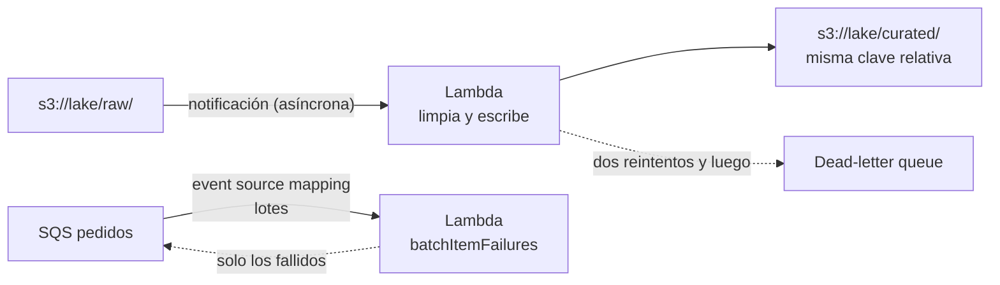

## 1. Resumen

**AWS Lambda** ejecuta una función ante un evento sin administrar servidores. Para datos sirve en pasos cortos y reactivos: un archivo llega a S3, un mensaje llega a SQS, un lote llega de Kinesis. Según su documentación:

- el **timeout** máximo es de **15 minutos**, la memoria va de 128 MB a 10.240 MB y `/tmp` hasta 10.240 MB;
- los **reintentos** dependen de la invocación: dos en asíncrona, el lote completo en streams y lo que fije la cola en SQS;
- con SQS se puede devolver **solo los mensajes fallidos** (`batchItemFailures`);
- la función debe ser **idempotente**, porque un evento puede llegar más de una vez.

Lo que dura más de 15 minutos o necesita encadenar pasos va a otro servicio (Glue, EMR, Step Functions).

## 2. Qué es

- **Función:** un handler conectado a un trigger. Cada invocación corre de forma independiente, sin estado compartido.
- **Invocación asíncrona:** el servicio que dispara (por ejemplo S3) no espera la respuesta; Lambda reintenta dos veces los errores y puede mandar los fallidos a una dead-letter queue.
- **Event source mapping:** Lambda lee de un stream o una cola y llama a la función con lotes.
  - Streams (Kinesis): procesa cada shard en orden; un error reintenta el lote completo y bloquea el shard.
  - Colas (SQS): los reintentos y el destino de los fallidos los fija la cola (visibility timeout, redrive policy); con `ReportBatchItemFailures`, la función devuelve solo los fallidos.
- **Cuotas:** 15 minutos, memoria y `/tmp` hasta 10.240 MB, payload de 6 MB (síncrona) o 1 MB (asíncrona), 1.000 ejecuciones concurrentes por defecto.
- **Otras primitivas:** Lambda MicroVMs (entornos aislados de hasta 8 horas) y Lambda Managed Instances, con otros límites.

## 3. Problema que resuelve

Muchos pasos de un pipeline son chicos y reactivos: validar un archivo al llegar, mover un objeto, transformar un mensaje. Lambda los corre al ocurrir el evento, escala con la cantidad de eventos y se paga por invocación y duración, sin servidores encendidos esperando.

## 4. Cómo funciona

1. Un objeto nuevo en `raw/` dispara una notificación de S3.
2. S3 invoca la función de forma asíncrona con el bucket y la clave (codificada: se decodifica con `unquote_plus`).
3. La función lee el objeto, lo limpia y escribe el resultado en **otro prefijo** (`curated/`), con la misma clave relativa: un reintento reemplaza el objeto.
4. Si falla, Lambda reintenta dos veces; si sigue fallando, el evento va a la dead-letter queue.

## 5. Cuándo utilizarlo

- Validaciones y transformaciones chicas al llegar un archivo.
- Procesar mensajes de SQS o registros de Kinesis en lotes chicos.
- Pegamento entre servicios: iniciar un job, publicar una notificación.

## 6. Cuándo no utilizarlo

- Procesos de más de 15 minutos o con mucha memoria: Glue, EMR o contenedores.
- Transformaciones distribuidas de grandes volúmenes: Spark.
- Orquestar varios pasos con esperas y ramas: Step Functions (ver `step-functions-workflows`).

## 7. Ejemplo sencillo

Un proveedor deja `raw/ventas/dt=2026-10-01/lote 1.jsonl`. La función lee el archivo, descarta las líneas inválidas, redondea montos y escribe `curated/ventas/dt=2026-10-01/lote 1.jsonl`. Si S3 entrega el evento dos veces, el segundo intento escribe la misma clave.

## 8. Ejemplo de producción

Una cola de SQS recibe pedidos y una función los procesa en lotes de 10 con `ReportBatchItemFailures`:

- un mensaje inválido vuelve en `batchItemFailures` y solo él se reintenta;
- tras los intentos que fija la redrive policy, va a la dead-letter queue de la cola;
- la función escribe con una clave por pedido, así un reintento no duplica.

## 9. Arquitectura



## 10. Código

```python
# Python 3.12 y boto3 (ejecutado en la CI: el handler de S3 contra moto, el de SQS con eventos de ejemplo; no se
# desplegó en Lambda). Dos handlers:
# - S3: un objeto nuevo en raw/ dispara la función, que escribe su versión limpia en curated/ con la misma clave
#   relativa (otro prefijo, para no volver a dispararse; un reintento reemplaza el objeto, no duplica).
# - SQS: con ReportBatchItemFailures, devuelve solo los mensajes que fallaron para que no se reintente el lote entero.
from __future__ import annotations

import json
import urllib.parse
from typing import TYPE_CHECKING, Any

import boto3

if TYPE_CHECKING:
    from mypy_boto3_s3 import S3Client

RAW, CURATED = "raw/", "curated/"


def clean(line: str) -> dict[str, Any] | None:
    """Una línea JSON válida con id y monto; las demás se descartan."""
    try:
        row = json.loads(line)
    except json.JSONDecodeError:
        return None
    if not isinstance(row, dict) or "id" not in row or not isinstance(row.get("monto"), (int, float)):
        return None
    return {"id": row["id"], "monto": round(float(row["monto"]), 2)}


def process_s3_event(event: dict[str, Any], s3: S3Client) -> list[str]:
    written: list[str] = []
    for record in event["Records"]:
        bucket = record["s3"]["bucket"]["name"]
        key = urllib.parse.unquote_plus(record["s3"]["object"]["key"], encoding="utf-8")
        if not key.startswith(RAW):
            continue  # defensa extra contra bucles: solo se procesa raw/
        body = s3.get_object(Bucket=bucket, Key=key)["Body"].read().decode("utf-8")
        rows = [r for r in (clean(line) for line in body.splitlines()) if r is not None]
        target = CURATED + key[len(RAW):]
        s3.put_object(Bucket=bucket, Key=target, Body="".join(json.dumps(r) + "\n" for r in rows).encode("utf-8"))
        written.append(target)
    return written


def s3_handler(event: dict[str, Any], context: object) -> list[str]:
    return process_s3_event(event, boto3.client("s3"))


def sqs_handler(event: dict[str, Any], context: object) -> dict[str, list[dict[str, str]]]:
    """Procesa cada mensaje; los que fallan vuelven en batchItemFailures (itemIdentifier = messageId)."""
    failures: list[dict[str, str]] = []
    for record in event["Records"]:
        try:
            if clean(record["body"]) is None:
                raise ValueError("mensaje inválido")
        except Exception:
            failures.append({"itemIdentifier": record["messageId"]})
    return {"batchItemFailures": failures}
```

El script en Python 3.12 con boto3 se **ejecuta en la CI**: el handler de S3 contra moto, que simula S3 (ADR-011), y el de SQS con un evento de ejemplo. Pasa `mypy --strict` con `boto3-stubs`. **No se desplegó en Lambda.** El test procesa dos veces el mismo evento, con una clave codificada (`dt%3D...`, `lote+1`) y un objeto de `curated/` que se ignora, y comprueba que queda un solo objeto limpio. El handler de SQS devuelve solo el mensaje inválido.

## 11. GCP

No aplica de forma específica: esta ficha describe Lambda. En GCP, lo más cercano para cargas de datos es Cloud Run (ver `cloud-run-for-data`), con otros límites y otro modelo de ejecución; no son lo mismo.

## 12. AWS

**AWS Lambda.** Las primitivas, las cuotas, los reintentos por tipo de invocación, la respuesta parcial de SQS, la advertencia de bucles con S3 y la detección de bucles recursivos son los de sus páginas. Los precios por solicitud y duración se consultan en la página de precios.

## 13. Azure

No aplica de forma específica.

## 14. Buenas prácticas

- Escribir en un prefijo o bucket distinto del que dispara la función.
- Claves de salida deterministas: un reintento reemplaza.
- `ReportBatchItemFailures` en SQS para no reintentar lotes completos.
- Timeout y memoria ajustados a lo que hace la función, no al máximo.
- **Seguridad:** cada función con su rol de IAM, con acceso solo a sus prefijos (ver `aws-iam-for-data`).
- **Observabilidad:** seguir errores, duración, throttling y, en streams, la antigüedad del iterador (Iterator Age), que muestra shards bloqueados.
- **Costo:** se paga por solicitud y por duración según la memoria; una función que espera a otro servicio paga esa espera. Los montos se consultan en la página de precios.

## 15. Errores frecuentes

- Escribir en el mismo bucket y prefijo que dispara la función.
- Usar la clave del evento sin decodificar y no encontrar el objeto.
- Lanzar una excepción por un solo mensaje y reintentar el lote completo de SQS.
- Un error persistente que bloquea un shard de Kinesis durante horas.

## 16. Trade-offs

Lambda arranca solo con el evento y escala sin servidores, a cambio de límites de tiempo, memoria y payload, y de reintentos que obligan a escribir código idempotente. Un contenedor o un job de Spark aguantan cargas largas y pesadas, con más que administrar.

## 17. Conceptos relacionados

- `event-driven-pipelines`: el patrón.
- `cloud-run-for-data`: lo más cercano en GCP.
- `idempotency`, `retries` y `dead-letter-queue`: eventos duplicados y fallidos.
- `s3-data-lake` y `kinesis-data-streams`: fuentes de eventos.
- `step-functions-workflows`: para encadenar pasos.
- `aws-iam-for-data`: el rol de la función.

## 18. Preguntas técnicas abiertas

1. ¿Qué paso de tu pipeline es corto y reactivo, y podría ser una función?
2. ¿Cómo garantizas que tu función no se dispare a sí misma?
3. ¿Qué haces con un mensaje que falla siempre?

## 19. Laboratorio relacionado

Pendiente (F4).

## 20. Fuentes

- AWS, AWS Lambda Developer Guide: *What is AWS Lambda?*, *Lambda quotas*, *Understanding retry behavior in Lambda*, *Process Amazon S3 event notifications with Lambda*, *Tutorial: Using an Amazon S3 trigger*, *Use Lambda recursive loop detection*, *Using Lambda to process records from Amazon Kinesis Data Streams*, *Handling errors for an SQS event source* y *Best practices*; *AWS Lambda pricing*.

El detalle de cada fuente está en `sources` del frontmatter.

## 21. Fecha de última verificación

2026-10-12. `review_required`: pendiente de revisión B-F3.1 del lote F3b-09b.

## 22. Historial de cambios importantes

- 2026-10-12: creación (lote F3b-09b).
