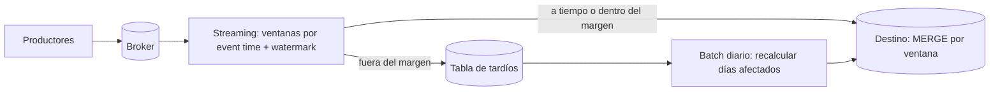

## 1. Resumen

Un dato llega tarde cuando su **tiempo de evento** pertenece a un período que el pipeline ya procesó: una venta del lunes que llega el miércoles. No es un error excepcional sino algo normal en sistemas distribuidos (dispositivos sin conexión, reintentos, colas). El diseño decide cuánto se espera, qué se hace con lo que llega después y cómo se corrigen los resultados ya publicados.

## 2. Qué es

La diferencia entre dos relojes:

- **tiempo de evento**: cuándo ocurrió el hecho;
- **tiempo de llegada o de procesamiento**: cuándo lo recibe o procesa el pipeline.

Un dato es tardío respecto de un período si su tiempo de evento cae dentro de él pero llega después de que ese período se dio por cerrado. En modelado dimensional aparece otra variante: un hecho que llega antes que su dimensión (*early-arriving fact*), que obliga a usar un miembro provisional y corregirlo después.

## 3. Problema que resuelve

Si el pipeline ignora los datos tardíos, los totales de días pasados quedan incompletos para siempre. Si los acepta sin control, los reportes ya publicados cambian sin aviso. Entender el fenómeno permite elegir explícitamente entre completitud, latencia y estabilidad de los resultados.

## 4. Cómo funciona

**En batch**, cada ejecución procesa un período (por ejemplo, un día). Los datos tardíos aparecen en la carga de días posteriores con fecha de evento anterior. Hay tres formas de tratarlos:

- una **ventana de relectura**: cada día se reprocesan también los N días anteriores;
- **reprocesar solo los períodos afectados** que aparezcan en el delta;
- **aceptarlos en el período de llegada** y documentarlo.

**En streaming**, el motor agrupa por ventanas de tiempo de evento y usa un **watermark**, que es el umbral en el que espera que hayan llegado todos los datos de una ventana. Lo que llega después de que el watermark pasa el fin de su ventana es *late data*. Se puede aceptar dentro de un margen (y emitir resultados corregidos mediante triggers), descartar o desviar a otro destino.

## 5. Cuándo utilizarlo

Hay que diseñar para datos tardíos siempre que:

- se agregue por tiempo de evento (ventas por día, sesiones por hora);
- los productores puedan desconectarse o reintentar (móviles, IoT, integraciones);
- los resultados se usen para decisiones o conciliaciones que requieren completitud.

## 6. Cuándo no utilizarlo

- Si se agrega por tiempo de llegada (por ejemplo, métricas operativas del propio pipeline), el retraso no cambia el período del dato.
- Si el negocio acepta explícitamente que los datos se asignan al período de llegada, no hace falta reprocesar, aunque sí documentarlo.

## 7. Ejemplo sencillo

La tabla `ventas_diarias` se calcula cada madrugada con las ventas del día anterior. El miércoles llegan 40 ventas del lunes desde una tienda que estuvo sin conexión. Si el pipeline solo mira "ayer", el lunes queda incompleto. Con una ventana de relectura de 3 días, la ejecución del jueves recalcula lunes, martes y miércoles y los incluye.

## 8. Ejemplo de producción

Un pipeline de streaming agrega eventos de una app por ventanas de 5 minutos de tiempo de evento. Emite un resultado cuando el watermark cierra la ventana y acepta datos tardíos durante un margen; si llegan, emite una versión corregida que el destino aplica con `MERGE` por ventana. Lo que llega después del margen se desvía a una tabla de tardíos. Un proceso batch diario la reincorpora recalculando los días afectados y registra cuántos eventos tardíos hubo por día.

## 9. Arquitectura



## 10. Código

```sql
-- Batch con ventana de relectura (BigQuery): recalcula los últimos 3 días lógicos de forma atómica.
-- Requiere: eventos con fecha_evento; @hoy es la fecha lógica de la ejecución.
BEGIN TRANSACTION;

DELETE FROM `proyecto.dwh.ventas_diarias`
WHERE fecha BETWEEN DATE_SUB(@hoy, INTERVAL 3 DAY) AND DATE_SUB(@hoy, INTERVAL 1 DAY);

INSERT INTO `proyecto.dwh.ventas_diarias` (fecha, tienda_id, total)
SELECT fecha_evento, tienda_id, SUM(monto)
FROM `proyecto.raw.ventas`
WHERE fecha_evento BETWEEN DATE_SUB(@hoy, INTERVAL 3 DAY) AND DATE_SUB(@hoy, INTERVAL 1 DAY)
GROUP BY fecha_evento, tienda_id;

COMMIT TRANSACTION;
```

Como reemplaza los tres días completos en una transacción, repetir la ejecución da el mismo resultado.

## 11. GCP

En **Dataflow**, el watermark es el umbral en el que se espera que hayan llegado todos los datos de una ventana, y lo determina la fuente. Los datos que llegan con timestamp dentro de una ventana cuyo fin ya pasó el watermark son *late data*. El SDK de Apache Beam permite aceptarlos. Por defecto, los resultados se emiten cuando el watermark pasa el fin de la ventana, y los *triggers* cambian cuándo y cuántas veces se emiten.

## 12. AWS

En **Managed Service for Apache Flink** se elige qué tiempo usar: *processing time*, *event time* (cuándo ocurrió el evento en el dispositivo productor) o *ingestion time*. Para agregar por event time hacen falta watermarks, cuya generación la guía de AWS remite a la documentación de Apache Flink. Los conceptos de event time y watermark son los mismos que en Dataflow, pero la API y la configuración son distintas.

## 13. Azure

En **Stream Analytics**, el tiempo por defecto es el de llegada; para usar el tiempo de la aplicación se declara `TIMESTAMP BY`. El watermark es el mayor event time visto menos la tolerancia *out-of-order*. Los eventos fuera de la tolerancia o por debajo del watermark se pueden **descartar** o **ajustar** (se les cambia el timestamp para que entren en la tolerancia). Ajustar no es lo mismo que el modelo de Beam de aceptar late data dentro de un margen: aquí el evento se reasigna a otro instante.

## 14. Buenas prácticas

- Guardar siempre el tiempo de evento y el tiempo de llegada.
- Medir la distribución real de los retrasos antes de fijar márgenes o ventanas de relectura.
- Hacer idempotente el reproceso de períodos (reemplazo de partición o `MERGE`).
- Documentar para los consumidores cuándo un período se considera estable.
- **Observabilidad:** medir el volumen de datos tardíos por período y el retraso máximo; un salto suele indicar una fuente con problemas.
- **Seguridad:** la tabla de tardíos contiene los mismos datos sensibles que el flujo principal: aplicar los mismos controles de acceso.
- **Costo:** una ventana de relectura amplia multiplica el reproceso diario; ajustarla a los retrasos observados y no al peor caso imaginable.

## 15. Errores frecuentes

- Agregar por tiempo de llegada creyendo que es tiempo de evento.
- Descartar datos tardíos sin contarlos.
- Recalcular períodos pasados sin avisar a quienes ya consumieron el resultado.
- Fijar un margen de espera enorme que retrasa todos los resultados.

## 16. Trade-offs

Esperar más aumenta la completitud y retrasa los resultados. Aceptar correcciones tardías mantiene los datos correctos, pero hace que los resultados publicados cambien. Descartar da resultados estables y rápidos, a cambio de perder información.

## 17. Conceptos relacionados

- `batch-vs-streaming`: dos maneras distintas de tratar lo tardío.
- `backfill`: reproceso de períodos afectados.
- `partitioning`: la partición por fecha de evento define dónde cae el dato tardío.
- `idempotency`: requisito para reprocesar sin duplicar.
- `event-time-vs-processing-time`: tiempo de evento y tiempo de procesamiento.
- `watermarks`: cuándo se da por cerrada una ventana en tiempo de evento.
- `windowing`: ventanas tumbling, sliding y de sesión.

## 18. Preguntas técnicas abiertas

1. ¿Cómo medirías la distribución de retrasos de una fuente antes de decidir la ventana de relectura?
2. ¿Qué le comunicarías a finanzas sobre cuándo el total de un día deja de cambiar?
3. ¿Qué harías con un evento que llega tres meses tarde?

## 19. Laboratorio relacionado

Pendiente (F4): arquitectura "Streaming pipeline" (§24).

## 20. Fuentes

- Google Cloud: *Streaming pipelines* (Dataflow) y *Multi-statement transactions* (BigQuery).
- AWS: *Track events in Managed Service for Apache Flink using the DataStream API*.
- Microsoft Learn: *Understand time handling in Azure Stream Analytics*.

El detalle de cada fuente está en `sources` del frontmatter.

## 21. Fecha de última verificación

2026-09-30. Pasa a `verified`: revisión B-F3.1 del lote 2 aplicada, sin VERIFY pendientes.

## 22. Historial de cambios importantes

- 2026-09-30: creación (lote 2 de F3).
- 2026-09-30: `verification_status: verified` (revisión B-F3.1 del lote 2 aplicada; sin VERIFY pendientes).
- 2026-10-13: `page_title` en cada cita, con el título de la página citada (ADR-012); sin cambios de contenido.
- 2026-10-19: lote F3b-14b (regla del §17): relations y el §17 enlazan `event-time-vs-processing-time`, `watermarks`, `windowing`, que ya tienen ficha; antes figuraban como pendientes de ficha.
