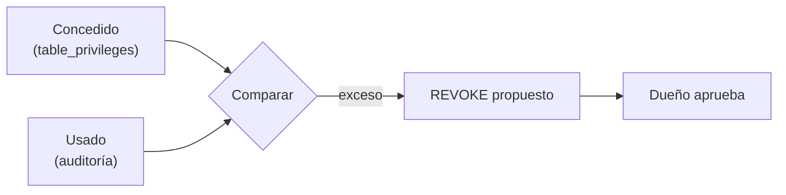

## 1. Resumen

**Mínimo privilegio** es conceder solo los permisos necesarios, sobre los recursos necesarios, y retirar los que no se usan. Tiene dos momentos:

- **al conceder:** el rol más acotado que alcanza, en el alcance más chico que sirve (Google Cloud: no conceder roles básicos en producción salvo que no haya alternativa, *Use IAM securely*);
- **al mantener:** comparar lo concedido con lo usado y revocar lo que sobra (AWS: Access Analyzer detecta, entre otros, accesos sin uso).

## 2. Qué es

- **Privilegio concedido:** lo que el rol puede hacer.
- **Privilegio usado:** lo que hizo en un período (de los logs de auditoría).
- **Exceso:** concedido y no usado; candidato a revocar.

## 3. Problema que resuelve

Para que un pipeline nuevo «funcione ya», le dan `ALL` sobre tres tablas. Un año después, una credencial filtrada de ese pipeline permite borrar clientes, aunque el pipeline solo insertaba. Con mínimo privilegio, el pipeline tenía `INSERT` en dos tablas y `SELECT` en una.

## 4. Cómo funciona

1. Al crear el acceso, se concede lo mínimo y se prueba.
2. Se registra el uso real (auditoría).
3. Periódicamente, se compara concedido con usado.
4. Se revoca el exceso, con aviso al dueño.
5. Se vuelve a probar que el proceso sigue funcionando.

## 5. Cuándo utilizarlo

- Siempre, y más con cuentas de servicio y roles con escritura.
- Antes de dar acceso a datos sensibles.

## 6. Cuándo no utilizarlo

- Revocando sin mirar el período: un proceso trimestral no aparece en 30 días de logs.

## 7. Ejemplo sencillo

El rol `pipeline_ventas` tenía `ALL` sobre `staging_ventas`, `ventas` y `clientes` (21 privilegios); en 30 días usó 3.

| Tabla | Se revoca | Queda |
|---|---|---|
| `clientes` | todo | nada |
| `staging_ventas` | DELETE, REFERENCES, TRIGGER, TRUNCATE, UPDATE | INSERT, SELECT |
| `ventas` | DELETE, REFERENCES, SELECT, TRIGGER, TRUNCATE, UPDATE | INSERT |

## 8. Ejemplo de producción

- Roles nuevos con lo mínimo, aprobados por el dueño de los datos.
- Un job mensual compara privilegios con 90 días de auditoría y propone revocaciones.
- El dueño aprueba; la revocación se aplica como código.
- Las cuentas de servicio sin uso en 90 días se deshabilitan.

## 9. Arquitectura



## 10. Código

```python
# Python 3.12 y psycopg contra PostgreSQL 17 (ejecutado en la CI con el servicio postgres:17): mínimo privilegio.
# Se comparan los privilegios que tiene un rol (information_schema.table_privileges) con los que usó en 30 días, y se
# proponen los REVOKE de lo que sobra. PG_HOST, PG_PORT, PG_USER, PG_PASSWORD y PG_DB: base vacía temporal.
import os

import psycopg

S = os.environ["PG_DB"]
ROL = f"pipeline_ventas_{S}"
USADOS = {("staging_ventas", "INSERT"), ("staging_ventas", "SELECT"), ("ventas", "INSERT")}   # del log de 30 días

with psycopg.connect(host=os.environ["PG_HOST"], port=os.environ["PG_PORT"], user=os.environ["PG_USER"],
                     password=os.environ["PG_PASSWORD"], dbname=S, autocommit=True) as conn:
    try:
        for t in ("staging_ventas", "ventas", "clientes"):
            conn.execute(f"CREATE TABLE {t} (id int)")
        conn.execute(f"CREATE ROLE {ROL}")
        conn.execute(f"GRANT ALL ON staging_ventas, ventas, clientes TO {ROL}")    # lo que alguien dio «por si acaso»
        tiene = set(conn.execute("SELECT table_name, privilege_type FROM information_schema.table_privileges "
                                 "WHERE grantee = %s", (ROL,)).fetchall())
        sobran = sorted(tiene - USADOS)
        print(f"privilegios: {len(tiene)}; usados en 30 días: {len(USADOS & tiene)}; sobran: {len(sobran)}")
        for tabla in sorted({t for t, _ in sobran}):
            privs = ", ".join(p for t, p in sobran if t == tabla)
            sentencia = f"REVOKE {privs} ON {tabla} FROM {ROL}"
            conn.execute(sentencia)
            print(f"  {sentencia.replace(ROL, 'pipeline_ventas')}")
        quedan = sorted(conn.execute("SELECT table_name, privilege_type FROM information_schema.table_privileges "
                                     "WHERE grantee = %s", (ROL,)).fetchall())
        print("quedan:", quedan)
    finally:
        conn.execute("DROP TABLE IF EXISTS staging_ventas, ventas, clientes")
        conn.execute(f"DROP ROLE IF EXISTS {ROL}")
```

El script se **ejecuta en la CI contra el servicio postgres:17** y pasa `mypy --strict`. Imprime `privilegios: 21; usados en 30 días: 3; sobran: 18`, los tres `REVOKE` y lo que queda: `INSERT` y `SELECT` en `staging_ventas` e `INSERT` en `ventas`.

## 11. GCP

En GCP, **IAM**. Según *GRANT* y *Use IAM securely* (no ejecutado):

| | Revisión propia (este ejemplo) | Google Cloud |
|---|---|---|
| Al conceder | El privilegio exacto | No conceder roles básicos en producción salvo sin alternativa; usar los predefinidos o personalizados más limitados |
| Al mantener | Concedido frente a usado | Recomendaciones de roles y Policy Simulator para comprobar el cambio |

## 12. AWS

En AWS, **IAM** y **Access Analyzer**. Según *Security best practices in IAM* y *Using AWS Identity and Access Management Access Analyzer* (no ejecutado):

| | Revisión propia (este ejemplo) | AWS |
|---|---|---|
| Principio | Lo necesario | Solo los permisos necesarios: acciones sobre recursos concretos bajo condiciones concretas |
| Detectar exceso | Comparar con la auditoría | Analizadores de acceso externo, interno y sin uso |

## 13. Azure

En Azure, **Azure RBAC**. Según *GRANT* y *Understand scope for Azure RBAC* (no ejecutado):

| | Revisión propia (este ejemplo) | Azure RBAC |
|---|---|---|
| Acotar | Privilegio por tabla | El ámbito de la asignación de rol (grupo de administración, suscripción, grupo de recursos, recurso) |

## 14. Buenas prácticas

- Lo mínimo al conceder, con prueba.
- Revisión periódica de concedido frente a usado.
- Período de uso que cubra los procesos menos frecuentes.
- **Seguridad:** una credencial con lo justo limita el daño si se filtra.
- **Observabilidad:** auditoría de uso activada; sin ella no hay comparación.
- **Costo:** revisar cuesta horas; automatizar la propuesta y dejar al dueño la aprobación.

## 15. Errores frecuentes

- `ALL` «por ahora».
- Revisar solo al dar el acceso.
- Revocar sin avisar y romper un proceso mensual.

## 16. Trade-offs

Menos privilegios reducen el daño posible y generan más pedidos de acceso. Revocar con poca historia de uso rompe procesos poco frecuentes; con mucha, el exceso dura más.

## 17. Conceptos relacionados

- `iam-fundamentals`: el modelo.
- `rbac`: roles.
- `service-accounts`: cuentas de procesos.
- `column-level-security`: privilegios por columna.

## 18. Preguntas técnicas abiertas

1. ¿Qué cuentas de servicio tienen escritura que no usan?
2. ¿Tienes auditoría de uso para comparar?
3. ¿Cada cuánto se revisan los accesos?

## 19. Laboratorio relacionado

Pendiente (F4).

## 20. Fuentes

- PostgreSQL 17: *GRANT* y *5.8. Privileges*.
- Google Cloud: *Use IAM securely*.
- AWS: *Security best practices in IAM* y *Using AWS Identity and Access Management Access Analyzer*.
- Microsoft Learn: *Understand scope for Azure RBAC*.

El detalle de cada fuente está en `sources` del frontmatter.

## 21. Fecha de última verificación

2026-10-21. `review_required`: pendiente de revisión B-F3.1 del lote F3b-18a.

## 22. Historial de cambios importantes

- 2026-10-21: creación (lote F3b-18a).
