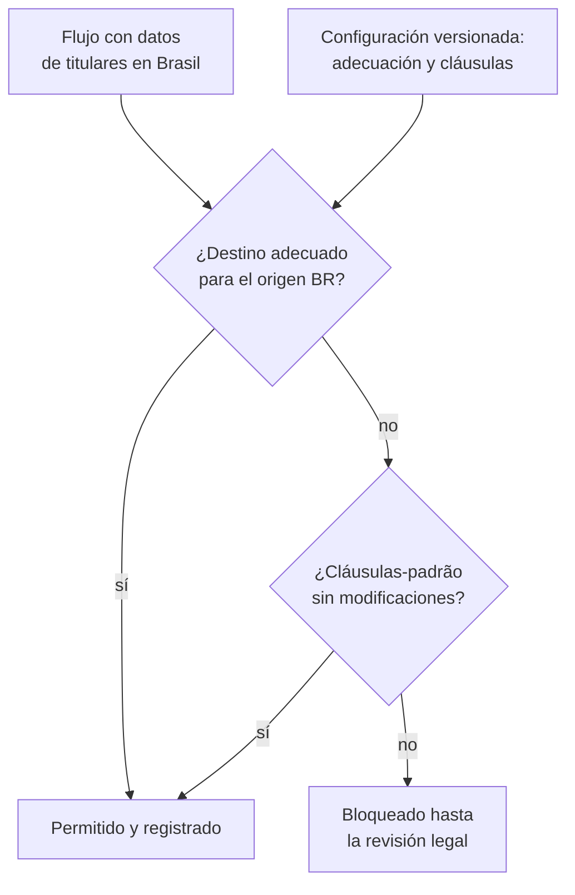

## 1. Resumen

Esta ficha no es asesoría legal: explica qué cambia en una plataforma de datos cuando también trata datos de personas en Brasil. Si la LGPD aplica, qué hipótesis corresponde o qué mecanismo usar lo decide el área legal.

**Pregunta guía:** una plataforma chilena que trata datos de residentes de Brasil, ¿qué tiene que hacer distinto? Sobre todo, manejar **plazos cortos y en días hábiles**, un **calendario de feriados como dato** y transferencias con **cláusulas-padrão que no se modifican**. Las reglas van como configuración versionada por jurisdicción, junto a las de Chile y la UE (ficha `gdpr`).

**Cómo leerla.** *Comprender* (§1–6): cuándo alcanza la LGPD a una empresa chilena y en qué difiere de la Ley 21.719. *Aplicar* (§7–13): calendario, mecanismos y residencia en las tres nubes. *Demostrar*: la evidencia del §8, el código del §10 y los criterios del §18.

Las citas de la LGPD y de la ANPD van en portugués, con una traducción breve.

## 2. Qué es

- **[Obligación legal · LGPD art. 3]** La Lei 13.709/2018 se aplica si «a operação de tratamento seja realizada no território nacional» (el tratamiento se realiza en Brasil), si busca «a oferta ou o fornecimento de bens ou serviços» o trata datos «de indivíduos localizados no território nacional» (ofrecer bienes o servicios o tratar datos de personas en Brasil), o si los datos «tenham sido coletados no território nacional» (se recolectaron en Brasil).
- **[Obligación legal · Ley 19.628, art. 1 bis]** La ley chilena hace la misma pregunta en sentido inverso: alcanza a quien, desde fuera, ofrece bienes o servicios a titulares en Chile o monitorea su comportamiento.
- **[Buena práctica]** La tercera condición de la LGPD, la recolección en Brasil, no tiene equivalente en el art. 3 del RGPD: un formulario que recoge datos en Brasil basta, aunque la oferta no esté dirigida allí.
- **[Buena práctica]** Comparación en lo que impacta a ingeniería. Cada fila lleva la etiqueta de la LGPD; la columna chilena se etiqueta en el §4 y la europea en la ficha `gdpr`.

| Tema | Ley 21.719 (Chile) | RGPD (UE) | LGPD (Brasil) | Etiqueta |
|---|---|---|---|---|
| Bases de licitud | Consentimiento (art. 12) y casos sin consentimiento (art. 13) | Condiciones del art. 6.1 | «somente poderá ser realizado nas seguintes hipóteses» (solo en las hipótesis que enumera) | **[Obligación legal · LGPD art. 7]** |
| Plazo de respuesta a una solicitud | 30 días corridos, prorrogable una vez (art. 11) | Un mes, prorrogable dos (art. 12.3) | «no prazo de até 15 (quinze) dias, contado da data do requerimento» (hasta 15 días desde el requerimiento), para la declaración completa | **[Obligación legal · LGPD art. 19]** |
| Registro de actividades | Política de tratamiento disponible (art. 14 ter) | Registro de actividades (art. 30) | «registro das operações de tratamento» (registro de las operaciones) | **[Obligación legal · LGPD art. 37]** |
| Evaluación de impacto | Si puede producir un alto riesgo (art. 15 ter) | Si es probable un alto riesgo (art. 35) | La ANPD «poderá determinar» que se elabore un relatório de impacto (puede exigirlo) | **[Obligación legal · LGPD art. 38]** |
| Incidente | Agencia sin dilaciones indebidas; titulares en los casos que indica (art. 14 sexies) | Autoridad en 72 horas (art. 33.1); interesados con alto riesgo (art. 34.1) | ANPD y titular, si hay «risco ou dano relevante», en el plazo que define la autoridad: 3 días hábiles según la ANPD | **[Obligación legal · LGPD art. 48]** |
| Transferencias | País adecuado según la Agencia, cláusulas u otros instrumentos (arts. 27 y 28) | Adecuación (art. 45) o cláusulas tipo (art. 46.2 c)) | Protección adecuada o «cláusulas-padrão contratuais» | **[Obligación legal · LGPD art. 33]** |
| Delegado | En el modelo de prevención voluntario (art. 49) | En los casos del art. 37.1 | «O controlador deverá indicar encarregado» (el controlador indica un encarregado) | **[Obligación legal · LGPD art. 41]** |
| Decisiones automatizadas | Oponerse y no ser objeto de ellas (art. 8 bis) | No ser objeto de una decisión únicamente automatizada (art. 22.1) | «solicitar a revisão de decisões tomadas unicamente com base em tratamento automatizado» (pedir su revisión) | **[Obligación legal · LGPD art. 20]** |

- **[Buena práctica]** Las filas no son equivalencias: la LGPD pide revisar la decisión automatizada; la ley chilena da derecho a oponerse y a no ser objeto de ella; el RGPD, a no ser objeto de ella.

## 3. Problema que resuelve

**[Buena práctica]** Un marketplace chileno vende a clientes en São Paulo y guarda sus pedidos en una bodega en la UE. Se detecta un incidente un viernes: Chile pide reportar sin dilaciones indebidas, la UE da 72 horas a sus clientes europeos y la ANPD da 3 días hábiles. Si el código cuenta días corridos, el plazo brasileño vence antes de lo calculado o después, según el calendario; si el feriado está escrito en el código, nadie lo actualiza.

**[Obligación legal · LGPD art. 48]** La comunicación va a la ANPD y al titular cuando el incidente puede acarrear riesgo o daño relevante. **[Obligación legal · Ley 19.628, art. 14 sexies]** En Chile va a la Agencia y, en los casos que indica, a los titulares. **[Decisión de arquitectura]** Un solo runbook con las reglas de cada jurisdicción como datos.

## 4. Cómo funciona

1. **[Obligación legal · LGPD art. 3]** Marcar con BR los productos y datasets que cumplen alguna de las tres condiciones, incluida la recolección en Brasil.
2. **[Obligación legal · LGPD art. 37]** Llevar el registro de operaciones desde el inventario. **[Obligación legal · Ley 19.628, art. 14 ter]** El mismo inventario alimenta la política chilena.
3. **[Obligación legal · LGPD art. 7]** Registrar la hipótesis de cada actividad. **[Obligación legal · Ley 19.628, art. 12]** Y la base chilena, con consentimiento o **[Obligación legal · Ley 19.628, art. 13]** en los casos sin consentimiento.
4. **[Obligación legal · LGPD art. 19]** Calcular quince días para la declaración completa; **[Obligación legal · Ley 19.628, art. 11]** treinta días corridos en Chile. **[Obligación legal · LGPD art. 18]** Como el reglamento puede fijar plazos, el valor vive en la configuración.
5. **[Obligación legal · LGPD art. 38]** Tener la evaluación de impacto lista para exportarla como relatório si la ANPD lo determina. **[Obligación legal · Ley 19.628, art. 15 ter]** En Chile se hace cuando el tratamiento puede producir un alto riesgo.
6. **[Obligación legal · LGPD art. 48]** Ante un incidente, el plazo en días hábiles sale del calendario brasileño versionado, no de días corridos.
7. **[Obligación legal · LGPD art. 33]** Cada flujo con datos de Brasil hacia otro país necesita protección adecuada o cláusulas-padrão. **[Obligación legal · Ley 19.628, art. 27]** Un flujo de Chile al exterior, uno de los casos de la ley chilena, **[Obligación legal · Ley 19.628, art. 28]** con la adecuación que determine la Agencia.
8. **[Obligación legal · LGPD art. 20]** Los modelos que deciden sobre personas en Brasil tienen ruta de revisión. **[Obligación legal · Ley 19.628, art. 8 bis]** La misma ruta sirve a la ley chilena.
9. **[Obligación legal · LGPD art. 41]** El encarregado recibe las alertas. **[Obligación legal · Ley 19.628, art. 49]** En Chile el delegado forma parte del modelo de prevención voluntario.
10. **[Decisión de arquitectura]** Calendario, plazos, listas de adecuación y textos de cláusulas son datos versionados que revisa el área legal.

## 5. Cuándo utilizarlo

- Al vender u ofrecer servicios a personas en Brasil, al tratar sus datos o al recolectar datos allí.
- Al recibir datos de una filial o un socio brasileño, o al enviar datos de Brasil a otra región.
- Al diseñar el runbook de incidentes o el pipeline de derechos con clientes en varias jurisdicciones.

## 6. Cuándo no utilizarlo

- Para decidir si la LGPD aplica, qué hipótesis corresponde o si las cláusulas firmadas bastan: el área legal.
- Para resumir la LGPD completa: esta ficha cubre lo que impacta a ingeniería.
- Para tratar como iguales la Ley 21.719 y la LGPD: tienen plazos, unidades, condiciones y mecanismos distintos.

## 7. Ejemplo sencillo

Un incidente conocido el viernes 4 de diciembre de 2026, con el calendario del §10 (feriado ficticio el martes 8):

| Jurisdicción | Regla | Vence |
|---|---|---|
| Brasil | 3 días hábiles (ANPD), sin feriados | 2026-12-09 |
| Brasil | 3 días hábiles, con el feriado del calendario | 2026-12-10 |
| UE | 72 horas desde la constancia (ficha `gdpr`) | 2026-12-07 |
| Chile | Sin dilaciones indebidas: sin plazo fijo | Objetivo interno del área legal |

## 8. Ejemplo de producción

Escenario genérico: un marketplace con clientes en Chile, la UE y Brasil.

| Control | Implementación posible | Qué demuestra y qué no |
|---|---|---|
| Jurisdicción BR en el catálogo | Etiqueta derivada de oferta, país del titular o país de recolección | Qué datos se declararon bajo la LGPD; no que la etiqueta sea correcta |
| Calendario versionado | `rules/calendars/br.yaml` con feriados, revisado por el área legal | Qué días se consideraron hábiles en cada versión; no que el calendario esté completo |
| Mecanismos por origen | Configuración con adecuación y cláusulas por jurisdicción de origen | Qué mecanismo se declaró por flujo; no que el contrato esté firmado ni sin modificaciones |
| Residencia en Brasil | Políticas de ubicación para los datos que deben quedar en Brasil | Dónde se crean recursos; no adónde replica la plataforma |

### Evidencia de cumplimiento

| Evidencia | Dónde queda | Quién la produce | Qué demuestra | Qué no demuestra |
|---|---|---|---|---|
| Calendario y reglas con historial | Repositorio | Área legal e ingeniería | El plazo y los días hábiles usados en cada versión | Que el reglamento no haya cambiado después |
| Salida del control de flujos | Log de la CI | CI | Qué flujos con datos de Brasil tienen mecanismo declarado | El tráfico real ni el texto de las cláusulas |
| Cláusulas-padrão firmadas | Repositorio del área legal | Área legal | Que se adoptaron, y su versión | Que el uso real se ajuste a ellas |
| Política de ubicación y réplica | Configuración como código | Plataforma | Dónde se crean recursos y qué réplicas están configuradas | Accesos remotos del soporte |

## 9. Arquitectura



La decisión de adecuación depende del origen de los datos: la UE considera adecuado a Brasil y la ANPD a la UE, pero son dos listas distintas, cada una con su fecha.

## 10. Código

```python
# Python 3.12+, biblioteca estándar. Dos reglas de la LGPD como configuración versionada por jurisdicción:
# 1) el plazo de comunicación de incidentes en días hábiles, con el calendario de feriados como dato y no como código;
# 2) el mecanismo de cada flujo internacional según el origen de los datos (CL, UE, BR).
# Ilustrativo: los feriados son ficticios y el estado de cada flujo no es una conclusión jurídica.
from __future__ import annotations

import datetime as dt
from dataclasses import dataclass

CONFIG_VERSION = "2026-10-30"
# Plazo de la ANPD: 3 días hábiles (arts. 6 y 9 de la Res. CD/ANPD 15/2024, según la página de la ANPD); el día de
# inicio se toma aquí como el del conocimiento del incidente (ilustrativo: la página no dice desde cuándo se cuenta).
INCIDENT_BUSINESS_DAYS = {"BR": 3}
HOLIDAYS = {"BR": {dt.date(2026, 12, 8)}}   # feriado ficticio para el ejemplo; el calendario real lo mantiene legal
# Decisiones de adecuación vigentes según la fuente de cada origen (Comisión Europea; ANPD, Res. 32/2026).
ADEQUATE = {"EU": {"BR"}, "BR": {"EU"}, "CL": set[str]()}   # CL: sin listado de la Agencia cargado aquí (art. 28)
CONTRACT_MECHANISMS = {"EU": "cláusulas tipo de la Comisión", "BR": "cláusulas-padrão contratuais da ANPD",
                       "CL": "cláusulas contractuales (art. 27 b)"}


def business_deadline(start: dt.date, jurisdiction: str) -> dt.date:
    days, current = INCIDENT_BUSINESS_DAYS[jurisdiction], start
    while days:
        current += dt.timedelta(days=1)
        if current.weekday() < 5 and current not in HOLIDAYS.get(jurisdiction, set()):
            days -= 1
    return current


@dataclass(frozen=True)
class Flow:
    name: str
    origin: str           # jurisdicción de los titulares cuyos datos salen
    destination: str      # país o bloque de proceso o acceso
    clauses: bool         # hay cláusulas firmadas para este flujo
    modified: bool = False  # las cláusulas se alteraron respecto del modelo oficial


def mechanism(flow: Flow) -> str:
    if flow.destination in ADEQUATE[flow.origin]:
        return "OK: destino adecuado según el origen"
    if not flow.clauses:
        return "BRECHA: sin adecuación ni cláusulas → bloquear hasta la revisión"
    if flow.origin == "BR" and flow.modified:
        return "BRECHA: las cláusulas-padrão se adoptan sin modificaciones → revisar con legal"
    return f"OK: {CONTRACT_MECHANISMS[flow.origin]}"


print(f"configuración versión {CONFIG_VERSION}")
known = dt.date(2026, 12, 4)   # viernes
print(f"incidente conocido el {known}: ANPD y titulares hasta {business_deadline(known, 'BR')} (sin feriado sería 2026-12-09)")
flows = [
    Flow("pedidos de clientes en Brasil → bodega en la UE", "BR", "EU", clauses=False),
    Flow("clientes en la UE → soporte en Brasil", "EU", "BR", clauses=False),
    Flow("clientes en Brasil → analítica en Chile", "BR", "CL", clauses=True, modified=True),
    Flow("clientes en Brasil → CRM en EE. UU.", "BR", "US", clauses=True),
    Flow("clientes en Chile → API de LLM en EE. UU.", "CL", "US", clauses=False),
]
for flow in flows:
    print(f"{flow.name}: {mechanism(flow)}")
gaps = [f.name for f in flows if mechanism(f).startswith("BRECHA")]
print(f"brechas: {len(gaps)} de {len(flows)}")
```

Salida:

```text
configuración versión 2026-10-30
incidente conocido el 2026-12-04: ANPD y titulares hasta 2026-12-10 (sin feriado sería 2026-12-09)
pedidos de clientes en Brasil → bodega en la UE: OK: destino adecuado según el origen
clientes en la UE → soporte en Brasil: OK: destino adecuado según el origen
clientes en Brasil → analítica en Chile: BRECHA: las cláusulas-padrão se adoptan sin modificaciones → revisar con legal
clientes en Brasil → CRM en EE. UU.: OK: cláusulas-padrão contratuais da ANPD
clientes en Chile → API de LLM en EE. UU.: BRECHA: sin adecuación ni cláusulas → bloquear hasta la revisión
brechas: 2 de 5
```

Limitaciones: el feriado es ficticio y el día de inicio del conteo es ilustrativo; las listas de adecuación tienen la fecha de su configuración y no se actualizan solas; «cláusulas firmadas» es un dato declarado, no una verificación del contrato. El plazo de solicitudes y el resolvedor para las tres jurisdicciones están en la ficha `gdpr`.

## 11. GCP

| Necesidad | Servicio y alcance | Lo que no cubre | Etiqueta |
|---|---|---|---|
| Recursos de datos brasileños solo en Brasil | Organization Policy con el grupo `in:br-locations` (`southamerica-east1-locations`) | Recursos creados antes de la política | **[Buena práctica]** |
| Datos de Brasil y de Chile en la región | `in:southamerica-locations` incluye `br-locations` y `cl-locations` | Permitir el grupo completo deja mover datos brasileños a Chile: es un flujo internacional | **[Decisión de arquitectura]** |

## 12. AWS

Etiqueta: **[Buena práctica]**

| Necesidad | Servicio y alcance | Lo que no cubre |
|---|---|---|
| Región en Brasil | sa-east-1, South America (São Paulo), geografía Brazil, habilitada por defecto | La tabla de regiones no lista una región con geografía Chile: los datos chilenos en AWS quedan en otro país |
| Limitar regiones | Condición `aws:RequestedRegion` (ficha `processors-and-international-transfers`) | Los efectos entre regiones, como la replicación |

## 13. Azure

| Necesidad | Servicio y alcance | Lo que no cubre | Etiqueta |
|---|---|---|---|
| Región en Brasil | Brazil South (Sao Paulo State) | Su región par es South Central US (Texas): una réplica geográfica basada en el par sale de Brasil | **[Decisión de arquitectura]** |
| Recuperación dentro de Brasil | Brazil Southeast (Rio), de acceso restringido para escenarios como recuperación ante desastres | Requiere solicitar acceso | **[Buena práctica]** |
| Limitar ubicaciones | Azure Policy «Allowed locations» | Resource groups y recursos de la región «global» | **[Buena práctica]** |

## 14. Buenas prácticas

- **[Decisión de arquitectura]** Los días hábiles se calculan con un calendario por jurisdicción guardado como dato, con versión y revisor.
- **[Buena práctica]** Las cláusulas-padrão se registran con su versión; cualquier diferencia con el modelo oficial abre una revisión.
- **[Buena práctica]** Revisar la región par y las réplicas de cada servicio, no solo la región principal.
- **[Obligación legal · LGPD art. 41]** El encarregado recibe las alertas de incidentes y de flujos bloqueados. **[Buena práctica]** Registrar el envío.
- **[Buena práctica]** **Seguridad:** el calendario, las listas de adecuación y las reglas solo cambian con revisión del área legal en el repositorio.
- **[Buena práctica]** **Observabilidad:** alertar si un dataset con jurisdicción `BR` aparece en una región no permitida o si su réplica está fuera de Brasil.
- **[Buena práctica]** **Costo:** la región par fuera de Brasil abarata la recuperación; mantenerla dentro (región restringida) exige solicitar acceso.

## 15. Errores frecuentes

| Error | Consecuencia |
|---|---|
| Contar los 3 días de la ANPD como corridos | Vencimientos que no coinciden con los hábiles |
| Feriados escritos en el código | Un calendario desactualizado que nadie revisa |
| Suponer que la adecuación es recíproca entre cualquier par de países | Flujos Chile → Brasil o Brasil → Chile tratados como si tuvieran adecuación |
| Ajustar el texto de las cláusulas-padrão | La página de la ANPD pide adoptarlas sin modificaciones |
| Mirar solo la región principal | Réplicas geográficas fuera de Brasil |

## 16. Trade-offs

| Opción | Gana | Cuesta |
|---|---|---|
| Calendario por jurisdicción como dato | Plazos correctos y auditables | Mantener los feriados con el área legal |
| Datos brasileños solo en Brasil | Menos flujos internacionales que justificar | Recuperación más cara o con región restringida |
| Bloquear flujos sin mecanismo | Nada sale sin revisión | Un proceso ágil de excepciones |

## 17. Conceptos relacionados

- `chile-data-protection`: ficha padre.
- `gdpr`: el otro marco comparado del tramo y el resolvedor de plazos para Chile, la UE y Brasil.
- `processors-and-international-transfers`: mecanismo por flujo y políticas de región.
- `data-breach-response`: el reporte chileno junto a los tres días hábiles.
- `data-subject-rights-pipeline`: quince días frente a treinta.
- `processing-activities-inventory`: base del registro de operaciones.
- `dpia-and-automated-decisions`: relatório de impacto y revisión de decisiones automatizadas.

## 18. Preguntas técnicas abiertas

1. ¿Qué formularios, apps o integraciones recolectan datos en Brasil, aunque el producto no esté dirigido allí?
2. ¿Dónde está hoy el calendario de feriados que usa tu runbook?
3. ¿Qué servicios replican datos brasileños a su región par?
4. ¿Qué flujos con datos de Brasil salen del país, y con qué mecanismo y versión de cláusulas?

**Criterio de dominio:** dominas esta ficha si, ante un incidente o un flujo nuevo con datos de Brasil, puedes decir por qué aplica la LGPD, cuándo vence la comunicación en días hábiles y con qué calendario, qué mecanismo cubre el flujo según su origen, y qué parte es cálculo y qué parte decide el área legal.

## 19. Laboratorio relacionado

Propuesta para F4: el calendario y la configuración de mecanismos del §10 como YAML; agregar un feriado en una rama, ver cómo cambia el vencimiento en la CI y simular un flujo con cláusulas modificadas para comprobar que se bloquea. Sin datos personales reales.

## 20. Fuentes

- Câmara dos Deputados: *LEI Nº 13.709, DE 14 DE AGOSTO DE 2018* (texto actualizado).
- ANPD: *Comunicação de Incidente de Segurança*; *Transferência Internacional de Dados*.
- BCN Ley Chile: *Ley 19628 SOBRE PROTECCION DE LOS DATOS PERSONALES* (versión con vigencia diferida desde 2026-12-01).
- BOE: *Documento DOUE-L-2016-80807* (Reglamento (UE) 2016/679).
- Comisión Europea: *Adequacy decisions*.
- Google Cloud: *Restrict resource locations*.
- AWS: *AWS Regions*.
- Microsoft Learn: *List of Azure regions*; *Azure Policy built-in policy definitions*.

El detalle de cada fuente está en `sources` del frontmatter.

## 21. Fecha de última verificación

2026-10-30: LGPD en la Câmara (planalto.gov.br bloqueó la lectura automática), páginas de la ANPD, Ley 19.628 en BCN, RGPD en el BOE, lista de adecuación de la Comisión y páginas de GCP, AWS y Microsoft consultadas ese día. `review_required`: pasa a `verified` solo con la aprobación explícita de Felipe (`owner_approved_at`). Revisión mensual.

## 22. Historial de cambios importantes

- 2026-10-30: creación (lote P4), en el tramo 6 «Marcos regulatorios comparados», después de la Enmienda 4 de ADR-023 (jurisdicción BR y etiquetas «LGPD art. N»).
