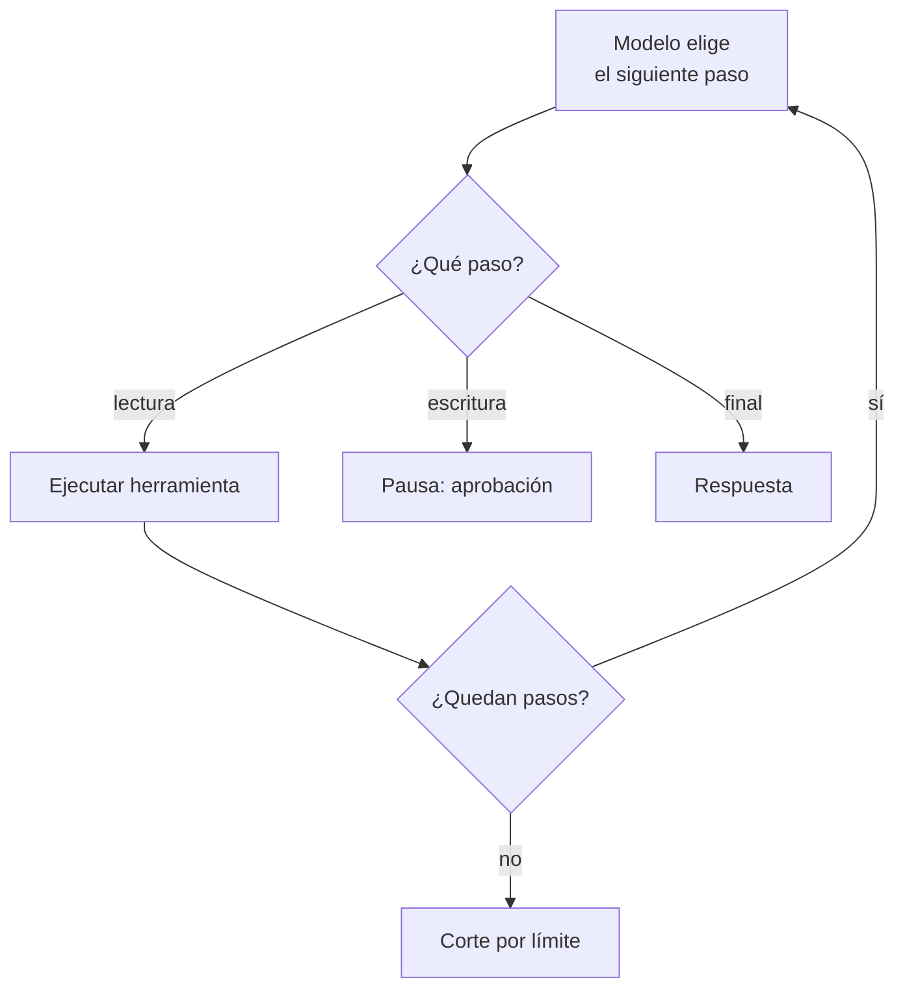

## 1. Resumen

Un **agente** es un modelo con **instrucciones** y **herramientas** que, en un **bucle**, decide el siguiente paso (consultar una herramienta o responder) hasta terminar. Foundry lo define así para un prompt agent: instrucciones, un modelo y herramientas (*Agents in Microsoft Foundry*). Es una práctica **en evolución** (`emerging`): sirve para tareas abiertas, como diagnosticar una carga fallida, y **no reemplaza un pipeline determinista** (`data-pipeline`) cuando los pasos se conocen.

La guía de Azure sobre patrones lo presenta como el default razonable antes de varios agentes, y agrega el control clave: **límites de iteración** contra los ciclos de llamadas a herramientas (*AI agent orchestration patterns*). Los controles son de la aplicación: qué herramientas existen, cuáles requieren aprobación humana y cuántos pasos se permiten.

## 2. Qué es

- **Bucle:** el modelo elige un paso; la aplicación lo ejecuta y le devuelve el resultado; se repite.
- **Herramientas:** de lectura por defecto; las que escriben, con aprobación (`tool-calling`).
- **Máximo de pasos:** corta los ciclos.
- **Aprobación humana:** pausa antes de una acción con efecto.
- **Runtime administrado:** Agent Runtime, AgentCore o los agentes de Foundry ejecutan el bucle; la responsabilidad de los controles sigue siendo del diseño.

## 3. Problema que resuelve

Una carga falla a las 3 AM. El ingeniero de guardia revisa el estado, el último error y el runbook antes de decidir. Un agente con herramientas de lectura hace esa recolección y propone el diagnóstico; relanzar el job queda para una persona.

## 4. Cómo funciona

1. Se define el agente: instrucciones, modelo y lista de herramientas.
2. El modelo elige un paso; la aplicación verifica que la herramienta esté permitida.
3. Si la herramienta escribe, se pausa para aprobación humana.
4. Se ejecuta y el resultado vuelve al modelo.
5. Se repite hasta la respuesta final o el máximo de pasos.
6. Cada paso se traza (`llm-observability`).

## 5. Cuándo utilizarlo

- Tareas con pasos que dependen de lo que se encuentra: diagnóstico, investigación sobre el catálogo.
- Cuando las herramientas son de lectura y una persona decide la acción.

## 6. Cuándo no utilizarlo

- Procesos con pasos conocidos: un pipeline o un DAG es más barato, repetible y auditable.
- Acciones destructivas sin aprobación humana.
- Decisiones sobre personas sin el análisis correspondiente (`dpia-and-automated-decisions`).
- Cuando una sola llamada al modelo resuelve la tarea.

## 7. Ejemplo sencillo

| Corrida | Qué pasa |
|---|---|
| Diagnóstico | Dos herramientas de lectura y respuesta final en 3 pasos |
| Con escritura | Pide `relanzar_job`: pausa para aprobación humana |
| Ciclo | Repite la misma consulta; el máximo de 4 pasos la corta |

## 8. Ejemplo de producción

Un asistente de guardia para cargas fallidas:

- herramientas de lectura: estado de la carga, último error, runbook (`rag`);
- relanzar o reprocesar, solo con aprobación de la persona de guardia;
- máximo de 6 pasos y tiempo total acotado;
- cada paso trazado con tokens y herramienta usada;
- desplegado en Agent Runtime, AgentCore o Foundry (no ejecutado).

## 9. Arquitectura



## 10. Código

```python
# Python 3.12, biblioteca estándar (ejecutado en la CI): el bucle de un agente con controles. Un "modelo" fijo decide
# el siguiente paso (herramienta o respuesta final); la aplicación ejecuta solo herramientas permitidas, pide
# aprobación humana para las que escriben y corta al llegar al máximo de pasos. Tres corridas: termina, pide
# aprobación y entra en un ciclo que el límite corta.
from collections.abc import Callable, Iterator
from dataclasses import dataclass

LECTURA: dict[str, Callable[[str], str]] = {
    "estado_carga": lambda tabla: f"{tabla}: última carga 2026-10-25 03:10, ERROR timeout",
    "ultimo_error": lambda tabla: f"{tabla}: TimeoutError al escribir en el warehouse",
}
ESCRITURA = {"relanzar_job"}  # requieren aprobación humana


@dataclass(frozen=True)
class Paso:
    herramienta: str | None  # None: respuesta final
    argumento: str = ""
    texto: str = ""


def correr(decisiones: Iterator[Paso], max_pasos: int = 4) -> list[str]:
    traza: list[str] = []
    for n in range(1, max_pasos + 1):
        paso = next(decisiones)
        if paso.herramienta is None:
            traza.append(f"{n}: respuesta final: {paso.texto}")
            return traza
        if paso.herramienta in ESCRITURA:
            traza.append(f"{n}: {paso.herramienta}({paso.argumento}) → pausa: requiere aprobación humana")
            return traza
        if paso.herramienta not in LECTURA:
            traza.append(f"{n}: {paso.herramienta} no permitida → se informa al modelo")
            continue
        traza.append(f"{n}: {paso.herramienta}({paso.argumento}) → {LECTURA[paso.herramienta](paso.argumento)}")
    traza.append(f"corte: {max_pasos} pasos sin respuesta final")
    return traza


def ciclo() -> Iterator[Paso]:
    while True:
        yield Paso("estado_carga", "silver.pedidos")


CORRIDAS = {
    "diagnóstico": iter([Paso("estado_carga", "silver.pedidos"), Paso("ultimo_error", "silver.pedidos"),
                         Paso(None, texto="falló por timeout del warehouse; reintentar")]),
    "con escritura": iter([Paso("estado_carga", "silver.pedidos"), Paso("relanzar_job", "ventas_diarias")]),
    "ciclo": ciclo(),
}
for nombre, decisiones in CORRIDAS.items():
    print(f"corrida «{nombre}»:")
    for linea in correr(decisiones):
        print("  " + linea)
```

El script se **ejecuta en la CI** con la biblioteca estándar y pasa `mypy --strict`. Imprime las tres corridas del §7: el diagnóstico termina en el paso 3, la escritura se pausa en el paso 2 y el ciclo termina con `corte: 4 pasos sin respuesta final`. Las decisiones del modelo son fijas.

## 11. GCP

En GCP, **Agent Runtime** de Gemini Enterprise Agent Platform. Según *Agent Runtime* y *Agents overview* (no ejecutado):

| | Este concepto | Agent Runtime |
|---|---|---|
| Quién ejecuta el bucle | La aplicación | Runtime administrado para desplegar, operar y escalar agentes |
| Seguridad | Herramientas permitidas y aprobación | VPC-SC, autenticación e IAM |
| Observabilidad | Traza por paso | Trazas, logs y métricas con OpenTelemetry |

## 12. AWS

En AWS, **Amazon Bedrock AgentCore**. Según *Overview* (Amazon Bedrock AgentCore) (no ejecutado):

| | Este concepto | AgentCore |
|---|---|---|
| Framework | El propio | Cualquier framework y modelo; servicios modulares |
| Bucle | El de la aplicación | Harness: un bucle de agente administrado |

## 13. Azure

En Azure, **agentes de Microsoft Foundry**. Según *Agents in Microsoft Foundry* y *AI agent orchestration patterns* (no ejecutado):

| | Este concepto | Microsoft Foundry |
|---|---|---|
| Definición | Instrucciones, modelo y herramientas | Prompt agent con esos tres elementos; hosted agent con código propio |
| Ciclos | Máximo de pasos | La guía de patrones recomienda límites de iteración |

## 14. Buenas prácticas

- Herramientas de lectura por defecto; aprobación humana para las que escriben.
- Máximo de pasos y de tiempo.
- Instrucciones que dicen qué no hacer.
- Evaluar el agente con casos de control (`llm-evaluation`).
- **Seguridad:** el agente corre con permisos mínimos; la herramienta, no el modelo, aplica los permisos.
- **Observabilidad:** traza por paso, herramienta usada y tokens por corrida.
- **Costo:** cada paso es otra llamada con todo el contexto acumulado.

## 15. Errores frecuentes

- Reemplazar un pipeline conocido por un agente.
- Herramientas con permisos de escritura sin aprobación.
- Sin límite de pasos.
- No trazar qué herramienta usó y por qué.

## 16. Trade-offs

Un agente maneja tareas abiertas a cambio de costo, latencia y menos previsibilidad que un pipeline. Más herramientas dan más capacidad y más riesgo. Un runtime administrado ahorra infraestructura y no reemplaza el diseño de los controles.

## 17. Conceptos relacionados

- `tool-calling`: el paso del agente.
- `multi-agent-systems`: varios agentes.
- `guardrails` y `llm-observability`: control y traza.
- `llm-evaluation`: evaluar el agente.
- `rag`: el runbook como herramienta.
- `data-pipeline`: lo determinista.
- `dpia-and-automated-decisions`: decisiones sobre personas.
- Pendiente de ficha: `rag-over-technical-docs` (lote 21d).

## 18. Preguntas técnicas abiertas

1. ¿Qué tarea de guardia tiene pasos que dependen de lo que encuentras?
2. ¿Qué herramienta nunca dejarías sin aprobación humana?
3. ¿Cuántos pasos debería tener como máximo tu agente?

## 19. Laboratorio relacionado

Pendiente (F4).

## 20. Fuentes

- Google Cloud: *Agent Runtime* y *Agents overview*.
- AWS: *Overview* (Amazon Bedrock AgentCore).
- Microsoft Learn: *Agents in Microsoft Foundry*; Azure Architecture Center: *AI agent orchestration patterns*.

El detalle de cada fuente está en `sources` del frontmatter.

## 21. Fecha de última verificación

2026-10-26. `review_required`: pendiente de revisión B-F3.1 del lote F3b-21c.

## 22. Historial de cambios importantes

- 2026-10-26: creación (lote F3b-21c).
