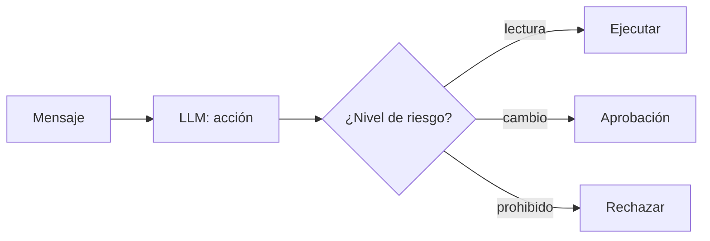

## 1. Resumen

Muchas tareas operativas empiezan con un mensaje: «¿terminó la carga?», «reintenta el job», «limpia la tabla vieja». Un LLM puede interpretar el mensaje y elegir la acción (`tool-calling`). La clave no es el modelo sino los **niveles de riesgo**: AWS lo resume en que pasar todo por revisión humana produce aprobaciones automáticas y no pasar nada produce autonomía sin límites; la aprobación por riesgo pausa solo donde el juicio humano cambia el resultado (*AGENTSEC04-BP02 Human-in-the-loop for critical decisions*).

Es emergente y **no reemplaza** la automatización determinista: la usa. Antes de activarla, una **puerta de evaluación** (`llm-evaluation`) mide si el modelo elige bien; después, cada acción queda en un registro de auditoría.

## 2. Qué es

- **Nivel lectura:** consultar estado; se ejecuta.
- **Nivel cambio:** reintentar, recargar; espera aprobación (en ADK, `require_confirmation`; en Bedrock, user confirmation).
- **Nivel prohibido:** borrar, cambiar permisos; se rechaza siempre.
- **Puerta de evaluación:** un conjunto de control con la acción correcta esperada.
- **Auditoría:** mensaje, acción, nivel y resultado de cada caso.

## 3. Problema que resuelve

El canal de soporte recibe cien mensajes al día y la mitad son «¿terminó la carga?». Automatizarlos ahorra tiempo; automatizar también «limpia la tabla vieja» sería un incidente. Con niveles de riesgo, la lectura se automatiza, el cambio espera a una persona y lo prohibido nunca ocurre.

## 4. Cómo funciona

1. Se define la tabla de acciones con su nivel de riesgo.
2. La puerta de evaluación mide al modelo sobre casos de control.
3. Si pasa, la automatización se activa.
4. Cada mensaje produce una acción clasificada por nivel.
5. El resultado y el motivo quedan auditados (`llm-observability`).

## 5. Cuándo utilizarlo

- Solicitudes operativas repetitivas con acciones conocidas.
- Cuando las acciones se pueden clasificar por riesgo.
- Con un conjunto de control para evaluar.

## 6. Cuándo no utilizarlo

- Sin tabla de riesgos: el modelo decidiría qué es seguro.
- Para acciones irreversibles sin aprobación.
- Si la puerta de evaluación no pasa.

## 7. Ejemplo sencillo

| Caso | Resultado |
|---|---|
| Puerta de evaluación | Acierto 100 %: activa |
| `consultar_estado` (lectura) | Ejecutada |
| `reintentar_job` (cambio) | Espera aprobación |
| `borrar_tabla` (prohibido) | Rechazada |

## 8. Ejemplo de producción

Automatización del canal de soporte de datos:

- tabla de acciones versionada con su nivel de riesgo;
- conjunto de control evaluado antes de cada cambio de prompt o modelo;
- aprobación en el canal para las acciones de cambio;
- auditoría consultable;
- en la nube (no ejecutado): confirmaciones de acciones en ADK, user confirmation de Bedrock Agents o workflows agénticos de Logic Apps.

## 9. Arquitectura



## 10. Código

```python
# Python 3.12, biblioteca estándar (ejecutado en la CI): automatización con un LLM por niveles de riesgo. El modelo
# propone acciones (respuestas fijas); la plataforma las clasifica: las de lectura se ejecutan, las que cambian datos
# esperan aprobación y las prohibidas se rechazan. Antes de activar la automatización, una puerta de evaluación exige
# que el modelo acierte el nivel esperado en un conjunto de control. Todo queda en un registro de auditoría.
import json

RIESGO = {"consultar_estado": "lectura", "reintentar_job": "cambio", "borrar_tabla": "prohibido"}
CONTROL = [  # (mensaje de soporte, acción correcta) para la puerta de evaluación
    ("¿terminó la carga de ventas?", "consultar_estado"),
    ("la carga de ventas falló, reinténtala", "reintentar_job"),
    ("¿hay datos de ayer en ventas?", "consultar_estado"),
]
PROPUESTAS_DEL_MODELO = ["consultar_estado", "reintentar_job", "consultar_estado"]   # respuestas fijas
UMBRAL = 1.0

acierto = sum(p == esperado for p, (_, esperado) in zip(PROPUESTAS_DEL_MODELO, CONTROL)) / len(CONTROL)
print(f"puerta de evaluación: acierto {acierto:.0%}; {'activa' if acierto >= UMBRAL else 'bloqueada'}")

auditoria: list[dict[str, str]] = []
for mensaje, accion in [("estado de la carga", "consultar_estado"), ("reintenta la carga", "reintentar_job"),
                        ("limpia la tabla vieja", "borrar_tabla")]:
    nivel = RIESGO[accion]
    resultado = {"lectura": "ejecutada", "cambio": "espera aprobación", "prohibido": "rechazada"}[nivel]
    auditoria.append({"mensaje": mensaje, "accion": accion, "nivel": nivel, "resultado": resultado})
    print(f"{accion} ({nivel}): {resultado}")
print("auditoría:", json.dumps([a["resultado"] for a in auditoria], ensure_ascii=False))
```

El script se **ejecuta en la CI** con la biblioteca estándar y pasa `mypy --strict`. Imprime la puerta de evaluación activa, las tres decisiones del §7 y la auditoría. Las respuestas del modelo son fijas.

## 11. GCP

En GCP, las **confirmaciones de acciones** de ADK. Según *Get action confirmation for ADK Tools* (no ejecutado):

| | Este concepto | ADK |
|---|---|---|
| Aprobación | Nivel cambio | `require_confirmation=True` en `FunctionTool` (Python, Go y Java) |
| TypeScript | — | Se implementa a mano con `ToolContext` |

## 12. AWS

En AWS, **user confirmation** de Bedrock Agents y la **Agentic AI Lens**. Según *Get user confirmation before invoking action group function* y *AGENTSEC04-BP02 Human-in-the-loop for critical decisions* (no ejecutado):

| | Este concepto | AWS |
|---|---|---|
| Aprobación | Nivel cambio | Confirmación del usuario antes de invocar la función del action group |
| Motivo | Riesgo | Protección frente a prompt injections maliciosas |
| Criterio | Niveles | Aprobación por niveles de riesgo, no todo ni nada |

## 13. Azure

En Azure, los **workflows agénticos** de Azure Logic Apps. Según *What are agentic workflows that work with AI agents and models in Azure Logic Apps?* (no ejecutado):

| | Este concepto | Logic Apps |
|---|---|---|
| Interacción humana | Por nivel de riesgo | El agente trabaja con o sin interacción humana |
| Estructura | Tabla de acciones | Bucle del agente con rol, instrucciones y prompts |

## 14. Buenas prácticas

- Tabla de riesgos explícita y versionada.
- Puerta de evaluación antes de activar o cambiar el modelo.
- Aprobación solo donde cambia el resultado, para no automatizar la aprobación.
- **Seguridad:** lo prohibido se rechaza en código, no en el prompt.
- **Observabilidad:** auditoría por mensaje, acción y resultado.
- **Costo:** una llamada al modelo por mensaje; las respuestas frecuentes se pueden cachear.

## 15. Errores frecuentes

- Pedir aprobación para todo y aprobar sin leer.
- Confiar en el prompt para impedir acciones prohibidas.
- Cambiar el modelo sin repetir la evaluación.
- No auditar.

## 16. Trade-offs

Automatizar más ahorra tiempo de soporte y aumenta el riesgo de un error repetido. Más aprobaciones dan control y fatigan a quien aprueba. Es emergente: las funciones y sus estados cambian entre versiones.

## 17. Conceptos relacionados

- `guardrails`: los controles.
- `llm-evaluation`: la puerta.
- `tool-calling`: la acción.
- `llm-observability`: la auditoría.

## 18. Preguntas técnicas abiertas

1. ¿Qué solicitudes de tu canal de soporte son de solo lectura?
2. ¿Qué acción clasificarías como prohibida?
3. ¿Qué casos de control usarías para la puerta?

## 19. Laboratorio relacionado

Pendiente (F4).

## 20. Fuentes

- ADK: *Get action confirmation for ADK Tools*.
- AWS: *Get user confirmation before invoking action group function* y *AGENTSEC04-BP02 Human-in-the-loop for critical decisions*.
- Microsoft Learn: *What are agentic workflows that work with AI agents and models in Azure Logic Apps?*.

El detalle de cada fuente está en `sources` del frontmatter.

## 21. Fecha de última verificación

2026-10-27. `review_required`: pendiente de revisión B-F3.1 del lote F3b-23a.

## 22. Historial de cambios importantes

- 2026-10-27: creación (lote F3b-23a).
