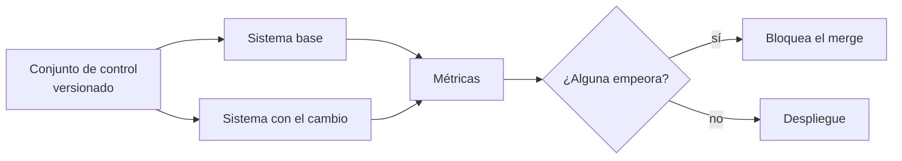

## 1. Resumen

Cambiar un prompt, un modelo o la forma de fragmentar cambia las respuestas de todo el sistema. **Evaluar** es medir esos cambios con un **conjunto fijo de preguntas de control** antes de desplegarlos, como un test de regresión. Para un data engineer el modelo mental es el de calidad de datos (`data-quality-dimensions`): métricas definidas, umbrales y una puerta que bloquea lo que empeora.

Hay tres familias de métricas. **Computadas** cuando hay respuesta de referencia: recall@k y MRR para la recuperación, acierto exacto para la respuesta (Google menciona ROUGE y BLEU entre las deterministas). **Rúbricas**: adaptativas, con pruebas de aprobado o reprobado propias de cada pregunta, o estáticas, con los mismos criterios y un puntaje numérico (*Gen AI evaluation service overview*). Y **LLM como juez**, un segundo modelo que puntúa y explica (*Evaluate model performance using another LLM as a judge*).

## 2. Qué es

- **Conjunto de control (golden set):** preguntas con el fragmento esperado y la respuesta esperada; versionado como código.
- **recall@k:** proporción de preguntas cuyo fragmento esperado está entre los k recuperados.
- **MRR:** promedio de 1/posición del fragmento esperado.
- **Acierto:** la respuesta coincide con la esperada después de normalizar.
- **Citas correctas:** la respuesta cita el fragmento esperado y solo fragmentos recuperados.
- **Rúbrica:** adaptativa, un conjunto de pruebas de aprobado o reprobado propio de cada pregunta; o estática, los mismos criterios para todas las preguntas con un puntaje numérico por pregunta (la página pone de ejemplo 1-5) (*Gen AI evaluation service overview*).
- **LLM como juez:** un modelo evaluador puntúa las respuestas de un modelo generador.
- **Evaluadores de agentes:** por ejemplo, adherencia a la tarea o exactitud de las llamadas a herramientas (*Agent evaluators*).

## 3. Problema que resuelve

Un cambio de prompt mejora la pregunta que alguien probó a mano y empeora otras tres. Sin evaluación se nota en producción; con un conjunto de control, la CI lo muestra antes del merge.

## 4. Cómo funciona

1. Se arma el conjunto de control: preguntas reales, con fragmento y respuesta esperados.
2. Cada versión del sistema responde el conjunto; se guardan los recuperados, la respuesta y las citas.
3. Se calculan las métricas por versión.
4. La puerta compara con la versión base: si una métrica baja más que la tolerancia, bloquea.
5. Cuando no hay respuesta exacta, se suman rúbricas o un LLM como juez, cuyo puntaje también se registra.

## 5. Cuándo utilizarlo

- Antes de cambiar prompt, modelo, embeddings, chunking o reranking.
- Periódicamente sobre el sistema en producción, para detectar degradación.
- Para elegir entre dos modelos con datos y no con impresiones.

## 6. Cuándo no utilizarlo

- Con un conjunto de control inventado que no se parece a las preguntas reales.
- Con LLM como juez como única métrica: es otro modelo con sus propios sesgos; calibrarlo contra revisiones humanas.
- Ajustando el sistema hasta pasar el conjunto de control: deja de medir generalización (ver el hold-out de `prompt-engineering`).

## 7. Ejemplo sencillo

| Métrica | v1 | v2 |
|---|---|---|
| recall@3 | 1.0 | 1.0 |
| MRR | 0.875 | 0.875 |
| Acierto | 1.0 | 0.75 |
| Citas correctas | 1.0 | 0.75 |

v2 recupera igual, pero en una pregunta cita el fragmento equivocado y responde mal. La puerta la bloquea.

## 8. Ejemplo de producción

Un asistente sobre documentación interna:

- 200 preguntas de control tomadas de consultas reales, revisadas por los dueños de cada documento;
- en cada PR que toca prompt, índice o modelo: correr el conjunto y publicar las métricas;
- la puerta bloquea si acierto o citas bajan más de 2 puntos;
- una muestra semanal evaluada con rúbricas o con un LLM como juez en el servicio de la nube (no ejecutado);
- preguntas nuevas que fallaron en producción se agregan al conjunto (`llm-observability`).

## 9. Arquitectura



## 10. Código

```python
# Python 3.12, biblioteca estándar (ejecutado en la CI): evaluación offline de un sistema RAG con un conjunto fijo de
# preguntas de control. Métricas de recuperación (recall@3, MRR) y de respuesta (acierto exacto normalizado y citas
# válidas), comparadas entre dos versiones; la puerta bloquea un cambio que empeora. Las salidas de cada versión son
# fijas (lo que devolvió cada corrida); un LLM como juez queda «no ejecutado».
import unicodedata
from dataclasses import dataclass


@dataclass(frozen=True)
class Caso:
    pregunta: str
    fragmento_esperado: str
    respuesta_esperada: str


@dataclass(frozen=True)
class Salida:
    recuperados: list[str]
    respuesta: str
    citas: list[str]


CASOS = [
    Caso("¿qué hago si ventas_diarias falla por timeout?", "runbook#timeout", "reintentar una vez y escalar"),
    Caso("¿quién es dueño de ventas_diarias?", "runbook#dueno", "ingeniería de ventas"),
    Caso("¿cuántos días se conserva bronze?", "politica#retencion", "90 días"),
    Caso("¿a qué hora se carga silver.pedidos?", "catalogo#pedidos", "02:00"),
]
V1 = [Salida(["runbook#timeout", "runbook#dueno"], "Reintentar una vez y escalar.", ["runbook#timeout"]),
      Salida(["runbook#dueno"], "Ingeniería de ventas.", ["runbook#dueno"]),
      Salida(["catalogo#pedidos", "politica#retencion"], "90 días.", ["politica#retencion"]),
      Salida(["catalogo#pedidos"], "02:00", ["catalogo#pedidos"])]
V2 = [Salida(["runbook#timeout"], "Reintentar una vez y escalar.", ["runbook#timeout"]),
      Salida(["catalogo#pedidos", "runbook#dueno"], "El equipo de datos.", ["catalogo#pedidos"]),
      Salida(["politica#retencion"], "90 días.", ["politica#retencion"]),
      Salida(["catalogo#pedidos"], "02:00", ["catalogo#pedidos"])]


def normalizar(texto: str) -> str:
    sin_tildes = unicodedata.normalize("NFKD", texto.lower()).encode("ascii", "ignore").decode()
    return "".join(c for c in sin_tildes if c.isalnum() or c == " ").strip()


def metricas(salidas: list[Salida]) -> dict[str, float]:
    recall = sum(c.fragmento_esperado in s.recuperados[:3] for c, s in zip(CASOS, salidas, strict=True)) / len(CASOS)
    mrr = sum(1 / (s.recuperados.index(c.fragmento_esperado) + 1) if c.fragmento_esperado in s.recuperados else 0
              for c, s in zip(CASOS, salidas, strict=True)) / len(CASOS)
    exacto = sum(normalizar(s.respuesta) == normalizar(c.respuesta_esperada) for c, s in zip(CASOS, salidas, strict=True))
    citas = sum(set(s.citas) <= set(s.recuperados) and c.fragmento_esperado in s.citas
                for c, s in zip(CASOS, salidas, strict=True))
    return {"recall@3": recall, "mrr": round(mrr, 3), "acierto": exacto / len(CASOS), "citas_correctas": citas / len(CASOS)}


def puerta(base: dict[str, float], nueva: dict[str, float], tolerancia: float = 0.0) -> list[str]:
    return [m for m in base if nueva[m] < base[m] - tolerancia]


m1, m2 = metricas(V1), metricas(V2)
print("v1:", m1)
print("v2:", m2)
empeoran = puerta(m1, m2)
print("puerta:", "bloquea v2, empeoran " + ", ".join(empeoran) if empeoran else "v2 pasa")
```

El script se **ejecuta en la CI** con la biblioteca estándar y pasa `mypy --strict`. Imprime las métricas de v1 y v2 de la tabla del §7 y `puerta: bloquea v2, empeoran acierto, citas_correctas`. Las salidas de cada versión son fijas; un LLM como juez queda «no ejecutado».

## 11. GCP

En GCP, **Gemini Enterprise Agent Platform Evals** (en la tabla de cambios de nombre, antes «Gen AI evaluation service on Vertex AI»). Según *Gen AI evaluation service overview* y *Gemini Enterprise Agent Platform name changes* (no ejecutado):

| | Este concepto | Agent Platform |
|---|---|---|
| Con referencia | recall@k, MRR, acierto | Métricas computadas como ROUGE o BLEU |
| Sin referencia | Rúbricas o LLM como juez | Rúbricas adaptativas (recomendadas) o estáticas |
| Lógica propia | Funciones en el pipeline | Funciones propias en Python |

## 12. AWS

En AWS, **evaluación de modelos de Amazon Bedrock**. Según *Evaluate model performance using another LLM as a judge* (no ejecutado):

| | Este concepto | Amazon Bedrock |
|---|---|---|
| LLM como juez | Un segundo modelo | Trabajo de evaluación con modelo generador y modelo evaluador |
| Resultado | Puntaje | Puntaje y explicación por par prompt-respuesta |

## 13. Azure

En Azure, **evaluadores de Microsoft Foundry**. Según *Agent evaluators* (no ejecutado):

| | Este concepto | Microsoft Foundry |
|---|---|---|
| Agentes | Métricas propias | Task Adherence y Intent Resolution (preview), Tool Call Accuracy |
| Escala | La que se defina | Algunos son aprobado o reprobado; otros, escala de 1 a 5 con umbral |

## 14. Buenas prácticas

- Conjunto de control versionado, con preguntas reales y dueño.
- Métricas de recuperación y de respuesta por separado: un fallo puede estar en cualquiera.
- Puerta en la CI con tolerancia explícita.
- Calibrar el LLM como juez contra revisiones humanas antes de confiar en él.
- **Seguridad:** el conjunto de control puede tener datos reales; seudonimizar como cualquier dataset.
- **Observabilidad:** métricas por versión publicadas en cada corrida.
- **Costo:** cada corrida de evaluación es una pasada completa del sistema; un LLM como juez la duplica.

## 15. Errores frecuentes

- Evaluar a mano con dos o tres preguntas.
- Mirar solo la respuesta final sin la recuperación.
- No versionar el conjunto de control junto con el sistema.
- Usar el mismo modelo como generador y juez sin calibrar.

## 16. Trade-offs

Métricas computadas son baratas y repetibles, y exigen respuesta de referencia; rúbricas y LLM como juez cubren respuestas abiertas, con costo y variabilidad. Un conjunto grande da confianza y tarda más; uno chico corre en cada PR.

## 17. Conceptos relacionados

- `rag`: lo que se evalúa.
- `prompt-engineering`: el hold-out.
- `reranking`: un cambio a medir.
- `llm-observability`: de producción al conjunto de control.
- `data-quality-dimensions`: el mismo enfoque en datos.

## 18. Preguntas técnicas abiertas

1. ¿Qué 20 preguntas reales serían tu primer conjunto de control?
2. ¿Qué métrica bloquearía un merge en tu sistema?
3. ¿Cómo calibrarías un LLM como juez?

## 19. Laboratorio relacionado

Pendiente (F4).

## 20. Fuentes

- Google Cloud: *Gen AI evaluation service overview* y *Gemini Enterprise Agent Platform name changes*.
- AWS: *Evaluate model performance using another LLM as a judge*.
- Microsoft Learn: *Agent evaluators*.

El detalle de cada fuente está en `sources` del frontmatter.

## 21. Fecha de última verificación

2026-10-26. Pasa a `verified`: revisión B-F3.1 del lote F3b-21c aplicada (docs/reviews/cards-f3b-21c.md; rúbricas estáticas) y CI en verde (run 40364714269).

## 22. Historial de cambios importantes

- 2026-10-26: creación (lote F3b-21c).
- 2026-10-26: revisión B-F3.1 aplicada: §1, §2 y la nota de la fuente distinguen las rúbricas adaptativas (aprobado o reprobado) de las estáticas (puntaje numérico, por ejemplo 1-5), según *Gen AI evaluation service overview* (actualizada el 2026-10-22).
- 2026-10-26: `verification_status: verified` (revisión aplicada; CI en verde, run 40364714269).
