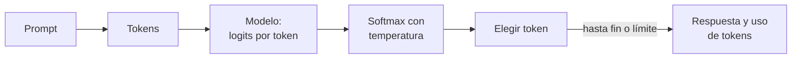

## 1. Resumen

Un **modelo de lenguaje grande** (LLM) recibe un texto, el **prompt**, y genera su continuación **token a token**: en cada paso calcula qué tan probable es cada token siguiente y elige uno. La guía de Google lo resume así: modelos de ML que generan contenido nuevo y que se llaman LLM por su tamaño y su capacidad de entender y generar lenguaje natural (*Generative AI beginner's guide*).

Para un data engineer, un LLM es **otro servicio que se llama por API**, con entrada y salida en texto (o JSON), costo por token, límites y una salida que **no es determinista** salvo que se configure. Las tres nubes lo ofrecen como servicio administrado. Gemini Enterprise Agent Platform es el nombre actual de Vertex AI Platform según su página de cambios de nombre. Le siguen Amazon Bedrock y Microsoft Foundry (antes Azure AI Studio / Azure AI Foundry).

## 2. Qué es

- **Modelo fundacional:** un modelo general, entrenado por el proveedor, que se usa tal cual o se ajusta.
- **Prompt:** la entrada; instrucciones, contexto y datos (`prompt-engineering`).
- **Token:** la unidad que el modelo lee y genera (`tokens`).
- **Ventana de contexto:** cuántos tokens entran en una llamada, entrada y salida juntas (`context-windows`).
- **Temperatura:** cuánto se reparte la probabilidad entre los tokens candidatos; con temperatura 0 se elige siempre el más probable (greedy).
- **Multimodal:** modelos que también leen o generan imágenes, audio o video.

## 3. Problema que resuelve

Tareas sobre texto libre que una regla no cubre bien: clasificar mensajes de error, resumir incidentes, extraer campos de documentos, proponer descripciones para el catálogo. Antes requerían entrenar un modelo por tarea; con un LLM se describe la tarea en el prompt.

## 4. Cómo funciona

1. La aplicación envía el prompt a un endpoint del proveedor (en Bedrock, el recomendado para aplicaciones nuevas es `bedrock-runtime`, según *Overview*).
2. El modelo convierte el texto en tokens y calcula, para cada posición, una puntuación (logit) por token posible.
3. Un softmax convierte las puntuaciones en probabilidades; la temperatura las concentra o las reparte.
4. Se elige un token (el más probable, o una muestra), se agrega a la salida y se repite hasta un token de fin o el límite de salida.
5. La respuesta vuelve con el texto y el uso de tokens, que es lo que se factura.

## 5. Cuándo utilizarlo

- Texto libre que hay que clasificar, resumir o extraer, con una salida que se puede validar (`structured-outputs`).
- Tareas donde una respuesta revisada por una persona o validada por una regla es aceptable.
- Como paso de un pipeline, con la salida validada antes de escribirla en una tabla.

## 6. Cuándo no utilizarlo

- Cálculos, agregaciones y joins: SQL los hace exactos y repetibles.
- Reglas que se pueden escribir: un regex o un `CASE` es más barato y auditable.
- Decisiones que tienen que ser idénticas en cada corrida y no admiten revisión.
- Datos personales hacia un proveedor externo sin haber resuelto antes ese flujo (`processors-and-international-transfers`).

## 7. Ejemplo sencillo

Para el prompt «La tabla de», el modelo puntúa los tokens candidatos. Con temperatura baja casi toda la probabilidad va a «pedidos»; con temperatura alta, «zapatos» deja de ser imposible. Con temperatura 0, cinco corridas dan siempre «pedidos».

## 8. Ejemplo de producción

Un job nocturno clasifica los mensajes de error de los pipelines en `esquema`, `datos` o `infraestructura` para enrutar las alertas:

- temperatura 0 y salida con esquema, para que la misma entrada dé la misma categoría;
- validación de la respuesta antes de escribirla (`structured-outputs`);
- conteo de tokens por corrida como métrica de costo (`tokens`);
- llamada al proveedor no ejecutada aquí; el ejemplo del §10 muestra solo la selección de tokens.

## 9. Arquitectura



## 10. Código

```python
# Python 3.12, biblioteca estándar (ejecutado en la CI): cómo un modelo de lenguaje elige el siguiente token.
# Los logits son fijos e inventados para el ejemplo; un modelo real los calcula para todo su vocabulario.
import math
import random

LOGITS = {"pedidos": 3.1, "ventas": 2.6, "clientes": 1.4, "zapatos": -1.0}


def probabilidades(logits: dict[str, float], temperatura: float) -> dict[str, float]:
    """Softmax con temperatura: más baja concentra la probabilidad; más alta la reparte."""
    escalados = {t: v / temperatura for t, v in logits.items()}
    tope = max(escalados.values())
    exp = {t: math.exp(v - tope) for t, v in escalados.items()}
    total = sum(exp.values())
    return {t: e / total for t, e in exp.items()}


def muestrear(logits: dict[str, float], temperatura: float, semilla: int) -> str:
    if temperatura == 0:  # greedy: siempre el más probable
        return max(logits, key=lambda t: logits[t])
    p = probabilidades(logits, temperatura)
    return random.Random(semilla).choices(list(p), weights=list(p.values()))[0]


print("Prompt: «La tabla de», siguiente token:")
for temp in (0.2, 1.0, 2.0):
    p = probabilidades(LOGITS, temp)
    print(f"  temperatura {temp}: " + ", ".join(f"{t}={v:.2f}" for t, v in p.items()))
print("greedy (temperatura 0), 5 corridas:", {muestrear(LOGITS, 0, s) for s in range(5)})
print("temperatura 2.0, 5 corridas:", [muestrear(LOGITS, 2.0, s) for s in range(5)])
```

El script se **ejecuta en la CI** con la biblioteca estándar y pasa `mypy --strict`. Con temperatura 0.2, «pedidos» se lleva 0.92; con 2.0, baja a 0.43 y «zapatos» sube a 0.06. Greedy da `{'pedidos'}` en las cinco corridas; con temperatura 2.0 y semillas fijas sale `['clientes', 'pedidos', 'zapatos', 'pedidos', 'pedidos']`. Los logits son inventados: un modelo real los calcula para todo su vocabulario.

## 11. GCP

En GCP, **Gemini Enterprise Agent Platform** (antes Vertex AI Platform). Según *Generative AI beginner's guide* y *Gemini Enterprise Agent Platform name changes* (no ejecutado):

| | Este concepto | Gemini Enterprise Agent Platform |
|---|---|---|
| Acceso | Un modelo por API | Modelos fundacionales por una API administrada |
| Catálogo | — | Model Garden: modelos de Google, abiertos y de socios |
| Ajuste | Prompt | También customización (tuning) del comportamiento por defecto |
| Nombre | — | «Vertex AI Platform» se renombró «Gemini Enterprise Agent Platform», y «Vertex AI Model Garden», «Gemini Enterprise Agent Platform Model Garden» |

## 12. AWS

En AWS, **Amazon Bedrock**. Según *Overview* (Amazon Bedrock) (no ejecutado):

| | Este concepto | Amazon Bedrock |
|---|---|---|
| Acceso | Un modelo por API | Servicio administrado con modelos fundacionales de varias empresas de IA |
| Endpoint | — | `bedrock-runtime`, recomendado para aplicaciones nuevas |

## 13. Azure

En Azure, **Microsoft Foundry**. Según *What is Microsoft Foundry?* (no ejecutado):

| | Este concepto | Microsoft Foundry |
|---|---|---|
| Acceso | Un modelo por API | Plataforma unificada para modelos, agentes y herramientas |
| Nombre | — | Azure AI Studio / Azure AI Foundry pasa a Microsoft Foundry; Azure AI Services, a Foundry Tools |
| Portal | — | El anterior es Foundry (classic) |

## 14. Buenas prácticas

- Temperatura 0 en tareas de clasificación o extracción dentro de un pipeline.
- Validar siempre la salida antes de escribirla (`structured-outputs`).
- Versionar el prompt junto con el código (`prompt-engineering`).
- Registrar el modelo y su versión en cada corrida: un cambio de modelo cambia las salidas.
- **Seguridad:** no enviar datos personales ni secretos en el prompt sin un flujo aprobado; la API es un proveedor externo (`processors-and-international-transfers`).
- **Observabilidad:** registrar tokens de entrada y salida, latencia y respuestas rechazadas por corrida.
- **Costo:** se paga por token; medir tokens por fila antes de procesar millones de filas.

## 15. Errores frecuentes

- Tratar la respuesta como verdad sin validarla.
- Usar un LLM para sumar o agrupar lo que SQL hace exacto.
- No fijar el modelo ni la temperatura y esperar la misma salida en cada corrida.
- Medir el costo en filas en lugar de tokens.

## 16. Trade-offs

Un LLM cubre texto libre que una regla no cubre, a cambio de costo por token, latencia y una salida que hay que validar. Temperatura baja da salidas repetibles y menos variadas. Un modelo más grande suele responder mejor y cuesta más por token; uno chico puede bastar para clasificar.

## 17. Conceptos relacionados

- `tokens` y `context-windows`: la unidad y el límite.
- `prompt-engineering`: cómo se pide la tarea.
- `embeddings`: vectores en lugar de texto.
- `vertex-ai-for-data-engineers`, `bedrock-for-data-engineers` y `azure-ai-for-data-engineers`: la inferencia por lotes en cada nube.
- `processors-and-international-transfers`: el proveedor como destino de los datos.
- `structured-outputs`: la salida validada contra un esquema.
- `rag`: responder con documentos propios.

## 18. Preguntas técnicas abiertas

1. ¿Qué tarea de tu plataforma resuelves hoy con reglas frágiles sobre texto libre?
2. ¿Cómo validarías la salida de un LLM antes de escribirla en una tabla?
3. ¿Cuántos tokens por fila tendría ese proceso?

## 19. Laboratorio relacionado

Pendiente (F4).

## 20. Fuentes

- Google Cloud: *Generative AI beginner's guide* y *Gemini Enterprise Agent Platform name changes*.
- AWS: *Overview* (Amazon Bedrock).
- Microsoft Learn: *What is Microsoft Foundry?*.

El detalle de cada fuente está en `sources` del frontmatter.

## 21. Fecha de última verificación

2026-10-25. `review_required`: pendiente de revisión B-F3.1 del lote F3b-21a.

## 22. Historial de cambios importantes

- 2026-10-25: creación (lote F3b-21a).
- 2026-10-25: §17 y `relations` enlazan `rag`, creadas en el lote F3b-21b (regla del §17); sin otros cambios.
- 2026-10-26: revisión B-F3.1 aplicada (docs/reviews/cards-f3b-21a.md): la nota de la fuente y el §11 citan solo filas de la tabla de *Gemini Enterprise Agent Platform name changes*; se quita «Vertex AI» → «Agent Platform», que la tabla no tiene.
