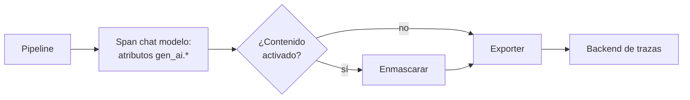

## 1. Resumen

Un sistema con LLM falla de formas nuevas: respuestas cortadas por límite de tokens, costos que se disparan, un cambio de modelo que nadie notó. **Observarlo** es registrar cada llamada al modelo como un **span** (`observability-traces`) con atributos estándar: operación, proveedor, modelo, tokens de entrada y salida, y motivo de término.

OpenTelemetry define esos atributos en sus convenciones de GenAI, que viven en un repositorio propio y siguen en estado **Development** (*Semantic conventions for generative client AI spans*). El nombre del span es `{operación} {modelo}`, y `gen_ai.operation.name` y `gen_ai.provider.name` son obligatorios. El **contenido** de prompts y respuestas (`gen_ai.input.messages`, `gen_ai.output.messages`) es **opt-in**, y la especificación advierte que probablemente tenga datos personales (*Semantic conventions for generative AI client inference*).

## 2. Qué es

- **Span de inferencia:** una llamada al modelo; nombre `chat amazon.nova-pro-v1:0`, kind `CLIENT`.
- **Atributos obligatorios:** `gen_ai.operation.name` (`chat`, `generate_content`, `text_completion`) y `gen_ai.provider.name` (`aws.bedrock` para Bedrock).
- **Uso:** `gen_ai.usage.input_tokens` y `gen_ai.usage.output_tokens`.
- **Término:** `gen_ai.response.finish_reasons`; una salida cortada por límite se ve aquí.
- **Contenido opt-in:** mensajes de entrada y salida, instrucciones de sistema y definiciones de herramientas.
- **Estado Development:** los nombres pueden cambiar; se fija la versión de la especificación que se usa.

## 3. Problema que resuelve

El costo mensual del asistente se duplica y nadie sabe por qué. Con un span por llamada y los tokens como atributos se ve que un cambio de prompt agregó 4 000 tokens de contexto a cada pregunta; con el motivo de término, que un 8 % de las respuestas termina por límite.

## 4. Cómo funciona

1. Cada llamada al modelo abre un span `CLIENT` con el nombre `{operación} {modelo}`.
2. Se ponen los atributos obligatorios y el modelo pedido.
3. Al volver la respuesta se registran tokens y motivo de término.
4. El contenido no se registra por defecto; si se activa para depurar, se enmascara antes.
5. Los spans van al backend de la nube o a un collector; el SDK es el mismo.

## 5. Cuándo utilizarlo

- Siempre que un pipeline o asistente llame a un modelo en producción.
- Para atribuir costo por equipo, por pipeline o por versión de prompt.
- Para investigar respuestas malas: qué modelo, qué contexto, cuántos tokens.

## 6. Cuándo no utilizarlo

- Registrar el contenido completo por defecto: duplica en los logs lo que hay en las tablas, incluidos datos personales.
- Como reemplazo de la evaluación: la traza muestra qué pasó, no si la respuesta era correcta (`llm-evaluation`).

## 7. Ejemplo sencillo

| Span | Tokens | Contenido | Datos personales en el span |
|---|---|---|---|
| `chat amazon.nova-pro-v1:0` | 52 + 11 | No | No |
| `chat amazon.nova-pro-v1:0`, con contenido activado | 52 + 11 | Sí, enmascarado | No |

El contenido registrado queda como «El cliente [RUT] ([CORREO]) pregunta por qué falló ventas_diarias.».

## 8. Ejemplo de producción

Un pipeline que resume incidentes con un modelo:

- un span por llamada con los atributos de GenAI y `pipeline.run_id`;
- métricas de tokens por corrida y alerta ante saltos (`tokens`);
- contenido apagado; para depurar, se activa por un tiempo con enmascaramiento;
- en la nube (no ejecutado): Cloud Observability en Agent Platform, logging de invocaciones de Bedrock o trazas de Foundry con Application Insights.

## 9. Arquitectura



## 10. Código

```python
# Python 3.12 y OpenTelemetry SDK 1.45 (ejecutado en la CI; ADR-020 y ADR-025): un span por llamada al modelo con
# las convenciones semánticas de GenAI (estado «Development»): nombre «{operación} {modelo}», gen_ai.operation.name,
# gen_ai.provider.name, gen_ai.request.model y el uso de tokens. El contenido de los mensajes es opt-in: por defecto no
# se registra, y si se activa se enmascaran RUT y correos antes de ponerlo en el span. La llamada al modelo es fija.
import json
import re
from collections.abc import Sequence

from opentelemetry.sdk.trace import ReadableSpan, TracerProvider
from opentelemetry.sdk.trace.export import SimpleSpanProcessor, SpanExporter, SpanExportResult
from opentelemetry.trace import SpanKind

RUT = re.compile(r"\b\d{7,8}-[\dkK]\b")
CORREO = re.compile(r"\b[^@\s]+@[^@\s]+\.[a-z]{2,}\b", re.I)


class EnMemoria(SpanExporter):
    def __init__(self) -> None:
        self.spans: list[ReadableSpan] = []

    def export(self, spans: Sequence[ReadableSpan]) -> SpanExportResult:
        self.spans.extend(spans)
        return SpanExportResult.SUCCESS


def enmascarar(texto: str) -> str:
    return CORREO.sub("[CORREO]", RUT.sub("[RUT]", texto))


exporter = EnMemoria()
provider = TracerProvider()
provider.add_span_processor(SimpleSpanProcessor(exporter))
tracer = provider.get_tracer("asistente.guardia")
MODELO = "amazon.nova-pro-v1:0"


def llamar(prompt: str, registrar_contenido: bool) -> str:
    with tracer.start_as_current_span(f"chat {MODELO}", kind=SpanKind.CLIENT) as span:
        span.set_attribute("gen_ai.operation.name", "chat")
        span.set_attribute("gen_ai.provider.name", "aws.bedrock")
        span.set_attribute("gen_ai.request.model", MODELO)
        if registrar_contenido:  # opt-in, y enmascarado
            mensajes = [{"role": "user", "parts": [{"type": "text", "content": enmascarar(prompt)}]}]
            span.set_attribute("gen_ai.input.messages", json.dumps(mensajes, ensure_ascii=False))
        respuesta, entrada, salida = "Reintenta una vez y escala a la guardia.", 52, 11  # respuesta fija del "modelo"
        span.set_attribute("gen_ai.usage.input_tokens", entrada)
        span.set_attribute("gen_ai.usage.output_tokens", salida)
        span.set_attribute("gen_ai.response.finish_reasons", ["stop"])
        return respuesta


prompt = "El cliente 12345678-5 (ana@example.com) pregunta por qué falló ventas_diarias."
llamar(prompt, registrar_contenido=False)
llamar(prompt, registrar_contenido=True)
for s in exporter.spans:
    attrs = dict(s.attributes or {})
    contenido = str(attrs.get("gen_ai.input.messages", ""))
    print(f"{s.name} [{s.kind.name}] tokens={attrs['gen_ai.usage.input_tokens']}+{attrs['gen_ai.usage.output_tokens']}"
          f" contenido={'sí' if contenido else 'no'} PII en el span={bool(RUT.search(contenido) or CORREO.search(contenido))}")
print("contenido registrado:", json.loads(str(dict(exporter.spans[1].attributes or {})["gen_ai.input.messages"]))[0]["parts"][0]["content"])
```

El script se **ejecuta en la CI** con el SDK de OpenTelemetry (ADR-020), sin collector, y pasa `mypy --strict`. Imprime los dos spans `chat amazon.nova-pro-v1:0 [CLIENT] tokens=52+11`, el primero sin contenido y el segundo con contenido, ambos con `PII en el span=False`, y el texto enmascarado. La llamada al modelo y los tokens son fijos.

## 11. GCP

En GCP, **Google Cloud Observability** para Gemini Enterprise Agent Platform. Según *Observability overview* (no ejecutado):

| | Este concepto | Agent Platform |
|---|---|---|
| Formato | OpenTelemetry | Los agentes envían telemetría en formato OpenTelemetry |
| Componentes propios | — | Emiten OpenTelemetry; Model Armor expone sus intercepciones en las trazas |

## 12. AWS

En AWS, **logging de invocaciones de Amazon Bedrock**. Según *Monitor model invocation using CloudWatch Logs and Amazon S3* (no ejecutado):

| | Este concepto | Amazon Bedrock |
|---|---|---|
| Qué registra | Atributos; contenido opt-in | Request, response y metadata completos |
| Por defecto | Contenido apagado | Logging desactivado; al activarlo guarda los datos completos |
| Destino | Exporter | CloudWatch Logs y S3 de la misma cuenta y región |
| Retención | La del backend | Hasta borrar la configuración |

## 13. Azure

En Azure, **trazas de Microsoft Foundry** con Application Insights. Según *Set up tracing in Microsoft Foundry* (no ejecutado):

| | Este concepto | Microsoft Foundry |
|---|---|---|
| Punto de partida | Instrumentar la llamada | Tracing del lado del servidor, sin cambios de código |
| Lógica propia | El mismo SDK | Instrumentación del lado del cliente como segundo paso |

## 14. Buenas prácticas

- Un span por llamada al modelo, con los atributos de GenAI y el identificador de corrida.
- Fijar la versión de las convenciones de GenAI, que están en Development.
- Contenido apagado por defecto; enmascarar si se activa.
- Registrar el motivo de término y alertar sobre respuestas cortadas.
- **Seguridad:** el logging de invocaciones de Bedrock guarda request y response completos; protegerlo o no activarlo con datos personales (`privacy-controls-as-code`).
- **Observabilidad:** tokens por corrida, latencia por llamada y tasa de respuestas cortadas.
- **Costo:** registrar contenido multiplica el volumen de telemetría.

## 15. Errores frecuentes

- Registrar prompts completos con datos personales en los logs.
- Spans sin el modelo: un cambio de versión pasa sin verse.
- Mirar solo latencia y no tokens.
- Asumir que los nombres de atributos son estables: la especificación está en Development.

## 16. Trade-offs

Registrar contenido facilita depurar y expone datos; no registrarlo protege y obliga a reproducir los casos. Un exporter directo es simple; un collector permite enmascarar y enrutar en un solo lugar. Los servicios de la nube traen trazas sin código y quedan atados a su backend.

## 17. Conceptos relacionados

- `observability-traces`: las trazas en general.
- `llm-evaluation`: de la traza al conjunto de control.
- `tokens`: el uso por llamada.
- `guardrails`: lo que se bloquea, también se registra.
- `privacy-controls-as-code`: sin datos personales en logs ni trazas.

## 18. Preguntas técnicas abiertas

1. ¿Sabes cuántos tokens consume cada corrida de tu pipeline con modelo?
2. ¿Dónde quedaría el contenido si activas el logging de invocaciones?
3. ¿Cómo detectarías un cambio de modelo en producción?

## 19. Laboratorio relacionado

Pendiente (F4).

## 20. Fuentes

- OpenTelemetry: *Semantic conventions for generative client AI spans* y *Semantic conventions for generative AI client inference* (semantic-conventions-genai, commit 0b9555d).
- Google Cloud: *Observability overview*.
- AWS: *Monitor model invocation using CloudWatch Logs and Amazon S3*.
- Microsoft Learn: *Set up tracing in Microsoft Foundry*.

El detalle de cada fuente está en `sources` del frontmatter.

## 21. Fecha de última verificación

2026-10-26. `review_required`: pendiente de revisión B-F3.1 del lote F3b-21c.

## 22. Historial de cambios importantes

- 2026-10-26: creación (lote F3b-21c).
