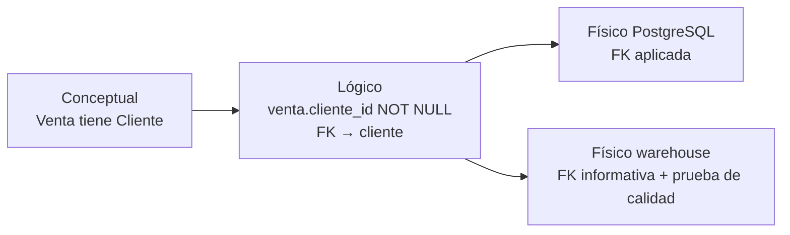

## 1. Resumen

El modelo lógico convierte el diagrama de negocio en una estructura precisa:

- cada entidad con sus **atributos tipados** (texto, número, fecha, decimal);
- una **clave** que identifica sus filas;
- **relaciones** con cardinalidad exacta;
- **reglas** expresadas como restricciones.

Todavía no depende de un motor: el mismo modelo lógico se puede implementar en PostgreSQL, BigQuery o Fabric. Algunas reglas de negocio no caben en una restricción y quedan como chequeos explícitos.

## 2. Qué es

Según AWS, el modelo lógico mapea las clases del modelo conceptual a estructuras técnicas: tipos de datos, relaciones entre entidades y atributos clave. Es independiente de la tecnología y lo construyen arquitectos de datos y analistas con un método formal de modelado.

Sus elementos:

- **Atributos con tipo y dominio:** `email` es texto con formato de email; `monto` es decimal y mayor que cero.
- **Claves:**
  - primaria, que identifica la fila;
  - alternativas, únicas;
  - foráneas, que referencian otra entidad.
- **Relaciones:** uno a muchos con clave foránea. Muchos a muchos con una entidad asociativa (por ejemplo, `venta_vendedor`).
- **Reglas:** obligatoriedad (no nulo), unicidad y condiciones (`CHECK`).

## 3. Problema que resuelve

Un diagrama conceptual no dice si una venta puede tener dos vendedores en la base, si el email es obligatorio o qué identifica a un auto. Sin esas decisiones, cada desarrollador las toma al escribir el DDL, y la base termina aceptando datos que el negocio considera inválidos. El modelo lógico las fija una vez y de forma revisable, antes de elegir el motor y sus optimizaciones.

## 4. Cómo funciona

1. Cada entidad del modelo conceptual pasa a ser una tabla lógica con sus atributos y tipos.
2. Se elige la clave primaria: natural (un código del negocio) o sustituta (ver `surrogate-keys`).
3. Las relaciones uno a muchos se resuelven con una clave foránea en el lado «muchos». Las de muchos a muchos, con una tabla asociativa cuya clave es la combinación de ambas.
4. Las reglas de negocio se traducen a restricciones:
   - `NOT NULL` para lo obligatorio;
   - `UNIQUE` para lo irrepetible;
   - `CHECK` para condiciones sobre el valor.
5. Las reglas que involucran varias filas o tablas, como «al menos un vendedor por venta», no se expresan con una clave foránea. Quedan como chequeos o validaciones en la carga.
6. En modelos transaccionales se normaliza para evitar redundancia (ver `normalization`). En analíticos, el modelo lógico puede ser dimensional (ver `kimball-methodology`).

## 5. Cuándo utilizarlo

- Antes de crear tablas para un sistema nuevo o un área nueva del warehouse.
- Cuando el mismo modelo se va a implementar en más de un motor, por ejemplo una base operacional y un warehouse.
- Para revisar un diseño con otros equipos sin discutir detalles de un motor.

## 6. Cuándo no utilizarlo

- No como entregable aislado que nadie actualiza: si el DDL físico cambia y el lógico no, el lógico deja de servir.
- No para decidir particiones, índices o distribución: eso es del modelo físico.
- No en prototipos desechables, donde un esquema rápido basta.

## 7. Ejemplo sencillo

La regla conceptual «toda venta tiene un cliente» en el modelo lógico:

- `Venta.cliente_id` es una clave foránea a `Cliente`, no nula.
- Una venta sin cliente, o con un cliente inexistente, se rechaza.

## 8. Ejemplo de producción

El modelo lógico de ventas de un retailer se mantiene como DDL portable en el repositorio, con:

- tablas, claves y restricciones;
- un documento de reglas que no caben en restricciones, cada una con su chequeo de calidad.

Se implementa dos veces: en PostgreSQL para la aplicación, con todas las restricciones aplicadas, y en el warehouse, donde algunas restricciones solo son informativas y las reglas se verifican con pruebas en el pipeline (ver `physical-data-model`).

## 9. Arquitectura



## 10. Código

```sql
-- PostgreSQL 17 (ejecutado): el modelo lógico del concesionario como tablas, con claves y reglas de negocio.
CREATE TABLE sucursal (
  sucursal_id integer PRIMARY KEY,
  nombre      text NOT NULL
);
CREATE TABLE cliente (
  cliente_id integer PRIMARY KEY,
  email      text NOT NULL UNIQUE CHECK (email ~ '^[^@]+@[^@]+\.[^@]+$'),
  telefono   text NOT NULL                         -- regla: todo cliente da teléfono y email
);
CREATE TABLE vendedor (
  vendedor_id integer PRIMARY KEY,
  nombre      text NOT NULL
);
CREATE TABLE auto (
  auto_id         integer PRIMARY KEY,
  marca           text NOT NULL,
  numero_producto text NOT NULL,
  sucursal_id     integer NOT NULL REFERENCES sucursal   -- regla: todo auto pertenece a una sucursal
);
CREATE TABLE venta (
  venta_id   integer PRIMARY KEY,
  auto_id    integer NOT NULL UNIQUE REFERENCES auto,  -- un auto se vende una vez
  cliente_id integer NOT NULL REFERENCES cliente,      -- regla: toda venta tiene un cliente
  fecha      date NOT NULL,
  monto      numeric(12, 2) NOT NULL CHECK (monto > 0)
);
CREATE TABLE venta_vendedor (                          -- relación muchos a muchos: una venta, uno o más vendedores
  venta_id    integer REFERENCES venta,
  vendedor_id integer REFERENCES vendedor,
  PRIMARY KEY (venta_id, vendedor_id)
);

INSERT INTO sucursal VALUES (1, 'Centro');
INSERT INTO cliente VALUES (10, 'ana@example.com', '+56 9 1111 1111');
INSERT INTO vendedor VALUES (100, 'Luis');
INSERT INTO auto VALUES (500, 'Marca A', 'P-01', 1);
INSERT INTO venta VALUES (9000, 500, 10, '2026-10-07', 15990000);
INSERT INTO venta_vendedor VALUES (9000, 100);

DO $$
DECLARE intento text;
BEGIN
  FOREACH intento IN ARRAY ARRAY[
    $q$INSERT INTO auto VALUES (501, 'Marca B', 'P-02', 99)$q$,                 -- sucursal inexistente
    $q$INSERT INTO cliente VALUES (11, 'sin-arroba', '+56 9 2222 2222')$q$,     -- email inválido
    $q$INSERT INTO venta VALUES (9001, 500, 10, '2026-10-08', 100)$q$           -- el mismo auto otra vez
  ] LOOP
    BEGIN
      EXECUTE intento;
    EXCEPTION WHEN others THEN
      RAISE NOTICE '%', SQLERRM;
    END;
  END LOOP;
END $$;
-- NOTICE: insert or update on table "auto" violates foreign key constraint "auto_sucursal_id_fkey"
-- NOTICE: new row for relation "cliente" violates check constraint "cliente_email_check"
-- NOTICE: duplicate key value violates unique constraint "venta_auto_id_key"

-- "Toda venta tiene al menos un vendedor" no se expresa con una clave foránea: se verifica con una consulta.
SELECT v.venta_id FROM venta v
WHERE NOT EXISTS (SELECT 1 FROM venta_vendedor vv WHERE vv.venta_id = v.venta_id);   -- 0 filas
```

Ejecutado en PostgreSQL 17.11 local, en un esquema desechable. Las tres inserciones inválidas fallan con el mensaje que indica cada comentario. La regla «al menos un vendedor» queda como consulta de verificación: devuelve 0 filas. El DDL usa tipos comunes, así que el modelo es portable. Al pasarlo a otro motor, las restricciones se comportan distinto (ver `physical-data-model`).

## 11. GCP

No aplica de forma específica: el modelo lógico es independiente del motor. Cómo BigQuery trata las claves declaradas está en `physical-data-model`.

## 12. AWS

No aplica de forma específica (ver §11 y `physical-data-model` para Redshift).

## 13. Azure

No aplica de forma específica (ver §11 y `physical-data-model` para Fabric Warehouse).

## 14. Buenas prácticas

- Una clave primaria explícita por entidad, que diga qué representa una fila.
- Cada regla de negocio del modelo conceptual, trazada a una restricción o a un chequeo con nombre.
- Tablas asociativas para relaciones muchos a muchos, no listas en una columna.
- Tipos con precisión explícita para dinero (`numeric(12,2)`), no flotantes.
- **Seguridad:** identificar en el modelo lógico los atributos sensibles (email, teléfono, documento) para clasificarlos y aplicar después permisos o enmascaramiento por columna.
- **Observabilidad:** las reglas que no son restricciones se convierten en pruebas con nombre que se ejecutan en cada carga y se reportan, como la consulta de «al menos un vendedor».
- **Costo:** decidir tipos y claves en el lógico evita migraciones de esquema costosas cuando la tabla ya tiene volumen.

## 15. Errores frecuentes

- Usar un flotante para montos y acumular errores de redondeo.
- Modelar una relación muchos a muchos como una columna con varios valores separados por comas.
- Suponer que todas las reglas de negocio se garantizan con claves foráneas.
- Copiar el modelo de la fuente sin preguntar qué identifica una fila.

## 16. Trade-offs

Un modelo lógico explícito cuesta tiempo de diseño y disciplina para mantenerlo sincronizado con el DDL. A cambio, da una referencia independiente del motor y reglas revisables. Cuantas más reglas se expresan como restricciones, más protege la base, pero en algunos motores analíticos las claves declaradas no se aplican (ver `physical-data-model`).

## 17. Conceptos relacionados

- `conceptual-data-model` y `physical-data-model`: los niveles vecinos.
- `normalization`: organizar entidades sin redundancia.
- `surrogate-keys`: claves naturales o sustitutas.
- `grain`: qué representa una fila.

## 18. Preguntas técnicas abiertas

1. ¿Qué reglas de tu negocio no se pueden expresar como restricción y dónde se verifican hoy?
2. ¿Usarías una clave natural o sustituta para el auto del ejemplo, y qué pasa si el número de producto se reutiliza?
3. ¿Cómo mantendrías sincronizados el modelo lógico y el DDL de dos motores distintos?

## 19. Laboratorio relacionado

Pendiente (F4).

## 20. Fuentes

- AWS: *What is Data Modeling?*
- Chen (1976): *The Entity-Relationship Model* (Nivel 4, conceptual).
- PostgreSQL 17: *Constraints*.

El detalle de cada fuente está en `sources` del frontmatter.

## 21. Fecha de última verificación

2026-10-11. Pasa a `verified`: revisión B-F3.1 del lote F3b-04a aplicada, sin VERIFY pendientes.

## 22. Historial de cambios importantes

- 2026-10-10: creación (lote F3b-04a).
- 2026-10-11: revisión B-F3.1 del lote F3b-04a aplicada (docs/reviews/cards-f3b-04a.md): filas aprobadas sin cambios en esta ficha.
- 2026-10-11: `verification_status: verified` (sin VERIFY pendientes).
