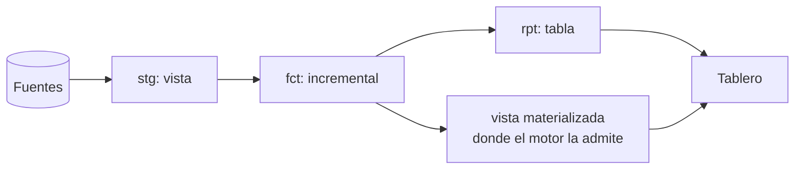

## 1. Resumen

Una transformación SQL puede existir de varias formas, y elegir cuál es un trade-off entre **frescura**, **costo** y **latencia**:

- **vista lógica:** no guarda datos; recalcula en cada consulta (siempre fresca, potencialmente lenta y cara);
- **tabla:** guarda el resultado y se reconstruye en cada ejecución del pipeline (rápida de consultar, fresca hasta la siguiente ejecución);
- **tabla incremental:** procesa solo lo nuevo (más barata de construir, más compleja);
- **efímera** (dbt): no existe en la base; se inserta como CTE en quien la usa;
- **vista materializada:** el motor guarda y refresca el resultado. En BigQuery y Redshift refresca solo lo que cambió cuando puede. Fabric Warehouse no la admite.

dbt resume la regla práctica: empezar con vistas y pasar a tablas o incrementales cuando el rendimiento lo pida.

## 2. Qué es

| Estrategia | Datos guardados | Frescura | Costo de consulta | Costo de construcción |
|---|---|---|---|---|
| Vista lógica | No | Siempre al día | Alto si la lógica es pesada | Ninguno |
| Tabla | Sí | Hasta la última ejecución | Bajo | Alto (reconstrucción completa) |
| Incremental | Sí | Hasta la última ejecución | Bajo | Bajo por ejecución; diseño más complejo |
| Efímera (dbt) | No | Como quien la usa | Se suma a quien la usa | Ninguno |
| Vista materializada | Sí, gestionada por el motor | Según refresco o `max_staleness` | Bajo | Refresco, a menudo incremental |

## 3. Problema que resuelve

Sin una decisión explícita, los modelos terminan como vistas apiladas que recalculan todo en cada consulta del tablero, o como tablas que se reconstruyen enteras cada hora aunque solo cambió el último día. Elegir la materialización ajusta el costo al uso real.

## 4. Cómo funciona

1. **Vista lógica:** la consulta se guarda; cada lectura la ejecuta. BigQuery factura según los datos de las tablas que la vista referencia.
2. **Tabla:** dbt la reconstruye con `CREATE TABLE AS` en cada ejecución.
3. **Incremental:** el modelo inserta o actualiza solo los registros nuevos desde la última ejecución (ver `incremental-load`).
4. **Efímera:** dbt inserta su SQL como CTE en los modelos dependientes.
5. **Vista materializada:**
   - el motor guarda el resultado y lo mantiene;
   - BigQuery lee solo los cambios cuando puede, limita la sintaxis y exige `max_staleness` entre 30 minutos y 3 días;
   - Redshift refresca con `REFRESH MATERIALIZED VIEW` o automáticamente, y solo reescribe consultas hacia la vista si está al día;
   - PostgreSQL refresca con `REFRESH MATERIALIZED VIEW` y, mientras tanto, sus datos pueden no estar al día.

## 5. Cuándo utilizarlo

- **Vista:** transformaciones livianas (renombrar, castear) y modelos poco consultados.
- **Tabla:** modelos que consultan herramientas de BI, o transformaciones lentas usadas por muchos modelos, como recomienda dbt.
- **Incremental:** datos tipo evento, de gran volumen, cuando la reconstrucción completa se vuelve lenta.
- **Efímera:** lógica reutilizable que no necesita existir como objeto.
- **Vista materializada:** agregaciones frecuentes y predecibles sobre tablas grandes, en motores que la admiten.

## 6. Cuándo no utilizarlo

- Vistas apiladas sobre vistas con transformaciones pesadas: dbt advierte que son lentas de consultar.
- Incremental desde el primer día: dbt recomienda no empezar por ahí.
- Vistas materializadas en Fabric Warehouse, que no las admite, o con consultas fuera de la sintaxis restringida de BigQuery.
- Tablas reconstruidas con mucha frecuencia cuando casi nada cambia.

## 7. Ejemplo sencillo

```yaml
# dbt: tres modelos, tres materializaciones.
models:
  - name: stg_pedidos
    config: { materialized: view }         # renombra y castea
  - name: fct_pedidos
    config: { materialized: incremental }  # eventos de gran volumen
  - name: rpt_ventas_diarias
    config: { materialized: table }        # lo consulta el tablero
```

## 8. Ejemplo de producción

Un tablero de ventas en BigQuery consultaba una vista que agregaba 2 años de pedidos en cada visita. Se evaluaron dos opciones:

- **Tabla de dbt reconstruida cada hora:** consultas baratas, pero reprocesa 2 años por hora.
- **Vista materializada incremental** con `max_staleness` de 1 hora: BigQuery refresca solo los cambios.

Se eligió la vista materializada, porque la agregación cabía en su sintaxis restringida. Para la versión en Fabric Warehouse, que no admite vistas materializadas, se usó una tabla incremental de dbt.

## 9. Arquitectura



## 10. Código

```sql
-- PostgreSQL (ejecutado): una vista materializada no refleja cambios hasta REFRESH.
CREATE MATERIALIZED VIEW resumen_mes AS
SELECT date_trunc('month', ocurrido)::date AS mes, count(*) AS n
FROM eventos GROUP BY 1;

INSERT INTO eventos VALUES ('2026-10-15', 1, 1);
SELECT n FROM resumen_mes WHERE mes = '2026-10-01';   -- valor anterior (721)
REFRESH MATERIALIZED VIEW resumen_mes;
SELECT n FROM resumen_mes WHERE mes = '2026-10-01';   -- valor nuevo (722)
```

La vista materializada devolvió el mismo conteo después del `INSERT` y el nuevo después del `REFRESH`, que es el comportamiento que documenta PostgreSQL. En BigQuery y Redshift, el refresco lo hace el motor según su configuración; no se ejecutó, porque requiere esas nubes.

## 11. GCP

En **BigQuery**, una vista lógica ejecuta su consulta cada vez y se factura por los datos que lee. Las vistas materializadas son tablas precalculadas para consultas frecuentes y predecibles. Funcionan así:

- leen solo los cambios cuando pueden;
- solo las incrementales aprovechan el smart tuning;
- por defecto solo se crean sobre consultas incrementales;
- usan una sintaxis restringida;
- `max_staleness` debe estar entre 30 minutos y 3 días.

## 12. AWS

En **Redshift**, la vista materializada guarda un resultado precalculado para consultas repetidas, como las de tableros. Se refresca con `REFRESH MATERIALIZED VIEW`, que aplica los cambios de las tablas base, o automáticamente. La reescritura automática de consultas hacia la vista requiere que esté al día.

## 13. Azure

**Fabric Warehouse** no admite vistas materializadas, según su lista de limitaciones de T-SQL. Las alternativas son tablas reconstruidas o incrementales, por ejemplo con dbt. No es una diferencia de sintaxis: la estrategia de materialización cambia entre nubes.

## 14. Buenas prácticas

- Empezar con vistas y materializar cuando la consulta lo justifique, medido en tiempo o costo.
- Materializar como tabla lo que consumen herramientas de BI.
- Usar incrementales para datos de eventos de gran volumen, y definir de antemano cómo reconstruirlos por completo si la lógica cambia.
- Documentar la frescura esperada de cada modelo materializado.
- **Seguridad:** una tabla o vista materializada copia datos; sus permisos deben ser al menos tan restrictivos como los de las tablas base.
- **Observabilidad:** medir la frescura (hora del último refresco o construcción) de cada modelo materializado y alertar si se atrasa.
- **Costo:** comparar el costo de reconstruir (o refrescar) con el ahorro en consultas; una tabla que se reconstruye cada hora y se consulta una vez al día no conviene.

## 15. Errores frecuentes

- Vistas apiladas que recalculan todo en cada consulta del tablero.
- Cambiar la lógica de un incremental sin reconstruirlo: las filas antiguas quedan con la lógica anterior.
- Suponer que una vista materializada siempre está al día.
- Migrar un diseño con vistas materializadas a un motor que no las admite.

## 16. Trade-offs

Más materialización da consultas rápidas y baratas a cambio de almacenamiento, construcción y riesgo de datos atrasados. Menos materialización da frescura y simplicidad a cambio de costo y latencia en cada consulta. Las vistas materializadas mueven ese equilibrio al motor, a cambio de su sintaxis restringida y de su disponibilidad en cada nube.

## 17. Conceptos relacionados

- `incremental-load`: el patrón detrás de la materialización incremental.
- `data-transformation`: modelos de transformación.
- `scan-reduction`: materializar para leer menos.
- `sql-cte`: los modelos efímeros se insertan como CTE.

## 18. Preguntas técnicas abiertas

1. ¿Qué modelos de tu proyecto son vistas consultadas por tableros y deberían ser tablas?
2. ¿Qué frescura necesita realmente cada tablero?
3. ¿Cómo materializarías el mismo modelo en un motor con vistas materializadas y en uno sin ellas?

## 19. Laboratorio relacionado

Pendiente (F4).

## 20. Fuentes

- dbt: *Materializations*.
- Google Cloud: *Introduction to logical views* e *Introduction to materialized views* (BigQuery).
- AWS: *Materialized views* (Amazon Redshift).
- Microsoft Learn: *T-SQL Surface Area in Fabric Data Warehouse*.
- PostgreSQL: *Materialized Views*.

El detalle de cada fuente está en `sources` del frontmatter.

## 21. Fecha de última verificación

2026-10-07. Pasa a `verified`: revisión B-F3.1 del lote F3b-02b aplicada, sin VERIFY pendientes.

## 22. Historial de cambios importantes

- 2026-10-05: esqueleto creado desde el blueprint (rama `f/sql`).
- 2026-10-07: ficha completa (lote F3b-02b, dominio 02-sql).
- 2026-10-07: revisión B-F3.1 del lote F3b-02b aplicada (docs/reviews/cards-f3b-02b.md): sin cambios pedidos.
- 2026-10-07: `verification_status: verified` (sin VERIFY pendientes).
