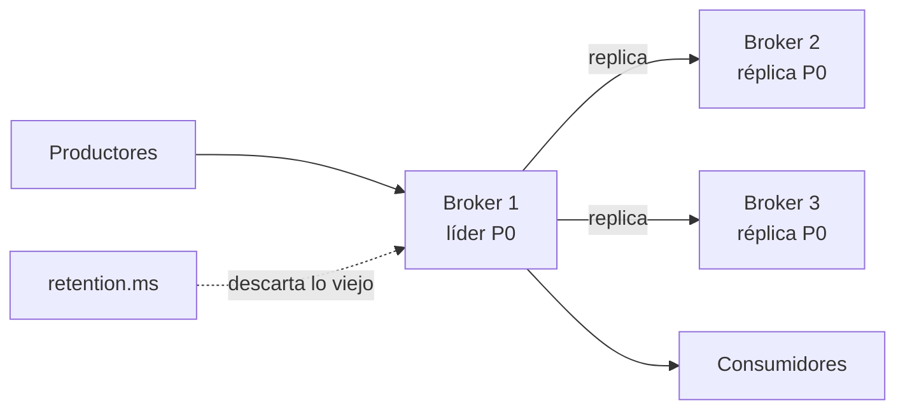

## 1. Resumen

Un broker es el servicio que recibe los eventos de los productores, los guarda y los entrega a los consumidores. En Kafka, los brokers son la capa de almacenamiento del clúster.

Dos responsabilidades definen a un broker:

- **retención:** cuánto tiempo guarda los eventos, configurable por topic (`retention.ms`);
- **replicación:** cuántas copias tiene cada partición en brokers distintos; según la documentación, «A common production setting is a replication factor of 3».

En la nube, el broker se compra administrado: Pub/Sub, Kinesis Data Streams, Amazon MSK (Kafka administrado) y Event Hubs (con endpoint de Kafka). No son equivalentes: cambian la retención, la capacidad y el cobro.

## 2. Qué es

- **Broker:** un servidor que guarda particiones y atiende a productores y consumidores.
- **Clúster:** varios brokers; en KRaft, algunos servidores son controllers y forman el quorum de metadatos (3 o 5, por lo general).
- **Líder y réplicas:** cada partición tiene un broker líder y copias en otros brokers.
- **Factor de replicación:** la cantidad de copias de cada partición.
- **Retención:** el tiempo (o tamaño) que el broker guarda los eventos antes de descartarlos.

## 3. Problema que resuelve

Si los productores escribieran directo a los consumidores, un consumidor caído perdería eventos y uno lento frenaría al productor. El broker los guarda en forma durable, con copias en varios servidores, para que nadie dependa de que el otro esté disponible en ese momento.

## 4. Cómo funciona

1. El topic se crea con particiones, un factor de replicación y una retención.
2. Cada partición tiene un líder; el productor escribe en el líder y las réplicas copian.
3. Los consumidores leen del broker a su ritmo.
4. Los segmentos más viejos que la retención se descartan.
5. Si un broker cae, otra réplica toma el lugar de líder.

## 5. Cuándo utilizarlo

- Integrar productores y consumidores que no deben depender entre sí.
- Guardar eventos el tiempo suficiente para reprocesar o para que un consumidor caído se ponga al día.
- Un servicio administrado cuando el equipo no quiere operar un clúster.

## 6. Cuándo no utilizarlo

- Un clúster de Kafka propio para un volumen que un servicio administrado cubre.
- Factor de replicación 1 en producción: un broker caído deja la partición sin datos disponibles.
- Como base de datos de consulta: el broker guarda eventos en orden, no responde consultas.

## 7. Ejemplo sencillo

En un broker Kafka de un nodo se crea `logs-app` con 2 particiones, factor de replicación 1 y retención de un día. Cada partición tiene el broker 1 como líder y única réplica. El contenedor corre un servidor combinado (broker y controller). Pedir un factor de replicación 3 falla: con un solo broker no hay dónde poner las otras dos copias.

## 8. Ejemplo de producción

Un clúster de streaming de un equipo de datos:

- tres brokers como mínimo, en zonas distintas, con factor de replicación 3;
- retención por topic según para qué se usa: horas para métricas, días para pagos;
- un servicio administrado (MSK, Event Hubs o Pub/Sub) en lugar de operar los brokers;
- alertas si una partición queda con menos réplicas sincronizadas que las esperadas.

## 9. Arquitectura



## 10. Código

```bash
# Bash y Kafka (ejecutado en la CI con un broker Kafka 4.3.1 en KRaft, en Docker; ADR-017): el broker guarda los eventos
# por un tiempo configurable por topic y replica cada partición en tantos brokers como pida el factor de replicación.
set -euo pipefail
K="${KAFKA_CONTAINER:-dekh-kafka}"
kafka() { docker exec -i "$K" /opt/kafka/bin/"$1" --bootstrap-server localhost:9092 "${@:2}"; }
trap 'kafka kafka-topics.sh --delete --topic logs-app > /dev/null 2>&1 || true' EXIT

kafka kafka-topics.sh --create --topic logs-app --partitions 2 --replication-factor 1 \
  --config retention.ms=86400000 > /dev/null                                   # retiene 1 día
kafka kafka-topics.sh --describe --topic logs-app |
  awk -F'\t' '/^\tTopic/ {print $3 " → " $4 ", " $5}'                      # una línea por partición: líder y réplicas
kafka kafka-configs.sh --describe --entity-type topics --entity-name logs-app | grep -o 'retention.ms=[0-9]*' | head -1

# Con un solo broker, un factor de replicación 3 no se puede cumplir.
{ kafka kafka-topics.sh --create --topic logs-replicado --partitions 1 --replication-factor 3 2>&1 || true; } |
  grep -o 'The target replication factor of 3 cannot be reached because only 1 broker(s) are registered' | head -1
```

El script se **ejecuta en la CI contra un broker Kafka 4.3.1 en KRaft, en Docker** (ADR-017). Imprime el líder y las réplicas de cada partición, `retention.ms=86400000` y el error de Kafka ante un factor de replicación 3 con un solo broker.

## 11. GCP

En GCP, **Pub/Sub** es el broker administrado. Las diferencias con Kafka, según *Subscription properties* y *Pub/Sub pricing* (no ejecutado):

| | Kafka | Pub/Sub |
|---|---|---|
| Qué se opera | Brokers y su replicación, o un servicio administrado | Nada: topics y suscripciones |
| Retención | `retention.ms` por topic | Por suscripción: 7 días por defecto, de 10 minutos a 31 días |
| Cobro (consultado el 2026-10-19) | La infraestructura | Throughput de publicación y entrega, transferencia entre zonas o regiones y almacenamiento de mensajes retenidos |

## 12. AWS

En AWS hay dos brokers administrados, **Kinesis Data Streams** y **Amazon MSK**. Según *Choose the right mode to stream in*, *Amazon Kinesis Data Streams pricing*, *Welcome to the Amazon MSK Developer Guide* y *Amazon MSK pricing* (no ejecutado):

| | Kinesis Data Streams | Amazon MSK |
|---|---|---|
| Qué es | El servicio de streaming propio de AWS, con shards | Kafka de código abierto administrado: AWS opera el plano de control y se usa la API de Kafka |
| Capacidad | On-demand Standard, On-demand Advantage o Provisioned | Clústeres provisionados o MSK Serverless |
| Cobro (consultado el 2026-10-12) | Por modo de capacidad, datos escritos y leídos, retención extendida y enhanced fan-out | Por broker y almacenamiento, MSK Serverless y MSK Connect |

## 13. Azure

En Azure, **Event Hubs** es el broker administrado, con un endpoint de Kafka. Según *What is Azure Event Hubs for Apache Kafka?*, *Scaling with Event Hubs* y *Event Hubs pricing* (no ejecutado):

| | Kafka | Event Hubs |
|---|---|---|
| Protocolo | Kafka | Propio y un endpoint de Kafka: muchas aplicaciones de Kafka se conectan cambiando solo la configuración |
| Capacidad | Brokers | Standard: throughput units; Premium: processing units |
| Cobro (consultado el 2026-10-13) | La infraestructura | Por nivel (Basic, Standard, Premium, Dedicated), unidades de capacidad, eventos de entrada y Capture |

## 14. Buenas prácticas

- Factor de replicación 3 en producción, como sugiere la documentación de Kafka.
- Retención definida por topic, según cuánto atrás hace falta reprocesar.
- Un broker administrado salvo que haya una razón para operar Kafka.
- **Seguridad:** autenticación de clientes y permisos por topic; cifrado en tránsito.
- **Observabilidad:** particiones con réplicas atrasadas, espacio en disco y lag de los consumidores.
- **Costo:** la retención es almacenamiento y la replicación lo multiplica; en los servicios administrados se paga además el throughput o la capacidad (consultado el 2026-10-19 en Pub/Sub; ver las fechas de cada tabla).

## 15. Errores frecuentes

- Factor de replicación 1 copiado de un entorno de desarrollo a producción.
- Retención más corta que el tiempo que un consumidor puede estar caído.
- Suponer que Event Hubs es Kafka: expone el protocolo, pero su capacidad y su cobro son los suyos.
- Operar un clúster propio sin alertas de réplicas.

## 16. Trade-offs

Más réplicas dan durabilidad y disponibilidad, a cambio de almacenamiento y escritura más lenta. Más retención permite reprocesar más atrás y cuesta más. Operar Kafka da control total; un servicio administrado quita operación y fija límites y precios propios.

## 17. Conceptos relacionados

- `producers-and-consumers`: los clientes del broker.
- `topics-and-partitions`: lo que el broker guarda y replica.
- `msk-managed-kafka`: Kafka administrado en AWS.
- `kinesis-data-streams`: el broker propio de AWS.
- `event-hubs-streaming`: el broker de Azure.
- `pubsub-topics-and-subscriptions`: el broker de GCP.

## 18. Preguntas técnicas abiertas

1. ¿Cuánto tiempo puede estar caído tu consumidor antes de perder eventos por la retención?
2. ¿Con qué factor de replicación corren tus topics de producción?
3. ¿Qué te daría operar Kafka que no te da un servicio administrado?

## 19. Laboratorio relacionado

Pendiente (F4).

## 20. Fuentes

- Apache Kafka 4.3: *Introduction*, *Topic Configs*, *Docker* y *KRaft*.
- Google Cloud: *Subscription properties* y *Pub/Sub pricing*.
- AWS: *Choose the right mode to stream in*, *Amazon Kinesis Data Streams pricing*, *Welcome to the Amazon MSK Developer Guide* y *Amazon MSK pricing*.
- Microsoft Learn: *What is Azure Event Hubs for Apache Kafka?*, *Scaling with Event Hubs* y *Event Hubs pricing*.

El detalle de cada fuente está en `sources` del frontmatter.

## 21. Fecha de última verificación

2026-10-19. `review_required`: pendiente de revisión B-F3.1 del lote F3b-14a.

## 22. Historial de cambios importantes

- 2026-10-19: creación (lote F3b-14a).
