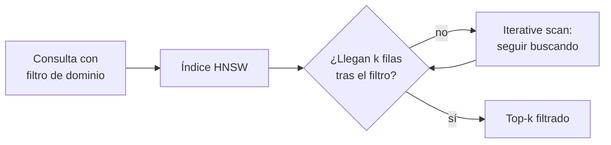

## 1. Resumen

Los fragmentos llevan **metadata**: dominio, fecha, idioma, documento de origen, permisos. **Filtrar** restringe la búsqueda vectorial a los que cumplen una condición: solo el dominio ventas, solo lo vigente, solo lo que el usuario puede ver.

Con un índice aproximado, **cuándo** se filtra cambia el resultado. Si el filtro se aplica a lo que devuelve el índice, uno selectivo deja menos resultados que los pedidos. pgvector lo cuantifica: con una condición que cumple el 10 % de las filas y `hnsw.ef_search` en 40, llegan en promedio 4 filas (*pgvector*, README v0.8.7). Azure AI Search lo expresa como modos: prefilter (antes, sin falsos negativos), postfilter y strict postfilter (después, con riesgo de falsos negativos) (*Add a filter to a vector query…*).

## 2. Qué es

- **Metadata:** atributos del fragmento, guardados junto al vector (`metadata-management`).
- **Prefiltro:** se filtra antes de buscar; el top-k sale del subconjunto.
- **Postfiltro:** se busca y después se filtra; un filtro selectivo devuelve menos de k.
- **Iterative scan:** en pgvector, el índice sigue buscando hasta completar k (`hnsw.iterative_scan`).
- **Índice parcial o particionado:** para filtros por pocos valores o por muchos, según el README.

## 3. Problema que resuelve

Un asistente de ventas pide los 10 fragmentos más cercanos del dominio ventas, que es el 10 % del índice. Recibe 4: el índice devolvió 40 candidatos y solo 4 eran de ventas. El modelo responde con menos contexto del que se pidió, y nadie lo nota.

## 4. Cómo funciona

1. Cada fragmento se guarda con su metadata y el vector.
2. La consulta lleva la condición (`WHERE dominio = 'ventas'`, una restricción, un filtro de metadata).
3. Sin índice, la búsqueda exacta filtra todo y devuelve los k correctos.
4. Con índice aproximado, el filtro se aplica a los candidatos del índice: con pgvector, `hnsw.iterative_scan` sigue buscando hasta completar.
5. Con filtros por pocos valores fijos, un índice parcial por valor evita el problema.

## 5. Cuándo utilizarlo

- Permisos: solo lo que el usuario puede ver.
- Vigencia: solo la versión actual de un documento.
- Dominio o idioma: restringir a lo pertinente.

## 6. Cuándo no utilizarlo

- Como único control de acceso a datos sensibles: el índice entero debería tener los permisos de la fuente.
- Con postfiltro y filtros muy selectivos sin verificar cuántos resultados llegan.
- Para filtros que cambian por consulta sobre metadata que no está indexada.

## 7. Ejemplo sencillo

5 000 fragmentos, 1 de cada 10 del dominio ventas, consulta por los 10 más cercanos de ventas:

| Búsqueda | Filas devueltas |
|---|---|
| Exacta, sin índice | 10 de 10 |
| HNSW, `ef_search` 40 | Menos de 10 |
| HNSW con `iterative_scan = strict_order` | 10 de 10 |

## 8. Ejemplo de producción

Un índice compartido entre dominios en PostgreSQL con pgvector:

- columna `dominio` y columna de permisos en cada fragmento;
- `SET hnsw.iterative_scan = strict_order` en la sesión de consulta;
- índices parciales para los dominios más consultados;
- una métrica de «filas devueltas menos que k» con alerta;
- en la nube (no ejecutado): restricciones de Vector Search, filtros de metadata de RAG Engine y de Knowledge Bases, o prefilter en Azure AI Search.

## 9. Arquitectura



## 10. Código

```python
# Python 3.12, psycopg 3 y numpy contra pgvector 0.8.7 (ejecutado en la CI; ADR-025): un filtro por metadata sobre
# un índice HNSW. Con el índice aproximado, el filtro se aplica a los candidatos que devuelve el índice: si la
# condición cumple el 10 % de las filas y hnsw.ef_search es 40 (el valor por defecto), llegan menos filas que el
# LIMIT. Con hnsw.iterative_scan el índice sigue buscando hasta completar. Vectores al azar con semilla fija.
import os

import numpy as np
import psycopg

FILAS, DIM, K = 5000, 16, 10
rng = np.random.default_rng(7)
vectores = rng.normal(size=(FILAS, DIM))


def literal(v: np.typing.NDArray[np.float64]) -> str:
    return "[" + ",".join(f"{x:.5f}" for x in v) + "]"


CONSULTA = """SELECT count(*) FROM (SELECT id FROM fragmentos WHERE dominio = 'ventas'
              ORDER BY embedding <-> %s::vector LIMIT %s) AS t"""

with psycopg.connect(os.environ["PGVECTOR_DSN"], autocommit=True) as conn:
    conn.execute("CREATE EXTENSION IF NOT EXISTS vector")
    conn.execute("DROP TABLE IF EXISTS fragmentos")
    conn.execute(f"CREATE TABLE fragmentos (id int PRIMARY KEY, dominio text, embedding vector({DIM}))")
    with conn.cursor() as cur:  # 1 de cada 10 filas es del dominio ventas
        cur.executemany("INSERT INTO fragmentos VALUES (%s, %s, %s::vector)",
                        [(i, "ventas" if i % 10 == 0 else f"otro{i % 10}", literal(v)) for i, v in enumerate(vectores)])
    q = literal(rng.normal(size=DIM))
    exacta = conn.execute(CONSULTA, (q, K)).fetchone()
    conn.execute("CREATE INDEX ON fragmentos USING hnsw (embedding vector_l2_ops)")
    conn.execute("SET enable_seqscan = off")
    sin_iterar = conn.execute(CONSULTA, (q, K)).fetchone()
    conn.execute("SET hnsw.iterative_scan = strict_order")
    con_iterar = conn.execute(CONSULTA, (q, K)).fetchone()

assert exacta and sin_iterar and con_iterar
print(f"exacta, sin índice: {exacta[0]} de {K}")
print(f"HNSW, ef_search 40, filtro del 10 %: menos de {K}: {sin_iterar[0] < K}")
print(f"HNSW con iterative_scan = strict_order: {con_iterar[0]} de {K}")
```

El script se **ejecuta en la CI** contra `pgvector/pgvector:0.8.7-pg17` en Docker (ADR-025) y pasa `mypy --strict`. Imprime `exacta, sin índice: 10 de 10`, `HNSW, ef_search 40, filtro del 10 %: menos de 10: True` y `HNSW con iterative_scan = strict_order: 10 de 10`. La cantidad exacta sin iterative scan depende de la construcción del grafo; por eso se imprime si es menor que 10 y no el número.

## 11. GCP

En GCP, **Vector Search** y **RAG Engine** de Gemini Enterprise Agent Platform. Según *Filter vector matches* y *Filter with metadata search* (no ejecutado):

| | pgvector (este concepto) | Google Cloud |
|---|---|---|
| Cómo se filtra | `WHERE` sobre columnas | Reglas booleanas: restricciones categóricas y numéricas (Vector Search) |
| En RAG | Columna de metadata | Solo se consideran los archivos cuya metadata cumple el filtro (RAG Engine) |

## 12. AWS

En AWS, **Amazon Bedrock Knowledge Bases**. Según *Configure and customize queries and response generation* (no ejecutado):

| | pgvector (este concepto) | Bedrock Knowledge Bases |
|---|---|---|
| Operadores | Los de SQL | En knowledge bases administradas: `equals`, `greaterThan`, `lessThan`, `in`, `notIn` (sin `startsWith` ni `stringContains`) |
| Campos reservados | — | Prefijo `x-amz-bedrock` (custom) o guion bajo (administradas) |

## 13. Azure

En Azure, **Azure AI Search**. Según *Add a filter to a vector query in Azure AI Search* (no ejecutado):

| | pgvector (este concepto) | Azure AI Search |
|---|---|---|
| Antes de buscar | Índice parcial o búsqueda exacta | Prefiltering |
| Después | Filtro sobre los candidatos del índice; `iterative_scan` | Postfiltering por shard; strict postfiltering (preview) sobre el top-k global |
| Riesgo | Menos de k filas | Falsos negativos con filtros selectivos o k chico |

## 14. Buenas prácticas

- Verificar cuántas filas llegan después del filtro, no solo cuáles.
- En pgvector con HNSW, activar `iterative_scan` cuando hay filtros.
- Índices parciales para filtros por pocos valores fijos.
- Aplicar el mismo filtro a la búsqueda léxica y a la vectorial (`hybrid-rag`).
- **Seguridad:** el filtro por permisos complementa, no reemplaza, separar índices por nivel de acceso.
- **Observabilidad:** métrica de consultas que devuelven menos de k.
- **Costo:** `iterative_scan` recorre más del índice: más latencia en filtros selectivos.

## 15. Errores frecuentes

- Asumir que el índice aproximado con filtro devuelve k resultados.
- Filtrar por un campo que no está en la metadata del fragmento.
- Usar el filtro de metadata como único control de acceso.

## 16. Trade-offs

Prefiltrar no pierde resultados y puede ser más lento con filtros amplios; postfiltrar es rápido y pierde resultados con filtros selectivos. Índices parciales resuelven filtros fijos y multiplican índices. `iterative_scan` completa los resultados a cambio de más recorrido del índice.

## 17. Conceptos relacionados

- `rag`: lo que se filtra.
- `metadata-management`: la metadata.
- `vector-databases`: el índice.
- `hybrid-rag`: el filtro en las dos búsquedas.

## 18. Preguntas técnicas abiertas

1. ¿Qué filtro aplicarías siempre en tu índice, y qué tan selectivo es?
2. ¿Cómo sabrías que una consulta devolvió menos fragmentos que los pedidos?
3. ¿Separarías índices por nivel de acceso o filtrarías?

## 19. Laboratorio relacionado

Pendiente (F4).

## 20. Fuentes

- pgvector: *pgvector* (README, v0.8.7).
- Google Cloud: *Filter vector matches* y *Filter with metadata search*.
- AWS: *Configure and customize queries and response generation*.
- Microsoft Learn: *Add a filter to a vector query in Azure AI Search*.

El detalle de cada fuente está en `sources` del frontmatter.

## 21. Fecha de última verificación

2026-10-25. `review_required`: pendiente de revisión B-F3.1 del lote F3b-21b.

## 22. Historial de cambios importantes

- 2026-10-25: creación (lote F3b-21b).
