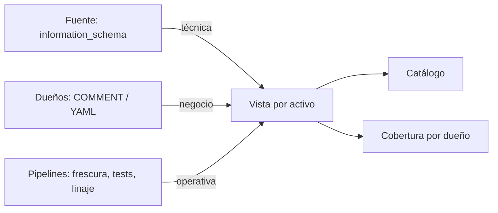

## 1. Resumen

La **metadata** son los datos sobre los datos. Gestionarla es decidir qué se registra, quién lo mantiene y cómo se mide que esté completa. Hay tres tipos:

- **técnica:** schema, tipos, nulabilidad, ubicación; la generan los sistemas;
- **de negocio:** descripción, significado, dueño, términos; la agregan personas;
- **operativa:** frescura, calidad, linaje, uso; la generan los pipelines y las herramientas.

La técnica se obtiene sola; la de negocio es la que falta casi siempre. Por eso la gestión se mide: **cobertura** de descripciones y de dueños.

## 2. Qué es

| Tipo | Ejemplos | Quién la produce |
|---|---|---|
| Técnica | Columnas, tipos, `NOT NULL` | La base (`information_schema`) |
| De negocio | «Monto total en CLP, con impuestos»; dueño | Dueños y stewards |
| Operativa | Última carga, resultado de tests, linaje | Pipelines y herramientas |

En Knowledge Catalog, esa metadata se organiza en **aspects** sobre **entries**, con plantillas predefinidas o propias (*About metadata in Knowledge Catalog*).

## 3. Problema que resuelve

Una columna `monto` existe en cinco tablas. En unas incluye impuestos, en otras no, en una está en dólares. El schema es idéntico; lo que cambia es el significado, y no está escrito en ningún lado. Con metadata de negocio por columna, la diferencia queda registrada donde se consulta.

## 4. Cómo funciona

1. La técnica se lee de la fuente (`information_schema.columns`).
2. La de negocio se escribe junto al dato (`COMMENT ON` en PostgreSQL, *COMMENT*) o en el catálogo.
3. La operativa la publican los pipelines (frescura, tests, linaje).
4. Se juntan en una vista por activo.
5. Se mide la cobertura y se asigna a cada dueño lo que le falta.

## 5. Cuándo utilizarlo

- En toda tabla de consumo.
- Antes de exponer datos a otros equipos o a usuarios de negocio.
- Como requisito para catalogar y para clasificar.

## 6. Cuándo no utilizarlo

- Documentando tablas temporales o intermedias que nadie consume.
- Escribiendo descripciones que repiten el nombre de la columna.

## 7. Ejemplo sencillo

Tabla `pedidos` con descripción («Un pedido por fila; dueño: equipo comercial») y cuatro columnas:

| Columna | Técnica | Negocio |
|---|---|---|
| `id` | integer, no nulo | Identificador del pedido en el sistema de ventas |
| `cliente_id` | integer, no nulo | SIN DESCRIPCIÓN |
| `monto` | numeric, admite nulos | Monto total en CLP, con impuestos |
| `canal` | text, admite nulos | SIN DESCRIPCIÓN |

Cobertura: 2/4; faltan `cliente_id` y `canal`.

## 8. Ejemplo de producción

- La metadata técnica se sincroniza sola al catálogo.
- Descripciones de tabla y de columna en el repositorio (por ejemplo, en el YAML de dbt) y aplicadas en cada despliegue.
- Un aspect propio de «nivel de servicio» y otro de «clasificación» por tabla.
- Un tablero de cobertura por dueño; publicar en la capa de consumo exige cobertura completa.

## 9. Arquitectura



## 10. Código

```python
# Python 3.12 y psycopg contra PostgreSQL 17 (ejecutado en la CI con el servicio postgres:17): metadata técnica desde
# information_schema y metadata de negocio con COMMENT ON, juntas en una entrada de catálogo; las columnas sin
# descripción quedan a la vista. PG_HOST, PG_PORT, PG_USER, PG_PASSWORD y PG_DB apuntan a una base vacía temporal.
import os

import psycopg

with psycopg.connect(host=os.environ["PG_HOST"], port=os.environ["PG_PORT"], user=os.environ["PG_USER"],
                     password=os.environ["PG_PASSWORD"], dbname=os.environ["PG_DB"], autocommit=True) as conn:
    conn.execute("CREATE TABLE pedidos (id int PRIMARY KEY, cliente_id int NOT NULL, monto numeric(12, 2), canal text)")
    conn.execute("COMMENT ON TABLE pedidos IS 'Un pedido por fila; dueño: equipo comercial'")
    conn.execute("COMMENT ON COLUMN pedidos.id IS 'Identificador del pedido en el sistema de ventas'")
    conn.execute("COMMENT ON COLUMN pedidos.monto IS 'Monto total en CLP, con impuestos'")
    tabla = conn.execute("SELECT obj_description('pedidos'::regclass, 'pg_class')").fetchone()
    columnas = conn.execute(
        "SELECT c.column_name, c.data_type, c.is_nullable, col_description('pedidos'::regclass, c.ordinal_position) "
        "FROM information_schema.columns c WHERE c.table_name = 'pedidos' ORDER BY c.ordinal_position").fetchall()

assert tabla is not None
print(f"pedidos: {tabla[0]}")
for nombre, tipo, nulos, descripcion in columnas:
    print(f"  {nombre} ({tipo}, nulos={nulos}): {descripcion or 'SIN DESCRIPCIÓN'}")
sin = [c[0] for c in columnas if not c[3]]
print(f"cobertura de descripciones: {len(columnas) - len(sin)}/{len(columnas)}; faltan {sin}")
```

El script se **ejecuta en la CI contra el servicio postgres:17**, en una base vacía que el test crea y borra, y pasa `mypy --strict`. Imprime la descripción de la tabla, cada columna con su tipo, nulabilidad y descripción (o `SIN DESCRIPCIÓN`) y `cobertura de descripciones: 2/4; faltan ['cliente_id', 'canal']`.

## 11. GCP

En GCP, **Knowledge Catalog**. Según *COMMENT* y *About metadata in Knowledge Catalog* (no ejecutado):

| | PostgreSQL | Knowledge Catalog |
|---|---|---|
| Técnica | `information_schema` | Entries automáticas desde fuentes de Google Cloud, con aspects como Schema |
| De negocio | Un comentario por objeto | Aspect types propios (por ejemplo, clasificación de PII o niveles de SLA) y glosarios |
| Quién la llena | Los dueños, con `COMMENT ON` | Sistemas de origen, escaneos, usuarios, pipelines o agentes |

## 12. AWS

En AWS, el **AWS Glue Data Catalog**. Según *COMMENT* y *Data discovery and cataloging in AWS Glue* (no ejecutado):

| | PostgreSQL | Glue Data Catalog |
|---|---|---|
| Técnica | `information_schema` | Ubicación, schema y métricas de ejecución, en tablas de metadata |
| Cómo se llena | La base la tiene | Crawlers que escanean las fuentes |

## 13. Azure

En Azure, **Microsoft Purview Unified Catalog**. Según *COMMENT* y *Learn about Microsoft Purview Unified Catalog* (no ejecutado):

| | PostgreSQL | Purview Unified Catalog |
|---|---|---|
| De negocio | Comentarios | Glossary terms y critical data elements |
| Organización | Esquemas | Governance domains y data products |

## 14. Buenas prácticas

- Técnica automática; de negocio con dueño y requisito de publicación.
- Descripciones que digan lo que el nombre no dice (unidad, impuestos, origen).
- La metadata de negocio, versionada con el código.
- **Seguridad:** la metadata puede revelar datos sensibles (nombres de columnas, ejemplos); se controla igual que el acceso.
- **Observabilidad:** cobertura medida y publicada; metadata operativa (frescura, tests) junto a la de negocio.
- **Costo:** escribir metadata cuesta tiempo de los dueños; empezar por las tablas más consumidas.

## 15. Errores frecuentes

- Descripciones que repiten el nombre (`monto: el monto`).
- Metadata de negocio fuera del alcance de quien consulta (en un wiki aparte).
- No medir la cobertura.

## 16. Trade-offs

Exigir metadata completa mejora el uso y frena la publicación. Guardarla junto al dato (comentarios) la mantiene cerca del cambio; en el catálogo es más rica y puede quedar desactualizada respecto de la fuente.

## 17. Conceptos relacionados

- `data-catalog`: dónde se publica.
- `data-lineage`: metadata operativa.
- `schema-change-detection`: cambios en la técnica.
- `data-contracts`: metadata acordada.
- `dataplex-governance`: aspects en Knowledge Catalog.

## 18. Preguntas técnicas abiertas

1. ¿Qué columnas de tu tabla más usada tienen un significado que su nombre no dice?
2. ¿Dónde vive hoy la metadata de negocio?
3. ¿Mides la cobertura?

## 19. Laboratorio relacionado

Pendiente (F4).

## 20. Fuentes

- PostgreSQL 17: *COMMENT*, *9.27. System Information Functions and Operators* y *35.17. columns*.
- Google Cloud: *About metadata in Knowledge Catalog*.
- AWS: *Data discovery and cataloging in AWS Glue*.
- Microsoft Learn: *Learn about Microsoft Purview Unified Catalog*.

El detalle de cada fuente está en `sources` del frontmatter.

## 21. Fecha de última verificación

2026-10-20. `review_required`: pendiente de revisión B-F3.1 del lote F3b-17a.

## 22. Historial de cambios importantes

- 2026-10-20: creación (lote F3b-17a).
