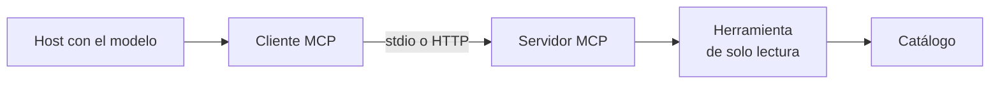

## 1. Resumen

Un asistente que consulta el catálogo, otro que lee el warehouse y otro que abre tickets: sin un estándar, cada integración entre el modelo y una herramienta se escribe a mano (`tool-calling`). **Model Context Protocol (MCP)** define cómo una aplicación con un modelo (el **host**, con su **cliente**) descubre y llama **herramientas** que expone un **servidor**. La revisión vigente es la **2026-07-28** («The current protocol version is 2026-07-28», *Versioning*).

Es emergente: el protocolo cambia y cada nube publica servidores con estados distintos. Para un data engineer, lo importante no es el modelo sino el **servidor**: qué herramientas expone, con qué identidad y si son de **solo lectura**. BigQuery lo hace explícito con `execute_sql_readonly` (*Use the BigQuery MCP server*). No reemplaza las APIs ni los controles de acceso: los usa.

## 2. Qué es

- **Host y cliente:** la aplicación con el modelo; el cliente habla MCP con uno o más servidores.
- **Servidor:** expone herramientas (y recursos) con nombre, descripción y esquema de entrada.
- **Transporte:** stdio para un servidor local (subproceso) o HTTP para uno remoto.
- **Resultado de una herramienta:** contenido para el modelo, datos estructurados y una marca de error; una herramienta que falla es un resultado, no una excepción (*The Client*).
- **Anotaciones:** describen el comportamiento de la herramienta, pero el cliente debe tratarlas como no confiables salvo que el servidor lo sea (*Tools*).

## 3. Problema que resuelve

El equipo quiere que un asistente responda «¿qué columnas tiene la tabla de ventas?». Integrarlo a mano en cada host cuesta y cada integración trae su propio formato. Con un servidor MCP del catálogo, cualquier host compatible descubre la herramienta y la llama igual. El riesgo cambia de lugar: ahora hay que gobernar qué herramientas expone el servidor y con qué permisos.

## 4. Cómo funciona

1. El host lanza o conecta el servidor.
2. El cliente pide la lista de herramientas.
3. El modelo elige una herramienta y sus argumentos.
4. El cliente la llama; el servidor la ejecuta con su propia identidad y permisos.
5. El resultado vuelve al host, con la marca de error si falló.

## 5. Cuándo utilizarlo

- Exponer el catálogo o consultas de lectura a asistentes de distintos hosts.
- Cuando varias herramientas internas se integran con varios clientes.
- Con servidores de solo lectura para empezar.

## 6. Cuándo no utilizarlo

- Para dar al modelo permisos de escritura sobre producción sin aprobación.
- Como reemplazo del control de acceso: el servidor hereda los permisos de su identidad.
- Con servidores de terceros sin revisar qué hacen; Azure aclara que su servidor local es solo para uso de desarrollo dentro de la organización (*What is the Azure MCP Server?*).

## 7. Ejemplo sencillo

| Paso | Resultado |
|---|---|
| Versión negociada | `2026-07-28` |
| Herramientas del servidor | `['describir_tabla']` |
| `describir_tabla('ventas')` | Columnas `fecha date`, `monto numeric`, `region text` |
| `describir_tabla('clientes_pii')` | `is_error = True`, sin excepción |

## 8. Ejemplo de producción

Servidor MCP del catálogo:

- herramientas de solo lectura: describir tablas y buscar en el catálogo;
- identidad propia del servidor con lectura de metadata, no de datos (`least-privilege`);
- registro de cada llamada para auditoría (`llm-observability`);
- en la nube (no ejecutado): servidores MCP de BigQuery, de AWS o de Azure, según su página.

## 9. Arquitectura



## 10. Código

```python
# Python 3.12 y el SDK oficial de MCP (mcp 2.3.0, versión fija; ADR-026), ejecutado en la CI sin servicios pagados:
# un servidor MCP local por stdio expone una sola herramienta de solo lectura sobre un catálogo en SQLite (abierto con
# mode=ro); el cliente lo lanza como subproceso, lista las herramientas y las llama. Una herramienta que falla
# devuelve un resultado con is_error, no una excepción. No hay modelo de lenguaje: el cliente hace lo que haría el host.
import asyncio
import sqlite3
import sys
import tempfile
from pathlib import Path

from mcp import Client, StdioServerParameters

SERVER = '''
import sqlite3, sys
from mcp.server import MCPServer

DB = sys.argv[1]
mcp = MCPServer("catalogo")


@mcp.tool()
def describir_tabla(tabla: str) -> dict[str, object]:
    """Columnas y descripción de una tabla del catálogo (solo lectura)."""
    with sqlite3.connect(f"file:{DB}?mode=ro", uri=True) as conn:
        filas = conn.execute("SELECT columna, tipo FROM columnas WHERE tabla = ? ORDER BY columna", (tabla,)).fetchall()
    if not filas:
        raise ValueError(f"tabla desconocida: {tabla}")
    return {"tabla": tabla, "columnas": [f"{c} {t}" for c, t in filas]}


mcp.run()
'''


async def main(base: Path) -> None:
    base.mkdir(parents=True, exist_ok=True)
    db = base / "catalogo.db"
    with sqlite3.connect(db) as conn:
        conn.execute("CREATE TABLE columnas (tabla text, columna text, tipo text)")
        conn.executemany("INSERT INTO columnas VALUES (?, ?, ?)",
                         [("ventas", "monto", "numeric"), ("ventas", "region", "text"), ("ventas", "fecha", "date")])
    (base / "server.py").write_text(SERVER, encoding="utf-8")
    params = StdioServerParameters(command=sys.executable, args=[str(base / "server.py"), str(db)])
    async with Client(params) as client:
        print("protocolo:", client.protocol_version)
        tools = await client.list_tools()
        print("herramientas:", [t.name for t in tools.tools])
        ok = await client.call_tool("describir_tabla", {"tabla": "ventas"})
        print("resultado:", ok.structured_content)
        error = await client.call_tool("describir_tabla", {"tabla": "clientes_pii"})
        print("tabla desconocida: is_error =", error.is_error)


asyncio.run(main(Path(sys.argv[1] if len(sys.argv) > 1 else tempfile.mkdtemp())))
```

El script se **ejecuta en la CI con el SDK oficial `mcp` 2.3.0** (ADR-026), sin red ni modelo, y pasa `mypy --strict`. Imprime el protocolo `2026-07-28`, la herramienta del servidor, su resultado y `is_error = True` para la tabla desconocida. El servidor registra el error en su salida de error; el cliente sigue.

## 11. GCP

En GCP, el **servidor MCP de BigQuery**. Según *Use the BigQuery MCP server* y *Google Cloud MCP servers release notes* (no ejecutado):

| | Este concepto | BigQuery MCP |
|---|---|---|
| Herramienta de lectura | `describir_tabla` | `execute_sql_readonly`, sin DML, DDL ni UDF de Python |
| Límites | — | Consultas de más de tres minutos se cancelan; hasta 3.000 filas |
| Estado | — | «remote MCP servers are generally available (GA). Individual MCP servers might be in Preview or GA» |

## 12. AWS

En AWS, el **AWS MCP Server** de Agent Toolkit for AWS. Según *AWS MCP Server* (no ejecutado):

| | Este concepto | AWS MCP Server |
|---|---|---|
| Identidad | La del servidor local | Credenciales de IAM del agente para llamar APIs |
| Auditoría | Registro propio | CloudTrail registra todas las llamadas |
| Estado | — | La página actual no lo marca como preview |

## 13. Azure

En Azure, el **Azure MCP Server**. Según *What is the Azure MCP Server?* (no ejecutado):

| | Este concepto | Azure MCP Server |
|---|---|---|
| Permisos | Solo lectura | Azure RBAC |
| Uso | Servidor del catálogo | El servidor local es solo para desarrollo dentro de la organización |
| Estado | — | La página no declara un estado de madurez |

## 14. Buenas prácticas

- Empezar con herramientas de solo lectura.
- Una identidad por servidor, con el mínimo privilegio.
- Revisar cada servidor de terceros antes de conectarlo.
- **Seguridad:** tratar las anotaciones de las herramientas como no confiables; el control real es el permiso del servidor.
- **Observabilidad:** registrar herramienta, argumentos y resultado de cada llamada.
- **Costo:** límites por llamada (tiempo, filas) como los del servidor de BigQuery.

## 15. Errores frecuentes

- Exponer una herramienta que escribe sin aprobación.
- Dar al servidor la identidad de un administrador.
- Creer que una anotación «solo lectura» garantiza que la herramienta no escribe.
- Fijar el código a una revisión del protocolo y no seguir sus cambios.

## 16. Trade-offs

Un protocolo común reduce integraciones a cambio de una pieza más que gobernar. Servidores administrados ahorran operación y fijan sus propias herramientas y límites. Es emergente: la especificación tiene revisiones y funciones que se marcan como deprecated.

## 17. Conceptos relacionados

- `tool-calling`: el mecanismo.
- `llm-agents`: quien llama.
- `guardrails`: los controles.
- `least-privilege`: los permisos del servidor.
- `dataplex-governance`: el catálogo como contexto vía MCP.
- `llm-observability`: el registro de las llamadas.

## 18. Preguntas técnicas abiertas

1. ¿Qué herramienta de lectura expondrías primero?
2. ¿Con qué identidad correría el servidor?
3. ¿Cómo auditarías las llamadas?

## 19. Laboratorio relacionado

Pendiente (F4).

## 20. Fuentes

- Model Context Protocol: *Versioning* y *Tools*.
- MCP Python SDK: *The Client*.
- Google Cloud: *Use the BigQuery MCP server* y *Google Cloud MCP servers release notes*.
- AWS: *AWS MCP Server*.
- Microsoft Learn: *What is the Azure MCP Server?*.

El detalle de cada fuente está en `sources` del frontmatter.

## 21. Fecha de última verificación

2026-10-27. `review_required`: pendiente de revisión B-F3.1 del lote F3b-23a.

## 22. Historial de cambios importantes

- 2026-10-27: creación (lote F3b-23a).
