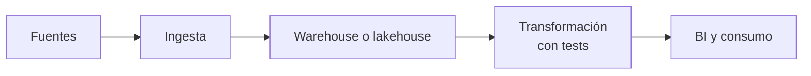

## 1. Resumen

«Modern data stack» no es un producto ni un estándar: es una **etiqueta** para una combinación de piezas que se volvió común con los warehouses en la nube. Ingesta administrada, almacenamiento en un warehouse o lakehouse, **transformación dentro del warehouse** (ELT) con herramientas como dbt o Dataform, orquestación, calidad, observabilidad y BI.

Esta ficha es un **mapa**: cada pieza tiene su ficha, con sus fundamentos y su código. Sirve para ubicarse y para leer ofertas de trabajo que usan la etiqueta. Lo que no cambia con la etiqueta son los fundamentos: modelado, idempotencia, calidad y contratos.

## 2. Qué es

| Pieza | Qué hace | Ficha |
|---|---|---|
| Transformación en el warehouse | Modelos SQL versionados, con tests y dependencias | `etl-vs-elt`, `analytics-engineering`, `dbt-core-concepts`, `dataform-workflows` |
| Almacenamiento | Warehouse o lakehouse con tablas abiertas | `lakehouse`, `open-table-formats` |
| Acuerdos | Esquema y garantías entre productor y consumidor | `data-contracts` |
| Calidad y observabilidad | Saber si los datos llegaron bien y a tiempo | `data-observability` |
| Despliegue | Transformaciones como software | `ci-cd-for-data`, `gitops` |

## 3. Problema que resuelve

Como mapa, resuelve un problema de orientación: la etiqueta aparece en ofertas, charlas y documentación de proveedores con significados distintos. Saber qué piezas agrupa permite preguntar por cada una en lugar de discutir la etiqueta.

## 4. Cómo funciona

1. Los datos llegan crudos al warehouse o al lakehouse.
2. Los modelos de transformación los limpian y los combinan en capas, dentro del motor (`etl-vs-elt`).
3. Los tests y los contratos validan cada capa (`data-contracts`).
4. Un orquestador ejecuta el grafo; la observabilidad avisa si algo se atrasa o cambia (`data-observability`).
5. Todo vive en un repositorio y se despliega por CI/CD (`ci-cd-for-data`).

## 5. Cuándo utilizarlo

- Como mapa de entrada antes de estudiar cada pieza.
- Para traducir una oferta de trabajo o una propuesta de proveedor a piezas concretas.

## 6. Cuándo no utilizarlo

- Como criterio de diseño: se diseña por requisitos, no por etiqueta.
- Para suponer que una herramienta de la lista resuelve un problema de modelado o de calidad.

## 7. Ejemplo sencillo

Una oferta pide «experiencia en modern data stack». Traducido a piezas: transformación con dbt o Dataform (`analytics-engineering`), un warehouse en la nube, tests y contratos (`data-contracts`), y despliegue con CI (`ci-cd-for-data`).

## 8. Ejemplo de producción

Una plataforma de ventas: ingesta a bronze, modelos de staging y marts con tests y contrato en el mart (`analytics-engineering`), orquestación diaria, alertas de frescura (`data-observability`) y despliegue por pull request (`ci-cd-for-data`).

## 9. Arquitectura

## 10. Código

Sin código propio: esta ficha es un mapa. Los ejemplos ejecutados en la CI están en sus fichas: `dbt-core-concepts` (dbt build contra PostgreSQL), `analytics-engineering` (capas y contrato aplicado), `open-table-formats` (snapshots de Iceberg), `data-contracts` y `ci-cd-for-data`.

## 11. GCP

En GCP, la transformación en el warehouse se hace con **Dataform** sobre BigQuery. Según *Dataform overview* (no ejecutado): SQLX que se compila a SQL y corre en orden de dependencias. El detalle está en `dataform-workflows` y `bigquery-architecture`.

## 12. AWS

En AWS, el warehouse es Amazon Redshift y la transformación con dbt se orquesta, por ejemplo, desde Amazon MWAA. El detalle está en `redshift-architecture` y en el §12 de `analytics-engineering`.

## 13. Azure

En Azure, Microsoft Fabric reúne warehouse, lakehouse y orquestación, y tiene dbt jobs. El detalle está en `azure-analytics-landscape` y en el §13 de `analytics-engineering`.

## 14. Buenas prácticas

- Pensar en piezas y requisitos, no en la etiqueta.
- Mantener los fundamentos: modelado, idempotencia, calidad y contratos.
- **Seguridad:** cada pieza nueva suma accesos y credenciales; revisar el mínimo privilegio de cada una.
- **Observabilidad:** frescura y volumen por tabla, no solo el estado del job.
- **Costo:** transformar en el warehouse traslada el costo al motor; medirlo (`finops-for-data`).

## 15. Errores frecuentes

- Elegir herramientas por la etiqueta antes de tener requisitos.
- Creer que una herramienta de transformación reemplaza el modelado.
- Sumar piezas sin dueño ni monitoreo.

## 16. Trade-offs

Combinar servicios especializados da velocidad y cada pieza mejora por separado, a cambio de más integraciones, credenciales y costos que vigilar. Una plataforma integrada reduce integraciones y aumenta la dependencia de un proveedor.

## 17. Conceptos relacionados

- `etl-vs-elt`, `analytics-engineering`, `dbt-core-concepts` y `dataform-workflows`: la transformación.
- `bigquery-architecture`, `redshift-architecture` y `azure-analytics-landscape`: el warehouse en cada nube.
- `finops-for-data`: el costo de transformar en el motor.
- `lakehouse` y `open-table-formats`: el almacenamiento.
- `data-contracts` y `data-observability`: acuerdos y monitoreo.
- `ci-cd-for-data` y `gitops`: el despliegue.
- Pendiente de ficha: `medallion-architecture` (F4).

## 18. Preguntas técnicas abiertas

1. ¿Qué piezas de esta lista tiene tu plataforma y cuál falta?
2. ¿Qué pieza no tiene dueño?
3. ¿Dónde se ejecutan hoy tus transformaciones y cuánto cuestan?

## 19. Laboratorio relacionado

Pendiente (F4).

## 20. Fuentes

- dbt: *What is dbt?*.
- Google Cloud: *Dataform overview*.

El detalle de cada fuente está en `sources` del frontmatter.

## 21. Fecha de última verificación

2026-10-26. `review_required`: pendiente de revisión B-F3.1 del lote F3b-22a.

## 22. Historial de cambios importantes

- 2026-10-26: creación (lote F3b-22a).
