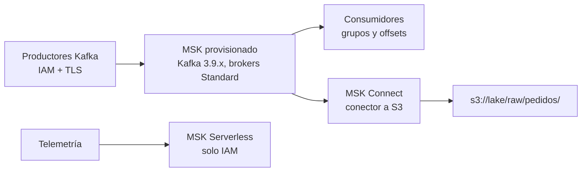

## 1. Resumen

**Amazon MSK** administra clústeres de **Apache Kafka** de código abierto: crea, actualiza y borra clústeres, y deja usar Kafka tal cual para producir y consumir. Según su documentación, las aplicaciones y herramientas de Kafka funcionan sin cambiar el código.

Hay dos tipos de clúster:

- **Provisionado:** se eligen los brokers, **Standard** (más configurables) o **Express** (más elásticos, almacenamiento administrado por MSK);
- **MSK Serverless:** escala solo, cobra por throughput y **exige IAM**.

En versiones, la página marca **3.9.x como recomendada**: es la última con ZooKeeper y KRaft. Kafka 4.0 deja ZooKeeper. **MSK Connect** ejecuta conectores de Kafka Connect administrados, por ejemplo hacia S3.

## 2. Qué es

- **Clúster provisionado:**
  - brokers Standard: almacenamiento EBS que administra el cliente, tiered storage, throughput de almacenamiento aprovisionado;
  - brokers Express: almacenamiento totalmente administrado por MSK, instancias M7g, Kafka desde 3.6;
  - no se pasa de Standard a Express en el mismo clúster: hay que crear otro.
- **MSK Serverless:** sin capacidad que administrar; gestiona las particiones de los topics. Solo IAM, sin ACLs de Kafka. Disponible en un conjunto de regiones.
- **Autenticación y autorización:** en provisionado, IAM, SASL/SCRAM, mTLS o texto plano, y ACLs de Kafka.
- **Versiones:** 4.2.x, 4.1.x, 4.0.x, 3.9.x (recomendada) y anteriores. 3.9 tiene soporte extendido de MSK por al menos dos años.
- **MSK Connect:** conectores de Kafka Connect (2.7.1 o 3.7.x) administrados, hacia o desde almacenes como S3.

## 3. Problema que resuelve

Kafka sirve para streams con muchos consumidores, retención y reproceso por offsets, pero operar sus brokers, discos y versiones es trabajo propio. MSK se encarga del plano de control y deja el protocolo y el ecosistema de Kafka intactos.

## 4. Cómo funciona

1. Se crea el clúster: provisionado (versión, tipo y cantidad de brokers, almacenamiento) o serverless.
2. Los clientes se conectan con el mecanismo de autenticación elegido; en serverless, IAM.
3. Productores y consumidores usan la API de Kafka: topics, particiones, offsets y grupos de consumidores.
4. MSK Connect lee o escribe topics hacia sistemas externos con conectores de Kafka Connect.
5. Crear, actualizar y borrar el clúster son operaciones del plano de control de MSK.

## 5. Cuándo utilizarlo

- Equipos con aplicaciones, conectores o herramientas de Kafka.
- Streams con muchos consumidores, retención larga y reproceso por offsets.
- Integraciones con Kafka Connect hacia S3 u otros almacenes.
- Tráfico variable sin planificar brokers: MSK Serverless.

## 6. Cuándo no utilizarlo

- Ingesta simple en AWS sin necesidad del ecosistema de Kafka: Kinesis Data Streams (ver `kinesis-data-streams`) tiene menos que configurar.
- Clientes que no pueden usar IAM, en MSK Serverless.
- Un clúster provisionado que se va a pasar a Express: hay que crear otro.

## 7. Ejemplo sencillo

Un equipo que ya usa Kafka en sus servidores migra a un clúster MSK provisionado con Kafka 3.9.x y brokers Standard. Los productores y consumidores cambian solo la dirección de los brokers y la autenticación; el código de Kafka es el mismo.

## 8. Ejemplo de producción

Una plataforma de pedidos tiene:

- un clúster provisionado `pedidos` con 3 brokers, Kafka 3.9.x, IAM y TLS entre clientes y brokers;
- un conector de MSK Connect que escribe el topic `pedidos` en `s3://lake/raw/pedidos/`;
- un clúster MSK Serverless `eventos` para telemetría de tráfico variable, solo con IAM.

El paso a Kafka 4.x se planifica con tiempo: 4.0 deja ZooKeeper y exige Java 17 en brokers y herramientas.

## 9. Arquitectura



## 10. Código

```hcl
# Terraform (validado en la CI con terraform validate, sin credenciales; no se aplicó): un clúster MSK Serverless
# (IAM obligatorio) y un clúster provisionado con brokers Standard, Kafka 3.9.x, IAM y TLS entre clientes y brokers.
# Requiere: provider hashicorp/aws ~> 6.0; subredes y security group existentes.
terraform {
  required_providers {
    aws = {
      source  = "hashicorp/aws"
      version = "~> 6.0"
    }
  }
}

provider "aws" {
  region = "us-east-1"
}

variable "subnet_ids" {
  type = list(string)
}

variable "security_group_id" {
  type = string
}

resource "aws_msk_serverless_cluster" "eventos" {
  cluster_name = "eventos"

  vpc_config {
    subnet_ids         = var.subnet_ids
    security_group_ids = [var.security_group_id]
  }

  client_authentication {
    sasl {
      iam {
        enabled = true
      }
    }
  }
}

resource "aws_msk_cluster" "pedidos" {
  cluster_name           = "pedidos"
  kafka_version          = "3.9.x"
  number_of_broker_nodes = 3

  broker_node_group_info {
    instance_type   = "kafka.m7g.large"
    client_subnets  = var.subnet_ids
    security_groups = [var.security_group_id]
    storage_info {
      ebs_storage_info {
        volume_size = 500
      }
    }
  }

  client_authentication {
    sasl {
      iam = true
    }
  }

  encryption_info {
    encryption_in_transit {
      client_broker = "TLS"
      in_cluster    = true
    }
  }
}
```

El bloque de Terraform se valida en la CI con `terraform validate`, sin credenciales (`make validate-terraform`), y **no se aplicó**. No hay código de cliente de Kafka ejecutado: el ejemplo de productor y consumidor con partition key está en `kinesis-data-streams`, y moto no simula el plano de datos de Kafka (ADR-011).

## 11. GCP

No aplica de forma específica: esta ficha describe MSK. En GCP, el servicio de mensajería nativo es Pub/Sub (ver `pubsub-topics-and-subscriptions`), con otro modelo; no es Kafka administrado.

## 12. AWS

**Amazon MSK.** Los tipos de clúster, los tipos de broker, las versiones soportadas, MSK Serverless (solo IAM) y MSK Connect son los de sus páginas. Los precios por broker, almacenamiento, serverless y conectores se consultan en la página de precios.

## 13. Azure

No aplica de forma específica.

## 14. Buenas prácticas

- Fijar la versión de Kafka y planificar la salida de ZooKeeper (4.x).
- IAM como autenticación por defecto; en serverless es la única.
- TLS entre clientes y brokers y dentro del clúster.
- MSK Connect para mover datos a S3 en lugar de consumidores propios.
- **Seguridad:** IAM con permisos por topic y grupo; TLS en tránsito; nada de acceso público por defecto.
- **Observabilidad:** seguir el retraso de los grupos de consumidores, el uso de disco de los brokers y el throughput por topic.
- **Costo:** en provisionado se paga por broker y almacenamiento; en serverless, por uso; MSK Connect aparte. Los montos se consultan en la página de precios.

## 15. Errores frecuentes

- Crear un clúster provisionado Standard pensando pasarlo a Express después.
- Clientes con usuario y contraseña en un clúster serverless, que solo admite IAM.
- Quedarse en una versión sin soporte por no planificar la actualización.
- Elegir MSK solo por costumbre cuando nadie usa el ecosistema de Kafka.

## 16. Trade-offs

MSK da el protocolo, las herramientas y el ecosistema de Kafka sin operar el plano de control, a cambio de más configuración que Kinesis (brokers, versiones, autenticación). MSK Serverless quita la capacidad que planificar, con IAM como única autenticación. Los brokers Express simplifican el almacenamiento, con menos opciones de configuración que los Standard.

## 17. Conceptos relacionados

- `kinesis-data-streams`: la alternativa nativa de AWS.
- `streaming-ingestion`: el patrón que implementa.
- `pubsub-topics-and-subscriptions`: el servicio de GCP, con otro modelo.
- `s3-data-lake`: el destino de MSK Connect.

## 18. Preguntas técnicas abiertas

1. ¿Qué te da Kafka en tu plataforma que Kinesis no te daría?
2. ¿Cuándo elegirías MSK Serverless en lugar de un clúster provisionado?
3. ¿Cómo planificarías el paso de Kafka 3.9 a 4.x?

## 19. Laboratorio relacionado

Pendiente (F4).

## 20. Fuentes

- AWS, Amazon MSK Developer Guide: *Welcome to the Amazon MSK Developer Guide*, *What is MSK Serverless?*, *Amazon MSK broker types*, *Supported Apache Kafka versions* y *Understand MSK Connect*; *Amazon MSK pricing*.

El detalle de cada fuente está en `sources` del frontmatter.

## 21. Fecha de última verificación

2026-10-12. `review_required`: pendiente de revisión B-F3.1 del lote F3b-09a.

## 22. Historial de cambios importantes

- 2026-10-12: creación (lote F3b-09a).
