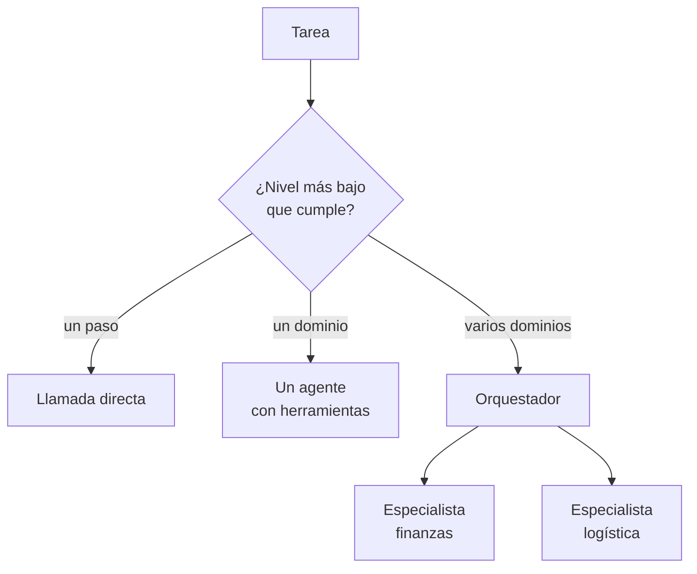

## 1. Resumen

Un **sistema multi-agente** reparte una tarea entre agentes especializados que coordina un orquestador o un protocolo entre pares. Es la opción más compleja, y la guía de Azure pide preguntarse antes si hace falta: cada nivel agrega **sobrecarga de coordinación, latencia y costo**, y conviene **el nivel más bajo que cumple** (*AI agent orchestration patterns*).

Esa guía ordena tres niveles. Una **llamada directa** al modelo (si el prompt resuelve la tarea, no hace falta un agente). **Un agente con herramientas** (`llm-agents`), a menudo el default correcto. Y **varios agentes**, para problemas que cruzan funciones o dominios. Para un data engineer, la señal para el tercer nivel es una tarea que cruza dominios con datos, permisos o dueños distintos; casi todo lo demás se resuelve con uno de los dos primeros.

## 2. Qué es

- **Orquestador o supervisor:** reparte, junta y decide; en Bedrock, un agente supervisor con colaboradores (*Use multi-agent collaboration…*).
- **Especialistas:** agentes con instrucciones, herramientas y permisos de un dominio.
- **Patrones:** secuencial, concurrente, handoff, group chat y Magentic en Agent Framework (*Workflow orchestrations*).
- **Workflow agents:** en ADK, pipelines predecibles entre agentes, frente al enrutamiento dinámico (*Agent Development Kit*).
- **Costo de coordinación:** más llamadas, más contexto compartido, más puntos de falla.

## 3. Problema que resuelve

Conciliar ventas (finanzas) con despachos (logística) requiere datos y permisos de dos equipos. Un solo agente necesitaría acceso a ambos dominios; dos especialistas, cada uno con sus permisos, y un orquestador que compara, mantienen la separación.

## 4. Cómo funciona

1. Se evalúa si basta una llamada directa o un agente con herramientas.
2. Solo si la tarea cruza dominios con dueños distintos, se define un especialista por dominio.
3. El orquestador planifica, delega y combina los resultados.
4. Cada especialista corre con sus propios permisos y límites de pasos.
5. Cada agente y cada traspaso se trazan (`llm-observability`).

## 5. Cuándo utilizarlo

- Tareas que cruzan dominios con datos, permisos o dueños distintos.
- Cuando un solo agente necesitaría tantas herramientas que elige mal entre ellas.
- Cuando partes de la tarea pueden correr en paralelo y vale la latencia ahorrada.

## 6. Cuándo no utilizarlo

- **Clasificar, resumir o extraer:** una llamada directa con un buen prompt basta, según la guía de Azure.
- **Tareas de un solo dominio:** un agente con herramientas es más simple de depurar y de probar.
- **Cuando los pasos se conocen:** un pipeline determinista o un DAG es más barato y repetible.
- **Sin una forma de evaluar** si el diseño con varios agentes mejora frente a uno (`llm-evaluation`).
- **Por arquitectura de moda:** cada agente agrega llamadas, latencia y costo.

## 7. Ejemplo sencillo

| Tarea | Nivel elegido | Con varios agentes |
|---|---|---|
| Clasificar un mensaje de error | Llamada directa: 1 llamada (~2 s) | 6 llamadas (~12 s) |
| Diagnosticar una carga fallida | Un agente con herramientas: 3 llamadas (~6 s) | 6 llamadas (~12 s) |
| Conciliar ventas con despachos | Varios agentes: 6 llamadas (~12 s) | — |

Las llamadas y los segundos son supuestos del ejemplo, no cifras de un proveedor.

## 8. Ejemplo de producción

Conciliación mensual entre finanzas y logística:

- un especialista por dominio, con permisos de lectura solo sobre sus tablas;
- un orquestador que pide a cada uno su resumen y compara;
- diferencias a revisión humana, nunca corregidas por un agente;
- evaluación contra conciliaciones anteriores revisadas;
- con Agent Framework, multi-agent collaboration de Bedrock o ADK (no ejecutado).

## 9. Arquitectura



## 10. Código

```python
# Python 3.12, biblioteca estándar (ejecutado en la CI): elegir el nivel de complejidad más bajo que cumple la tarea,
# como recomienda la guía de patrones de orquestación de Azure: llamada directa, un agente con herramientas o varios
# agentes. Para cada tarea se cuentan las llamadas al modelo y el tiempo estimado de cada diseño (cifras supuestas del
# ejemplo, no de un proveedor). Varios agentes solo se justifican cuando la tarea cruza dominios con dueños distintos.
from dataclasses import dataclass

SEGUNDOS_POR_LLAMADA = 2.0  # supuesto del ejemplo


@dataclass(frozen=True)
class Tarea:
    nombre: str
    necesita_herramientas: bool
    dominios: int  # cuántos dominios con datos, permisos o dueños distintos toca


@dataclass(frozen=True)
class Diseno:
    nivel: str
    llamadas: int


def disenos(t: Tarea) -> list[Diseno]:
    opciones = [Diseno("llamada directa", 1)]
    if t.necesita_herramientas:
        opciones = [Diseno("un agente con herramientas", 3)]
    if t.dominios > 1:
        # orquestador: planificar + un especialista por dominio (2 llamadas cada uno) + combinar
        opciones.append(Diseno("varios agentes", 1 + 2 * t.dominios + 1))
    return opciones


def elegir(t: Tarea) -> Diseno:
    """El nivel más bajo que cumple: varios agentes solo si cruza dominios con dueños distintos."""
    candidatos = disenos(t)
    return candidatos[-1] if t.dominios > 1 else candidatos[0]


TAREAS = [
    Tarea("clasificar un mensaje de error", necesita_herramientas=False, dominios=1),
    Tarea("diagnosticar una carga fallida", necesita_herramientas=True, dominios=1),
    Tarea("conciliar ventas (finanzas) con despachos (logística)", necesita_herramientas=True, dominios=2),
]


def llamadas(n: int) -> str:
    return f"{n} llamada" if n == 1 else f"{n} llamadas"


for t in TAREAS:
    elegido = elegir(t)
    alternativa = Diseno("varios agentes", 1 + 2 * max(t.dominios, 2) + 1)  # al menos dos especialistas
    print(f"{t.nombre}: {elegido.nivel}, {llamadas(elegido.llamadas)} (~{elegido.llamadas * SEGUNDOS_POR_LLAMADA:.0f} s)"
          + ("" if elegido.nivel == "varios agentes" else
             f"; con varios agentes serían {llamadas(alternativa.llamadas)} (~{alternativa.llamadas * SEGUNDOS_POR_LLAMADA:.0f} s)"))
```

El script se **ejecuta en la CI** con la biblioteca estándar y pasa `mypy --strict`. Imprime, para cada tarea del §7, el nivel elegido con sus llamadas y su tiempo estimado y, cuando no se eligieron varios agentes, lo que costarían. Las cifras por llamada son supuestos del ejemplo.

## 11. GCP

En GCP, **Agent Development Kit** en Gemini Enterprise Agent Platform. Según *Agent Development Kit* (no ejecutado):

| | Este concepto | ADK |
|---|---|---|
| Crecimiento | Empezar con un agente | Empezar con agentes y herramientas y crecer a multi-agente |
| Orquestación | Orquestador propio | Workflow agents para pipelines predecibles o enrutamiento dinámico |

## 12. AWS

En AWS, **multi-agent collaboration de Amazon Bedrock Agents**. Según *Use multi-agent collaboration with Amazon Bedrock Agents* (no ejecutado):

| | Este concepto | Bedrock Agents |
|---|---|---|
| Estructura | Orquestador y especialistas | Agente supervisor con agentes colaboradores, jerárquico |
| Respuesta | Según el diseño | Sincrónica |

## 13. Azure

En Azure, **Agent Framework** y los workflows de Microsoft Foundry. Según *Workflow orchestrations* y *AI agent orchestration patterns* (no ejecutado):

| | Este concepto | Agent Framework |
|---|---|---|
| Patrones | Orquestador | Secuencial, concurrente, handoff, group chat y Magentic |
| Intervención humana | Revisión de diferencias | Herramientas que requieren aprobación |
| Cuándo | Nivel más bajo que cumple | La guía de patrones pide evaluar antes si hace falta |

## 14. Buenas prácticas

- Probar primero con una llamada directa y con un agente; medir antes de agregar agentes.
- Un especialista por dominio con permisos propios, no un agente con todos los permisos.
- Límites de pasos por agente y para el total.
- Trazar cada traspaso entre agentes.
- **Seguridad:** la separación de permisos es la razón de ser del diseño; no darle al orquestador acceso a los datos de los especialistas.
- **Observabilidad:** llamadas, tokens y latencia por agente y por tarea.
- **Costo:** cada agente y cada traspaso son llamadas extra con contexto.

## 15. Errores frecuentes

- Usar varios agentes para una tarea que resuelve una llamada.
- Especialistas sin límites de pasos que se llaman entre sí.
- Un orquestador con todos los permisos.
- No medir contra la alternativa de un solo agente.

## 16. Trade-offs

Varios agentes separan permisos y responsabilidades, y pueden trabajar en paralelo, a cambio de más llamadas, latencia, costo y puntos de falla. Un agente es más simple de depurar; un pipeline, más todavía. Un patrón administrado acelera el armado y no reemplaza decidir si hace falta.

## 17. Conceptos relacionados

- `llm-agents`: el nivel anterior.
- `tool-calling`: las herramientas de cada especialista.
- `llm-observability`: la traza de cada agente.
- `llm-evaluation`: medir contra un solo agente.

## 18. Preguntas técnicas abiertas

1. ¿Qué tarea de tu plataforma cruza dominios con dueños distintos?
2. ¿Cómo medirías que dos agentes rinden mejor que uno?
3. ¿Qué permisos tendría cada especialista?

## 19. Laboratorio relacionado

Pendiente (F4).

## 20. Fuentes

- Azure Architecture Center: *AI agent orchestration patterns*; Microsoft Learn: *Workflow orchestrations* (Agent Framework).
- AWS: *Use multi-agent collaboration with Amazon Bedrock Agents*.
- Google Cloud: *Agent Development Kit*.

El detalle de cada fuente está en `sources` del frontmatter.

## 21. Fecha de última verificación

2026-10-26. Pasa a `verified`: revisión B-F3.1 del lote F3b-21c sin hallazgos en esta ficha (docs/reviews/cards-f3b-21c.md) y CI en verde (run 40364714269).

## 22. Historial de cambios importantes

- 2026-10-26: creación (lote F3b-21c).
- 2026-10-26: `verification_status: verified` (revisión sin hallazgos en esta ficha; CI en verde, run 40364714269).
