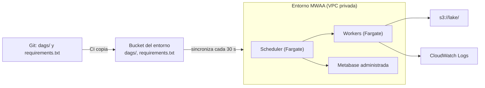

## 1. Resumen

**Amazon MWAA** ejecuta Apache Airflow administrado. Según su documentación:

- el **scheduler** y los **workers** corren en contenedores de **Fargate** dentro de subredes privadas de la VPC del cliente, con una **metabase** propia que administra AWS;
- los **Dags** y el **`requirements.txt`** viven en un **bucket de S3** y MWAA los sincroniza cada 30 segundos;
- la **clase de entorno** (`mw1.small` a `mw1.xlarge` y más) fija cuántos Dags y tareas concurrentes soporta;
- la última versión listada es **Airflow 3.3.1**, con Python 3.12.

Además del entorno provisionado, **MWAA Serverless** es otra opción de despliegue: no hay entorno, cada workflow corre con su propio rol, los workflows se definen en YAML y se paga por el tiempo de las tareas.

El código de los Dags es Airflow estándar: lo que cambia frente a un Airflow propio es dónde se suben los archivos, cómo se instalan las dependencias y qué no se administra.

## 2. Qué es

- **Entorno:** una instalación de Airflow con su versión, su clase y su red.
- **Componentes:** schedulers y workers en Fargate, webserver, metabase administrada. CloudWatch, S3, SQS y KMS son servicios aparte que deben ser accesibles desde el entorno.
- **Bucket del entorno:** `dags/`, `requirements.txt` y plugins.
- **Versiones:** imágenes de MWAA con cada versión de Airflow. Tabla al 2026-10-12: 3.3.1 (Python 3.12), 3.2.1, 2.11.2 y anteriores. El entorno sigue en su versión hasta que se actualiza.
- **Dependencias:** desde Airflow 2.7.2, `requirements.txt` lleva `--constraint` con el archivo de constraints de la versión; si falta, MWAA agrega uno.
- **MWAA Serverless:** opción sin entorno, con Airflow v3 y Python 3.12; cada workflow con su rol de ejecución y su worker; workflows en YAML y con versionado; cobro por duración de las tareas.
- **Clases (entorno provisionado):**

| Clase | Dags (hasta) | Tareas concurrentes (por defecto) |
|---|---|---|
| `mw1.small` | 50 | 5 |
| `mw1.medium` | 250 | 10 |
| `mw1.large` | 1.000 | 20 |
| `mw1.xlarge` | 2.000 | 40 |

## 3. Problema que resuelve

Operar Airflow exige mantener scheduler, workers, metabase, actualizaciones y escalado. MWAA lo administra y deja al equipo los Dags y sus dependencias, con Airflow estándar.

## 4. Cómo funciona

1. Se crea el entorno con versión, clase, bucket, rol de ejecución y red privada.
2. Se suben los Dags a `dags/` y el `requirements.txt` al bucket.
3. MWAA sincroniza los archivos a los componentes cada 30 segundos; un Dag nuevo aparece según `scheduler.dag_dir_list_interval`.
4. El scheduler programa las tareas y los workers las ejecutan con el rol del entorno.
5. CloudWatch, S3, SQS y KMS son servicios aparte que el entorno usa desde su red privada.

## 5. Cuándo utilizarlo

- Equipos que ya usan Airflow y quieren dejar de operarlo.
- Pipelines con muchos Dags, dependencias entre tareas y backfills.
- Orquestar servicios de AWS y externos desde un solo lugar.

## 6. Cuándo no utilizarlo

- Pocos pasos serverless dentro de AWS con integraciones `.sync`: Step Functions (ver `step-functions-workflows`) puede bastar. Si se quiere Airflow sin entorno siempre encendido, MWAA Serverless.
- Necesitar el modo multi-team de Airflow: MWAA no lo admite.
- Una versión de Airflow que MWAA todavía no ofrece.

## 7. Ejemplo sencillo

El Dag `ventas_diarias_mwaa` corre a las 3:00 UTC con tres tareas (`extraer`, `transformar`, `publicar`), dos reintentos por tarea y sin catchup. Se sube como un archivo a `dags/` y aparece en el entorno tras la sincronización.

## 8. Ejemplo de producción

Un entorno `mw1.small` con Airflow 3.3.1 en subredes privadas:

- `dags/` y `requirements.txt` versionados en Git y copiados al bucket por la CI;
- `requirements.txt` con `--constraint` de la versión de Airflow y Python del entorno;
- logs de tareas en CloudWatch;
- el rol de ejecución solo puede leer y escribir los prefijos del lake que usan los Dags.

Cuando los Dags pasan de 50, se cambia la clase a `mw1.medium`.

## 9. Arquitectura



## 10. Código

```python
# Airflow 3.3.2 (cargado en la CI con DagBag, sin errores de import; las tareas no se ejecutan). En MWAA la última
# versión listada es la 3.3.1: el Dag usa solo la API del SDK de tareas, presente en ambas. Se sube a la carpeta
# dags/ del bucket del entorno; sin proveedores extra, así no depende de requirements.txt.
import datetime

from airflow.sdk import dag, task


@dag(
    dag_id="ventas_diarias_mwaa",
    schedule="0 3 * * *",
    start_date=datetime.datetime(2026, 10, 1, tzinfo=datetime.timezone.utc),
    catchup=False,
    max_active_runs=1,
    default_args={"retries": 2, "retry_delay": datetime.timedelta(minutes=5)},
    tags=["mwaa", "ventas"],
)
def ventas_diarias_mwaa() -> None:
    @task
    def extraer(ds: str | None = None) -> str:
        # En el entorno: leer del origen y escribir en s3://lake/raw/ventas/dt=<ds>/ (idempotente por día).
        return f"raw/ventas/dt={ds}/"

    @task(execution_timeout=datetime.timedelta(minutes=30))
    def transformar(prefijo: str) -> str:
        return prefijo.replace("raw/", "curated/")

    @task
    def publicar(prefijo: str) -> None:
        print(f"listo: {prefijo}")

    publicar(transformar(extraer()))


ventas_diarias_mwaa()
```

```text
--constraint "https://raw.githubusercontent.com/apache/airflow/constraints-3.3.1/constraints-3.12.txt"
```

```hcl
# Terraform (validado en la CI con terraform validate, sin credenciales; no se aplicó): entorno de MWAA con la
# versión de Airflow fijada, la carpeta de Dags y el requirements.txt en S3, y logs de tareas en CloudWatch.
# Requiere: provider hashicorp/aws ~> 6.0; bucket, rol de ejecución, subredes privadas y security group existentes.
terraform {
  required_providers {
    aws = {
      source  = "hashicorp/aws"
      version = "~> 6.0"
    }
  }
}

provider "aws" {
  region = "us-east-1"
}

variable "dags_bucket_arn" {
  type = string
}

variable "execution_role_arn" {
  type = string
}

variable "private_subnet_ids" {
  type = list(string)
}

variable "security_group_id" {
  type = string
}

resource "aws_mwaa_environment" "datos" {
  name                 = "plataforma-datos"
  airflow_version      = "3.3.1"
  environment_class    = "mw1.small"
  source_bucket_arn    = var.dags_bucket_arn
  dag_s3_path          = "dags/"
  requirements_s3_path = "requirements.txt"
  execution_role_arn   = var.execution_role_arn

  network_configuration {
    subnet_ids         = var.private_subnet_ids
    security_group_ids = [var.security_group_id]
  }

  logging_configuration {
    task_logs {
      enabled   = true
      log_level = "INFO"
    }
  }
}
```

El Dag se **carga en la CI con DagBag** (Airflow 3.3.2, sin errores de import; `make check-airflow-dag`) y sus aserciones comprueban las dependencias y los reintentos; **las tareas no se ejecutan**. MWAA lista 3.3.1 como su última versión: el Dag usa solo el SDK de tareas (`airflow.sdk`), presente en ambas. **No se subió a MWAA.**

El `requirements.txt` muestra solo la línea de constraints, con el formato de *Installing Python dependencies*; **no se instaló**. El bloque de Terraform se valida en la CI con `terraform validate`, sin credenciales (`make validate-terraform`), y **no se aplicó**.

## 11. GCP

No aplica de forma específica: esta ficha describe MWAA. En GCP, Airflow administrado es el servicio de `composer-environments`, con otra arquitectura, otras versiones y otra forma de cargar los Dags; no son lo mismo.

## 12. AWS

**Amazon MWAA.** La arquitectura, el bucket del entorno, la sincronización, las versiones (tabla consultada el 2026-10-12), `--constraint` y las clases de entorno son los de sus páginas. Los precios por clase y componentes adicionales se consultan en la página de precios.

## 13. Azure

No aplica de forma específica.

## 14. Buenas prácticas

- Fijar la versión de Airflow del entorno y probar los Dags con esa versión.
- `requirements.txt` siempre con `--constraint` de la versión.
- Dags y dependencias versionados en Git y copiados por la CI, nunca a mano.
- Clase según la cantidad de Dags y tareas concurrentes.
- **Seguridad:** entorno en subredes privadas; el rol de ejecución con acceso solo a lo que usan los Dags (ver `aws-iam-for-data`); secretos fuera del código.
- **Observabilidad:** logs de tareas en CloudWatch; seguir duración, reintentos y tareas en cola (ver `cloudwatch-for-data-pipelines`).
- **Costo:** el entorno provisionado se cobra por hora mientras existe, más los workers adicionales; MWAA Serverless cobra por duración de las tareas, con un mínimo de 1 minuto por tarea. Los montos se consultan en la página de precios.

## 15. Errores frecuentes

- Un `requirements.txt` sin constraints que rompe la instalación del entorno.
- Probar los Dags con una versión de Airflow distinta de la del entorno.
- Subir Dags al bucket a mano, sin revisión.
- Un entorno provisionado siempre encendido para pocos workflows que cabrían en MWAA Serverless o en Step Functions.

## 16. Trade-offs

MWAA provisionado da Airflow estándar sin operar sus componentes, a cambio de pagar el entorno mientras existe y de esperar a que AWS ofrezca cada versión. MWAA Serverless cobra por uso y aísla cada workflow, con workflows en YAML. Step Functions es serverless y se paga por uso, con un lenguaje propio y menos herramientas para backfills. Un Airflow propio da control total, con toda la operación.

## 17. Conceptos relacionados

- `open-source-vs-managed-orchestration` y `airflow-architecture`: qué se administra y qué no.
- `composer-environments`: el Airflow administrado de GCP.
- `dag` y `catchup`: el Dag del ejemplo.
- `step-functions-workflows`: la alternativa serverless.
- `s3-data-lake`: el bucket del entorno y los datos.
- `aws-iam-for-data` y `cloudwatch-for-data-pipelines`: rol y monitoreo.

## 18. Preguntas técnicas abiertas

1. ¿Cuántos Dags y tareas concurrentes tienes, y qué clase de entorno te toca?
2. ¿Cómo pruebas tus Dags con la misma versión que el entorno?
3. ¿Qué pipelines pasarías a Step Functions?

## 19. Laboratorio relacionado

Pendiente (F4).

## 20. Fuentes

- AWS, Amazon MWAA User Guide: *What Is Amazon Managed Workflows for Apache Airflow?*, *Apache Airflow versions on Amazon MWAA*, *Adding or updating DAGs*, *Installing Python dependencies* y *Configuring the Amazon MWAA environment class*; *What is Amazon MWAA Serverless?*; *Amazon MWAA pricing*.

El detalle de cada fuente está en `sources` del frontmatter.

## 21. Fecha de última verificación

2026-10-12. `review_required`: pendiente de revisión B-F3.1 del lote F3b-09b.

## 22. Historial de cambios importantes

- 2026-10-12: creación (lote F3b-09b).
