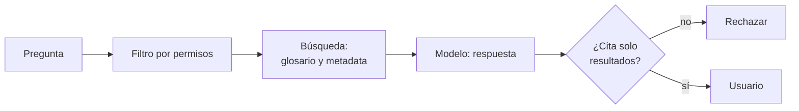

## 1. Resumen

Un analista no sabe que la tabla se llama `fct_ventas`; pregunta «¿dónde están los ingresos por región?». Una interfaz en lenguaje natural resuelve la pregunta con el **glosario** («ingresos» es sinónimo de «venta neta», enlazada a `fct_ventas`) y con la metadata de negocio. Knowledge Catalog combina lenguaje natural, coincidencia semántica y palabras clave (*About search in Knowledge Catalog*); SageMaker Data Agent usa el contexto de negocio de SageMaker Catalog; Purview ofrece búsqueda en lenguaje natural en preview.

Es emergente: **no reemplaza** la búsqueda por palabras ni el catálogo gobernado (`data-catalog`). Dos controles son de la plataforma, no del modelo: los **permisos** se aplican antes de rankear (`least-privilege`), y la respuesta solo vale si **cita activos** que la búsqueda devolvió (`rag`).

## 2. Qué es

- **Resolución por glosario:** sinónimos que llevan a un término y del término a los activos enlazados.
- **Búsqueda sobre metadata:** nombres, descripciones y contexto de negocio, no los datos.
- **Permisos primero:** lo que el usuario no puede ver no entra al ranking ni al modelo.
- **Respuesta citada:** el modelo redacta usando solo los activos recuperados; una cita fuera de ellos se rechaza.
- **Límite conocido:** Knowledge Catalog documenta que, sobre 600 restricts de permisos, la búsqueda puede omitir activos.

## 3. Problema que resuelve

Los analistas no encuentran los datos porque no conocen los nombres técnicos, y terminan preguntando en un canal. Una búsqueda en lenguaje natural acorta eso, con dos riesgos: mostrar un activo al que el usuario no tiene acceso, o que el modelo recomiende una tabla que no salió de la búsqueda. Filtrar antes y validar las citas cierra ambos.

## 4. Cómo funciona

1. Se filtran los activos por los permisos del usuario.
2. Se puntúan los visibles por coincidencia con la pregunta y por términos del glosario.
3. Los mejores van al modelo, que redacta la respuesta.
4. Se aceptan solo respuestas que citan activos de los resultados.
5. La respuesta enlaza la ficha del activo en el catálogo.

## 5. Cuándo utilizarlo

- Catálogos con metadata de negocio y glosario mantenidos.
- Usuarios de negocio que no conocen los nombres técnicos.
- Como complemento de la búsqueda por palabras.

## 6. Cuándo no utilizarlo

- Para inventarios completos: Google recomienda exportar la metadata en lugar de buscar.
- Sobre catálogos sin descripciones ni glosario: no hay nada que resolver.
- Si los permisos se aplicarían después del modelo.

## 7. Ejemplo sencillo

| Paso | Resultado |
|---|---|
| Pregunta | «¿dónde están los ingresos por región?», usuario `analista_ventas` |
| Resultados | `ventas.fct_ventas` (3.0), por el glosario y la palabra «región» |
| `finanzas.ingresos_contables` | No visible: sin permiso, nunca llega al modelo |
| Respuesta que cita `ventas.fct_ventas` | Aceptada |
| Respuesta que cita `finanzas.ingresos_contables` | Rechazada: fuera de los resultados |

## 8. Ejemplo de producción

Búsqueda de datos para analistas:

- búsqueda sobre el catálogo con los permisos del usuario;
- glosario de negocio mantenido por los dueños (`ai-metadata-enrichment` propone, el dueño aprueba);
- respuesta con citas validadas y enlace a la ficha del activo;
- en la nube (no ejecutado): búsqueda de Knowledge Catalog, SageMaker Data Agent o la búsqueda en lenguaje natural de Purview.

## 9. Arquitectura



## 10. Código

```python
# Python 3.12, biblioteca estándar (ejecutado en la CI): búsqueda en lenguaje natural sobre un catálogo. La pregunta
# se resuelve con el glosario (sinónimos → término → activos enlazados) y con coincidencia de palabras en la
# metadata; los permisos se aplican antes de rankear, así un activo sin acceso nunca llega al modelo. La respuesta del
# modelo (fija) solo se acepta si cita activos que la búsqueda devolvió.
import re

GLOSARIO = {"venta neta": {"sinonimos": {"ingresos", "facturacion"}, "activos": {"ventas.fct_ventas"}}}

CATALOGO = {
    "ventas.fct_ventas": "Ventas diarias por región, monto neto después de descuentos.",
    "ventas.stg_pedidos": "Pedidos crudos del ecommerce, una fila por pedido.",
    "finanzas.ingresos_contables": "Ingresos contables por centro de costo, cierre mensual.",
    "rrhh.remuneraciones": "Remuneraciones por persona y mes.",
}

PERMISOS = {"analista_ventas": {"ventas.fct_ventas", "ventas.stg_pedidos", "rrhh.remuneraciones"}}
STOP = {"de", "por", "la", "el", "los", "las", "y", "en", "del"}


def palabras(texto: str) -> set[str]:
    return set(re.findall(r"[a-záéíóúñ]+", texto.lower())) - STOP


def buscar(pregunta: str, usuario: str, k: int = 2) -> list[tuple[str, float]]:
    visibles = PERMISOS.get(usuario, set())          # primero los permisos
    q = palabras(pregunta)
    puntaje = {a: float(len(q & palabras(a.replace("_", " ") + " " + d))) for a, d in CATALOGO.items() if a in visibles}
    for termino, entrada in GLOSARIO.items():
        if q & (entrada["sinonimos"] | palabras(termino)):
            for activo in entrada["activos"] & visibles:
                puntaje[activo] += 2.0                 # el término del glosario pesa más que una palabra suelta
    return sorted(((a, s) for a, s in puntaje.items() if s > 0), key=lambda x: -x[1])[:k]


def aceptar(respuesta: str, resultados: list[tuple[str, float]]) -> str:
    citados = set(re.findall(r"\b[a-z]+\.[a-z_]+\b", respuesta))
    fuera = citados - {a for a, _ in resultados}
    return "aceptada" if citados and not fuera else f"rechazada: cita activos fuera de los resultados {sorted(fuera)}"


pregunta = "¿dónde están los ingresos por región?"
resultados = buscar(pregunta, "analista_ventas")
print("resultados para analista_ventas:", resultados)
print("finanzas.ingresos_contables visible:", any(a == "finanzas.ingresos_contables" for a, _ in resultados))
print("respuesta 1:", aceptar("Usa ventas.fct_ventas: tiene el monto neto por región.", resultados))
print("respuesta 2:", aceptar("Usa finanzas.ingresos_contables, que tiene los ingresos.", resultados))
```

El script se **ejecuta en la CI** con la biblioteca estándar y pasa `mypy --strict`. Imprime los resultados `[('ventas.fct_ventas', 3.0)]`, que `finanzas.ingresos_contables` no es visible y una respuesta aceptada y otra rechazada. La búsqueda es léxica y las respuestas del modelo son fijas.

## 11. GCP

En GCP, la **búsqueda de Knowledge Catalog** (antes Dataplex Universal Catalog). Según *About search in Knowledge Catalog* (no ejecutado):

| | Este concepto | Knowledge Catalog |
|---|---|---|
| Consulta | Palabras y glosario | Lenguaje natural, coincidencia semántica, palabras clave y predicados |
| Permisos | Antes de rankear | Respeta los permisos de origen; sobre 600 restricts puede omitir activos |
| Inventario completo | No es su uso | Exportar la metadata en lugar de buscar |

## 12. AWS

En AWS, **SageMaker Data Agent** con SageMaker Catalog. Según *Release notes for Amazon SageMaker Unified Studio*, entrada del 2026-06-04 (no ejecutado):

| | Este concepto | SageMaker Data Agent |
|---|---|---|
| Contexto | Glosario y descripciones | Metadata de negocio de SageMaker Catalog, también desde Collibra, Atlan y Alation |
| Salida | Activos citados | Descubrir datasets y generar SQL y Python con terminología de negocio |

## 13. Azure

En Azure, **Natural language search** de Purview Unified Catalog, en preview. Según *Application card: Microsoft Purview Unified Catalog* (no ejecutado):

| | Este concepto | Purview Unified Catalog |
|---|---|---|
| Resultado | Activos (tablas) | Data products rankeados según metadata y contexto de negocio |
| Estado | — | Preview |

## 14. Buenas prácticas

- Permisos antes del ranking y del modelo.
- Citas validadas contra los resultados.
- Glosario y descripciones mantenidos por dueños.
- Búsqueda por palabras siempre disponible.
- **Seguridad:** el modelo recibe metadata de activos visibles, nunca datos de filas.
- **Observabilidad:** preguntas sin resultados, respuestas rechazadas y activos más buscados.
- **Costo:** una llamada al modelo por pregunta; la búsqueda no la necesita.

## 15. Errores frecuentes

- Filtrar permisos después de que el modelo vio los resultados.
- Aceptar respuestas que citan tablas fuera de la búsqueda.
- Usar la búsqueda para inventarios completos.
- Esperar buenos resultados sin glosario ni descripciones.

## 16. Trade-offs

El lenguaje natural acerca el catálogo a quien no conoce los nombres técnicos, a cambio de depender de la calidad de la metadata. La búsqueda semántica encuentra sinónimos que la léxica no ve y es menos predecible. Es emergente: la de Purview está en preview, y las otras dos cambiaron de nombre o de alcance en 2026.

## 17. Conceptos relacionados

- `data-catalog`: el catálogo gobernado.
- `rag`: recuperar y citar.
- `least-privilege`: los permisos.
- `ai-metadata-enrichment`: la metadata de negocio.
- `data-agents`: agentes que consultan los datos encontrados (dominio 23).

## 18. Preguntas técnicas abiertas

1. ¿Qué preguntas hacen hoy tus analistas en el canal de datos?
2. ¿Qué parte de tu catálogo tiene glosario y descripciones?
3. ¿Dónde se aplicarían los permisos en tu búsqueda?

## 19. Laboratorio relacionado

Pendiente (F4).

## 20. Fuentes

- Google Cloud: *About search in Knowledge Catalog*.
- AWS: *Release notes for Amazon SageMaker Unified Studio* (entrada del 2026-06-04).
- Microsoft Learn: *Application card: Microsoft Purview Unified Catalog*.

El detalle de cada fuente está en `sources` del frontmatter.

## 21. Fecha de última verificación

2026-10-26. Pasa a `verified`: revisión B-F3.1 del lote F3b-21e sin hallazgos en esta ficha (docs/reviews/cards-f3b-21e.md) y CI en verde (run 40375774081).

## 22. Historial de cambios importantes

- 2026-10-26: creación (lote F3b-21e).
- 2026-10-26: `verification_status: verified` (revisión sin hallazgos en esta ficha; CI en verde, run 40375774081).
- 2026-10-27: §17 y `relations` enlazan `data-agents`, creada en el lote F3b-23a (regla del §17); sin otros cambios.
