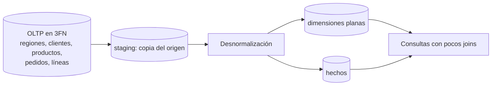

## 1. Resumen

Normalizar es repartir los datos en tablas relacionadas para que cada dato viva en **un solo lugar**: la región de un cliente se guarda una vez, no en cada pedido. Así, cambiarla es una sola actualización y no hay copias contradictorias. Es la regla en las bases transaccionales (OLTP). En los modelos analíticos se hace lo contrario a propósito: se **desnormaliza** (dimensiones planas, tablas anchas) para leer con menos joins. Entender las dos direcciones es clave al llevar datos del origen al warehouse.

## 2. Qué es

Es un concepto consolidado del diseño relacional. Las formas normales son reglas sucesivas:

| Forma | Regla (resumida) |
|---|---|
| 1FN | Sin grupos repetidos: un valor por celda, una tabla por conjunto de datos relacionados, con clave primaria |
| 2FN | Los valores que aplican a varios registros van en su propia tabla, relacionada por clave foránea; cada atributo depende de toda la clave |
| 3FN | Fuera los campos que no dependen de la clave |

Existen formas superiores (4FN, 5FN), que la documentación de Microsoft describe como poco usadas en el diseño práctico.

## 3. Problema que resuelve

La redundancia produce **anomalías**:

- **De actualización:** la dirección del cliente está en cinco tablas y se cambia en cuatro.
- **De inserción:** no se puede registrar una región sin un cliente.
- **De borrado:** borrar el último pedido borra lo único que se sabía del producto.

Además, ocupa espacio. Normalizar elimina esas anomalías y deja que la base haga cumplir la integridad con claves y restricciones.

## 4. Cómo funciona

1. **Identificar entidades** (cliente, región, producto, pedido, línea) y su clave.
2. **Separar grupos repetidos** (1FN): las líneas de un pedido van en su propia tabla, no en columnas `producto1`, `producto2`.
3. **Separar lo que depende de parte de la clave** (2FN): el nombre del producto no depende de `(pedido, línea)` sino del producto.
4. **Separar lo que no depende de la clave** (3FN): la región del cliente no es un atributo del pedido.
5. **Relacionar** con claves foráneas, que la base hace cumplir en OLTP.

En analítica se recorre el camino inverso:

- se **desnormaliza** en dimensiones planas (cliente con su región; producto con su categoría);
- en BigQuery, a veces con campos anidados y repetidos;
- se conserva la historia que el OLTP sobrescribe.

## 5. Cuándo utilizarlo

- Al diseñar el modelo de una aplicación transaccional (OLTP): normalizar al menos hasta 3FN.
- Al modelar datos maestros y de referencia que muchos sistemas actualizan.
- Al **leer** un sistema origen: reconocer su normalización ayuda a saber qué joins reconstruyen cada entidad.

## 6. Cuándo no utilizarlo

- En la capa de consumo analítica: un modelo en 3FN obliga a los analistas a encadenar muchos joins. La guía de Fabric recomienda desnormalizar casi siempre las dimensiones, y Kimball las describe como planas y anchas.
- Hasta el extremo: la propia documentación de Microsoft advierte que muchas tablas pequeñas pueden degradar el rendimiento.
- En archivos de intercambio o eventos, donde un registro autocontenido es más útil que referencias a otras tablas.

## 7. Ejemplo sencillo

Sin normalizar: `pedidos(pedido_id, cliente, region_cliente, producto, categoria, cantidad)`. Si cambia el nombre de una región, hay que actualizar todos los pedidos de esa región.

Normalizado: `regiones`, `clientes(region_id)`, `productos`, `pedidos(cliente_id)` y `pedido_lineas(pedido_id, linea, producto_id, cantidad)`. La región se cambia en una fila.

## 8. Ejemplo de producción

El ERP de una empresa está en 3FN, con más de 40 tablas para representar un pedido. El equipo de datos replica esas tablas a staging, tal cual. En core construye `dim_cliente` (cliente, región y segmento aplanados, con SCD2), `dim_producto` (producto, subcategoría y categoría en una fila) y `fact_venta_linea`. Los analistas pasan de 8 joins a 2. La normalización del origen no se pierde: está en staging y es la referencia para cuadrar.

## 9. Arquitectura



## 10. Código

```sql
-- PostgreSQL (ejecutable): modelo normalizado (3FN) de un pedido y la vista plana que reconstruye
-- el registro para análisis. Cambiar el nombre de una región es una sola fila.
CREATE TABLE regiones  (region_id INT PRIMARY KEY, nombre TEXT NOT NULL);
CREATE TABLE clientes  (cliente_id INT PRIMARY KEY, nombre TEXT NOT NULL,
                        region_id INT NOT NULL REFERENCES regiones (region_id));
CREATE TABLE productos (producto_id INT PRIMARY KEY, nombre TEXT NOT NULL, categoria TEXT NOT NULL);
CREATE TABLE pedidos   (pedido_id INT PRIMARY KEY,
                        cliente_id INT NOT NULL REFERENCES clientes (cliente_id), fecha DATE NOT NULL);
CREATE TABLE pedido_lineas (
  pedido_id   INT NOT NULL REFERENCES pedidos (pedido_id),
  linea       INT NOT NULL,
  producto_id INT NOT NULL REFERENCES productos (producto_id),
  cantidad    INT NOT NULL CHECK (cantidad > 0),
  PRIMARY KEY (pedido_id, linea)
);

-- Desnormalización para lectura: una fila por línea con todos sus atributos descriptivos.
CREATE VIEW venta_plana AS
SELECT pl.pedido_id, pl.linea, p.fecha,
       c.nombre AS cliente, r.nombre AS region,
       pr.nombre AS producto, pr.categoria, pl.cantidad
FROM pedido_lineas AS pl
JOIN pedidos   AS p  USING (pedido_id)
JOIN clientes  AS c  USING (cliente_id)
JOIN regiones  AS r  USING (region_id)
JOIN productos AS pr USING (producto_id);
```

La vista refleja siempre el estado actual. Por eso, en el warehouse, la desnormalización se materializa en dimensiones con historia (SCD) en vez de una vista sobre el OLTP.

## 11. GCP

En **BigQuery** la desnormalización tiene una opción propia: **campos anidados y repetidos**, que guardan, por ejemplo, las líneas dentro del pedido sin una tabla aparte, y reducen joins. La documentación advierte que no siempre mejora: un star schema suele estar ya optimizado para analítica. Las claves primarias y foráneas existen, pero `NOT ENFORCED`: la integridad que en OLTP hace cumplir la base, aquí la controla el pipeline.

## 12. AWS

En **Redshift** el costo de un modelo normalizado está en los joins entre nodos. La guía es distribuir por columnas comunes las tablas que se unen, y usar distribución `ALL` en dimensiones que no pueden colocarse junto al hecho, a costa de almacenamiento. Desnormalizar dimensiones reduce el número de joins que hay que colocar. Como en BigQuery, las claves son informativas.

## 13. Azure

La guía de modelado de **Fabric Warehouse** es explícita: las tablas de dimensión casi siempre deben desnormalizarse, con la desnormalización como repetición deliberada para simplificar y acelerar las consultas. Las bases operacionales de origen (Azure SQL) suelen estar normalizadas, con claves foráneas aplicadas, a diferencia del warehouse, donde son `NOT ENFORCED`.

## 14. Buenas prácticas

- OLTP: normalizar al menos a 3FN y hacer cumplir claves y restricciones en la base.
- Analítica: desnormalizar en la capa de consumo; dejar el modelo normalizado del origen en staging como referencia.
- Desnormalizar con criterio: aplanar jerarquías estables (categoría de producto), no copiar medidas que cambian.
- Documentar de qué tablas del origen sale cada atributo desnormalizado.
- **Seguridad:** al desnormalizar, los datos sensibles de una tabla (por ejemplo, del cliente) se copian a otras; aplicar los controles de acceso en cada copia o excluir esos atributos.
- **Observabilidad:** cuadrar los atributos desnormalizados contra el origen (por ejemplo, número de clientes por región) para detectar joins que pierden o duplican filas.
- **Costo:** la desnormalización repite datos y ocupa más; en motores que cobran por bytes leídos se compensa con menos joins, pero conviene medirlo.

## 15. Errores frecuentes

- Llevar el 3FN del origen tal cual a la capa de consumo.
- Desnormalizar en OLTP "por rendimiento" y abrir la puerta a datos contradictorios.
- Usar un join que multiplica filas (una relación uno a muchos no prevista) al aplanar.
- Desnormalizar atributos que cambian sin decidir cómo conservar su historia.

## 16. Trade-offs

Normalizar da integridad, escrituras simples y sin anomalías, a cambio de más joins al leer. Desnormalizar da lecturas simples y rápidas, a cambio de redundancia, más almacenamiento y de hacerse cargo de la consistencia en el pipeline. Por eso el mismo dato suele existir normalizado en el origen y desnormalizado en el warehouse.

## 17. Conceptos relacionados

- `oltp-vs-olap`: dónde se normaliza y dónde no.
- `star-schema` y `dimension-tables`: la desnormalización deliberada.
- `surrogate-keys`: las claves del modelo dimensional.
- `denormalization`: repetir datos a propósito para leer mejor, y lo que cuesta.

## 18. Preguntas técnicas abiertas

1. ¿En qué forma normal está una tabla `pedidos` que guarda el nombre y la región del cliente?
2. ¿Qué atributos de un cliente aplanarías en la dimensión y cuáles dejarías fuera?
3. ¿Cuándo preferirías en BigQuery campos anidados a una tabla de líneas aparte?

## 19. Laboratorio relacionado

Pendiente (F4).

## 20. Fuentes

- Microsoft Learn: *Description of the database normalization basics*, *Online transaction processing (OLTP)* y *Dimensional modeling in Fabric Warehouse: Dimension tables*.
- Kimball Group: *Dimension Table Structure* (referencia conceptual, Nivel 4).
- Google Cloud: *Use nested and repeated fields* (BigQuery).
- AWS: *Choose the best distribution style* (Amazon Redshift).

El detalle de cada fuente está en `sources` del frontmatter.

## 21. Fecha de última verificación

2026-10-05. Pasa a `verified`: revisión B-F3.1 del lote 6 aplicada, sin VERIFY pendientes.

## 22. Historial de cambios importantes

- 2026-10-05: creación (lote 6 de F3).
- 2026-10-05: revisión B-F3.1 del lote 6 aplicada (docs/reviews/cards-lote6.md), sin cambios pedidos. `verification_status: verified` (sin VERIFY pendientes).
- 2026-10-11: §17 enlaza `denormalization`, que ya tiene ficha (lote F3b-04a); antes figuraba como pendiente de ficha.
- 2026-10-13: `page_title` en cada cita, con el título de la página citada (ADR-012); sin cambios de contenido.
